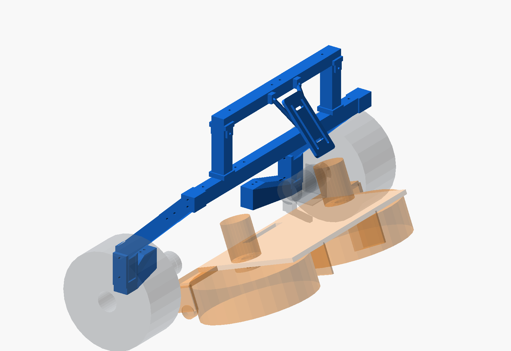
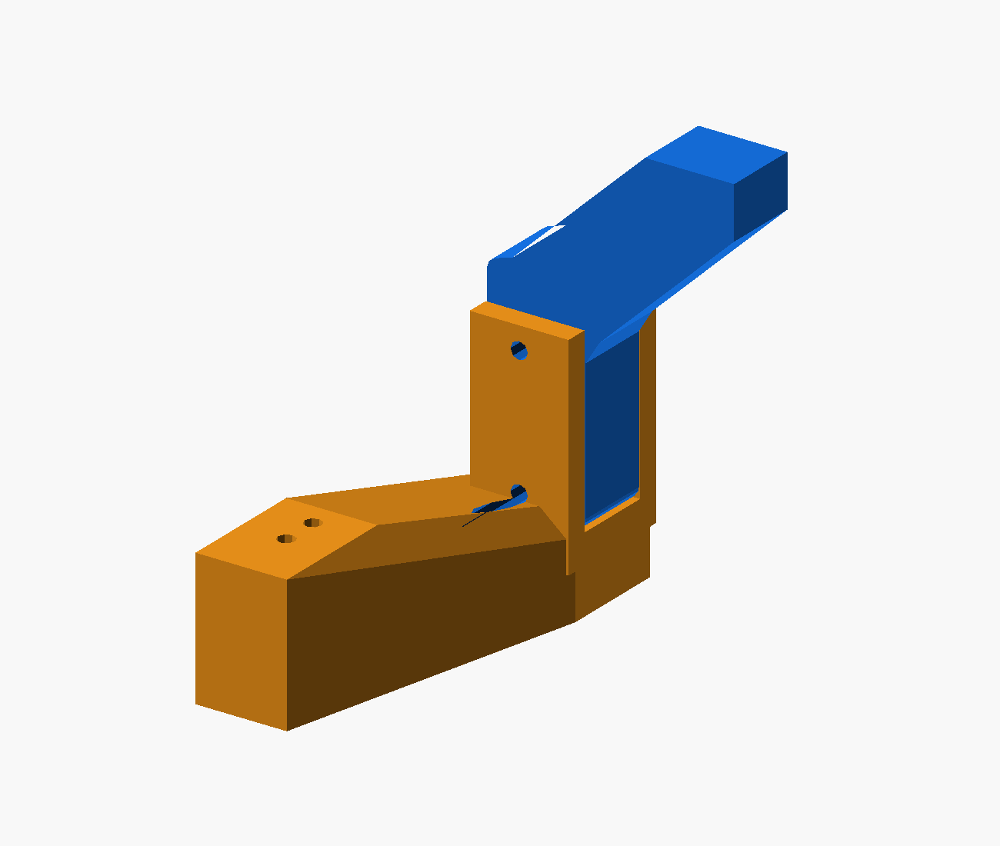

# P2-93d — candidate αψίδα X258 / απλοποιημένη Α

> Ιστορικό snapshot P2-93d. Η γεωμετρική έγκριση ακολουθήθηκε από την
> [P2-93e δεύτερη αγκύρωση](P2-93e-debug.md). Το παλιό base warning και
> τα παλιά foot dimensions παρακάτω αντικαταστάθηκαν, όχι το tilt.

τι διαφέρει από το αναμενόμενο: η απλή 26×20 δοκιμή στο X258 καθαρίζει
τη ζώνη του μοτέρ, αλλά δεν αποτελεί βάση ή σύνδεση. Η candidate προσθέτει
πραγματικό X240 πέλμα/clevis, ενιαίο Γ knee με R3/gusset, δύο M4 και
ξεχωριστό crown node. Οι πρόσθετες παρειές έχουν μεγαλύτερες τομές με το
F concept από το πρόχειρο σώμα των ~730 mm³· δεν αφαιρέθηκαν από το gate.

**Candidate για έγκριση, όχι print release. Κανένα commit/push.**
Το tilt/cradle/clevis και οι θέσεις του υπάρχοντος μοτέρ παραμένουν ως είχαν.

## Γεωμετρία μέσα στο current_robot

Πηγή: [p293d-arch-candidate.scad](p293d-arch-candidate.scad).
Το `current-design-p293.scad` καλεί `p293d_arch_assembly()` αντί της παλιάς
αψίδας. Η παλιά release SCAD και τα release STL δεν τροποποιήθηκαν.

- Rail datum Z52· foot floor έως Z72 και knee από Z72 ως Z120. Συνολικά
  το κάθετο σύνολο έχει κέντρο X258/Y±228 και πλευρές X245…271.
- Υπάρχουσες οπές **X240/Y±150,±160**. Καμία νέα τρύπα ή αλλαγή μοτέρ.
- Η ρίζα του foot είναι 24×36 mm, με ανοικτή πραγματική υποδοχή για το knee.
- Knee συμπαγές 26×20 mm, ενιαίο με το λοξό μέλος και gusset. Η διαδρομή
  knee→crown είναι ΔX132/ΔZ125, άρα **43,44°**, crown `[390,±228,245]`.
- Πείροι/through-M4 Y στα Z80/Z114, pitch34 mm. Κενό 0,4 mm ανά παρειά,
  πραγματική έδραση στο Z72 και θετική διαδρομή φορτίου μέσω M4.
- Η άνω απόληξη έχει δύο M4 στον crown και 0,2 mm end clearance. Δεν
  συνεχίζεται σωλήνας μέσα σε άλλο μέλος. Το crossbar-end spigot βρίσκεται
  μέσα στην πραγματική κοιλότητα της τραβέρσας με διάκενο, όχι μέσα στο υλικό.
- Καταργούνται από την candidate τα X300 foot/brace και ο μακρύς X240 brace·
  το knee/gusset αναλαμβάνει τη σύνδεση. Δεν προστέθηκε δεύτερη διαγώνιος.
- Mast shoe από Z258 πάνω από την τραβέρσα, ιστός έως Z344, χωριστό cap
  στο Z344…364. LiDAR halves τερματίζουν στο Y±138 και συνδέονται με
  spigot μέσα στο πραγματικό void και through-M4.
- OAK universal profile με ενσωματωμένα forward struts, mounting datum
  `[450,0,305]`, γωνία50°. Πραγματικά pads στο μπροστινό τοίχωμα της
  LiDAR τραβέρσας, όχι αιωρούμενη μετατόπιση της παλιάς plate.





## Υποχρεωτικό raw gate — πέντε γωνίες

Το ήδη υπάρχον working-tree `scene_check.py` χρησιμοποιεί
**−10/−3/0/15/20°**. Δεν έγινε αλλαγή στο εργαλείο, στον wrapper ή στο
`scadtree.py` σε αυτό το βήμα. Δεν υπάρχουν QA masks ή exceptions.

```bash
OPENSCAD_BIN=/snap/bin/openscad-nightly bash cad/arch-tilt-p293/export-p293d-candidate.sh
# Εξάγει candidate STL και καλεί το υποχρεωτικό:
OPENSCAD_BIN=/snap/bin/openscad-nightly bash cad/check-current-scene.sh
```

Αυτούσιο output: [check-current-scene.txt](p293d-results/check-current-scene.txt).
Πλήρες JSON: [scene-report.json](p293d-results/scene-report.json).

```text
bodies per angle: -10°=100, -3°=100, 0°=100, 15°=100, 20°=100
duplicates dropped: 0   export failures: 0
86 collisions > 0.0001 mm3
```

Το πλήρες gate επιστρέφει **exit 1**, με επιπλέον 3 contained pairs.
Δεν παρουσιάζεται ως global PASS. Έλεγχος όλων των arch-related γραμμών
του πλήρους report (όχι νέα εκτέλεση με περιορισμένη λίστα):

| Επαφή αψίδας | Ζεύγη με θετικό όγκο στις πέντε γωνίες |
|---|---:|
| Drive motors, brackets, καλώδια και τροχοί | **0** |
| Moving module | **0** |
| Chassis | **0** |
| Basket, front system, ball space | **0** |
| Μεταξύ των επιμέρους arch parts | **0** |
| Υπάρχον tilt/λοιπά πραγματικά solids | **0** |
| F side/front concept | **6 — blocking, δεν εξαιρούνται** |

Ελάχιστη raw απόσταση συνολικής αψίδας–drive envelope: **9,000 mm**.
Το αποτέλεσμα περιλαμβάνει τα διακριτά candidate parts, τις τραβέρσες
και τα sleeves· δεν ελέγχεται μία ενιαία arch union στη θέση τους.

Οι μόνες arch-related τομές είναι με το F concept, σε κάθε γωνία:

| Part | +Y mm³ | −Y mm³ |
|---|---:|---:|
| `p293d_foot` | 3.422,5720 | 3.422,5720 |
| `p293d_crown` | 1.642,7937 | 1.642,7934 |
| `p293d_knee` | 707,2341 | 707,2341 |

Οι υπόλοιπες 80 collisions και τα 3 contained αφορούν τα ήδη ανοικτά
pod/F/tilt/surrogate σύνολα. Δεν αλλάχθηκαν για να καθαρίσει η αψίδα.
Οι παλιές arch modules που εμφανίζονται στην absent λίστα αντικαταστάθηκαν
στη σκηνή από τα οκτώ νέα modules, τα οποία ανακαλύφθηκαν όλα.

Ο επαναλήψιμος έλεγχος
`uv run --with manifold3d --with trimesh --with numpy --with scipy python cad/arch-tilt-p293/p293d-inspect.py`
διαβάζει το πλήρες gate report, μετρά την απόσταση και ελέγχει τα STL.
Αποτελέσματα: [inspection.json](p293d-results/inspection.json).
**8/8 candidate STL είναι watertight, ακριβώς ένα σώμα**, με footprint
κάθε άξονα κάτω από 250 mm. Αυτό δεν πιστοποιεί support-free slicing.

## Ποια printable STL αντικαθίστανται

Τα candidate βρίσκονται μόνο στο `stl-candidate-p293d/`. Δεν έγινε overwrite
των παλιών `stl/`· δεν αναμειγνύονται παλιά και νέα joints.

| Παλιό STL / interface | Candidate STL | Ποσότητα |
|---|---|---:|
| `arch_foot_x240` | `p293d_foot.stl` | 2, κατοπτρικά installed |
| `arch_leg_lower`, `arch_leg_upper`, `arch_brace_x240` | `p293d_knee.stl` | 2 |
| Παλιή διείσδυση άνω leg/brace/crossbar | `p293d_crown.stl` | 2 |
| `arch_crossbar_end` | `p293d_crossbar_end.stl` | 2 |
| `lidar_mast` | `p293d_mast.stl` | 2 |
| Παλιή mast/crossbar επικάλυψη | `p293d_mast_cap.stl` | 2 |
| `lidar_crossbar_half` | `p293d_lidar_half.stl` | 2 |
| `oak_universal_plate` + mount | `p293d_oak_mount.stl` | 1 |
| `arch_foot_x300`, `arch_brace_x300` | **Δεν χρησιμοποιούνται** | 0 |

Διατηρούνται ίδια printable geometry `arch_crossbar_center`,
`arch_joint_sleeve` (μόνο δύο crossbar sleeves, όχι leg joints) και
`sensor_joint_sleeve`. Όλα τα tilt STL παραμένουν αμετάβλητα και η
προϋπάρχουσα διάταξη tilt παραμένει εσκεμμένα ανολοκλήρωτη για το επόμενο βήμα.

## Knee — υπολογισμός αντοχής

Επαναλήψιμος υπολογισμός: [p293d-strength.py](p293d-strength.py),
πλήρη δεδομένα [strength.json](p293d-results/strength.json).
Χρησιμοποιούνται τα υπάρχοντα repo screening limits PETG 10 MPa in-layer
και 5 MPa across/bearing. Πρόκειται για αναλυτικό screen, όχι FEA ή
πιστοποίηση υλικού. Ολόκληρη η ροπή φορτίζει **μία** πλευρά.

```text
M = 8.000 N·mm
e = 132 mm
F = M/e = 60,606 N
A_net = 20 × (26 − 4,6) = 428 mm²
I_y,net = 20 × (26³ − 4,6³)/12 = 29.131,107 mm⁴
W_y,net = I_y/13 = 2.240,854 mm³
σ = 1,8 × (M/W + F/A) = 6,681 MPa < 10 MPa
```

Η συγκέντρωση τάσεων **Kt=1,8 είναι παραδοχή** για τον R3/gusset και τις
οπές· χρειάζεται επιβεβαίωση με coupon/proof ή λεπτομερή ανάλυση. Το
περιθώριο του συγκεκριμένου screen είναι 10/6,681 = **1,50**.

| Έλεγχος | MPa | Όριο MPa |
|---|---:|---:|
| Knee κάμψη + αξονικό, Kt1,8 | 6,681 | 10 |
| M4 bearing στις δύο παρειές 6 mm | 4,298 | 5 |
| M4 bearing στο knee 20 mm | 2,579 | 5 |
| Cheek edge shear | 2,672 | 5 |
| Torsion ενισχυμένης ρίζας foot 24×36, K2 | 3,858 | 5 |
| Κάμψη foot από Y offset78, K2 | 1,824 | 10 |

Για M4 pitch34 mm: resultant ανά pin
`sqrt((8000/34)² + (60,606/2)²) = 237,237 N`.
Ο υπολογισμός χρησιμοποιεί την πραγματική διατομή των εξαγόμενων parts.
**Απαιτεί συμπαγή φέροντα knee/clevis/root ή επαληθευμένα ισοδύναμη
δομή — δεν ισχύει για draft 2 walls/10% infill.**

Με E=1.800 MPa η ελαστική εκτίμηση του knee είναι **2,191 mm**, με
συμπερίληψη κάμψης του λοξού μέλους και στροφής του 48 mm post. Δεν
περιλαμβάνει torsion της γέφυρας, bolt slip/compliance ή PETG creep.
Άρα δεν παρουσιάζεται ως συνολική ακαμψία της αψίδας.

**Ανοικτό base-hardware gate:** η νέα βάση δεν έχει το παλιό X240–X300
ζεύγος 60 mm. Το εγκάρσιο cantilever Y78 δίνει 4.727 N·mm και περίπου
473 N couple force στο υπάρχον Y pitch10. Πρέπει να ελεγχθούν οι
μακρύτερες M4, η επιφάνεια ροδέλας/διασποράς φορτίου, η προφόρτιση,
η rail bearing αντοχή και ο ερπυσμός. Δεν πιστοποιούνται από το knee screen.
Το crown και τα sensor joints επίσης χρειάζονται τελικό hardware/proof gate.

## Κατάσταση προς έγκριση

Η candidate επιτυγχάνει τον ζητούμενο raw γεωμετρικό στόχο αψίδας στα
πέντε δείγματα, διατηρώντας ≥9 mm drive clearance. Οι εσωτερικές
διεισδύσεις και τα mast/OAK overlaps καταργήθηκαν με πραγματικά parts.
Παραμένουν F concept collisions και οι προϋπάρχουσες αστοχίες εκτός αψίδας.
Δεν έγινε ακόμη πλήρες continuous sweep, full hardware installation,
support/underside release ή physical coupon/proof-load.

**ΠΑΥΣΗ για έγκριση της candidate. Καμία εκτύπωση release ή commit.**
