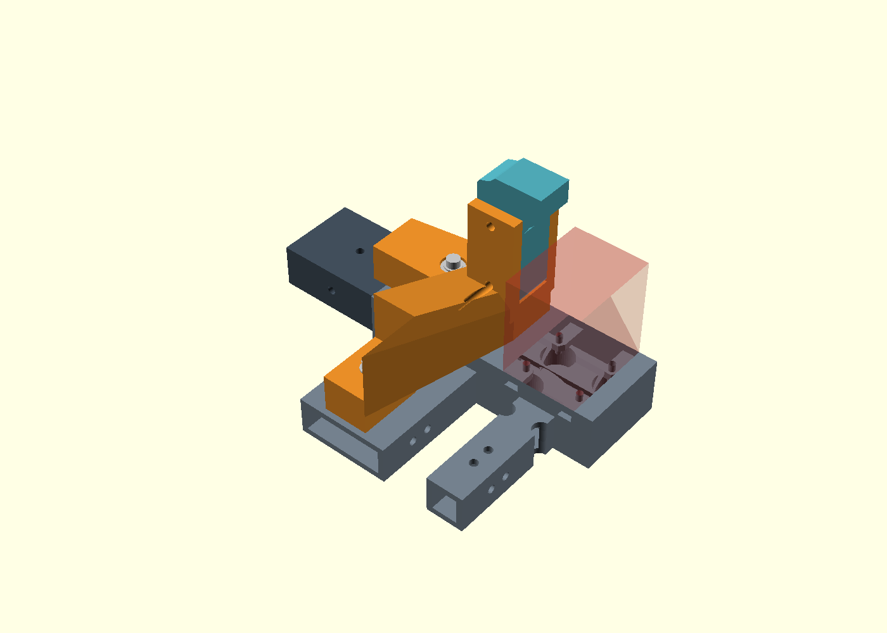
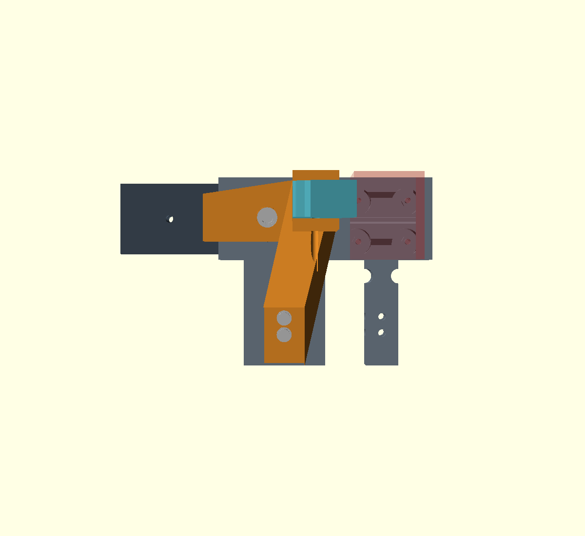
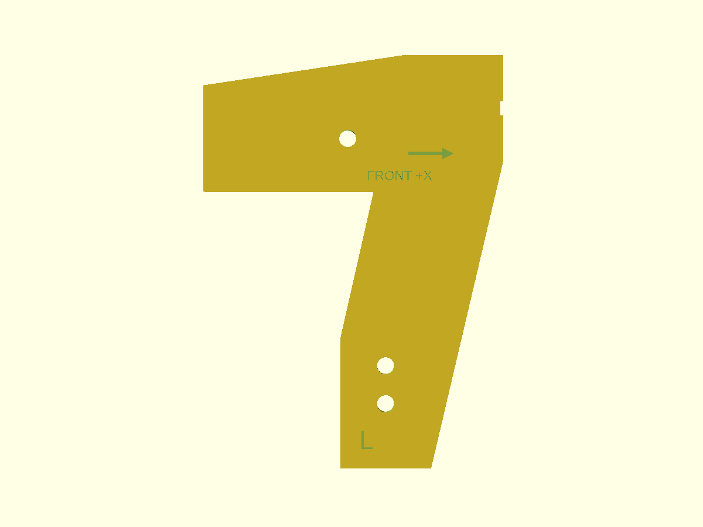
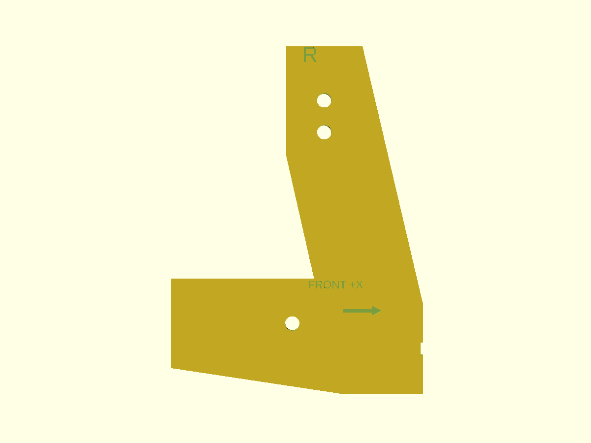

# P2-93e — δεύτερη αγκύρωση / templates L–R, 2026-11-05

τι διαφέρει από το αναμενόμενο: οι τρεις οπές της ράγας είναι στο **X230**,
όχι X240. Μόνο η μεσαία είναι M4 διαμπερής. Οι δύο πλαϊνές δεν μπορούν να
χρησιμοποιηθούν με M4 χωρίς νέα διάτρηση, η οποία **δεν** έγινε.

Πορτοκαλί foot, κυανό knee, γκρι πραγματικό terminal/sleeve, ασημί βίδες.
Το κόκκινο ημιδιαφανές κουτί δείχνει το συντηρητικό όριο X280 του drive,
όχι νέο ή μικρότερο envelope. Η τομή για να φαίνονται οι κεφαλές υπάρχει
**μόνο στο render**, όχι στο candidate STL, στο current_robot ή στο QA.

## Ταυτοποίηση υπαρχουσών οπών και hardware

Πηγές: `modular-chassis-v3.scad`: `front_terminal_v3`,
`end_lock_holes_local(130,side,true)`, `clamp_sleeve_x`,
`p278_terminal_socket`. Οι πλαϊνές προέρχονται από `splice_lock_holes`
του `engineering/chassis-strength-bench/coupon/drive-motor-inline-module.scad`.

| Ανά πλευρά, παγκόσμιες συντεταγμένες | CAD / σημερινός ρόλος |
| --- | --- |
| X230 / Y±220 | Ø4,5, πλήρως διαμπερής Z22–52, terminal και εσωτερικό X200 sleeve. Κοινή vertical joint-lock M4×40, μήκος επιβεβαιωμένο από χρήστη. Παξιμάδι κάτω από τη ράγα. |
| X230 / Y±207,5 | Ø3,4 μόνο επάνω τοίχωμα· κάτω τοίχωμα και sleeve εμποδίζουν τη διέλευση. Legacy pilot, χωρίς προβλεπόμενη συναρμολογημένη M4. Δεν χρησιμοποιείται. |
| X230 / Y±232,5 | Όπως προηγούμενη, όχι M4 through. Δεν χρησιμοποιείται. |
| X240 / Y±150 | Ø4,5 vertical accessory station, socket/terminal sleeve. Existing top M4×30 βάσει ACTIVE BOM, όχι η εγκάρσια βίδα του brace. |
| X240 / Y±160 | Ø4,5 vertical socket/sleeve lock, existing top M4×30 βάσει ACTIVE BOM. |

Ανεξάρτητα probes Ø2 σε όλο το Z22–52: η X230/Y±220 δίνει **0 mm³**
υλικό και στα δύο μέλη. Στις πλαϊνές: ~10,024 mm³ μέσα στο terminal και
~59,053 mm³ στο sleeve. Ακριβείς τιμές στο
[verification.json](p293e-results/verification.json). Η γεωμετρία αποδεικνύει
τη διαδρομή της βίδας, όχι τον τύπο παξιμαδιού που υπάρχει στη φυσική κατασκευή:
τον σημερινό τύπο/ροδέλες τα κρατάμε, δεν υποθέτουμε heat-set inserts.

## Νέα έδραση — χωρίς μεταβολή σασί ή tilt

- Νέο rail pad στο X230/Y±220. Κάτω επιφάνεια Z52, upper washer seat Z70:
  **18 mm PETG + δύο πρόσθετες χαλύβδινες ροδέλες Ø12/4,3×1 mm = +20 mm
  συνολική σύσφιξη**. Παραμένουν και οι παλιές ροδέλες. M4×40 → M4×60,
  ίδιο παξιμάδι, ίδιο υπόλοιπο σπειρώματος/εμπλοκή. Κάτω το νέο πλατύ
  washer μπαίνει μεταξύ ράγας και παλιάς ροδέλας, όχι επάνω στο παξιμάδι.
- Η υποδοχή του άνω πλατιού washer είναι Ø13, βάθος2 από το γενικό Z72.
  Το κάτω πρόσθετο washer κατεβάζει το παλιό washer/nut κατά1 mm· έτσι
  ακριβώς διατηρείται η εμπλοκή παρά την άνω seat Z70 αντί72.
- Οι X240/Y150–160 πατούν πλέον στο πραγματικό **Z42**, όχι σε αιωρούμενο
  Z52. Seat ροδέλας Z62: +20 mm PETG, M4×30 → M4×50. Οι υποδοχές Ø9,6
  αφήνουν χωριστές ροδέλες Ø9 στο pitch10. Πρόσβαση μακριού Allen από πάνω.
- Αν το φυσικό X240 hardware δεν είναι το M4×30 του BOM, επιβεβαιώνεται
  στο coupon πριν παραγγελία: απαιτείται **παλιό μήκος +20 mm**, όχι υπόθεση.
- Δεν χρησιμοποιούνται οι δύο blind pilots. Δεν προστέθηκε οπή ή clamp.
  Η rail sole επεκτείνεται πίσω ως **X192**, μόνο πάνω στη ράγα Y206–234,
  για θλιβόμενη έδραση και στην ανάποδη pitch ροπή. Δεν μπαίνει στο καλάθι.
  Το post/knee παραμένει X258, εμπρός παρειά **X271**, drive όριο X280.
  Το footprint στον rail δεν περνά το X271. Αμετάβλητο tilt/cradle/clevis.

## Hardware ανά χρησιμοποιούμενη οπή

Τα lengths είναι under-head, οι ροδέλες αναφέρονται ανά βίδα.
Τα παλιά washers/nuts επαναχρησιμοποιούνται χωρίς μεταβολή πάχους. Οι
προτεινόμενες Ø9/4,3×0,8 στα X240 πρέπει να συμφωνούν με τα υπάρχοντα·
έχουν διάμετρο μικρότερη του pitch10. Δεν βάζουμε Ø12 εκεί.

| Οπή | Νέα βίδα | Ροδέλες | Παξιμάδι |
| --- | --- | --- | --- |
| X240 / Y+150 | M4×50 (παλιά30 +20) | Παλιά άνω/κάτω, Ø9/4,3×0,8 | Ίδιο M4 από κάτω, ίδια εμπλοκή |
| X240 / Y+160 | M4×50 (παλιά30 +20) | Όπως προηγούμενη | Ίδιο M4 |
| X230 / Y+220 | **M4×60** (μετρημένη40 +20) | Παλιά άνω/κάτω **συν 2×Ø12/4,3×1**, ένα ακριβώς σε κάθε PETG επιφάνεια | Ίδιο M4, ίδια εμπλοκή |
| X240 / Y−150 | M4×50 (παλιά30 +20) | Παλιά άνω/κάτω, Ø9/4,3×0,8 | Ίδιο M4 |
| X240 / Y−160 | M4×50 (παλιά30 +20) | Όπως προηγούμενη | Ίδιο M4 |
| X230 / Y−220 | **M4×60** (μετρημένη40 +20) | Παλιά άνω/κάτω συν 2×Ø12/4,3×1 | Ίδιο M4, ίδια εμπλοκή |
| X258 / Y+228 / Z80 και114, άξοναςY | 2×M4×45 | 2×Ø9/4,3×0,8 ανά βίδα, έξω από τις παρειές | 1×M4 nyloc ανά βίδα, έλεγχος πλήρους nylon engagement στο coupon |
| X258 / Y−228 / Z80 και114, άξοναςY | 2×M4×45 | Όπως προηγούμενη | Όπως προηγούμενη |

Σύνολο base: 4×M4×50, 2×M4×60 και 4 πρόσθετα πλατιά washers. Οι τέσσερις
arch clevis M4×45 είναι ξεχωριστές (32,8 mm stack +1,6 washers + έως5 mm
nyloc + εμφανές σπείρωμα). Καμία εγκάρσια βίδα σασί/brace αλλάζει.
Η προσθήκη washer thickness δεν πρέπει να μετρηθεί διπλά ούτε να παραλειφθεί.

## Pitch / roll και PETG — screening, όχι πιστοποίηση

Αναπαραγώγιμος υπολογισμός: `python3 p293e-base-strength.py`,
[πλήρη αριθμητικά αποτελέσματα](p293e-results/base-strength.json).
Το [P2-93d knee screen](p293d-results/strength.json) παραμένει για το
αμετάβλητο knee (6,681 MPa, θεωρητικό βέλος2,191 mm χωρίς foot/joint/creep).
Οι παλιές foot-root τιμές με ύψος36 **δεν** χρησιμοποιούνται για τις νέες seats.

Μία πλευρά αναλαμβάνει ολόκληρα **8 Nm**, όχι μισό φορτίο. Στον crown:
F=8000/132=60,606 N. Διατηρείται συντηρητικά roll F×78=4,727 Nm, παρότι
πλέον υπάρχει άμεση rail έδραση κάτω από το post.

Οι βίδες είναι σε μη συνευθειακό τρίγωνο: (240,150), (240,160), (230,220).
Τα bolt-to-bolt offsets είναι ΔX10 και ΔY60/70, **όχι** pitch36 ή78.
Το νέο σύστημα λειτουργεί με βίδες **και πραγματική θλιβόμενη έδραση**:

- Pitch couple: rail bolt X230 προς θλιβόμενη toe patch κέντρο X266/Y220,
  **μοχλοβραχίονας36 mm → 222,22 N**. Patch X262–270/Y214–226 =96 mm².
- Reverse pitch: ίδια rail βίδα προς rear patch κέντρο X196/Y220,
  **34 mm → 235,29 N**. Patch X192–200/Y214–226 =96 mm².
- Roll couple: μία μόνο X240/Y150 προς patch κέντρο X240/Y228,
  **78 mm → 60,61 N**, αντί472,73 N στο παλιό pitch10. Patch
  X236–244/Y224–232 =64 mm². Η Y160 είναι πρόσθετη αγκύρωση, αλλά δεν
  πιστώνεται αυτόματα ίση κατανομή μεταξύ των δύο κοντινών βιδών.
- Reverse roll: rail βίδα X230/Y220 προς θλιβόμενη root patch στο
  X230/Y150, **70 mm → 67,53 N**. Patch X228–232/Y144–156 =48 mm².
  Το X είναι ίδιο στα άκρα αυτού του couple, χωρίς πρόσθετη pitch ροπή.
- Όλες οι θλιβόμενες patches είναι εντός του πραγματικού sole/rail και
  μπορούν να συνυπάρχουν με τα δύο ζεύγη ροπών. Ελέγχονται και οι τέσσερις
  συνδυασμοί **pitch±8 / roll±4,727 Nm**. Πραγματική ακαμψία, fatigue
  και preload απαιτούν coupon/δοκιμή.

Δεν είναι λύση ακαμψίας για ακριβείς bolt reactions αλλά στατικά παραδεκτή
διαδρομή φορτίων. Το τρίγωνο μόνο με βίδες, **χωρίς έδραση**, δεν πιστώνεται.
Στο envelope κάθε αγκύρωσης προστίθενται ολόκληρα F=60,606 N ως πιθανή
ανύψωση και **υποθετικό residual preload100 N** ανά βίδα. Δεν πρόκειται για
οδηγία ροπής σύσφιξης. Οι άλλες pretensions κλείνουν τοπικά κάτω από τις seats.

- Rail bolt worst combined envelope235,29+67,53+60,61+100=**463,43 N**·
  Awasher12=98,575 mm² → **4,701 MPa** PETG, επάνω και κάτω.
  Rail-wall punching screen t3,2 →3,842 MPa.
- Κάθε X240 envelope221,21 N· Awasher9=49,095 mm² → **4,506 MPa**.
- Pitch contact4,827 MPa (full combined envelope σε μία patch), roll
  contact2,509 / reverse3,490 MPa, έναντι screening5 MPa.
- Net foot-root bend με μειωμένο seat20 mm/Kt1,8:6,579 MPa.
  Rail pad με συντηρητικό net18 mm/Kt1,5:9,497 MPa έναντι10 MPa.

Το περιθώριο preload είναι περιορισμένο: στο screening5 MPa το residual
δεν πρέπει να υπερβαίνει ~124 N στα X240,129 N στη rail ροδέλα ή117 N
στη συντηρητική rail contact patch. **Όχι γενική
steel-joint ροπή M4 πάνω σε PETG.** Δεν δίνεται αυθαίρετη μετατροπή N→Nm.
Οι τιμές5/10 MPa και Kt είναι παραδοχές repo, όχι πιστοποιημένο PETG.
Δεν αποδεικνύονται rail-wall κάμψη, ερπυσμός, κόπωση ή συγκράτηση σπειρώματος.
Η πραγματική έδραση, η προφόρτιση και το μηδενικό rocking ελέγχονται στο
coupon. Αποτέλεσμα **SCREEN_PASS_NOT_RELEASE**, όχι άδεια πλήρους print.

## Templates 2 mm — διαδικασία χρήστη

- `stl-candidate-p293d/p293e_foot_template.stl`: **L**, +Y, ένα τεμάχιο.
- `stl-candidate-p293d/p293e_foot_template_R.stl`: **R**, −Y, ένα τεμάχιο.
- Ακριβής section-outline του foot στο Z52 (sample52,001 για μη εκφυλισμένη
  τομή), πάχος2. Οι τρεις κατακόρυφες οπές είναι **Ø4,5**: X240/Y150,160,
  X230/Y220, καθρεφτισμένες στο R. Οι δύο blind rail pilots δεν γίνονται
  οπές template επειδή δεν είναι τελικές οπές του foot.
- Εγκοπή X270,2…271 στο κέντρο Y±228. Η άθικτη ακμή δίπλα της είναι η
  **X271** για μέτρηση του κενού, όχι ο πυθμένας της εγκοπής.
- L/R, FRONT +X και βέλος έχουν χάραξη0,5 mm. Χωρίς supports, επίπεδα στο
  bed, FIT-CHECK. Κάθε gauge είναι κλειστό **ένα σώμα**, Z0…2 mm.
- Βγάζεις τις υπάρχουσες κατακόρυφες βίδες, ακουμπάς στη ράγα και περνάς
  **χαλαρές M4 και στις τρεις οπές ταυτόχρονα**. Καμία πίεση, διεύρυνση ή
  σφίξιμο. Το X240 βρίσκεται10 mm χαμηλότερα: το template γεφυρώνει το
  κενό, δεν το τραβάς με βίδα προς τα κάτω. Πρώτα στήριξη ασφαλείας του
  unloaded σασί, μία πλευρά κάθε φορά· μετά επανατοποθέτηση hardware.
- Όλες περνούν ελεύθερα → PASS αποστάσεων XY. Δεν αποδεικνύει washer
  bearing, seated foot, nut engagement ή αντοχή. Μετά προηγείται Cut coupon
  των πραγματικών stepped seats/clevis πριν από φέρον print >4 h.

Τα templates είναι εργαλεία ελέγχου, δεν συναρμολογούνται πάνω στο robot
και δεν μπαίνουν στο current_robot ως μόνιμα σώματα ούτε στο historical
parts manifest. Η candidate arch είναι στη σκηνή· η αντίστοιχη κλήση του
parts.py ενημερώθηκε. Το tilt δεν μετακινήθηκε.

## Full-scene gate και STL

Εκτέλεση: `bash cad/check-current-scene.sh`, −10/−3/0/15/20°.
[Αυτούσιο stdout](p293e-results/check-current-scene.txt),
[raw report](p293e-results/scene-report.json),
[arch classification / STL bodies](p293e-results/inspection.json).

100 bodies/angle, 0 duplicates, 0 export failures. **86 collisions +3
contained, global exit1**. Για την αψίδα: **0 internal και0 με σασί,
μοτέρ, moving set ή καλάθι**. Μόνο έξι F-concept hits: foot3422,572 mm³
ανά πλευρά, knee707,234 mm³ ανά πλευρά, crown1642,793 mm³ ανά πλευρά.
Ελάχιστο πραγματικό arch–drive gap **9,000 mm σε κάθε γωνία**.
Δεν αφαιρέθηκε όγκος, δεν παραλείφθηκε concept από το raw gate.

Στα οκτώ p293d STL αλλάζει γεωμετρικά **μόνο το p293d_foot.stl** έναντι
P2-93d. Knee/crown/crossbar-end/mast/lidar-half/mast-cap/OAK δεν αλλάζουν
γεωμετρία. Προστέθηκαν δύο gauge STL. Και τα δέκα είναι one-body/watertight,
**FIT-CHECK**. Δεν τροποποιήθηκαν παλιά release STL ή printed chassis STL.
Foot, knee και arch clevis τυπώνονται **συμπαγή**· όχι draft2walls/10% infill.
Το παλιό arch set σημειώθηκε **ΜΗΝ ΤΥΠΩΣΕΙΣ** στο ACTIVE-PRINT-SET.

Ο source renderer είναι `docs/mechanism/p293e-foot-view.scad`.
Ο exporter `export-p293d-candidate.sh` εξάγει και τα δύο gauges και μετά
τρέχει το gate (αναμενόμενο exit1 λόγω υπαρχόντων collisions, όχι PASS).

## Μετρήσεις χρήστη και αλλαγές εργαλείων

Μετρήσεις παχύμετρου: εμπρός drive motor **Ø35 mm, μήκος71 mm μαζί με
βάση, χωρίς άξονα**. Καταγράφηκαν και δίπλα στο MEASURED BY TAPE.
**Καμία αλλαγή γεωμετρίας drive**: παραμένει το συντηρητικό Ø38–40/~80 mm.
Υφιστάμενες rail βίδες M4×40. Οι μετρήσεις ~40 mm πίσω από μοτέρ και
~20 mm από μπροστινή άκρη X240 μπάρας παραμένουν στοιχεία χρήστη· δεν
παρουσιάζονται ως νέες ανεξάρτητες CAD μετρήσεις ή ως εξέταση φωτογραφιών.

Τα προϋπάρχοντα working-tree edits των scene_check/wrapper (5 γωνίες,
source-digest cache, guarded basket hull) και parts.py (drive manifest)
διατηρήθηκαν και περιλαμβάνονται στο commit κατόπιν ρητού αιτήματος.
Δεν προστέθηκε εξαίρεση ή αλλαγή threshold. scadtree.py/collide.py αμετάβλητα.
Νέα αλλαγή manifest: source `p293d` και
`("arch", "p293", "p293d", "p293d_arch_assembly(); ...")` αντί παλιάς
`arch_release_assembly()`. Καμία γραμμή τοποθέτησης tilt δεν άλλαξε.

Commit/push περιλαμβάνει και τις λοιπές αλλαγές χρήστη του working tree,
3MF, perfboard assets και calibration CSV, όπως εγκρίθηκε. Δεν ανοίγεται PR.
Το `git diff --check` αναφέρει μόνο τα δύο CRLF lines της προϋπάρχουσας
αλλαγής χρήστη στο `.vscode/settings.json`· το αρχείο διατηρήθηκε ως έχει.
**ΠΑΥΣΗ μετά την παράδοση. Tilt cradle/clevis σε χωριστό επόμενο βήμα.**
