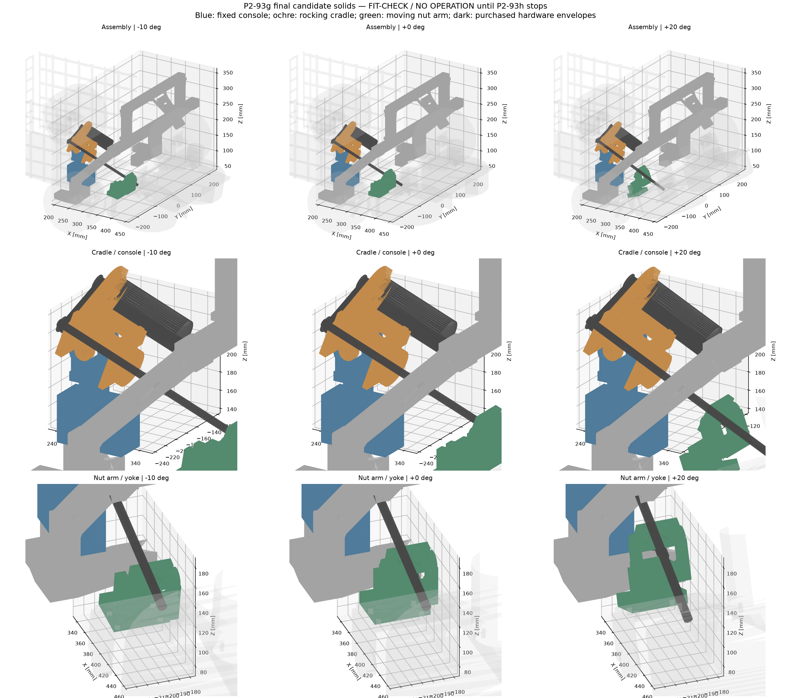

# P2-93g — inward knee / rocking cradle candidate

Τελική επαλήθευση: **2026-11-07**.

τι διαφέρει από το αναμενόμενο: η μετατόπιση του knee στο |Y|221,6
διατηρεί το solid και τους X/Z pin axes, αλλά δεν αρκούσε μόνη της.
Το λοξό return του F φτάνει τοπικά στο |Y|236,5, και οι κεφαλές βιδών
χρειάζονται πραγματικό χώρο, όχι μόνο οι άξονες. Το crown απέκτησε
μονόπλευρο inboard lug12×26 mm, το foot μεταλλικές έδρες pins και το arm
διαδρομή που καθαρίζει nut trunnion και mounting screw heads.

**FIT-CHECK, ΟΧΙ RELEASED. ΑΠΑΓΟΡΕΥΣΗ ΛΕΙΤΟΥΡΓΙΑΣ μέχρι να εγκατασταθούν
και να επαληθευτούν stops/strikers στο P2-93h.** Τα παλιά upper stops
αποσύρθηκαν με ρητή έγκριση. AS5600 pod/cover/magnet cap παραμένουν
γνωστά ανοικτά του P2-93h, όχι εγκεκριμένα interfaces.

## Γεωμετρία και αμετάβλητα

- B=[260,−205,220], N local=[30,−205,110], pivot Z51,837364.
  Tr8 και τα δύο trunnions στο Y−205. GT2 centres57…63, nominal60 mm.
- Knee: **ίδιο solid20 mm**, installed Y±221,6 αντί±228.
  Ίδιοι X/Z άξονες Z80/114 και crown pins. Δεν κόπηκε το knee.
- Foot: παρειές8,2 mm προς τα μέσα, socket20,4 mm /0,2 mm ανά πλευρά.
  Τα ακριβώς8,0 mm έδιναν οριακό0,993 με πραγματικές μάζες, όχι PASS.
  Rail pad40 mm,45° widening πάνω από το πέλμα, seatØ14,6/Z70.
  Το τελικό solid περιορίζεται στο |Y|240.
- Οι δύο οπές βάσης X240/Y150–160 και η rail X230/Y220 είναι ίδιες.
  M4×60 rail: πρόσθετο18 mm PETG +δύο1 mm washers=20 mm, όπως εγκρίθηκε.
- **Knee STL και p293e templates L/R byte-for-byte αμετάβλητα.**
  Τα templates παραμένουν έλεγχος hole centres/X271 datum. Το παλιό
  περίγραμμά τους δεν περιγράφει όλες τις νέες τοπικές επιφάνειες του foot.
- Το foot έχει στους ίδιους M4 pin axes Ø8,2 bores για steel sleeves OD8,
  όχι νέα οπή σασί. Outboard sleeve5 mm κάτω από recessØ10,6×3,2,
  inboard sleeve8 mm. Η φέρουσα PETG έδραση υπολογίζεται στη διάμετρο
  του sleeve, όχι σε ανύπαρκτο8,2 mm μήκος γυμνού bolt μετά το recess.
- Crown: αφαιρέθηκε το χαμηλό outboard lug που συναντούσε το F·
  inboard lug12×26 mm στα **ίδια δύο pin axes**. Απαιτούνται **class10.9**
  button-head pins· ελέγχεται η μονόπλευρη κάμψη στο threaded rootØ3,14,
  όχι ευνοϊκό smoothØ4. Κύριος crown node παραμένει.
  Το χαμηλό άκρο έχει **πραγματικό printed rod reliefR6,3**, sweep των
  γωνιών, για d8 Tr8 με≥2 mm clearance. Το relief υπάρχει στο STL,
  δεν είναι κουτί/εξαίρεση QA. Η κρίσιμη pin section μετριέται μετά το cut.
- Crossbar end:111,6→105,2 mm, άκροY205,2 αντί211,6,
  end bolt Y195,2 αντί201,6. Mast/centre bars/OAK δεν άλλαξαν.
- Console: split positive keyed saddle γύρω από knee, τέσσερις
  around-member M4, χωρίς νέα knee holes. Outboard screw heads και B
  stub heads έχουν πραγματικά recesses. Δεν αφαιρούνται από κανένα QA.
- Cradle: πραγματικές longitudinal16×8 και transverse8×16 διατομές,
  για το πλήρες force σε μία διαδρομή και26 mm εσωτερικό μοχλοβραχίονα.
  Ελέγχεται και το πραγματικό D20/Ø4,6 boss net section, όχι μόνο η front plate.
- Moving arm: risers30×10, **χαμηλό shelf30×16 κάτω από το nut**,
  base12 mm, upward fork legs4×24 και κάτω crossbar24×14/W80.
  Δεν υπάρχει πλέον ψηλή γέφυρα που περνούσε από knee/crown.
  Οι re-entrant roots έχουν
  πραγματικά R3 fillets (Kt1,5 παραμένει screening assumption, όχι FEA).
  Οι OD10 mounting washers έχουν πραγματικό χώρο δίπλα στους χαμηλούς risers.
  τέσσερις πραγματικές through-M4 οπές στο **concept moving yoke**.
  Δεν υπάρχει αλλαγή released moving-yoke STL. Απαιτείται interface coupon.
- Nut trunnion: πραγματικό **συνεχές head/tool slot** από την κεντρική
  οπή προς τα inward pockets. Μπαίνει στο upward clevis χωρίς pins,
  τα κοντά stub screws εισάγονται από το κέντρο μέσω του slot, και μετά
  μπαίνει το T8 nut. **Όχι ένας μακρύς through-pin διαμέσου Tr8**.

## Raw gate και κενά

[Αυτούσιο check-current-scene.sh stdout](p293g-candidate-results/final-stdout.txt),
[stderr](p293g-candidate-results/final-stderr.txt),
[πλήρες JSON](p293g-candidate-results/final-report.json).

Το υποχρεωτικό script ελέγχει−10/−3/0/15/20°. Παραμένει **global FAIL**
εξαιτίας παλιών εκτός-scope τομών· δεν μετατρέπεται το exit code σε PASS.
Το P2-93g scope ελέγχεται από το raw report, χωρίς volume/interface masks.
Τελικό αποτέλεσμα: **109 σώματα ανά γωνία, 0 duplicates, 0 export failures,
76 global collisions +3 contained, καμία τομή που να περιλαμβάνει νέο
P2-93g ή διατηρημένο P2-93d σώμα**. Ο συμπληρωματικός sweep ανά1° έχει
επίσης0 τομές του νέου set με το context. Μέγιστο |Y|240 mm στη ζώνη
X220–420, ελάχιστο F gap2 mm και drive gap9 mm. Τα παλιά AS5600 ανοικτά
δεν εξαιρούνται από το global report και παραμένουν P2-93h.
Συμπληρωματικά [raw sweep ανά1° και ακριβή min-gap](p293g-candidate-results/solid-clearances.json)
ελέγχει τις πραγματικές meshes σε31 γωνίες. Δεν αποτελεί μαθηματικό
continuous-motion proof μεταξύ δειγμάτων.

[Πίνακας ελάχιστων κενών ανά γωνία](P2-93g-solid-tables.md).
Τα0,1 mm arm–yoke και0,4 mm cradle–fork είναι **πραγματικά σχεδιασμένα
assembly clearances**, όχι εξαίρεση ελέγχου· κλείσιμο/ελεύθερη περιστροφή
επαληθεύονται με coupon. Το όριο |Y|240 αφορά το νέο arch/tilt body set
στη ζώνηX220–420· δεν βαφτίζει το παλιό AS5600 cover συμβατό.

[Supplemental raw hardware checks](p293g-candidate-results/hardware-probe.json):
foot sleeves/button heads, crown pins, console clamp bolts, B/N stub pins,
arm–yoke mounting bolts απέναντι σε όλα τα scene bodies στις πέντε γωνίες.
Το world-STL hardware probe διατηρεί **3 flags 0,000107–0,000119 mm³**
στις συνεπίπεδες άνω ροδέλες στους−10°, χωρίς αλλαγή threshold ή μάσκα.
Ο [raw native-CAD έλεγχος επαφής](p293g-candidate-results/exact-washer-contact.json)
των ίδιων πλήρων solids στο κοινό moving frame δίνει **EMPTY /0 mm³**.
Η κοινή rigid μετατόπιση διατηρεί την τομή, αποφεύγοντας τη στρογγύλευση
δύο ανεξάρτητων world-STL επιπέδων. Θετικός έλεγχος: μετατόπιση των
ροδελών μέσα κατά0,05 mm δίνει **12,348645 mm³**. Πρόκειται για επιβεβαίωση
ακριβούς επαφής, όχι για αποδοχή σκόπιμου όγκου ή απόκρυψη των mesh flags.
Τα βασικά M3 mounts/rail fasteners δεν μοντελοποιούνται όλα ως πλήρη
fasteners από το scene gate· οι φυσικές διαστάσεις και η πρόσβαση τους
παραμένουν υποχρεωτικό dry-fit/coupon, όχι δήλωση πλήρους hardware release.

## LC1 / LC2 — πραγματικές διατομές και μάζες

[Πλήρεις πίνακες](P2-93g-solid-tables.md),
[αριθμοί, θ/sign και assumptions JSON](p293g-candidate-results/solid-screen.json).

Όλα τα δηλωμένα screening checks περνούν≥1,0: ελάχιστο **LC1=1,032**
(foot cheek bearing), **LC2=1,133** (crown threaded pin10.9).
Συνολική μοντελοποιημένη μάζα μαζί με τα probed M4: **2082,51 g**.
Και τα9 STL είναι watertight, ένα σώμα, με volume parity προς τα
scene solids· knee/template και protected gate files παραμένουν ίδια.

- LC1: F=8000/h(θ) στοB, και τα δύο πρόσημα, sweep0,1°.
- LC2: μηδέν Tr8, όλη η8 N·m σε μία crown πλευρά, ως η συμφωνημένη
  ισοδύναμη κατακόρυφη±8000/132 N. Δεν πιστοποιούνται τα μελλοντικά
  local stop contacts πριν το P2-93h.
- Οι περιπτώσεις **ποτέ δεν αθροίζονται**. Βαρύτητα και στις δύο.
- Όλες οι μάζες των candidate solids/arch προκύπτουν από κλειστό mesh
  volume και CM, PETG1,27 g/cm³. Δεν χρησιμοποιείται0,600 kg lump.
  Δεν είναι φυσικό ζύγισμα. FIT0186 nominal205 g από
  [DFRobot](https://wiki.dfrobot.com/fit0186), G15 KFL08 provisional22 g
  από nominal supplier envelope, όχι μέτρηση του παραληφθέντος.
  Steel/brass/aluminium hardware envelopes χρησιμοποιούν τις δηλωμένες
  πυκνότητες του script. Τα κρίσιμα M4 bolt/nut/washer/sleeve/shim envelopes
  του hardware probe προστίθενται με volume×7,85 g/cm³ και τα πραγματικά CM,
  με ξεχωριστή μεταφορά foot/crown/console/B/N/moving-arm loads. Τα λίγα
  μη μοντελοποιημένα M3/rail fasteners και sensor payload masses δεν
  παριστάνονται ως μετρημένα CAD masses.
- Συμμετρικό self-weight αψίδας μοιράζεται στις δύο γραμμές ποδιών.
  Actuator ή LC2 stop force εφαρμόζεται ολόκληρη στην ελεγχόμενη πλευρά.
  Moving carriage mass αναφέρεται και προστίθεται τοπικά στο arm check,
  όχι δεύτερη φορά σαν ανεξάρτητη ροπή πέρα από το moving8 N·m bound.
- Knee Z97/Z114, rail pad X230, console Z180 και cradle front section
  μετρώνται στις **πραγματικές mesh τομές**, με αφαίρεση πραγματικών οπών.
  Pad: A668,45 mm², Z_pitch2062,53 mm³· όχι πλασματικό πλήρες40×18.
  Risers/γέφυρα/crown lug χρησιμοποιούν τις πραγματικές source διατομές.
- Όριο10 MPa bending/normal,5 MPa PETG bearing/shear, target≥1,0.
  Kt μόνο σε συγκεκριμένο bore/notch. Residual100 N **μόνο** σε φυσικά
  PETG washer/head seats, όχι σε ροπές/αντιδράσεις κόμβων.
- Foot sleeves:60% του συνολικού pin load σε **κάθε** έδρα για συντηρητική
  ανισοκατανομή. Edge shear διαχωρίζει Fx/Fz και πραγματικούς διαφορετικούς
  edge ligaments. Crown single-side pins: cantilever16,4 mm /thread rootØ3,14,
  class10.9 proof830 MPa. Δεν απαιτείται δυσεύρετη smooth-grip button βίδα.
  Arm riser/bridge: ολόκληρο force σε μία διαδρομή, όχι50/50 credit.
  Οι δυνάμεις περιστρέφονται στο **moving U/W frame** πριν τους ελέγχους·
  εξετάζονται biaxial bending, Y-offset torsion, fork/bight, base και οι
  τέσσερις washer seats με τα πραγματικά moving masses/CM.
- Steel screening conditional σε ελεγχόμενη class≥8.8 με proof580 MPa,
  όχι άγνωστο hardware. [Bossard mechanical properties](https://www.bossard.com/global-en/-/media/bossard-group/website/documents/technical-resources/en/f-004-en.pdf).

Πρόκειται για **sectional/contact screening, όχι FEA ή πιστοποίηση
κόμβων/creep**. Τα οριακά περιθώρια δεν δικαιολογούν χρήση χωρίς φυσική
δοκιμή. Η axial retention/capacity του πραγματικού G15, collar grip πάνω
σε thread crests και runout δεν πιστοποιούνται από τα PETG margins.

## FIT-CHECK print set

Όλα στο `stl-candidate-p293g/`,9 distinct STLs /12 prints:

Mirroring στις **εξαγόμενες print συντεταγμένες**: foot και crossbar-end
καθρέφτισμαY· crown καθρέφτισμα**Z**, επειδή εξάγεται rotatedXZ-on-bed,
και μετά Drop-to-bed. Όχι αυθαίρετη περιστροφή180° που αλλάζει FRONT.

| STL | Qty | Κατάσταση |
|---|---:|---|
| p293g_foot.stl | 2 mirrored L/R | FIT-CHECK, solid |
| p293g_crown.stl | 2 mirrored L/R | FIT-CHECK, solid /10.9 pins |
| p293g_crossbar_end.stl | 2 mirrored L/R | FIT-CHECK |
| p293g_console_inboard.stl | 1 | FIT-CHECK, solid |
| p293g_console_outboard.stl | 1 | FIT-CHECK, solid |
| p293g_cradle.stl | 1 | FIT-CHECK, solid |
| p293g_float_cap.stl | 1 | FIT-CHECK |
| p293g_nut_trunnion.stl | 1 | FIT-CHECK, solid |
| p293g_nut_arm.stl | 1 | FIT-CHECK, solid |

One-body/watertight results για κάθε εξαγωγή στο `print_STL_sanity` του JSON.
Αμετάβλητα ως solids/STLs: knee, mast, lidar half, mast cap, OAK mount,
centre arch bar και joint sleeves. Αλλάζουν foot/crown/end beam· τα παλιά
αντίστοιχα p293d STL **ΜΗΝ ΤΥΠΩΣΕΙΣ** για τη νέα συναρμολόγηση.
Template files δεν αλλάζουν. **Κανένα νέο STL RELEASED.**

## Hardware — τελικό nominal candidate stack, dry-fit υποχρεωτικό

| Interface | Qty | Βίδα / hardware | Ροδέλα / παξιμάδι / κρίσιμος περιορισμός |
|---|---:|---|---|
| Rail X230/Y±220 | 2 | M4×60 αντί υπαρχουσών40 | δύο πρόσθετες OD14×ID4,3×1 ανά βίδα· διατηρείται ίδιο παξιμάδι/engagement |
| Base X240/Y±150,±160 | 4 | M4×50 | OD9, υφιστάμενα captive nuts, ίδιο20 mm πρόσθετο grip |
| Foot pins Z80/114 | 4 | M4×45 button-head class10.9 | έξω OD10×1 σε recess3,2· μέσα OD12×1 +M4 nyloc5· sleeves OD8/ID4,3: έξωL5, μέσαL8 |
| Crown pins, original axes | 4 | **M4×45 button-head class10.9**, headh≤2,2 | έξω **OD9 steel washer0,5**· μέσα OD9×0,8 +nyloc5· μεταξύ knee/lug shim0,4 για να μη λυγίζει το lug στο σφίξιμο |
| Split saddle | 4 | M4×45 class8.8 | έξω OD9×0,8 +hex head μέσα στο recess4· μέσα OD9×0,8 +nyloc5 |
| Short crossbar end / crown spigot | 2 | M4×35 nominal | OD9×0,8 δύο πλευρές +nyloc5, άξοναςZ στο νέοY±195,2· unchanged hollow-interface clamp coupon, όχι υπερσύσφιγξη |
| B trunnion | 2 | **M4×16 button-head**, όχι through-pin | εξωτερική OD9×0,8 σε recess3,2· εσωτερικό **DIN439 M4 thin nut2,2 +threadlocker**, όχι5 mm nyloc· ρύθμιση ελεύθερης περιστροφής |
| N trunnion | 2 | **M4×16 button-head, κεφαλή προς τα μέσα** | μέσα washerOD8×0,5· έξω OD9×0,8 +nyloc5· τοποθέτηση **πριν** το T8 nut |
| Arm–yoke | 4 | **M4×30 class8.8, χωρίς κοπή** | OD10×1 δύο πλευρές, επιπλέον **OD9 steel shim0,5 πάνω** +nyloc5· πραγματική κάτω έδρα yoke W39· tipW30,6 μένει έξω από το ribW30 |
| FIT0186 face | 4 | M3×10 provisional | τέσσερις face slots PCD31· **μέτρηση blind thread depth πριν σύσφιγξη**, όχι bottoming |
| KFL08 to cradle | 2 | M4×25 +broad OD12 washers | nylon-lock nuts· slots pitch36…48, πραγματικό G15 pitch/face προς μέτρηση |
| Floating608 cap | 4 | M3×25 | OD7 washers +M3 nyloc· κρατά outer ring, όχι clamping inner ring |
| T8 nut flange | 4 | M3×20 | OD7 washers +M3 nyloc· PCD16, πραγματικό G14 προς coupon |
| Tr8 screw | 1 | **lead2/single-start300 mm, Parts To Order** | nominal CAD cut262,3 mm, κοπή μόνο μετά dry-fit· το200 mm δεν επαρκεί για τη συγκεκριμένη Α |
| Locating / floating | 1+1 | υπάρχονG15 KFL08 + **608ZZ8×22×7** | floating axial clearance0,5/0,6 mm· όχι journals/τόρνος ή αυτόματο ξεχωριστό thrust bearing |
| Axial retention | 2 | split shaft collars8 mm | δύο inner-ring face washers, nominalID8,2/OD10,5/t0,5 **μόνο εφόσον ταιριάζουν πραγματικά στο G15**· εναλλακτική δεύτερο πλήρεςT8 nut θέλει νέο stack check· όχι jam nuts |
| GT2 | 1 belt +2 pulleys | nominal160mm/20T–20T, hubs6mm/8mm | centres57…63· set screws και belt tension ελέγχονται στο πραγματικό hardware |

Για αγορά sleeves: **4×OD8/ID4,3/L5** (outboard foot),
**4×OD8/ID4,3/L8** (foot). Δεν υποκαθίστανται με μαλακούς printed spacers.
Επιπλέον:8×shim0,2 mm για τις δύο πλευρές των foot pins και4×shim0,4 mm
για τα crown pins, OD9/ID4,3 steel. Επιπλέον4×OD9 steel shim0,5 για
τα arm mounting heads (ίδιο πάχος με τις crown outer washers). Έτσι κλείνουν τα assembly gaps χωρίς
να απαιτείται κάμψη των cheeks από τη σύσφιγξη.
Τα OD/head heights, nut thicknesses και grade10.9 στο crown είναι
λειτουργικές προδιαγραφές· διαφορετικό κατάστημα/σειρά βίδας απαιτεί
νέο stack fit, όχι αυθαίρετη αντικατάσταση.

## Σειρά συναρμολόγησης / coupons

1. Ρεύμα εκτός, moving module ασφαλισμένο μηχανικά. F panels αφαιρούνται
   για πρόσβαση εργαλείου και επανέρχονται αφού ελεγχθούν τα τελικά heads.
2. Το αμετάβλητο p293e hole template ελέγχει όλες τις M4 ταυτόχρονα χαλαρές.
   Έπειτα foot coupon: rail washers/recess και steel sleeves/head seats.
3. Sleeves στο foot, knee στα±221,6, recessed button-head pins από έξω,
   OD12/nyloc προς τα μέσα και0,2 mm shims σε κάθε πλευρά του knee.
   Μη σφίξεις πάνω σε διαφορετικό/μαλακό sleeve.
   Στερέωση βάσεων στις ίδιες σασί οπές, rail M4×60 με ίδιο engagement.
4. Crown στα original knee pin axes, **10.9 button-head pins**,0,4 mm
   knee–lug shims και OD9 steel washers: έξω μόνο0,5 mm, μέσα0,8 mm.
   Νέα κοντά crossbar ends και unchanged mast/centre beams/OAK. Παχύτερη
   εξωτερική ροδέλα ή ψηλότερη κεφαλή παραβιάζει το F clearance.
5. Console halves γύρω από knee, τέσσερις recessed-head through-M4· πρώτα
   επιβεβαίωση keyed contact με coupon, όχι πίστωση άγνωστης τριβής.
6. Arm–yoke coupon με τις τέσσερις πραγματικές οπές, OD10×1 washers,
   top shims0,5 και stockM4×30. Οι θέσεις risers αφήνουν τις κεφαλές ελεύθερες.
7. Το nut trunnion κατεβαίνει χωρίς pins στο upward clevis. Οι inward
   button-head stub pins μπαίνουν από το κέντρο μέσω του συνεχούς head slot,
   με τις εσωτερικές ροδέλες0,5. Ρύθμιση ελεύθερης περιστροφής,
   μετά το G14 nut/τέσσεριςM3. Έτσι οι Allen κεφαλές δεν παγιδεύονται από
   τη φλάντζα του nut. Απαγορεύεται πλήρης άξονας που τέμνει τη Tr8.
8. Cradle: KFL08, floating608/cap και μοτέρ· ύστερα οι δύο κοντές B stub
   βίδες/λεπτά nuts, ελεύθερο rocking χωρίς αξονικό σφίξιμο του plastic.
9. Η μακριά Tr8 εισάγεται **κατά τον δικό της άξονα** μέσα από τα bearings
   και βιδώνεται στο nut. Όχι κάθοδος ολόκληρου μακριού screw assembly
   κατακόρυφα μέσα από το crown. Collars/face washers/pulleys/belt πριν
   την τελική αξονική δέσμευση· dry-fit και μετά κοπή του300 mm.
10. Χειροκίνητος έλεγχος−10…+20 με εξωτερική συγκράτηση, μέτρηση
    hardware/runout/belt/tolerance. Δεν αποτελεί άδεια powered λειτουργίας.
    Φυσικό proof-load και P2-93h stops παραμένουν υποχρεωτικά.

Πριν από κάθε print>4 h: interface coupon μέσω Cut στο Bambu Studio.
Foot/knee/crown/console/cradle/nut arm/clevis **συμπαγή** για φέρουσα δοκιμή·
το draft2 walls/10% ισχύει μόνο για μη φέροντα fit coupons.
Console/knee/arm στο XZ load plane όπου είναι πρακτικό, όχι αυτόματη
υπόσχεση strength από τον προσανατολισμό εξαγωγής STL. Το slicer drop-to-bed
δεν αλλάζει την installed pose που ελέγχεται από τη σκηνή.

## Proof-load / release lock

Foot+knee συμπαγή, τελικά βιδωμένα στο σασί:150 N στοB για24 h.
Δβέλους≤20% αρχικού loaded βέλους, residual≤0,5 mm, καμία ρωγμή,
λεύκανση/ολίσθηση ή washer indentation>0,2 mm. Καταγραφή datum,
θερμοκρασίας, αρχής/τέλους και φωτογραφιών. **Δεν εκτελέστηκε φυσική δοκιμή.**
Το φυσικό PASS μαζί με coupons/raw gates κλειδώνει RELEASED, όχι οι
παραπάνω analytical margins. Η δοκιμή B δεν πιστοποιεί αυτόματα local stops
ή τη μη μετρημένη axial capacity του G15.

## Ιστορικό και εργαλεία

- Η [απορριφθείσα ψηλή γέφυρα arm](p293g-candidate-results/rejected-high-arm/README.md)
  έδινε πραγματικές τομές crown485,56 /knee268,28 /Tr8 0,80 mm³.
  Αντικαταστάθηκε από low supported upward clevis και πραγματικό crown relief,
  όχι από αφαίρεση όγκων στον checker. Το προηγούμενο world-X/Z arm screen
  επίσης αντικαταστάθηκε από σωστά moving-U/W φορτία και πραγματικές ροπές.
- [Πρώτο combined-load preflight](P2-93g-preflight.md): ιστορικό,
  αποσυρμένο. [Διορθωμένο preflight](P2-93g-corrected-load-cases.md):
  approved sizing, αλλά οι παλιές μάζες/ενδιάμεσα συμπεράσματα δεν είναι
  τα τελικά solids. [Rear brace](P2-93g-rear-brace-analysis.md): **REJECTED**.
- Η P2-93f ανάλυση αντιγράφηκε στο repo: `p293f-analysis/`.
- `scene_check.py`, `scadtree.py`, `check-current-scene.sh`, `parts.py`
  **δεν αλλάχθηκαν**. Το full-scene gate χρησιμοποιεί CAD placements.
- Παρατήρηση συμβατότητας: single-line wrapper του console_outboard δεν
  ανακαλυπτόταν σωστά από instrumentation. Η candidate module declaration
  γράφτηκε multiline και πλέον αναφέρεται στο gate. Δεν τροποποιήθηκε ο
  checker ούτε αφαιρέθηκε το πραγματικό σώμα.
- Τα supplementary scripts είναι μετρήσεις/αναλύσεις, όχι αντικατάσταση
  του υποχρεωτικού full-scene gate. Οι εικόνες παράγονται από actual meshes·
  το clipping στα κοντινά views είναι **μόνο οπτικό**, ποτέ collision QA.

Αναπαραγωγή από repo root (OpenSCAD/uv, Linux):

```bash
bash cad/arch-tilt-p293/export-p293g-candidate.sh
python3 cad/arch-tilt-p293/p293g-run-gate.py --tag final
uv run --with manifold3d --with trimesh --with numpy --with scipy python cad/arch-tilt-p293/p293g-verify-solids.py
uv run --with manifold3d --with trimesh --with numpy --with scipy python cad/arch-tilt-p293/p293g-hardware-probe.py
uv run --with trimesh --with numpy --with scipy python cad/arch-tilt-p293/p293g-exact-contact.py
uv run --with trimesh --with numpy --with scipy --with shapely --with networkx python cad/arch-tilt-p293/p293g-solid-screen.py --tag final
uv run --with trimesh --with numpy --with scipy --with matplotlib --with shapely --with networkx python cad/arch-tilt-p293/p293g-candidate-figures.py
```

Το δεύτερο command επιστρέφει1 για το **global** FAIL· δεν συνδέονται οι
επόμενες μετρήσεις με `&&` και δεν κρύβεται το exit status. Τα hardware
probes είναι sampled geometry checks, όχι continuous installation-path proof.
Η ανάλυση είναι για το συμφωνημένο8 N·m bound, **όχι FIT0186 stall ή
αυθαίρετη GT2 pretension qualification**. Αυτά δεν καλύπτονται από μια
δήλωση PETG screening PASS ή από την αφαίρεση των stops.


