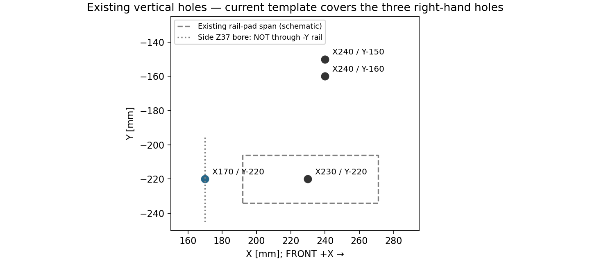
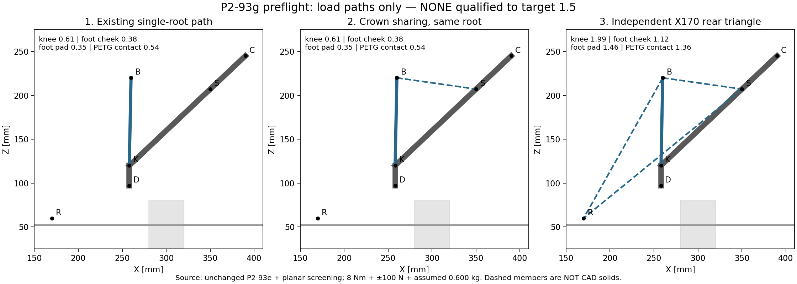

# P2-93g — preflight φέρουσας αγκύρωσης, ΠΑΥΣΗ για επιλογή

> **ΙΣΤΟΡΙΚΟ — ΑΚΥΡΩΜΕΝΟΣ συνδυασμός φορτίων και στόχος1,5.**
> Αντικαθίσταται από `P2-93g-corrected-load-cases.md`: LC1 και LC2 χωριστά,
> target1,0, preload μόνο κάτω από ροδέλες. Οι B/C δεν εγκρίθηκαν.

τι διαφέρει από το αναμενόμενο: το υπάρχον P2-93e δεν έχει αποδεδειγμένο
περιθώριο 1,5 ακόμη και πριν από το cradle. Η νέα αντίδραση δεν διορθώνεται
με μια ισχυρότερη κονσόλα ή με σύνδεσή της μόνο στο crown: αν η τελική
αγκύρωση παραμένει ίδια, η συνολική ροπή φτάνει πάλι στο ίδιο foot.

2026-11-06, βάση `9be0e03c`. **Preflight μόνο. Καμία αλλαγή SCAD/STL,
σκηνής, template, gate, parts.py ή print manifest. Κανένα commit/push.**
Δεν είναι candidate design, πιστοποιημένος υπολογισμός ή άδεια εκτύπωσης
φέροντος εξαρτήματος. Δεν υπάρχει επιλογή που να δηλώνεται εδώ PASS ≥1,5.

## 1. Απάντηση για το αυριανό template

**Τα δύο p293e templates ΔΕΝ αλλάζουν.** Παραμένουν FIT-CHECK για τις τρεις
υφιστάμενες τελικές οπές ανά πλευρά: X240/Y150–160 και X230/Y220, με
κατοπτρισμό Y για R. Ο έλεγχος χαλαρών M4 ταυτόχρονα παραμένει χρήσιμος.
Δεν αποδεικνύει αντοχή, και δεν ελέγχει την πρόσθετη X170.

- `p293e_foot_template.stl` SHA256
  `045a65e4e6d639af213e97955371c55f85a70a9f9b23a9671854cf2c9ab4bc49`
- `p293e_foot_template_R.stl` SHA256
  `8477e3e2c93ca872ddbfb8fa8854fdab7d8d7536655a4b5ef366a711b1db776d`

Με ενιαίο μακρύτερο foot θα χρειαζόταν **νέο, ξεχωριστό v2 template** για
την X170 και το νέο περίγραμμα· όχι σιωπηρή αντικατάσταση των παραπάνω.
Με ανεξάρτητη πίσω αγκύρωση, το foot/template μπορεί να μείνει ακριβώς ίδιο,
με ξεχωριστό coupon της νέας αγκύρωσης.

## 2. Ποια υπάρχουσα οπή προτείνεται

**Κάθετη X170/Y−220, από Z22 έως Z52, nominal Ø4,5 διαμπερής.**
Είναι η πίσω top-lock του sleeve του joint X200, όχι οι τυφλοί pilots
X230/Y−207,5 και −232,5.

Πηγή: `modular-chassis-v3.scad`, `rail_extension_v3(-1)` μήκους165,
μετατόπιση X117,5. Το `end_lock_holes_local` δίνει local X±52,5,
άρα global X65 και **170**. Μέσα της βρίσκεται το `clamp_sleeve_x()`
στο [200,−220,37], με αντίστοιχη οπή local X−30 και συμπαγή web γύρω της.

Hardware σήμερα **κατά BOM**: **M4×40 top**, ροδέλες και εξωτερικό
παξιμάδι. Η μέτρηση χρήστη επιβεβαιώνει M4×40 στις ράγες γενικά· δεν
έχουμε χωριστή φυσική επιβεβαίωση πληρότητας/μήκους της συγκεκριμένης X170.
Δεν εμφανίζεται μοντελοποιημένο installed screw ώστε το CAD να αποδείξει
την πραγματική σημερινή βίδα/ποιότητά της.

Για νέα top έδρα18 mm + δύο πρόσθετες ροδέλες1 mm: **M4×60**, με τα
σημερινά washers/nut και ίδιο thread engagement. Αυτό είναι grip budget,
όχι οριστικοποιημένο hardware νέου solid. Δεν σφίγγουμε PETG με generic
ροπή για μεταλλική M4 σύνδεση.

### Raw επιβεβαίωση και σημαντική εξαίρεση

Το υπάρχον scene export έχει οκταγωνικές nominal Ø4,5 οπές, inscribed
διάμετρο4,157 mm. Γι' αυτό ελέγχθηκε πραγματικός πυρήνας **Ø4**· δεν
αφαιρέθηκε κανένας όγκος από τα σώματα.

| Probe X170 | Ράγα −Y, mm³ | Sleeve X200, mm³ |
|---|---:|---:|
| Κάθετος Ø4, Y−220, Z21…53 | **0** | **0** |
| Πλευρικός Ø4, Z37, Y−194…−246 | **80,296** | **0** |
| Κάθετος offset control X175, Ø4,4 | 97,158 | 345,022 |

**Η πλευρική Z37 δεν είναι διαθέσιμη διαμπερής στην −Y ράγα του CAD.**
Στο `end_lock_holes_local`, για side−1, το rotate([90,0,0]) στρέφει
τον κύλινδρο προς −Y από την ήδη αρνητική εξωτερική παρειά, δηλαδή μακριά
από τη ράγα. Το sleeve έχει τη δίοδο, η ίδια η ράγα όχι. Δεν πιστώνεται
αυτή η πλευρική βίδα σε καμία λύση, δεν αλλάζει η γεωμετρία εδώ και δεν
προτείνεται διάνοιξη του τυπωμένου σασί. Αν υπάρχει φυσικά τέτοια οπή,
χρειάζεται φωτογραφία/έλεγχος της πραγματικής ράγας πριν αξιοποιηθεί.

Πλήρες αποτέλεσμα: `p293g-results/hole-probe.json`. Ο έλεγχος αυτός αφορά
διαθεσιμότητα οπής, όχι αντοχή του web/τοιχωμάτων ή full-scene PASS.

## 3. Ορισμός φορτίου και περιθωρίου

Περιθώριο = αντοχή screening / τάση screening, στόχος **≥1,5**.
Δεν σημαίνει περιθώριο ως προς μετρημένη θραύση συγκεκριμένου PETG.

- Ολόκληρα8 N·m στη μία πλευρά: F_C=8000/132=60,606 N κάτω στο
  C=[390,245] XZ. Καμία πίστωση ότι μοιράζεται στις δύο πλευρές.
- Πρόσθετη ανεξάρτητη αντίδραση Tr8 **±100 N** στο B=[260,220], παράλληλη
  στο B→N. Sweep −10…+20 ανά0,5°, και τα δύο πρόσημα. Η8 N·m και ηTr8
  χρησιμοποιούνται ως συντηρητικός ανεξάρτητος συνδυασμός που ζητήθηκε,
  όχι ως πλήρως λυμένο ενιαίο free-body του ρομπότ· πιθανή κοινή προέλευση
  των φορτίων δεν δίνει αυτόματα δικαίωμα αφαίρεσής τους.
- FIT0186 **0,205 kg** κατά DFRobot. Υπόθεση επιπλέον0,395 kg για
  cradle/bearings/hardware ⇒ **0,600 kg σύνολο**, CM=[300,−175,245].
  Το0,600 και το CM **δεν είναι μέτρηση**. Πρέπει να αντικατασταθούν με
  τη μάζα/CM των candidate solids και πραγματικού hardware.
- PETG E1800 MPa, όριο κάμψης10 MPa, bearing/shear5 MPa, Kt1,8 για knee,
  Kt1,5 για rail pad. Κληρονομημένες συντηρητικές παραδοχές screening,
  όχι process-specific allowables για creep, fatigue, θερμοκρασία ή layer adhesion.
- Residual preload100 N ανά βίδα, **παραδοχή**, όχι προδιαγραφή torque.
- M4 grade8.8, proof580 MPa **μόνο ως υπόθεση σύγκρισης**. Δεν γνωρίζουμε
  την πραγματική ποιότητα/θέση σπειρώματος στις υπάρχουσες βίδες.

Αναπαραγωγή: `python3 cad/arch-tilt-p293/p293g-preflight.py`.
Πρόκειται για linear XZ beam/truss με explicit sectional checks, όχι 3D
solid FEA. D=[258,97] το μέσο του Z80/114, K=[258,120], S η crown port
55 mm πριν το C. Κονσόλα αναλυτικού μοντέλου20Y×40normal από K→B.
Δεν έχει κατασκευαστεί κανένα νέο solid τέτοιας διατομής.

## 4. Πόσο λείπει στην απλή κονσόλα

Κρίσιμος pin load≈**633,09 N**, M_D≈**19,861 N·m**, αντίδραση D≈
[−93,86,+100,99] N στους−5° και +100 N. Το envelope στη βάση προσθέτει
τον μοχλοβραχίονα45 mm της οριζόντιας αντίδρασης: M_pitch≈**24,085 N·m**.
Τα μέγιστα ανά έλεγχο δεν εμφανίζονται όλα στην ίδια γωνία.

| Στοιχείο / έλεγχος | Περιθώριο | Έλλειμμα από1,5 | Απαίτηση / σημερινή ικανότητα για1,5 |
|---|---:|---:|---:|
| Knee, κάτω τμήμα/net section γύρω από σύνδεση | **0,611** | 0,889 | 2,46× |
| M4 Z80/114, πλήρες σπείρωμα στη διάτμηση/κάμψη, υποθ.8.8 | **0,661** | 0,839 | 2,27× |
| Ίδιες M4, υποθ. λείο Ø4 grip σε όλο το ενεργό μήκος | **1,356** | 0,144 | 1,11× |
| Foot cheeks, PETG bearing οπών6+6 mm | **0,379** | 1,121 | 3,96× |
| Foot cheeks, edge shear προς Z120 | **0,701** | 0,799 | 2,14× |
| Foot rail pad, κάμψη pitch, net18 mm | **0,350** | 1,150 | 4,29× |
| Foot root, κάμψη roll | **1,196** | 0,304 | 1,25× |
| Βίδες βάσης M4, μεταλλικό tensile/shear, υποθ.8.8 | **5,618** | 0 | PASS στο συγκεκριμένο steel screen μόνο |
| PETG κάτω από rail OD12 washer | **0,553** | 0,947 | 2,71× |
| PETG κάτω από κάθε inboard OD9 washer | **1,387** | 0,113 | 1,08× |
| PETG pitch compression patch8×12 | **0,538** | 0,962 | 2,79× |
| Νέα κονσόλα20×40, μόνο ιδανική αναλυτική διατομή | **2,961** | 0 | Δεν περιλαμβάνει τελικές οπές/κομβικές λεπτομέρειες |

Οι συντελεστές στην τελευταία στήλη δεν είναι εντολή να πολλαπλασιαστούν
όλα τα πάχη γραμμικά: αλλάζουν η γεωμετρία, η δυσκαμψία και η κατανομή φορτίου.
Το αρνητικό συμπέρασμα δεν εξαρτάται από τη μάζα0,600 kg: ήδη στο παλιό
8 N·m το `p293d-strength.py` δίνει knee≈**1,497**, cheeks≈**1,163**, και
το `p293e-base-strength.py` rail-pad≈**1,053**, rail washer≈**1,064**,
contact patch≈**1,036**. Τα παλιά PASS ήταν ως προς όριο1,0, όχι1,5.
Στον νέο έλεγχο το PETG bearing χρησιμοποιεί τη διάμετρο του πραγματικού
πείρου4 mm, όχι την οπή clearance4,6 mm του παλιού υπολογισμού. Επίσης
Q_pin=hypot(|M_D|/34+|F_x|/2, |F_z|/2): η συνιστώσα F_x και το couple
προστίθενται στην ίδια διεύθυνση, δεν μπαίνουν σε ορθογώνια τετραγωνική άθροιση.

### Γιατί οι M4 δεν ελέγχονται μόνο σε double shear

Στηρίξεις στα κέντρα των δύο cheeks: span26,8 mm, κατανεμημένο φορτίο knee
σε20 mm ⇒ M_bolt,max=Q(2×26,8−20)/8=**4,2Q N·mm**.
Με thread-root Ø3,14 η κάμψη κυριαρχεί. Ελέγχεται von Mises με διάτμηση
και proof580 MPa. Λείο Ø4 grip βοηθά, αλλά μόνο του παραμένει ελάχιστα
κάτω από1,5 και **δεν διορθώνει PETG foot ή βάση**. Το πραγματικό bearing
στις παρειές μπορεί να είναι δυσμενέστερο από το ιδανικό uniform load.

## 5. Σύγκριση διαδρομών — χωρίς αλλαγή γεωμετρίας

### A. Σύνδεση κονσόλας και στο crown, ίδιο foot

Νέο console και strut B→S (stock αναλυτικού μοντέλου12Y×26normal).
**Δεν αρκεί.** Μειώνει την κάμψη στο άνω σκέλος, όχι τη συνολική αντίδραση
στο D, στο κάτω knee και στη βάση. Χειρότερα περιθώρια ίδια: knee0,611,
pin0,661, foot cheek0,379, pad0,350, rail washer0,553.

Νέα STL: console, crown adapter, strut· hardware: πραγματικές αρθρωτές
M4 συνδέσεις με λείο grip/ροδέλες/nyloc, προς διαστασιολόγηση.
Foot/template **ίδια**. Δεν προτείνεται ως μοναδική διόρθωση.

### B. Ενιαίο ενισχυμένο foot μέχρι την X170

Νέα τετραοπική βάση X170+X230+X240/Y150–160, νέα σύνδεση knee/console,
θετική έδραση/μεταλλικοί διανομείς φορτίου αντί για μικρές ανεξάρτητες
ροδέλες. Bolt pitch X170→230=**60 mm**, αντί για σημερινό compression
arm34/36 mm. Ιδανικό pitch couple24,085 N·m /60=**401,4 N**, πριν roll,
preload, uplift, ανακατανομή και τοπική κάμψη.

**Περιθώριο: μη τεκμηριωμένο**, όχι PASS. Η απλή προσθήκη μιας τέταρτης
οπής δεν διορθώνει την αδύναμη παρειά ή το κάτω knee. Χρειάζεται κοινός
επανασχεδιασμός βάσης/σύνδεσης και πλήρης υπολογισμός, με τις απαιτήσεις
του §4 ως αρχικό sizing. Καμία δήλωση1,5 πριν την τελική διατομή.

Νέα/αλλαγμένα STL: −Y foot, πιθανό knee/joint, console, distribution seats.
Hardware: πρόσθετη X170 M4×60 με grip18+2 mm, υπάρχουσες X230 M4×60 και
X240 M4×50 δεν θεωρούνται αυτόματα κατάλληλες αν αλλάξει stack· νέα pins
με ορισμένο λείο grip, μεταλλικοί διανομείς. Θα διατηρηθούν υπάρχουσες
οπές σασί. **Νέο ξεχωριστό template v2**, το σημερινό δεν διαγράφεται.

### C. Ανεξάρτητη πίσω αγκύρωση — διατήρηση foot και template

Ξεχωριστό R κοντά στην X170 και τρίγωνο **R–B–S**, με B→S, B→R και S→R.
Δεν αρκεί μόνο strut προς το ίδιο X240 foot: χρειάζεται **δεύτερη τελική
αγκύρωση στη ράγα**, ώστε να υπάρχει πραγματική παράκαμψη της κάτω σύνδεσης.

Στο ιδανικό planar μοντέλο, stock12×26 με E1800 και R=[170,60]:

| Έλεγχος | Περιθώριο C | Κατάσταση έναντι1,5 |
|---|---:|---|
| Κάτω knee | 1,993 | περνά μόνο το planar sectional screen |
| M4 Z80/114, thread-root/υποθ.8.8 | 1,947 | περνά μόνο το ιδανικό steel screen |
| Foot cheek bearing | **1,116** | όχι, λείπει0,384 |
| Foot pad pitch | **1,463** | όχι, λείπει0,037 |
| Foot root roll, χωρίς αυθαίρετη πίστωση 3D sharing | **1,196** | όχι, λείπει0,304 |
| Βίδες παλιάς βάσης, steel screen | 13,753 | δεν ελέγχει το νέο R |
| PETG rail washer | **1,394** | όχι, λείπει0,106 |
| PETG inboard washer | **1,326** | όχι, λείπει0,174 |
| PETG pitch contact | **1,357** | όχι, λείπει0,143 |
| Console stock | 4,568 | χωρίς οπές/αρθρώσεις |

Άρα αυτή είναι **υποσχόμενη διαδρομή χωρίς αλλαγή foot, όχι έτοιμη λύση1,5**.
Χρειάζεται 3D load sharing/ισχυρότερη άμεση παράκαμψη της αντίδρασης, και
έλεγχος νέας αγκύρωσης/rail wall/anti-rotation. Δεν πιστώνεται η ανύπαρκτη
πλευρική −Y οπή Z37 ως ασφάλιση. Με μία κάθετη M4 και αυθαίρετη τριβή
δεν θεωρείται εξασφαλισμένο το νέο R. Μπορεί να εξεταστεί δεύτερη
υπάρχουσα κάθετη οπή της ράγας σε ξεχωριστή bridge βάση, χωρίς αλλαγή
foot· η επιλογή της και το εγκατεστημένο hardware της δεν έχουν ελεγχθεί εδώ.

Οι νέοι struts πρέπει να είναι **εκτός επιπέδου Y−228 των arch members**,
π.χ. κοντά στοY−205, για να μη διασταυρωθούν με το knee. Το offset23 mm
αυξάνει τα 3D moments στους κόμβους. Το roll envelope διατηρήθηκε ολόκληρο
και δεν δηλώνεται 3D PASS. Δυσκαμψία/ports/διαδρομές εγκατάστασης και
collision-free θέση πρέπει να ελεγχθούν πριν εξαχθούν STL.

Νέα STL: πίσω anchor, crown adapter, console, τρία struts/end fittings.
**Κανένα παλιό foot/knee/template δεν αλλάζει** ως στόχος αυτής της επιλογής.
Hardware: νέα top M4×60 στην X170 με OD washers/παξιμάδι, επιπλέον
through-bolts στις νέες αρθρώσεις με λείο grip· μήκη/πλήθος οριστικοποιούνται
μόνο μετά το design. Η παλιά X230 M4×60 και X240 M4×50 δεν μεταβάλλονται
εφόσον δεν αλλάξει το stack τους. Χρειάζεται νέο ξεχωριστό anchor coupon.

## 6. Τι ζητείται να επιλεγεί

- **B:** επιτρέπεται αλλαγή φέρουσας βάσης/σύνδεσης, νέο template v2.
- **C:** προτεραιότητα να μείνει foot/template ακριβώς ίδιο· επόμενη εργασία
  πρώτα πλήρης διαστασιολόγηση του ανεξάρτητου load bypass, όχι STL.

Η C προστατεύει τον αυριανό έλεγχο οπών, αλλά **δεν υπόσχομαι ότι θα
επιτύχει1,5 χωρίς αναθεώρηση της στήριξης/μεταλλικό στοιχείο**. Η A μόνο
προς crown απορρίπτεται ως επαρκής διόρθωση. ΠΑΥΣΗ, δεν υλοποιείται επιλογή.

## 7. Λοιπά ανοικτά P2-93g — δεν κλειδώνουν αγορές τώρα

Για την εγκεκριμένη κινηματική A, L_BN=129,601…187,302 mm και planning
finished screw=**262,302 mm** με τον παλιό προϋπολογισμό75 mm. Ακόμη και
αν μηδενιστεί το πίσω allowance45 mm, με nut nose20+overrun10 χρειάζονται
**217,302 mm**, άρα το αγορασμένο200 δεν χωρά **στη συγκεκριμένη A**.
Η γενική πρόταση «κανένα B/N με stack≥75 δεν χωρά200» δεν αποδεικνύεται
από αυτό. Δεν είναι ορθό να δηλωθεί καθολική αδυνατότητα χωρίς constraints
χώρου/φορτίων/στηρίξεων. Το300 mm lead2 παραμένει πρόταση για A, όχι αγορά.
Το ordered-parts δεν αλλάζει σε αυτό το narrowed preflight.

KFL08 set screws+μία ροδέλα δεν τεκμηριώνουν θετική αμφίδρομη αξονική
συγκράτηση100 N πάνω στο Tr8 thread. Δεν υπάρχει διαθέσιμη τεκμηριωμένη
ικανότητα του συγκεκριμένου αγορασμένου KFL08 ώστε να κλείσει ο υπολογισμός.
Άρα ούτε ορίζεται αυθαίρετα χωριστό thrust bearing, ούτε δηλώνεται ότι
δεν χρειάζεται. Locating/floating retention, face-only hardened spacers,
σωστά Tr8×2 jam nuts (όχι κοινά M8) και runout/fit πάνω στο σπείρωμα
παραμένουν ανοικτό preflight πριν το candidate hardware stack.

AS5600: provisional envelope13,2 mm· κενό προς λάστιχο ≥ ανοχή μέτρησης
τροχού+2 mm, όχι οριζόντιος κανόνας9 mm. Αναμένονται οι δύο μετρήσεις χρήστη.

Η ιστορική P2-93f αντιγράφηκε ολόκληρη στο `p293f-analysis/` με σήμανση
των superseded bearing/AS5600 παραδοχών και portable repo path.

## 8. Επαληθεύσεις και όρια παράδοσης

- Αριθμητικό μοντέλο: εκτελέστηκε, δεδομένα `p293g-results/preflight.json`.
- Raw hole probe: εκτελέστηκε, ο κάθετος πυρήναςØ4 EMPTY σε rail+sleeve.
- Template SHA256: καταγράφηκαν, τα tracked αρχεία δεν τροποποιήθηκαν.
- Δεν τροποποιήθηκαν `scene_check.py`, `scadtree.py`, `parts.py`,
  `check-current-scene.sh` ή οποιοδήποτε tracked αρχείο CAD/STL.
- Δεν τρέχει νέο full-scene gate ως υποκατάστατο της ανάλυσης αντοχής:
  δεν υπάρχουν νέα candidate solids. Κανένας ισχυρισμός νέου collision PASS.
- Δεν έγινε δοκιμή φυσικού hardware, 3D FEA, fatigue/creep test ή coupon.
- Δεν έγινε commit/push, σύμφωνα με το τελευταίο αίτημα preflight/ΠΑΥΣΗ.

Πηγές: `p293d-strength.py`, `p293e-base-strength.py`,
`p293d-arch-candidate.scad`, `p293e-foot-template.scad`,
`modular-test-chassis/modular-chassis-v3.scad`, `cad/ACTIVE-PRINT-SET.md`.
FIT μάζα από [DFRobot FIT0186](https://wiki.dfrobot.com/fit0186).
Η proof580 MPa είναι δηλωμένη υπόθεση class8.8, όχι μέτρηση υπαρχόντων βιδών.
