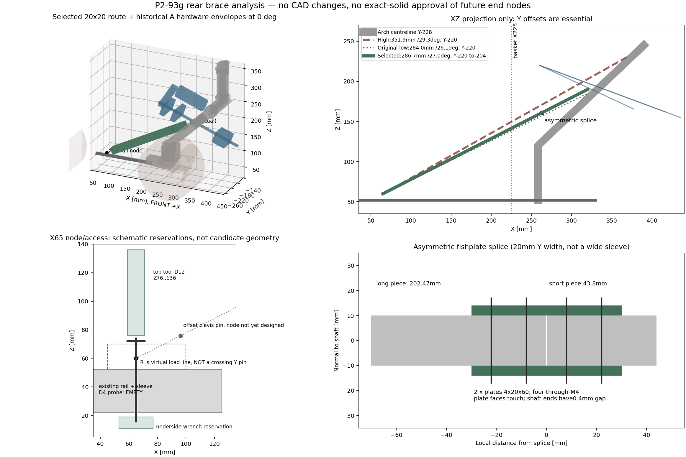
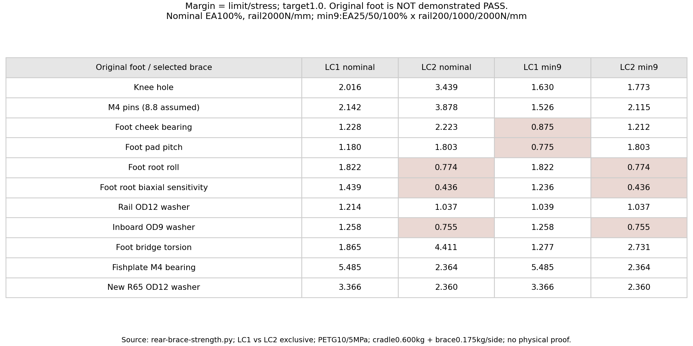

# P2-93g — πίσω διαγώνιος προς X65, μόνο ανάλυση

> **REJECTED / ΙΣΤΟΡΙΚΟ.** Η πίσω διαγώνιος απορρίφθηκε ρητά και δεν
> αποτελεί ενεργό στήριγμα ή print set. Διατηρούνται τα αρνητικά ευρήματα.
> Τρέχουσα τοπική λύση: [P2-93g-debug.md](P2-93g-debug.md).

τι διαφέρει από το αναμενόμενο: η ψηλή συνεπίπεδη διαγώνιος δεν συγκρούεται
μόνο με το παλιό stop· τέμνει την αψίδα και τις δεσμευμένες περιοχές νέου
stop/striker. Η χαμηλή διαδρομή μπορεί να καθαρίσει γεωμετρικά με μικρή
μετατόπιση προς τα μέσα και πάνω, αλλά το πλατύτερο sleeve δεν χωρά.
Προτείνονται επίπεδες πλάκες splice. Η διαγώνιος μειώνει το pitch, **δεν
αποδεικνύει αμετάβλητο-foot PASS** σε roll/εδράσεις LC2.

2026-11-06. **Δεν άλλαξαν SCAD/STL, current_robot, foot, knee, templates,
QA ή parts.py. Δεν υπάρχουν νέα candidate solids. Δεν έγινε commit/push.
ΠΑΥΣΗ για έγκριση.** Όλα τα νέα σώματα εδώ είναι μαθηματικά envelopes
στη μνήμη των analysis scripts, όχι εκτυπώσιμα αρχεία.

## 1. X65 — επιβεβαιωμένη διαμπερής M4

Στο `modular-chassis-v3.scad`, το `rail_extension_v3` έχει μήκος165 και
κέντροX117,5· τα end-lock localX±52,5 δίνουν global **X65 και170**.
Η X65 αντιστοιχεί στο εμπρός μισό του rear-joint sleeve στο **X35**,
local X+30. Δεν είναι η X170 του sleeveX200 ούτε blind accessory pilot.

| Probe vertical Ø4, Z21…53 | −Y220 mm³ | +Y220 mm³ |
|---|---:|---:|
| Rail extension X65 | **0** | **0** |
| Sleeve X35 στην ίδια X65 | **0** | **0** |
| Rail offset control X70 | 80,296 | 80,296 |
| Sleeve offset control X70 | 288,562 | 288,562 |

Η nominal CAD οπή είναι **Ø4,5**, διαμπερής στη ράγαZ22…52 και στο sleeve.
Το ήδη εξαγμένο gate mesh έχει οκταγωνικές οπές, inscribedØ4,157· γι' αυτό
ο καθαρός πυρήνας ελέγχθηκε με πραγματικό κύλινδροØ4, όπως στηνX170.
Δεν αφαιρέθηκε κανένας όγκος από τα σώματα. Raw δεδομένα στο `clearance.json`.

Hardware κατά `cad/ACTIVE-PRINT-SET.md`: **M4×40 top**, ροδέλες/παξιμάδι,
στα κύρια sleeves. Η μέτρηση χρήστη επιβεβαιώνειM4×40 στις ράγες γενικά·
η συγκεκριμένη φυσική X65/πληρότητα/grade δεν έχει ελεγχθεί. Το CAD δεν
περιλαμβάνει τη βίδα ως installed hardware body. Δεν προτείνεται νέα οπή
στο τυπωμένο σασί ή πίστωση της προβληματικής πλευρικής−Y οπής.

## 2. Διαδρομές και raw αποτελέσματα

Rail virtual node R=[65,±220,60], πάνω από τη ράγαZ52. Δοκάρι **συμπαγές
20×20**, με πραγματικό trim20 mm στα δύο άκρα για χωριστά end-nodes.
Αυτό είναι η πραγματική προτεινόμενη έκταση του δοκαριού, όχι αφαίρεση
«mating volume» από την intersection. Τα άκρα/κόμβοι αναφέρονται χωριστά
ως μη ολοκληρωμένα· δεν δηλώνεται full-assembly PASS από truncated beam.

| Διαδρομή | Κεντρικό μήκος / γωνία XZ | Εύρημα |
|---|---|---|
| [372,±220,232] | 351,90 mm /29,26° | knee≈5535,09 και crown≈1692,65 mm³/πλευρά· νέες stop reservations/strikers επίσης τέμνονται |
| [320,±220,185] | 283,99 mm /26,11° | P2-93f tilt/reserved stops EMPTY, αλλά knee≈3051,54 mm³/πλευρά |
| [320,±204,185] | 284,44 mm | το δοκάρι καθαρίζει· gap knee0,572 / basket0,130 mm, ανεπαρκές ως πρακτική ανοχή· πλατύτερο splice αποτυγχάνει |
| **[320,±204,190] + flat splice** | **286,67 mm /27,01° XZ** | ελεγμένο δοκάρι+πλάκες καθαρίζουν από arch/basket/tilt/moving/reserved new stops· παραμένουν raw παλιά upper stops |

Το αρχικό [372,232] και [320,185] είναι κοντά αλλά όχι ακριβώς πάνω στην
κεντρογραμμή του άνω μέλους: στοX320 η κεντρογραμμή έχειZ178,712.
Το προτεινόμενοJ=[320,±204,190] είναι **εικονικό σημείο της γραμμής φορτίου
για το end-node**, όχι εντολή να διαπεράσει εκεί το δοκάρι το άνω μέλος.

### Ελεγμένο envelope scope

- Και οι δύο πλευρές, −10…+20 ανά1° και GT2 centres **57/60/63 mm**.
- Ακριβώς τα P2-93f A envelopes: FIT motor, δύο bearing boxes, πλήρες
  σταθερό Tr8 shaft, nut, belt guard/keepout, rocking-joint και cable keepout.
- Πραγματικό baseline moving-module mesh περιστραμμένο γύρω από
  [387,0,51,837364], και τα υπάρχοντα installed scene bodies στους0°.
- Τα νέα stop consoles/strikers **δεν υπάρχουν ακόμη ως solids**. Ελέγχθηκαν
  ρητά μόνο reservations:16 mm square console bars από τις F§6 anchor
  θέσεις προς τα δύο contact points, και20×16×16 blocks γύρω από τη
  moving διαδρομή local[0,±205,150]. **Δεν είναι exact-solid πιστοποίηση
  ανύπαρκτων νέων parts.** Η τελική κονσόλα δεν επιτρέπεται να απλωθεί
  αυθαίρετα έξω από αυτά και να κληρονομήσει το παρόν αποτέλεσμα.
- Το ιστορικό thrust box τουF διατηρήθηκε ως ξεχωριστό diagnostic envelope,
  όχι ως απαίτηση αγοράς. Η ψηλή διαδρομή το τέμνει· η επιλεγμένη χαμηλή
  διαδρομή με flat splice δεν το τέμνει ούτε αυτό.

### Επιλεγμένη διαδρομή — τι παραμένει και τι δεν αποδεικνύεται

Στο `details-z190-plates.json` οι μόνες θετικές raw τομές είναι:

| Σώμα | Παλιό upper stop −Y mm³ | Παλιό upper stop +Y mm³ |
|---|---:|---:|
| Δοκάρι | 9656,277 | 10484,718 |
| Splice plates | 920,688 | 1810,804 |

Δεν κρύβονται. Τα παλιά upper stops πρέπει να **αντικατασταθούν πραγματικά
στη σκηνή** στο μελλοντικό candidate βήμα. Ο σημερινός full-scene gate
δεν βαφτίζεται PASS επειδή προγραμματίστηκε η αντικατάστασή τους.

Τα ελεγμένα νέα envelopes έχουν **0** θετικές τομές με τα ζητούμενα tilt
parts, το moving set και τις παραπάνω new-stop reservations. Η συνεπίπεδη
επαφή beam/flat plates έχει raw numerical signed volume≈−2,2e−11 mm³,
δηλαδή αριθμητικό roundoff γύρω από μηδέν, όχι θετικό interface overlap.

Ελάχιστα κενά του δοκαριού: **1,117 mm προς arch**, **0,515 mm προς basket**
στην−Y πλευρά. Το0,515 **δεν είναι πρακτικό print release clearance**·
χρειάζεται τελικό tolerance/coupon check ή μικρή περαιτέρω μετατόπιση
στο candidate βήμα. Δεν εφαρμόζεται καθολικός κανόνας9 mm.

## 3. Splice σε δύο κομμάτια ≤250 mm, χωρίς διαπέραση

Ο midpoint splice βρίσκεται πάνω στο καλάθι/front system: ένα28×28×80
κοίλο sleeve εκεί δίνει **1346,666 mm³** με `p271_front_system` στην−Y.
Μετατόπιση του28×28 sleeve ψηλότερα αποφεύγει το καλάθι αλλά τέμνει knee.
Δεν κόβεται αυθαίρετα το knee ή η τομή από το QA.

Πρόταση: **δύο flat fishplates4×20×60 mm**, στις δύο normal faces του
δοκαριού, όχι στα πλευρικά Y faces. Οι πραγματικές επίπεδες παρειές
τους ακουμπούν το δοκάρι χωρίς θετικό volume. Δεν είναι δύο δοκάρια
που χώνονται το ένα μέσα στο άλλο.

- Splice station **222,672 mm από R** πάνω στον άξονα.
- Δύο shaft pieces: **202,472 mm και43,800 mm**, με κενό0,4 mm μεταξύ τους.
  Το κοντό άνω τμήμα μπορεί να ενσωματωθεί στο τελικό upper end-node.
- Δύο πλάκες4×20×60, **4 through-M4 συνολικά**, δύο σε κάθε μισό,
  local stations−22/−8/+8/+22 mm. Ο άξονας των βιδών είναι normal στο
  δοκάρι, όχι Y. Προβλέπονται drilled/printed clearance bores στα parts,
  washers και nyloc. Στόχος M4×40/45 από το τελικό grip, όχι τυφλά μήκος.
- Όλα τα προτεινόμενα printed stock lengths≤250. Δεν έχουν εξαχθεί STL.
- Στα136 N peak της primary LC1/LC2 sensitivity, το bearing screen των
  δύο πλακών δίνει περιθώριο≥**2,364**. Ο υπολογισμός Euler του ιδανικού
  συνεχούς stock δεν πιστοποιεί τη rotational stiffness του πραγματικού
  splice. Οι δύο βίδες ανά μισό είναι απαραίτητες για moment restraint·
  μονή βίδα ως ελεύθερη μεσαία άρθρωση δεν είναι ισοδύναμη λύση.

## 4. Τερματισμοί σε πραγματικά ports / πρόσβαση

**Εκκρεμούν τα ίδια τα end-node solids.** Προτείνεται χωριστή θετικά
βιδωμένη έδρα στην inboard παρειά του άνω μέλους, με δύο νέες through-M4
printed ports στο knee/άνω μέλος, ενδεικτικά κοντά σεX296/Z155,98 και
X312/Z171,14. Δεν υπάρχουν ήδη αυτές οι οπές: αν εγκριθούν αλλάζει το
**knee STL μόνο στην περιοχή των ports**, όχι σασί ή foot/template.
Η κεντρογραμμή20×26 δεν διαπερνάται από δεύτερο μέλος· το end-node
πατά εξωτερικά, και οι βίδες περνούν στις πραγματικές drilled bores.

Το shaft δεν φτάνει ωςJ: τελειώνει20 mm πριν. Ενδεικτικός upper pin
28 mm πρινJ παραμένει πίσω από το moving striker, αντί για πλατύ
συμμετρικό block πάνω στοJ που θα μπορούσε να τον συναντήσει. Τα νέα
ακριβή node/stops πρέπει να ελεγχθούν μαζί πριν κατασκευαστούν STL.

Στη ράγα τοR=[65,±220,60] είναι **virtual force line**, όχι horizontal
pin που διασταυρώνεται με τη verticalM4. Η πραγματική clevis άρθρωση
μετατοπίζεται περίπου35 mm πάνω στη διαγώνιο, ώστε να μείνει χώρος
στην κεφαλή της X65. Το rail pad παραμένει στην υπάρχουσα οπή.

Grip budget: **18 mm PETG + δύο πρόσθετες washers1 mm =20 mm**,
άρα **M4×40→M4×60**, με τα σημερινά washers/nut και ίδιο thread engagement.
Το pad/clevis δεν είναι ακόμη ολοκληρωμένα solids, άρα δεν πιστοποιούνται
edge ligaments, washer pocket, support-free print ή πραγματική assembly.

Ελέγχθηκαν οι εξής χωρικές κρατήσεις εργαλείου, χωρίς θετικές τομές με
ελεγμένα σώματα: **top driver Ø12, Z76…136**, και κάτω wrench box
24X×40Y×8Z γύρω απόZ15. Τοπικό head/nut accessibility με τα τελικά printed
end-nodes και πραγματικό κλειδί παραμένει υποχρεωτικό coupon check.

## 5. LC1/LC2 με αμετάβλητο foot — δεν υποθέτουμε άκαμπτο τρίγωνο

Linear elastic beam/truss model: παλιό D=[258,97] ιδανικά fixed,
διαγώνιος20×20 με net A308 mm², E1800 MPa, νέα R65 elastic support.
Η κονσόλα παραμένει20×40. Corrected LC1/LC2 όπως στο προηγούμενο report,
χωρίς άθροισή τους: LC1=8000/h στοB, LC2=±8000/132 κατακόρυφα στοC,
μηδέν Tr8. Κάθε LC ελέγχεται και στις δύο φορές, −10…20 ανά0,5°.
Βάρος cradle0,600 kg και provisional diagonal/node/splice0,175 kg/πλευρά.
Preload100 N **μόνο** στις PETGwasher checks. Target≥1,0.

Η δυσκαμψία του splice δεν είναι δεδομένη. Ελέγχθηκαν **9 συνδυασμοί**:
effective axialEA25/50/100% του net stock και rail spring200/1000/2000N/mm.
Δεν είναι μετρημένα χαρακτηριστικά ή αυστηρό φυσικό bound, αλλά ρητή
sensitivity. Δεν θεωρείται equal sharing ούτε αφαιρείται load ως mating.

Στο nominal χρησιμοποιείταιEA100%, rail2000N/mm. Οι στήλεςmin9 δείχνουν
το χειρότερο μέσα στη δηλωμένη sensitivity, όχι αποδεδειγμένο global worst.

| Περιθώριο, σημερινό foot | LC1 nominal | LC2 nominal | LC1 min9 | LC2 min9 |
|---|---:|---:|---:|---:|
| Knee πραγματική bore | 2,016 | 3,439 | 1,630 | 1,773 |
| M4 Z80/114, thread-root8.8 assumption | 2,142 | 3,878 | 1,526 | 2,115 |
| Foot cheek bearing6+6 | 1,228 | 2,223 | **0,875** | 1,212 |
| Foot pad pitch, width28 | 1,180 | 1,803 | **0,775** | 1,803 |
| Foot root roll | 1,822 | **0,774** | 1,822 | **0,774** |
| Πρόσθετη biaxial root sensitivity | 1,439 | **0,436** | 1,236 | **0,436** |
| PETG rail OD12 washer | 1,214 | 1,037 | 1,039 | 1,037 |
| PETG inboard OD9 washers | 1,258 | **0,755** | 1,258 | **0,755** |
| Foot bridge torsion | 1,865 | 4,411 | 1,277 | 2,731 |
| Fishplate through-M4 bearing | 5,485 | 2,364 | 5,485 | 2,364 |
| Νέα X65 OD12 washer seat | 3,366 | 2,360 | 3,366 | 2,360 |
| X65 two-skin bearing sensitivity | 2,463 | 1,061 | 2,463 | 1,061 |

Κύριο εύρημα: η πίσω διαγώνιος αναλαμβάνει pitch αλλά, στη μία φορά LC2,
τραβά το crown προς πίσω/κάτω. Η παλιά βάση δέχεται επιπλέον κατακόρυφη
αντίδραση και lateral moment, όχι μόνο μικρότερη ροπή. **Δεν αποδεικνύεται
ότι μπορεί να διατηρηθεί το foot με όλα τα checks≥1,0.**

Το offsetY204→220 λήφθηκε υπόψη στην προβολή της αξονικής δυσκαμψίας και
στις στατικέςFy moments. Δεν λύθηκε η 3D lateral stiffness του arch/foot.
Το biaxial row περιλαμβάνειMx/Zx+Mz/Zz στην ίδια root proxy, όχι νέο
genericKt. Είναι αυστηρότερη supplemental sensitivity, όχι solid FEA.
Ακόμη και **χωρίς** αυτή τη γραμμή, roll0,774 και seat0,755 δεν περνούν.

Επίσης το foot contact model πιστώνει την παλιά συντηρητική διαδρομή
φορτίων του screening. Η πραγματική συμμετοχή της υπάρχουσας railX230
αγκύρωσης μπορεί να μειώνει το root roll. Γι' αυτό μια αποτυχία proxy δεν
αποδεικνύει ούτε πραγματική θραύση ούτε τη μικρότερη αναγκαία πάχυνση.
Δεν εξάγονται συγκεκριμένα root-rib mm από αυτό χωρίς πραγματική τομή/
contact model και proof-load της τελικής συναρμολόγησης.

### Τι κρατάμε από τις προηγούμενες τοπικές αλλαγές

- **Δεν διατηρείται αυτόματα rail OD14:** το σημερινόOD12 περνά και στα9.
- **Δεν διατηρούνται αυτόματα cheeks8 / pad40:** το nominal νέο τρίγωνο
  περνά με6/28. Απαιτείται όμως επαλήθευση δυσκαμψίας· στο μαλακό άκρο
  της sensitivity προκύπτουν παραμετρικά ελάχιστα≈**cheeks6,86→7 mm** και
  **pad width34,8→35 mm**, όχι το παλιό8/40. Δεν υλοποιούνται εδώ.
- **Δεν αγνοούνται root/inboard seats:** παραμένουν ανοικτά στοLC2.
  Ενδεικτικά για τα seats απαιτείται annular equivalentOD≈**10,06 mm**
  αντί9, αλλά το pitch10 και τα pockets9,6 δεν επιτρέπουν απλή αγορά
  μεγαλύτερων ανεξάρτητων washers. Χρειάζεται πραγματικός steel spreader/
  seat σχεδιασμός ή ελεγχόμενη διαφορετική κατανομή απόX230, όχι κρυφή
  αύξηση preload ούτε απλή εντολή «βάλε μεγαλύτερη ροδέλα».
- **Δεν προτείνεται τώρα αλλαγή foot ή template.** Το όριο αυτού του
  analysis βήματος είναι ότι δεν υπάρχει ακόμη τεκμηριωμένο all-PASS
  σχέδιο που να δικαιολογεί διαγραφή όλων των προηγούμενων blockers.
  Η τελική απαιτούμενη root/seat διόρθωση δεν χαρακτηρίζεται «ελάχιστη»
  χωρίς έλεγχο των πραγματικών countersinks και section moduli.

Για διαφάνεια υπολογίστηκε χωριστά και **pure8 N·m couple στο crown**
αντί της προηγούμενης ισοδύναμης κατακόρυφης δύναμης. Δεν υιοθετήθηκε
σιωπηρά ως ευνοϊκότερος LC2: στο nominal δίνει root roll1,372 και inboard
seat1,105, αλλά supplemental biaxial0,530. Επομένως η ακριβής εφαρμογή
του πραγματικού stop load/του contact support matter. Τα δεδομένα αυτής
της sensitivity βρίσκονται χωριστά στο `strength.json`, δεν αθροίζονται.

## 6. Hardware / template / proof-load / shaft retention

Προτεινόμενο rail-node hardware ανά πλευρά: **μία M4×60** στη σημερινήX65,
δύο πρόσθετες OD12×4,3×1 washers, διατήρηση υπάρχοντος nut/old washers.
Η πραγματική βίδα/grade/engagement και η επαφή του sleeve web χρειάζονται
έλεγχο με coupon. Four M4 through-bolts ανά splice, washers/nyloc, και
δύο through-M4 στις νέες upper ports ανά πλευρά· τα μήκη δεν κλειδώνουν
πριν το final grip. Δεν υπάρχει νέο hardware order ή εξωτερική αγορά.

**Foot/template αμετάβλητα.** Τα SHA256 των δύοp293e templates παραμένουν
ίδια μεHEAD. Οι ίδιες τρεις οπές του αυριανού template εξακολουθούν να
ελέγχονται· η νέαX65 θέλει χωριστό rail-node coupon, όχι νέο foot template.

Η υποχρεωτική δοκιμή150 N στοB για24 h πρέπει να περιλαμβάνει **το τελικό
τρίγωνο με splice/κόμβους/X65 στο πραγματικό σασί**. ΑναλυτικόPASS δεν
δίνει RELEASED. Δεν υπήρχαν στο διαθέσιμο ιστορικό τα αριθμητικά όρια
βέλους/creep/residual που ο χρήστης αναφέρει ως σημεία3–5· ζητήθηκαν
διευκρινίσεις, δεν επινοήθηκαν. Η δοκιμή δεν έχει γίνει, τα όρια παραμένουν
εκκρεμή μέχρι να δοθούν. Η διαδικασία/απαίτηση καταγράφηκε στο ACTIVE-PRINT-SET.
Ειδικά με τη διαγώνιο, η δοκιμή150 N στοB δεν θεωρείται αυτόματα
proof της μέγιστηςLC2 φόρτισης της διαγωνίου/του stop: οι δύο διαδρομές
φορτίου διαφέρουν. Δεν μεταφέρεται αυτόματα έναLC1 physical PASS σε
local hard-stop/LC2 release.

Στο ordered-parts **αποσύρθηκε η πρόταση jam nuts**. Αντικαταστάθηκε με
**δύο split shaft collars8 mm**, ή/και δεύτερο πλήρεςT8 nut κατά το τελικό
retention stack, όπως ζήτησε ο χρήστης. Όχι όλα ως αυτόματη αγορά, όχι
M8 nut, όχι προσθήκη μηχανουργείου ή thrust bearing χωρίς ανάγκη.
Η συγκράτηση collars πάνω στο τραπεζοειδές σπείρωμα και η πραγματική
axial retention τουG15 δεν πιστοποιούνται από ονομαστική διάμετρο8 mm.
T8 lead2 των300 mm παραμένει η πρόταση για την Α, κοπή μετά τοdry-fit.

## 7. Παραδοτέα και επαληθεύσεις

- `p293g-rear-brace-clearance.py`: X65 probes, route search, raw hits.
- `p293g-rear-brace-details.py --z190 --splice plates`: δοκάρι/flat
  splice, εργαλεία, C57/60/63, moving set, reserved stops.
- `p293g-rear-brace-strength.py`: LC1/LC2, splice/rail stiffness grid,
  global force/moment equilibrium assertions. Καμία πρόσθεση LC1/LC2.
- `p293g-rear-brace-figures.py`: οι δύο εικόνες από πραγματικά δεδομένα.
- Raw JSON στο `p293g-rear-brace-results/`, μαζί με αποτυχημένες διαδρομές
  και sleeves, χωρίς να διαγράφονται τα αρνητικά αποτελέσματα.

Δεν εκτελέστηκε νέο `check-current-scene.sh`: δεν υπάρχουν νέα candidate
parts στη σκηνή. Δεν τροποποιήθηκε κανένα QA/gate ή η γεωμετρία για να
παραχθεί τεχνητόPASS. Το τελικό exact gate θα περιλαμβάνει end-nodes,
πραγματικά stop consoles/strikers και hardware envelopes όταν σχεδιαστούν.
