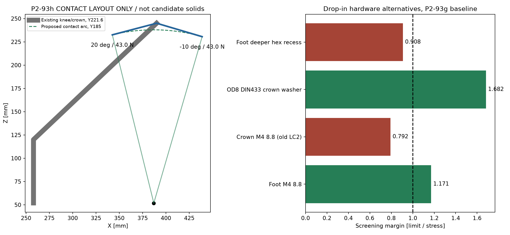
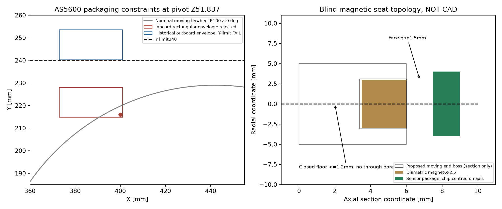

# P2-93h — PARKED ανάλυση αναφοράς

> **PARKED — εξαρτάται από το πραγματικό moving module.** Η παρούσα
> ανάλυση διατηρείται ως reference και δεν εξουσιοδοτεί candidate solids,
> εκτύπωση ή αγορά. Stops/strikers, magnet seat, AS5600 support και fixed
> pivot cassette σχεδιάζονται μόνο αφού κλειδώσει το πραγματικό moving
> module: flywheel wheels, D5065 και pivot supports/trunnions.

τι διαφέρει από το αναμενόμενο: το πραγματικό hard-stop contact δεν είναι
κατακόρυφη δύναμη60,6 N στο crown. Για την παρακάτω διάταξη είναι
**42,993 N εφαπτομενικά**, με διαφορετική pitch/roll αντίδραση. Επίσης,
το AS5600 δεν διορθώνεται μόνο με Z translation: το outboard πακέτο13,2 mm
παραβιάζει το Y240, και δεν υπάρχει fixed pivot bearing support στο
`current_robot` όπου να βιδωθεί αυτονόητα το pod.

2026-11-07, βάση3298ef90. **Δεν αλλάχθηκε SCAD/STL, current_robot,
ACTIVE-PRINT-SET ή ordered-parts. Δεν έγινε commit/push.** Οι αλλαγές του
χρήστη σε `scadtree.py`/`selftest.py` διατηρήθηκαν· SHA256 πριν/μετά στον
[baseline metadata](p293h-analysis/baseline-meta.json).
**FIT-CHECK / ΑΠΑΓΟΡΕΥΣΗ ΛΕΙΤΟΥΡΓΙΑΣ παραμένουν.**

## 1. Τι έχει πραγματικά ελεγχθεί

[Αυτούσιο baseline stdout](p293h-analysis/baseline-stdout.txt),
[stderr](p293h-analysis/baseline-stderr.txt),
[raw report](p293h-analysis/baseline-report.json):109 bodies/angle στις
−10/−3/0/15/20°,0 duplicates,0 export failures,76 collisions+3 contained.
Δεν υπάρχουν P2-93g/P2-93d hits. Τα παλιά AS5600 ανοικτά παραμένουν.
Το baseline **ΔΕΝ** είναι gate για προτεινόμενα stops/pod που δεν υπάρχουν.
Δεν δημιουργήθηκαν candidate printed solids ή QA exceptions.

## 2. Προτεινόμενη διάταξη stop — +Y crown, μακριά από Tr8

Μία θετικά εδραζόμενη κονσόλα με δύο αντικαταστάσιμα pads, στον πραγματικό
κόμβο crown/crossbar της +Y πλευράς. Ένα moving striker με δύο τελικές
επίπεδες παρειές. **Όλο το8 N·m σε μία πλευρά, όχι διαίρεση διά δύο.**

- Moving contact local `[U20,Y185,W185]`, pivot `[387,0,51.837364]`.
  Ακτίνα186,078 mm. Προς το crown υπάρχει αρκετός μοχλοβραχίονας χωρίς
  να χρησιμοποιηθεί το nut arm ή το Tr8 ως stop.
- Επαφή−10°: `[438.821,185,230.554]` mm.
  Επαφή+20°: `[342.520,185,232.521]` mm.
  Οι normals είναι αντίστοιχα `[-.96044,0,.27849]` και
  `[-.97101,0,-.23904]`, με το ενεργό πρόσημο να αντιστέκεται στην κίνηση.
- Striker από πραγματική yoke flange W47, όχι από το λάστιχο/ghost:
  προτεινόμενο web40U×12Y, φέρων μοχλοβραχίονας138 mm, base12 mm,
  τέσσερις through-M4 σε20×40 pitch, OD12 washers. Νέες οπές στη
  **moving concept flange** απαιτούν interface coupon και έλεγχο πρόσβασης.
- Console stock20Y×24Z, προβολή έως περίπου50 mm από το crown προς το
  contact. Πρόταση keyed saddle με πραγματικές compression shoulders
  πάνω στον κόμβο και βίδες συγκράτησης, **όχι friction-only clamp**.
  Τα υπάρχοντα crown ports X390/Z239,251 μπορούν να χρησιμοποιηθούν ως
  διαδρομή συγκράτησης, αλλά η τελική πρόσβαση/έδραση των nuts και το
  πάχος πίσω από τις οπές πρέπει να λυθούν στο candidate CAD. Το outer
  crown φτάνειY238: δεν χωρά αυθαίρετη πρόσθετη outboard παρειά/κεφαλή.
- Pads προτεινόμενα20radial×12Y×4 mm, πλήρης άκαμπτη πίσω έδρα, M3
  συγκράτηση από την πλάτη. Η M3 δεν παίρνει το stop load. Δύο χωριστές
  flat faces στο striker γίνονται παράλληλες στα αντίστοιχα όρια. Το pad
  αλλάζει χωρίς εκτύπωση όλης της κονσόλας· όχι παχύ ελαστικό που αλλάζει
  ανεξέλεγκτα το τελικό όριο.
- Νέο web στο Y179…191, console μόνο inboard έως το υπάρχον nodeY238.
  **Σχεδιαστικός στόχος |Y|≤240**, όχι ήδη επιβεβαιωμένο νέο-solid bound.

### Switches πριν από τα hard stops

Χρησιμοποιούνται τα ήδη παραληφθέντα **G19**,4 switches: ανά άκρο ένας
sense/homing και ένας ανεξάρτητος NC cutoff. Δεν υποκαθίστανται στο CAD
από αυθαίρετο μικρότερο switch. Body, roller, OP και OT του πραγματικού
G19 παραμένουν προς μέτρηση.

Αρχική πρόταση trigger−7°/+17°, δηλαδή3° ή9,743 mm τόξου πριν την επαφή.
Cam με ramp και μετά **dwell**: δεν αφήνουμε τα9,743 mm να γίνουν
υπερδιαδρομή του plunger. Ο microswitch δεν είναι μηχανικό stop.
Sense και cutoff τοποθετούνται χωριστά στο cam ώστε να αποφεύγεται κοινή
αστοχία ρύθμισης. Το cutoff πρέπει να επιτρέπει ασφαλή απομάκρυνση από
το ενεργό όριο, όχι απλή λογική που παγιδεύει τον μηχανισμό χωρίς escape.

Το3° είναι αρχική ρύθμιση, **όχι απόδειξη braking distance**. Πρέπει
`ω·t_latency + ω²/(2α_brake) + σφάλμα_ρύθμισης <3°` στη δυσμενέστερη φορά.
Τα δεδομένα ταχύτητας/αδρανείας/καθυστέρησης δεν έχουν δοθεί. Το8 N·m
screen δεν καλύπτει αυθαίρετο impact ή stall/overrun του FIT0186.
Το [Omron D2F datasheet](https://omronfs.omron.com/en_US/ecb/products/pdf/en-d2f.pdf)
δείχνει γιατί OP/OT είναι χωριστά χαρακτηριστικά· **οι τιμές του δεν
μεταφέρονται** στο μη μετρημένο G19.

## 3. LC1 / LC2 — τι περνά και τι μένει υπό όρο

[Ανά στοιχείο πίνακες](P2-93h-tables.md),
[forces/sections/assumptions](p293h-analysis/preflight.json).
Οι πραγματικές P2-93g διατομές/μάζες διατηρούνται. Για τα ανύπαρκτα
νέα prints χρησιμοποιείται **budget200 g σταθερής κονσόλας**, ολόκληρο
στη stop πλευρά. Δεν παρουσιάζεται ως πραγματική νέα CAD μάζα.
Το moving striker έχει sizing budget150 g· η ροπή του moving set παραμένει
μέσα στο συνολικό8 N·m bound, όχι δεύτερη αθροισμένη ροπή.

LC1: ίδιο8000/h, δύο πρόσημα, sweep0,1°, μαζί με το νέο fixed budget.
Ελάχιστο LC1 με το budget200 g: **foot cheek bearing≈1,008**, όχι το
παλιό1,032. Δεν υπάρχει ουσιαστικό περιθώριο για τυχαία μείωση effective
μήκους sleeve. Για το stop-side screening χρεώνεται συντηρητικά εκεί
και το πλήρες carried-gravity load του actuator της P2-93g, παρότι στην
πραγματική +Y εγκατάσταση βρίσκεται στην άλλη πλευρά.
LC2: πραγματικό προτεινόμενο σημείο/normal στις δύο τελικές γωνίες,
δύο πρόσημα συντηρητικά, **μηδέν Tr8**. Η ροπή του πλήρους3D contact
στο crown κατανέμεται συντηρητικά σε pin pitch20 με το μέτρο του moment,
όχι μόνο τη My. Preload100 N μόνο στις PETG washer seats.

Με τον αρχικό threaded-root10.9 έλεγχο, crown pin≈1,007 και crown
lug≈1,016: πολύ μικρό περιθώριο για να αγνοηθούν τοπικές οπές/πρόσθετη μάζα.
Με την προτεινόμενη **8.8 partial-thread με μετρημένο λείο κορμό≥Ø3,8**,
ο pin έλεγχος (κάμψη/διάτμηση και επιπλέον πλήρεςQ/At axial bound) δίνει
**1,202**. Δεν ισχύει για fully-threaded8.8, που δίνει μόλις0,704.
Ο crown lug παραμένει οριακός≈1,016 και πρέπει να ελεγχθεί μετά την
πραγματική saddle/contact γεωμετρία, όχι να θεωρηθεί ολοκληρωμένο PASS.

**Νέο αρνητικό αποτέλεσμα:** με το ίδιο συντηρητικό πλήρεςQ ως axial/prying
bound, η OD9 crown PETG seat φορτίζεται μεQ+100 N, όχι μόνο preload100 N.
Το margin πέφτει στο**0,930** (βλ. τελικό πίνακα). Άρα **η προτεινόμενη
LC2 σύνδεση όπως είναι ΔΕΝ κλείνει**. OD12 υποστηριζόμενη έδρα αυξάνει
το bearing margin κατά `(12²−4,6²)/(9²−4,6²)`, στο**1,909**, και περνά το ίδιο bound,
αλλά απαιτεί πραγματική άκαμπτη ροδέλα και έλεγχο bending της, όχι εύκαμπτο
foil0,5 που θεωρείται αυθαίρετα load spreader. Μια κοινή OD12×1 steel
plate/washer θα αύξανε το axial stack0,5 mm: με την hex κεφαλή το F gap
γίνεται περίπου1,1 mm. Για να παραμείνει ο παλιός στόχος2 mm χρειάζεται
setback≈0,9 mm στην εξωτερική knee seat, που **δεν εγκρίνεται/υλοποιείται
από αυτή την ανάλυση**. Εναλλακτικά χρειάζεται επακριβής επίλυση των
axial αντιδράσεων με το πραγματικό keyed saddle για μικρότερο τεκμηριωμένο
Q, όχι αυθαίρετη διαγραφή του axial φορτίου.

Προτεινόμενα τοπικά sections: striker1,674, console3,045, OD12
striker washers1,943. Pad pressure1,791 MPa /margin2,791 **μόνο εάν**
υπάρχει πραγματικό backed contact τουλάχιστον12×2=24 mm². Η πρώτη επαφή
ακμής δεν έχει αυτομάτως αυτό το εμβαδό. Απαιτούνται αναλυτικό contact
μοντέλο/συμμόρφωση pad και contact-witness coupon υπό φορτίο· η πλήρης
ονομαστική επιφάνεια20×12 δεν χρησιμοποιείται για τεχνητό PASS.

**Δεν δηλώνεται ολοκληρωμένο LC2≥1 με πραγματικά solids/contact.** Αυτό
θα κλείσει μόνο με τις πραγματικές έδρες, bolt axial/prying, pad contact,
νέες μάζες και raw gate μετά από έγκριση candidate. Το υπάρχον physical
proof-load foot+knee150 N/24 h και τα όριά του παραμένουν αναγκαία· δεν
αποδεικνύει από μόνο του hard-stop impact/contact.

## 4. Απλοποίηση ειδικού hardware — όχι γενικές αντικαταστάσεις

Οι αριθμοί είναι screening, όχι δήλωση παραλαβής/διαθεσιμότητας σε ελληνικό
κατάστημα. Καταλογογραφημένη [M4×45 DIN931 από TR Fastenings](https://www.trfastenings.com/Products/Catalogue/screws-and-bolts/hexagon-screws-and-bolts/Bolts/TR00002822-100).
Ζητείται συγκεκριμένα8.8 και μέτρηση shank/grip· δεν αρκεί το όνομα DIN.

| Ειδικό P2-93g είδος | Πρόταση / επίπτωση / απόφαση πριν από αγορά |
|---|---|
| Foot10.9 button-head | Η αντοχή απαιτεί μόνο8.8: LC1 pin1,171 /LC2 P293g1,475. Low head απαιτείται σήμερα για το Y240. Κοινό hex+βαθύτερο recess0,6 μειώνει PETG bearing1,032→0,908: **όχι drop-in**. Για πλήρη εξάλειψη low-head χρειάζεται νέα τοπική foot διατομή/μεγαλύτερο OD sleeve και νέος έλεγχος· δεν εγκρίνεται εδώ αλλαγή foot ή knee. Μην αγοράσεις premium10.9 μόνο για την αντοχή του foot. |
| Crown10.9 button-head | **Κοινή8.8 DIN931/ISO4014 M4×45**, εφόσον λείος κορμός≥22 mm από την έδρα κεφαλής και d≥3,8 στο critical root. Κορμός πρέπει να φτάνει πέρα από το interfaceY211,2· τα σπειρώματα να καλύπτουν όλο το nyloc. Νέο pin margin1,202 με το axial bound. Fully-threaded8.8 απορρίπτεται0,704. |
| Crown ψηλότερο hex head | Raw envelopeD8,1×2,8 με το ίδιο0,5 washer δίνει0 τομές /max|Y|234,9, αλλά **F gap1,6 mm**, όχι2. Για διατήρηση του παλιού στόχου2 mm απαιτείται τοπικό setback≥0,4 mm, που θα άλλαζε το immutable knee interface, ή διατήρηση χαμηλής κεφαλής. Άρα δεν δίνεται ανεπιφύλακτο drop-in approval της εξάγωνης λύσης. |
| Steel sleeves OD8/ID4,3 L5/L8 | Κόψιμο κοινής thick-wall **steel tube8×2**, άνοιγμα ID4→4,3 με τρυπάνι, απογρέζωση/παράλληλα άκρα. Στην αμετάβλητη P293g, L4,95 δίνει LC1≈1,022. **Με το νέο200g stop budget όμως≈0,998: απορρίπτεται αυτή η ανοχή.** Χρειάζεται effective outboard bearingL≥4,97 mm (και επιβεβαίωση ότι ολόκληρο το stack μένει εντόςY240), αλλιώς μεγαλύτερη φέρουσα έδρα πριν εγκριθεί κοινή κομμένη σωλήνα. Δεν απαιτείται τόρνος, αλλά δεν βαφτίζεται κάθε πριονισμένο κομμάτι ισοδύναμο precision spacer. |
| Brass tube8×0,9 | Έχει **ID6,2**, όχι4,3· ακτινικός τζόγος προς M4≈1,1 mm. Δεν είναι ισοδύναμος sleeve. Το PETG projected-area check θα έμενε ίδιο μόνο με την ίδια πλήρη έδραση, αλλά αυτή και pin bending/slip **δεν τεκμηριώνονται** με τη λεπτή/χαλαρή σωλήνα. Όχι PASS με δανεικό1,032. Nested brass8/6mm είναι άλλη σύνδεση που θέλει δικό της έλεγχο· δεν την προτείνω αντί του stock steel tube. |
| Shims0,2/0,4 | Κομμένα από κοινά steel feeler blades0,20/0,40 με κλειστή οπή4,5 και λειασμένα άκρα. Ίδιο thickness/steel bearing → ίδιο nominal margin. Κοινό DIN125 πάχους0,8 **δεν** αντικαθιστά0,2/0,4 χωρίς αλλαγή stack/preload. Όχι PETG/αλουμινόχαρτο ως creep-sensitive shim. |
| Shim/washer0,5 | **DIN433/ISO7092 M4 OD8×ID4,3×0,5**, με μέτρηση πραγματικού πάχους. Στο παλιό preload-only crown check2,350→1,682· **αυτό ΔΕΝ αρκεί για το νέο axial LC2, όπου ακόμη καιOD9 αποτυγχάνει**. Χρήση ως crown load washer απορρίπτεται χωρίς νέα έδρα. Στο arm είναι πάνω σε OD10 steel washer, οπότε δεν αλλάζει το PETG effective OD10 ούτε το1,217. Έλεγχος tip clearance εξαρτάται από το πραγματικό thickness. |
| DIN439 B thin nut2,2 | Στο B χωρά **κοινό ISO4032/DIN934 M4 nut3,2**, ίδιοM4×16 και locking κατάλληλο για αποσυναρμολόγηση. Νέο inner edgev10,8 αντί11,8, collar envelopeRv8 →τουλάχιστον2,8 mm εγκάρσια απόσταση. Πλήρες engagement3,2 και nominal tip projection0,8 mm. Όχι nyloc5 που δεν χωρά εκεί. Ίδιες PETG έδρες/αντιδράσεις· δεν μειώνεται το bearing margin1,113 του B ear. Το locking και tool access παραμένουν dry-fit gates. |

[Raw supplemental hardware-envelope report](p293h-analysis/hardware-clearance.json):
πέντε γωνίες,0 τομές των hex crown heads/κανονικών B nuts με όλα τα
υπάρχοντα scene bodies, χωρίς masks. Δεν αντικαθιστά νέο πλήρες gate.
Οι διαστάσεις normal/small washers διασταυρώθηκαν με
[Bossard ISO7089](https://nederland.bossard.com/en-us/standard-fastening-elements/washers/washers-flat-without-chamfer/708900280040000)
και [McMaster ISO7092](https://www.mcmaster.com/products/washers/specifications-met~iso-7092/).
Η thin nut2,2 είναι τυποποιημένη
[ISO4035](https://www.nbk1560.com/en-US/products/specialscrew/nedzicom/lowsmallheadscrew/SHNS-LP/SHNS-M4/SHNS-M4-LP/),
όχι ιδιοκατασκευή. Προτιμώνται κοινά είδη όπου περνούν **και** αντοχή **και** χώρο·
δεν υποβαθμίζεται ο γεωμετρικός κανόνας για να εξαφανιστεί μια γραμμή BOM.

## 5. AS5600 — ο σωστός άξονας δεν αρκεί

Κέντρο chip και διαμετρικά μαγνητισμένου magnet:
**X387/Z51,837364, άξοναςY**. Παλιό pod/cover window centreZ75,84 είναι
λάθος κατά24,003 mm. Το παλιό cap έχει throughØ8,3 που καταστρέφει όλο
το μικρότερο Ø6 pocket: δεν αποτελεί blind έδρα.

Πρόταση blind pocketØ6,2×2,6 για nominalØ6×2,5 magnet, κλειστός πυθμένας
≥1,2 mm και λεπτό nonmagnetic mechanical retainer. Τυχόν socket/βίδα
από πίσω τελειώνει **πριν** τον πυθμένα, όχι through-axis bore.
Η έδρα πρέπει να κλειδώνει θετικά στο moving trunnion, όχι να επιπλέει
σε κόλλα ή σε surrogate. Nominal magnet-face→sensor package gap1,5 mm,
με το πλαστικό retainer **μέσα** σε αυτό το gap, όχι προστιθέμενο μετά.
Η [ams OSRAM AS5600 evaluation guide](https://look.ams-osram.com/m/4f8342513a447495/original/AS5600_UG000254_2-00.pdf)
δείχνει Ø6×2,5 diametric magnet /gap0,5…2,5 mm και ρύθμιση μέσω AGC.
Αυτό δεν εγγυάται τον αγορασμένο magnet/PCB: απαιτούνται MD/ML/MH/AGC
και σύγκριση με μηχανική γωνία σε όλο το sweep, πριν από OTP/calibration.

**Outboard13,2 mm πακέτο**, όπως στο P2-93f: Y240,3…253,5.
Nominal road-tyre inner face255,5 →μόνο2,0 mm κενό. Παραβιάζει το
|Y|240 και δεν περνά για οποιαδήποτε θετική ανοχή/παιχνίδι με το νέο
κριτήριο. **Απορρίπτεται ως έχει**, χωρίς να μικρύνουμε το drive envelope.

**Inboard πρόταση:** chip προς την εσωτερική παρειά του πραγματικού
moving trunnionY228, όχι outboardY240. Κρατάμε provisional axial
envelope13,2 mm, Y214,8…228. Ένα πλήρες ορθογώνιο28X×28Z σε όλο αυτό
το βάθος δεν χωρά: το σημείο(X400,Y216,Zpivot) έχει απόσταση96,61 mm
από το nominal flywheel centre(X442,Y129) στοW0, μέσα στο R100.
Άρα χρειάζεται **stepped/asymmetric pod με το βαθύ τμήμα προς−X**,
thin front board zone κοντά στοY226,5 και όχι απλή μετάθεση του παλιού pod.
Η μαγνητική blind έδρα πρέπει να ενσωματωθεί στο inner trunnion face ή
σε πραγματικά keyed end boss. Αυτό μπορεί να αλλάξει το moving
trunnion/yoke print, όχι μόνο pod/cover/cap.

Το fixed pod απαιτεί πραγματική fixed reaction/bearing cassette.
Η phase1 έχει `pivot_supports()`, αλλά **δεν καλείται** στο current_robot.
Δεν προτείνεται να προστεθεί απλώς ολόκληρο: οι διαδρομές προς chassis,
drive και moving yoke πρέπει να σχεδιαστούν/ελεγχθούν. Χωρίς αυτήν τη
βάση δεν υπάρχει ολοκληρωμένο encoder assembly ή υπόσχεση0 τομών.

Εκκρεμής μέτρηση χρήστη: εξωτερική παρειά ράγας→εσωτερικό λάστιχο
**[__ mm]**, αξονικό παιχνίδι **[__ mm]**, ανοχή μέτρησης **[±__ mm]**.
Με s την πρώτη μέτρηση, p τη δυσμενέστερη προς τα μέσα μετακίνηση και
e το sensor projection από την ίδια rail datum:
`g_min=s−p−e ≥ ανοχή_μέτρησης+2 mm`.
Αν το p είναι συνολικό παιχνίδι χωρίς κεντραρισμένη αναφορά, αφαιρείται
ολόκληρο συντηρητικά. Δεν χρησιμοποιείται ο κανόνας post9 mm στον sensor.
Το13,2 mm είναι **package envelope**, όχι εγκεκριμένο διάκενο.

## 6. Χρόνος/PETG ανά P2-93g STL

[Πλήρης πίνακας ανά STL και ποσότητα](P2-93h-tables.md#print-planning-slicing-failed-no-g-code-estimate).
Τα9 αρχεία αντιστοιχούν σε12 prints: foot/crown/end-beam×2, τα άλλα×1.
Για συνεπή conservative procurement εδώ **όλα100% solid**, άρα σίγουρα
συμπαγή foot/crown/console/cradle/nut arm/clevis. PETG density1,27.

Σύνολο καθαρού όγκου **915,6 g**, χρόνος planning **31,0–52,5 h**
με παραδοχή effective deposition4–7 mm³/s και12 min setup ανά χωριστό
print. Αυτή είναι sensitivity σε throughput, **όχι πραγματικός Bambu
χρόνος, εγγυημένο range ή G-code estimate**. Brim/support/purge προστίθενται.
Δεν περιλαμβάνονται τα αμετάβλητα knee/mast/OAK/STL του παλιού σετ,
ούτε μελλοντικά P2-93h parts. Η φέρουσα δοκιμή εξακολουθεί να θέλει knee
συμπαγή ακόμη κι αν το STL του δεν ανήκει στα9 νέα αρχεία.

Πραγματικό slicing επιχειρήθηκε με το τοπικό BambuStudio02.08.03.66,
το P2S/0,4 mm,0,20 mm/PETG προφίλ από το παλιό3MF,100% rectilinear,
5 walls,auto supports. Το CLI απέτυχε **πριν παραγάγει G-code**:
`Unable to init glew library / init opengl failed`, return−11, και με
offscreen OSMesa και χωρίς previews. Δεν γίνεται install συστήματος ή
φανταστική ανάγνωση χρόνων. [Raw log](p293h-analysis/p293g_float_cap-slice.log),
[failure JSON](p293h-analysis/slice-results-float_cap.json),
[input settings](p293h-analysis/slice-settings.json),
script `p293h-slice.py` για επανάληψη σε λειτουργικό slicer environment.
Πριν από prints>4 h: Cut interface coupon. Τα solid load-bearing μέρη
δεν γίνονται draft2 walls/10% για να μειωθεί το estimate.

## 7. Συνθήκη επανεκκίνησης — όχι επόμενο βήμα τώρα

Το P2-93h επανεκκινεί μόνο όταν σχεδιαστεί το πραγματικό moving module.
Τότε, και όχι πριν:

1. Επιλογή +Y crown stop topology και αποδοχή ότι η πραγματική saddle,
   pad contact και οι local pin axial/prying αντιδράσεις παραμένουν gates.
   Η OD9 crown seat αποτυγχάνει στο συντηρητικό axial bound: πρέπει πρώτα
   να επιλεγεί μεγαλύτερη άκαμπτη έδρα/setback ή αναλυμένη keyed load path.
2. Για απλοποιημένο crown hardware: επιβεβαίωση smooth-grip DIN931 και
   απόφαση για το1,6 mm F gap έναντι του προηγούμενου στόχου2 mm.
   Δεν αλλάζει knee/foot/template με αυτήν την ανάλυση.
3. Επιλογή inboard stepped AS5600 με πραγματική fixed support/cassette,
   μέτρηση τροχού/παιχνιδιού/ανοχής και actual PCB/magnet/G19 dimensions.
4. Μετά την έγκριση: όλα τα σώματα/fasteners στο current_robot, raw full
   scene gate στις πέντε γωνίες+συμπληρωματικό1° sweep, max|Y|240,
   actual-solid mass/section/contact LC2≥1, installation/tool paths,
   pads/switch run-on/overtravel και coupons. Καμία declared-interface
   αφαίρεση όγκου. Μέχρι τότε **ούτε νέο gate PASS ούτε RELEASED**.

### Κανόνας για μελλοντικά screens

Με τα υφιστάμενα design bounds — terminal moment **8 N·m** και PETG
screening limits **10/5 MPa** — περιθώριο `limit / stress >= 1,0` σημαίνει
**PASS** για το συγκεκριμένο analytical screen. Δεν προστίθενται νέοι
συντηρητικοί συντελεστές ή υψηλότερα target margins χωρίς πραγματικό
στοιχείο που να τα απαιτεί. Οι οριακές περιπτώσεις (`margin` κοντά στο
1,0) κρίνονται με φυσική δοκιμή και δεν μετατρέπονται αυθαίρετα σε FAIL.

**PARKED / ΠΑΥΣΗ.** Κανένα stop/AS5600 solid, καμία παραγγελία και καμία
συνέχιση P2-93h πριν από το πραγματικό moving module.
