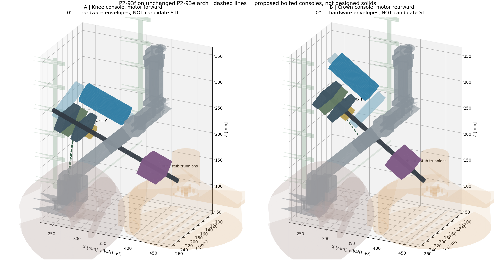
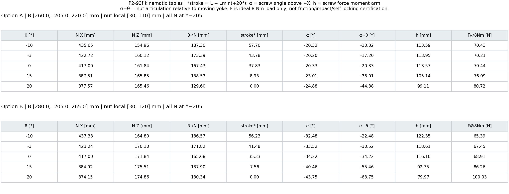
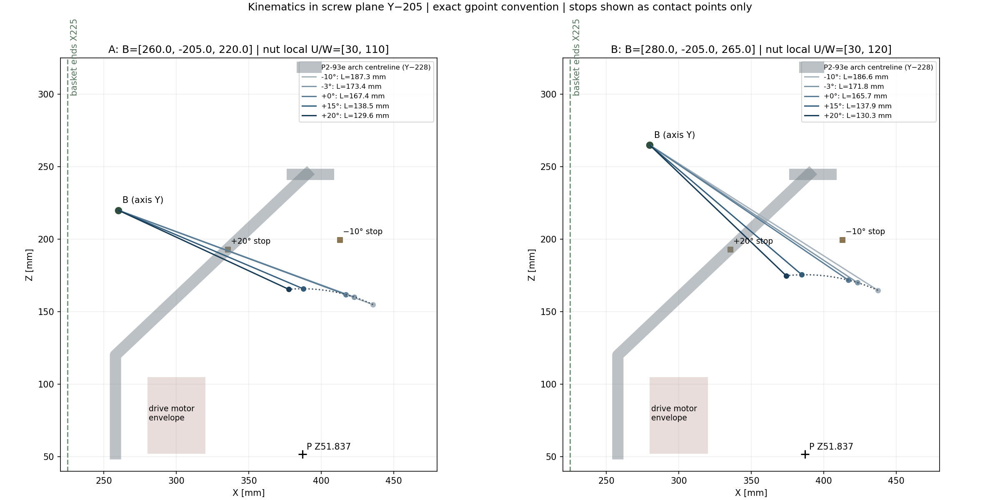

# P2-93f — ανάλυση tilt στην αμετάβλητη P2-93e

> Ιστορική ανάλυση P2-93f, αντιγράφηκε στο repo στο preflight P2-93g.
> Οι παρακάτω αναφορές «εκτός repo» περιγράφουν την αρχική παράδοση.
> Το thrust/bearing arrangement παραμένει ανοικτό· το P2-93g δεν απαιτεί
> αυτόματα χωριστό thrust bearing. Το ≥9 mm αφορά το arch post, όχι
> το AS5600: εκεί ισχύει ανοχή μέτρησης τροχού +2 mm, με provisional
> envelope 13,2 mm μέχρι τις μετρήσεις χρήστη. Καμία γεωμετρική έγκριση εδώ.

τι διαφέρει από το αναμενόμενο: δεν αρκεί να μεταφερθεί το παλιό carrier.
Το πραγματικό moving pivot βρίσκεται στο **P=[387,0,51,837364] mm**,
όχι Z55,84 του παλιού sensor datum. Το nut πρέπει να αρθρώνεται και η
βίδα να ελέγχεται στο **πλήρες σταθερό μήκος της**, όχι μόνο ως segment B→N.
Ένας συμπαγής διαμπερής Y-pin από το B ή το N θα διασταυρωνόταν με τον Tr8:
χρειάζονται δύο ομοαξονικά **stub-trunnions** που αφήνουν ελεύθερη την κεντρική δίοδο.

2026-11-05, HEAD9be0e03c. **Δεν άλλαξε geometry/SCAD/STL, manifest ή QA του
repo, δεν έγινε commit.** Όλα τα αρχεία της ανάλυσης είναι εκτός repo.
Δεν είναι candidate solids ή άδεια εκτύπωσης. Προτείνεται η **Α**.

Γκρι: ίδια P2-93e, πορτοκαλί ghost: υπάρχον moving concept, μπλε: FIT,
σκούρο: bearing boxes/Tr8, μωβ: nut+fork. Οι διακεκομμένες γραμμές είναι
**διαδρομές προς προτεινόμενες βάσεις**, όχι ελεγμένα printed solids.

## 1. Τεκμηρίωση διαφορών του baseline

- Η phase1 ορίζει `pivot_ground_target-4`, άρα
  `23−55 sin(−3°)+30 cos(−3°)−4=51,837363636`.
  Το ίδιο δίνει το μέσο Z των vertices στην κυκλική moving έδρα Y240:
  51,837363636. Το Z55,84 του `pivot_p293` διαφέρει κατά4,002636 mm.
- Το window/board centre του παλιού `as5600_pod` και του cover έχει επιπλέον
  local Z20: πραγματικό κέντρο **Z75,84**, δηλαδή **24,002636 mm** πάνω από
  τον άξονα. Το magnet-cap axis έχει το μικρότερο σφάλμα4,002636 mm.
- Το παλιό `magnet_cap` έχει διαμπερή Ø8,3 στην ίδια θέση με pocket Ø6,25:
  ο μεγαλύτερος διαμπερής κύλινδρος αφαιρεί όλο το μικρότερο pocket.
  Δεν υπάρχει έτσι κλειστή έδρα για Ø6 magnet. Απαιτείται πραγματικό blind
  shaft seat, χωριστό blind magnet pocket ή τεκμηριωμένο direct end-face mount.
- Το `current_robot()` δεν καλεί `pivot_supports()` της phase1. Το moving
  trunnion είναι μέσα στο moving concept, όχι πλήρες μοντελοποιημένο fixed
  bearing support. Η μελλοντική fixed encoder βάση δεν μπορεί να στηριχθεί
  σε ανύπαρκτο σώμα: αυτό πρέπει να σχεδιαστεί/προστεθεί στο επόμενο gate.
- Raw baseline: AS5600 cover×drive **2005,579 mm³**, παλιό FIT carrier×drive
  **1572,538 mm³**, FIT body×moving **71,512 mm³ στους+20°**, nut×F
  **92,192 mm³ στους−10°**, magnet cap contained μέσα στο moving
  **1601,397 mm³**. Δεν αφαιρείται κανένα από αυτά ως «declared interface».

## 2. Κοινή αρχιτεκτονική

Tr8 και nut στον ίδιο **Y−205**. B: fixed rocking pivot με άξοναY. N:
nut/fork virtual trunnion axisY, rigidly carried by a new yoke arm.
Και οι δύο αρθρώσεις χρησιμοποιούν opposed stub pins, όχι πείρο μέσα από
τη βίδα. Ο motor και **τα δύο radial screw bearings** βρίσκονται στο ίδιο
άκαμπτο rocking cradle. Το KFL08 δεν χρησιμοποιείται ως υποκατάστατο άρθρωσης.

Προτεινόμενη διάταξη bearing stations s=−15/+20 mm από B πάνω στον Tr8.
Ανεξάρτητο paired thrust stack γύρω στο s34, ως s40. Μία radial θέση
locating και η δεύτερη floating: όχι δύο αυθαίρετες axial δεσμεύσεις.
Η thrust αντίδραση περνά από μεταλλικούς ώμους/retainers προς το cradle,
όχι από γυμνό PETG ή από την υπόθεση ότι KFL08 είναι thrust bearing.

Για u=(N−B)/|N−B| και n=(−uz,0,ux), το belt-centre offset είναι
`d=C[(√11/6)n+(5/6)Y]`. Στο C60: **+50 mm Y και+33,166 mm n**.
Οι άξονες είναι παράλληλοι και οι τροχαλίες βρίσκονται στην **ίδια αξονική
στάθμη**, όχι απλώς60 mm μακριά σε κάτοψη. Slots συνολικής διαδρομής6 mm
κατά d/C δίνουν **C57…63**. Με20T/20T, GT2 pitch2, στο C60 το pitch
belt length είναι2C+40=**160 mm**. Δεν πιστώνεται «λάστιχο» για τάση.

Nominal hardware envelopes, όχι μετρημένες διαστάσεις χρήστη:
FIT Ø37 ×(17 gearbox+70 can), radial boxes32n×60Y×14u,
nut+fork32n×44Y×40u, GT2 guard R10 και axial width16,
thrust Ø26×12, rocking joint32n×56Y×16u. Περιλαμβάνεται επιπλέον10 mm
axial cable keepout στο πίσω άκρο του μοτέρ. Shaft projection15 mm είναι
προσωρινή παραδοχή, **όχι επιβεβαιωμένο χαρακτηριστικό FIT**.

Τα nut flange Ø22 / pattern16 προέρχονται από το σημερινό nominal CAD.
Αν πραγματικό spring/nut/fork ή pulley hub δεν χωρά στα παραπάνω envelopes,
η αντίστοιχη ανάλυση πρέπει να ξαναγίνει. Δεν μικραίνει hardware για να βγει PASS.

## 3. Επιλογή Α — console από foot/knee, motor body προς το nut

- **B=[260,−205,220] mm**. Νέο nut axis στο moving frame
  **[U30,Y−205,W110] mm**. Η μελλοντική κονσόλα πατά/κλειδώνει στις
  πραγματικές παρειές της foot/knee σύνδεσης και βιδώνεται στα υπάρχοντα
  διαμπερή M4 **X258/Z80 και114**, άξοναςY. Όχι αιωρούμενη μετατόπιση.
- Το αυξημένο bolt stack θα χρειαστεί αντίστοιχα μακρύτερα arch pin bolts,
  με ίδιο engagement· μήκος αφού σχεδιαστούν παρειές/ροδέλες, όχι υπόθεση.
- Motor face s−17, can προς **+u**. Screw/motor pulleys κοινό plane s−32,
  15 mm από motor face. Guard16 πλάτος: s−40…−24, 2 mm από radial box
  που αρχίζει στο s−22. Rear screw end s−45.
- B→N **187,30→129,60 mm**, stroke **57,70 mm**. Nut relative joint
  **−10,32…−44,88°**. Main pivot radius P→N=√(30²+110²)=**114,02 mm**.
- Ελάχιστο X του FIT body στο C60: **249,10 mm**. Δεν χρησιμοποιείται
  απλώς το κέντρο για το X>225· περιλαμβάνεται η ακτίνα του σώματος.
- Πλεονέκτημα: μικρότερη nut άρθρωση, ηπιότερη αξονική δύναμη, μεγάλο
  closed-length περιθώριο. Μειονέκτημα: ψηλή κονσόλα από το knee και μακρύτερη
  βίδα. Δεν έχει γίνει strength/deflection proof της καινούργιας κονσόλας.

## 4. Επιλογή Β — console από crown ports, folded motor προς τα πίσω

- **B=[280,−205,265] mm**. Nut local **[U30,Y−205,W120] mm**.
- Στήριξη σε δύο υπαρκτά crown/knee ports: περίπου
  **[350,1,−228,207,2] και[364,6,−228,220,9] mm**, άξοναςY.
  Νέα keyed console αναρτά το cradle προς τα πίσω/πάνω. Όχι νέα τρύπα
  στην αψίδα και όχι διαγώνιος μέσα στο ίδιο υλικό.
- Motor face s40, can προς **−u**. Κοινό pulley plane s55, guard s47…63.
  Αυτός ο hub χώρος είναι ο λόγος που η Β έχει μεγαλύτερο minimum stack,
  όχι αυθαίρετη τοποθέτηση τροχαλίας μέσα στο bearing. Rear screw end s−25.
- B→N **186,57→130,34 mm**, stroke **56,23 mm**. Nut relative joint
  **−22,48…−63,75°**. P→N=√(30²+120²)=**123,69 mm**.
- FIT body minimum X στο C60: **248,23 mm**, εκτός καλαθιού.
- Πλεονέκτημα: μικρότερη βίδα και folded motor, αλλά η console/crown
  σύνδεση είναι πιο απαιτητική και το clevis χρειάζεται ελεύθερη άρθρωση
  τουλάχιστον ως−64°. Ιδανική αξονική δύναμη στους+20°≈100 N, έναντι≈81 N
  στην Α για το ίδιο8 Nm. Δεν γίνεται αυτόματο strength credit από P2-93e.

## 5. Κινηματική — πέντε ζητούμενες γωνίες

CSV για επανέλεγχο: [Α](p293f-A-kinematics.csv), [Β](p293f-B-kinematics.csv).
`stroke=L−Lmin(+20°)`, α ως προς +X, α−θ η nut άρθρωση ως προς το yoke.
h=|r×u|, F=8000/h. Το F δεν περιλαμβάνει τριβή, κρούση ή belt pretension.

Η φορά gpoint είναι X=387+Ucosθ−Wsinθ,
Z=51,837364+Usinθ+Wcosθ. Τα νέα N είναι πιο ψηλά από το παλιό[50,90]
και λίγο πιο πίσω: το πλήρες Tr8 δεν κόβει τον τροχό όταν το nut πλησιάζει.

### Ελάχιστο μήκος άρθρωσης B→N

Αυτό δεν είναι το radius P→N του main yoke. Provisional stack budget:

- Α: fixed front40 + nut/fork half20 + gap5 + overrun10 = **75 mm**.
  Διαθέσιμο minimum129,60 → **54,60 mm** περιθώριο.
- Β: front pulley/hub έως63 +20+5+10 = **98 mm**.
  Διαθέσιμο minimum130,34 → **32,34 mm** περιθώριο.

Πρόκειται για **lower-bound σχεδιαστικό budget υπό τις ονομαστικές παραδοχές**,
όχι τελική απάντηση πριν μετρηθούν nut, spring, KFL08, thrust και shaft.
Η πραγματική απαίτηση είναι `Lmin≥s_fixed_front+nut_half+gap+overrun`.

Η βίδα δεν αλλάζει μήκος με τη γωνία: το tip είναι στο s=Lmax+20+10.
Άρα το συνολικό finished shaft envelope είναι **262,30 mm στην Α**
(Lmax+30+45), **241,57 mm στη Β** (Lmax+30+25). Δεν είναι drawing κοπής:
χρειάζονται πραγματικά Ø8 smooth bearing journals, shoulders/retainers και
έλεγχος hub set-screws, όχι περιστροφή τραπεζοειδούς σπειρώματος μέσα σε KFL08.
Δεν έχει πιστοποιηθεί backdriving/self-locking χωρίς lead/friction στοιχεία.

## 6. Stops σε πραγματικούς κόμβους — κοινά στις δύο επιλογές

Νέοι θετικά βιδωμένοι yoke strikers local **[U0,Y±205,W150]**.
Καμία αντίδραση hard-stop μέσω screw/nut. Σημεία επαφής:

- −10°: **[413,05,±205,199,56] mm**. Fixed stop console από τις
  υπάρχουσες crown through-M4 στο X390/Z239 και251, με θετική έδραση
  στις crown faces. Όχι έδραση πάνω σε κενό ή μέσα στην τραβέρσα.
- +20°: **[335,70,±205,192,79] mm**. Fixed console από τα δύο crown-arm
  ports περίπου X350,1/Z207,2 και364,6/Z220,9.
- Contact faces κάθετες στην εφαπτομένη της διαδρομής, όχι αυθαίρετες
  οριζόντιες πλάκες. Για radius150, one-side8 Nm →53,33 N ιδανική stop
  reaction, χωρίς δυναμικό/impact factor. Χρειάζονται αντικαταστάσιμα pads,
  θετικός ώμος και ανεξάρτητα limit sensors πριν το hard-stop.

Οι stop consoles, οι νέοι strikers και ο moving nut arm **δεν είναι ακόμη
solids**, δεν έχουν περάσει collision/strength QA. Η αψίδα διαθέτει τα
ports, αλλά αυτό δεν αποδεικνύει ότι ολόκληρη η σύνδεση έχει λυθεί.
Και στις δύο επιλογές ο nut arm βιδώνεται σε πραγματικά yoke lands με
through-M4. Τα σημερινά moving yoke concepts δεν έχουν αυτά τα bolt lands:
θα χρειαστεί συγκεκριμένη αλλαγή interface στο επόμενο εγκεκριμένο βήμα.

## 7. Τι ακριβώς ελέγχθηκε, χωρίς εξαιρέσεις

[Αναπαραγώγιμος υπολογισμός](p293f-analysis.py), [raw αποτελέσματα](p293f-results.json).
31 γωνίες −10…+20 ανά1°, C60 και επανέλεγχος motor/belt/cable σεC57/C63.
Το moving mesh μετασχηματίζεται άκαμπτα γύρω από τον πραγματικό P.
Δεν αφαιρούνται mating/interface volumes από κανένα σώμα.
Όριο αναφοράς τομής: **0,0001 mm³**, ίδιο με το baseline scene gate.

Και στις δύο επιλογές **0 external raw envelope intersections** για motor,
δύο radial bearings, thrust, screw πλήρους σταθερού μήκους, nut/fork44 mm,
GT2 capsule16 mm, cradle joint και cable keepout απέναντι σε:
moving concept, drive envelope, actual basket, F concept και τα υπάρχοντα
arch bodies που απαριθμούνται στο JSON. Έτσι η παλιά nut×F τομή δεν
επαναλαμβάνεται για τα προτεινόμενα nut envelopes, ούτε motor×moving.

Το capsule είναι convex hull δύο guard cylinders R10 στο ίδιο pulley plane,
όχι αφαίρεση των corners από QA. Το αρχικό corner box έδινε ψευδές keepout
hit της Α με το καλάθι· ορίζεται και ελέγχεται πλέον η προτεινόμενη capsule
guard μορφή. Δεν είναι άδεια για ορθογώνιο guard που θα παραβίαζε το basket.

**Δεν είναι πλήρες scene_check ούτε συνεχής απόδειξη sweep.** Δεν έχουν
σχεδιαστεί και ελεγχθεί printed consoles, cradle plates, yoke arm και stop
brackets, hardware fasteners, installation paths, cable bend radius ή encoder
support. Τα envelopes πρέπει να περιέχουν τις πραγματικές αγορασμένες
διαστάσεις. Το repository full-scene baseline παραμένει86 collisions+3
contained. Το `scene_check.py`/`scadtree.py` δεν άλλαξε και δεν δηλώνεται PASS.

## 8. AS5600 / magnet — ανοικτό interface, όχι κρυμμένο «surrogate»

Το παλιό cap δεν εξαιρείται από το moving mesh ως declared mating. Η
πραγματική προτεινόμενη λύση πρέπει να έχει exposed metal end/stub με
σωστή φορά και σαφή end-face contact, όχι cap μέσα σε solid trunnion.
Το PCB centre πρέπει να είναι στο **Z51,837364**, όχι75,84.

Εξετάστηκε thin outboard end-face package **28X×13,2Y×28Z**, centred X387,
Z51,837364, Y240,3…253,5. Planning stack: blind shaft3 + web0,8 + magnet2,5,
sensor gap1,5 + board assembly3 + cover1,5 + assembly/tolerance reserve0,9 =13,2 mm.
Το envelope έχει **0 raw τομές με drive/moving** στις πέντε γωνίες,
αλλά μόνο **2 mm** από tyre inner faceY255,5.

**Αν το όριο≥9 mm της P2-93e ισχύει και στον αισθητήρα, αυτή η λύση ΔΕΝ
συμμορφώνεται και παραμένει ανοικτή.** Με housing endY240, το διαθέσιμο
πακέτο για9 mm είναι μόλις6,5 mm. Δεν μπορεί να χωρέσει το παραπάνω13,2 mm
stack. Δεν αλλάζει το drive envelope για να «χωρέσει».
Τα6,5 mm είναι all-in από το housing faceY240, μαζί με running clearances·
με την εξεταζόμενη αρχήY240,3 απομένουν μόνο6,2 mm ωςY246,5.

Δύο κατευθύνσεις προς διερεύνηση μετά την έγκριση: μετρημένο flat PCB και
direct end-face magnet χωρίς το παλιό cap, εφόσον συνολικό stack≤6,5 mm·
ή remote1:1 encoder με πραγματική μεταφορά κίνησης και χωριστό QA. Καμία
δεν δηλώνεται τώρα λυμένη ή ελεγμένη. Η fixed βάση απαιτεί επίσης να
προστεθεί το πραγματικό main-pivot support που λείπει από τη σημερινή σκηνή.

## 9. Ποια tilt STL θα αλλάξουν αν εγκριθεί η αρχιτεκτονική

Και στις δύο επιλογές όλα τα επτά παλιά tilt solids χρειάζονται νέα έκδοση:

- `tilt_fit0186_carrier.stl`: rocking motor plate, slots57–63 και σύνδεση
  με κοινό bearing cradle. Δεν γίνεται μόνο μετατόπιση του παλιού carrier.
- `tilt_kfl08_base.stl`: κοινή κινούμενη bearing support με locating/floating
  και thrust load path, σωστή ευθυγράμμιση στον Tr8 Y−205.
- `tilt_nut_carriage.stl`: πραγματικό nut cartridge με opposed stub-trunnions,
  anti-rotation και clevis που αρθρώνεται ως προς το moving yoke.
- `tilt_stop.stl`: αντικαθίσταται από διαφορετικά lower/upper node-mounted
  stop modules και τους αντίστοιχους moving strikers, όχι αιωρούμενο ίδιο STL.
- `tilt_as5600_pod.stl`, `tilt_as5600_cover.stl`, `tilt_magnet_cap.stl`:
  νέα concentric fixed/rotating interface. Το cap μπορεί να καταργηθεί στην
  direct end-face λύση, αν επαληθευτεί αντί να τοποθετηθεί μέσα στο surrogate.

Νέα interfaces/prints: arch bolted console, cradle trunnion retainers,
nut/yoke clevis arm, node stop anchors, L/R strikers, fixed encoder bracket
και πραγματικό pivot-support interface. Η ονοματολογία/τελικός αριθμός
parts θα κλειδώσουν με τον σχεδιασμό, όχι ως υποτιθέμενα έτοιμα STL εδώ.
Τα8 p293d arch STL και το printed chassis **δεν αλλάζουν στην πρόταση**.
Πριν φέρον print απαιτούνται full exact-solid gate, holes/assembly/access
checks, strength της console/arch load path και τυπωμένα coupons.

## Πρόταση και όριο έγκρισης

Προτείνεται **Α για περαιτέρω CAD ανάπτυξη**, επειδή έχει περίπου45° αντί64°
nut articulation,54,6 αντί32,3 mm closed-length reserve και≈81 αντί100 N
ιδανική μέγιστη αξονική δύναμη. Η μεγάλη knee console παραμένει ουσιαστικό
strength/printability ερώτημα, όχι έτοιμη υποστήριξη.

Η έγκριση αφορά topology/σταθμούς B,N, όχι release STL. Το AS5600 παραμένει
ρητά ανοικτό για το≥9 mm κριτήριο. **ΠΑΥΣΗ για έγκριση. Καμία αλλαγή CAD,
κανένα commit/push.**
