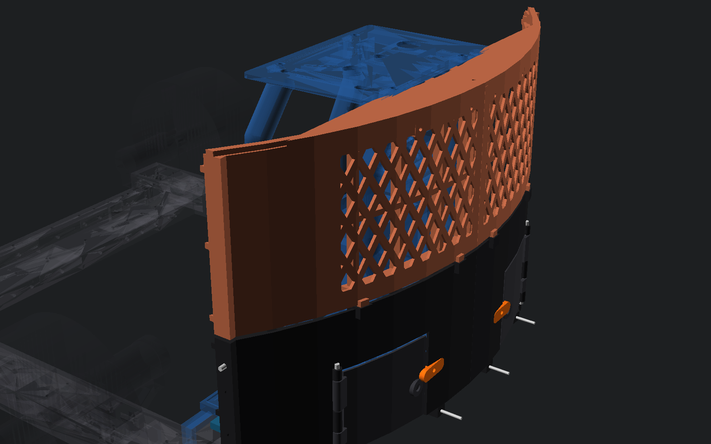
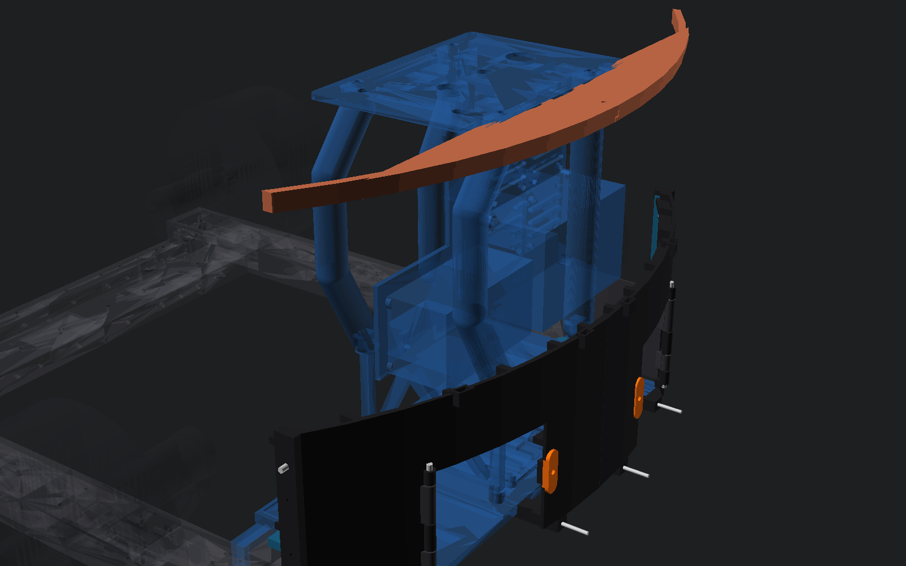

# P2-86 — πίσω panels F για rear pod v2

> **ΔΕΝ ΤΥΠΩΝΕΤΑΙ ΑΚΟΜΑ.** Είναι release-ready CAD/STL, αλλά η φυσική
> κατασκευή περιμένει P2-87 και basket mockup/pile-retention test.

Πηγές: `../body-panels-f-rear-v2.scad`, `../body-panels-f.scad` και
`../body-panels-f-support.scad`. Export: `../export-f-rear-stls.sh`.
Exact-solid suite: `../qa-p286-rear-f.sh`.

## Τι διαφέρει από το αναμενόμενο

Το P2-84 ήταν οπτικά σωστό αλλά όχι φέρον: το deck είχε ένα μικρό tab/M3 ανά
μισό, το `rear_hi` κρεμόταν από άλλα panels, το `rear_lo` είχε ελεύθερη πάνω
ακμή, το land `Y164` άφηνε περίπου 1,2 mm τοίχωμα, δεν υπήρχε splice στο
`Y=0` και οι πόρτες δεν είχαν κλείστρο.

Στο P2-86 το τόξο συνεχίζεται μέχρι τη ραφή των μελλοντικών πλαϊνών
`Y±244,5` (R60 corner του F). Κάθε `rear_lo` πατά σε δύο 12 mm base lands
και σε δύο M4 ενός corner stay. Κάθε `rear_hi` έχει δύο ανεξάρτητες M3 προς
τη συνεχή φέρουσα πίσω δοκό του control panel. Κάθε deck half είναι L-section
4+12 mm και δένει με δύο δικές του M3 στην ίδια δοκό (4 συνολικά, πάνω από
το ελάχιστο 3). Υπάρχουν κρυφά center laps με through M3 και 0,3 mm seam.

Τα corner stays χρησιμοποιούν την υπάρχουσα top M4 και την ορθογώνια side
M4 του rear corner clamp· δεν ανοίγεται τρύπα στο σασί. Η εξωτερική στήλη
τους δίνει δύο M4 στα rear panels. Οι πόρτες έχουν τυπωμένο περιστροφικό
turn-button, χωρίς αγοραζόμενο μαγνήτη. Όλα τα φέροντα fasteners είναι
captured/through, ποτέ self-tap ή insert.

## Κομμάτια

| STL | Ποσότητα | Μέγιστο print footprint | Ρόλος |
|---|---:|---:|---|
| `rear_lo_left/right.stl` | 1+1 | ≤250×153 mm | collar, Parkside frame, ribs, base/corner interfaces |
| `rear_hi_left/right.stl` | 1+1 | ≤250×153 mm | removable grille, ribs, 2× structural panel ties |
| `deck_rear_left/right.stl` | 1+1 | ≤250×86 mm | 4 mm deck, 12 mm total L-section depth, center under-lap |
| `parkside_door_left/right.stl` | 1+1 | 98×80 mm | hinged drawer closures |
| `corner_stay_left/right.stl` | 1+1 | 163×83 mm | existing-clamp M4 → two panel M4 load path |
| `door_turn_button.stl` | 2 prints | 34×12 mm | printed latch, rotate 90° before opening |

Όλα τα STL είναι manifold και ακριβώς ένα σώμα. PETG: 4–5 perimeters,
5 top/bottom layers και 35–45% gyroid στα stays/lands. Δεν απαιτούνται
supports στη δοσμένη orientation. Επιβεβαίωσε τα μήκη στο πραγματικό
stack-up πριν από αγορά.

## Βίδες

- Rear skin → base: 4×M3×45 περίπου, ροδέλα + captive M3 nut.
- Corner stays → υπάρχον corner clamp: ανά πλευρά 1×M4 top και 1×M4 side,
  μακρύτερες κατά το πραγματικό stack-up, ροδέλες/nyloc· 0,2 mm shim πάνω.
- Rear-lo corners → stays: 4×M4×20, ροδέλες/nyloc.
- Rear-hi → control-panel beam: 4×M3×35 περίπου, ροδέλες/nyloc.
- Deck → control-panel beam: 4×M3×30 περίπου, ροδέλες/nyloc.
- Center laps: 5×M3×12 (2 rear_lo, 2 rear_hi, 1 deck), ροδέλες/nyloc.
- Door hinges: 2×M4 rod/bolt περίπου 105 mm, ροδέλες/nyloc.
- Turn buttons: 2×M4×16, ροδέλα και nyloc με ελεύθερη περιστροφή.

## Συναρμολόγηση / service

1. Βίδωσε τα corner stays στις δύο κοινές M4 του corner clamp.
2. Βίδωσε `rear_lo` στις βάσεις, στα stays και στα center laps.
3. Πέρασε τις πόρτες/άξονες και τα turn-buttons. Για συρτάρι: turn-button
   90°, πόρτα 110°, μετά καθαρή εξαγωγή προς −X.
4. Βίδωσε `rear_hi` στη δοκό του control panel και στο center lap.
5. Βίδωσε τα deck halves στη δεύτερη σειρά της δοκού και στο deck lap.

Το `rear_hi` αφαιρείται χωρίς λύσιμο pod, deck ή άλλου panel και αποκαλύπτει
Mega/perfboard. Η εξωτερική πρόσβαση σε όλες τις κεφαλές παραμένει ανοικτή.

## Αντοχή και χρήση

Συντηρητικό PETG `E=1,8 GPa`, effective width 20 mm:

- Deck L-section, `h=12 mm`, `L=40 mm`, 100 N στο χείλος:
  `σ≈8,3 MPa`, `δ≈0,42 mm`. Δύο κοντινές M3 παίρνουν έως 50 N η καθεμία,
  bearing περίπου `3,3 MPa` σε 5 mm land.
- Rear skins, ribbed effective section `h=12 mm`, span 120 mm, 50 N:
  `σ≈2,5 MPa`, `δ≈0,28 mm` (<2 mm).
- Corner-stay worst shared 50 N ανά πλευρά: M4 shear <4 MPa και printed
  bearing <4,2 MPa. Οι τιμές είναι κάτω από 10 MPa in-layer και 5 MPa
  across-layer. Τα 2 g/.5 g skin inertia loads είναι μικρότερα από τα
  παραπάνω hand loads.

**ΜΗΝ ΣΗΚΩΝΕΙΣ ΑΠΟ DECK/SKINS.** Για μεταφορά πιάσε με δύο χέρια τις
μεταλλικές διαμήκεις ράγες δίπλα στις πίσω γωνίες ή την πίσω μεταλλική
τραβέρσα, αφού απομονωθεί η τροφοδοσία. Δεν προστέθηκε cosmetic handle που
θα μπορούσε να παρερμηνευτεί ως φέρον.

## QA / P2-87 interface

Exact-solid empty/PASS: F↔pod ≥3 mm εκτός δηλωμένων interfaces, πλήρες
frame/corner clamps, τροχοί/FIT0403, moving sweep −10…+20°, fixed/open
drawer sweep με screw heads, ground `<Z17` CAD (=≥15 mm με το σασί 2 mm
χαμηλότερα), controls/Ugreen/carrier/posts και base↔Parkside. Τα center
halves έχουν μόνο μηδενικού όγκου mating contact· δεν έχουν solid overlap.

Η P2-87 ραφή είναι η κατακόρυφη land στο `Y±244,5`, γύρω από `X−230`, με
δύο through M3 ανά πλευρά (`Z112/152`) και κοινή στήριξη από το corner stay.
Τα πλαϊνά δεν σχεδιάζονται πριν από το basket mockup.
