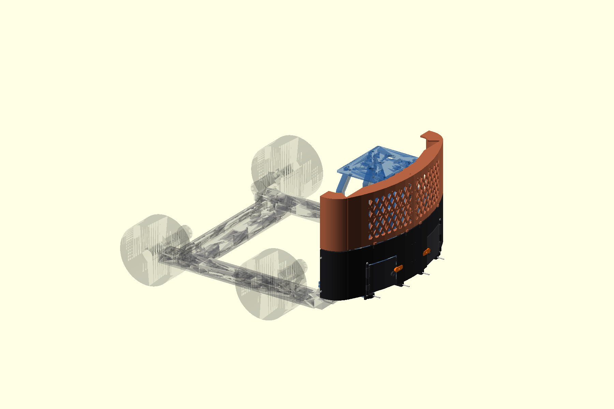
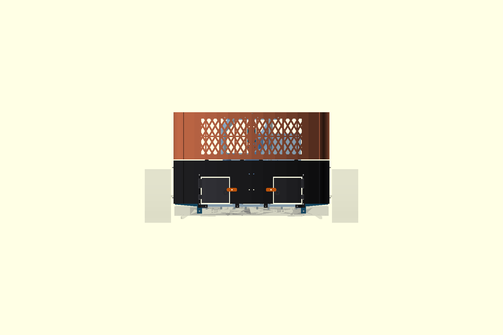

# P2-86b — πίσω panels F για rear pod v2

> **ΔΕΝ ΤΥΠΩΝΕΤΑΙ ΑΚΟΜΑ.** Είναι release-ready CAD/STL, αλλά η φυσική
> κατασκευή περιμένει basket mockup/pile-retention test.

Το F είναι το μοναδικό ενεργό body concept. Αυτός ο κατάλογος περιέχει μόνο
το exact rear subset· τα side/front F παραμένουν concept μέχρι το P2-71
basket mockup. Για τα current P2-93 renders δες `../README.md`.

Πηγές: `../body-panels-f-rear-v2.scad`, `../body-panels-f.scad` και
`../body-panels-f-support.scad`. Export: `../export-f-rear-stls.sh`.
Exact-solid suite: `../qa-p286-rear-f.sh`.

## Τι διαφέρει από το αναμενόμενο

Το P2-84 ήταν οπτικά σωστό αλλά όχι φέρον: το deck είχε ένα μικρό tab/M3 ανά
μισό, το `rear_hi` κρεμόταν από άλλα panels, το `rear_lo` είχε ελεύθερη πάνω
ακμή, το land `Y164` άφηνε περίπου 1,2 mm τοίχωμα, δεν υπήρχε splice στο
`Y=0` και οι πόρτες δεν είχαν κλείστρο.

Στο P2-86b το `R424,5` τελειώνει εφαπτομενικά σε πραγματικό `R60` και μετά
σε ευθεία `Y±244,5`; η ραφή μετακινήθηκε μετά το fillet στο `X−185`.
Κάθε `rear_lo` πατά σε δύο 12 mm base lands
και σε δύο M4 ενός corner stay. Κάθε `rear_hi` έχει δύο ανεξάρτητες M3 προς
τη συνεχή φέρουσα πίσω δοκό του control panel. Κάθε deck half είναι L-section
με 4 mm skin και 12 mm συνολικό βάθος και δένει με δύο δικές του M3 στην
ίδια δοκό (4 συνολικά, πάνω από το ελάχιστο 3). Τα rear skins έχουν 0,3 mm
seam και δύο ανεξάρτητες εσωτερικές splice plates με through M3.

Ο έλεγχος P2-86b απέδειξε ότι τα παλιά stay axes `Y±177,5` ήταν σε συμπαγές
υλικό. Τα corner stays χρησιμοποιούν πλέον το πραγματικό υπάρχον ζεύγος
rear-crossbar `X−165/Y±165`: top countersunk M4 και transverse M4 στο
`Z37`. Η transverse μοιράζεται με το διορθωμένο corner tie (tie εμπρός,
stay πίσω, μία μακρύτερη βίδα). Δύο 12 mm διαγώνιοι chords τριγωνίζουν την
εξωτερική στήλη. Δεν ανοίγεται τρύπα στο σασί. Οι πόρτες έχουν περιστροφικό
turn-button, χωρίς αγοραζόμενο μαγνήτη. Όλα τα φέροντα fasteners είναι
captured/through, ποτέ self-tap ή insert.

## Κομμάτια

| STL | Ποσότητα | Μέγιστο print footprint | Ρόλος |
|---|---:|---:|---|
| `rear_lo_left/right.stl` | 1+1 | 247×153 mm | collar, Parkside frame, ribs, base/corner interfaces |
| `rear_hi_left/right.stl` | 1+1 | 247×153 mm | removable grille, ribs, 2× structural panel ties |
| `deck_rear_left/right.stl` | 1+1 | ≤185×185 mm | 4 mm deck, 12 mm total L-section depth, flat 45° print orientation |
| `parkside_door_left/right.stl` | 1+1 | 98×80 mm | hinged drawer closures |
| `corner_stay_left/right.stl` | 1+1 | 165×56 mm | rear-crossbar top+side M4 → two panel M4 load path |
| `center_splice_lo.stl` | 1 | 76×26 mm | εσωτερική γέφυρα rear_lo, 4× through-M3 |
| `center_splice_hi.stl` | 1 | 81×26 mm | αφαιρούμενη εσωτερική γέφυρα rear_hi, 4× through-M3 |
| `door_turn_button.stl` | 2 prints | 34×12 mm | printed latch, rotate 90° before opening |

Όλα τα STL είναι manifold και ακριβώς ένα σώμα. PETG: 4–5 perimeters,
5 top/bottom layers και 35–45% gyroid στα stays/lands. Δεν απαιτούνται
supports στη δοσμένη orientation. Επιβεβαίωσε τα μήκη στο πραγματικό
stack-up πριν από αγορά.

## Βίδες

- Rear skin → base: 4×M3×45 περίπου, ροδέλα + captive M3 nut.
- Corner stay → rear crossbar ανά πλευρά: 1×M4 countersunk top στο
  `X−165/Y±165`, flush `Z57,5`, με low locknut συνολικής προβολής ≤4,9 mm·
  1×μακρύτερη transverse M4 στο `Y±165/Z37` κοινή με tie/crossbar/stay.
- Rear-lo corners → stays: 4×M4×20, ροδέλες/nyloc.
- Rear-hi → control-panel beam: 4×M3×35 περίπου, ροδέλες/nyloc.
- Deck → control-panel beam: 4×M3×30 περίπου, ροδέλες/nyloc.
- Center splices: 8×M3×16 περίπου (4 rear_lo, 4 rear_hi), ροδέλες/nyloc.
- Deck center under-lap: 1×M3×12, ροδέλα/nyloc.
- Door hinges: 2×M4 rod/bolt περίπου 105 mm, ροδέλες/nyloc.
- Turn buttons: 2×M4×16, ροδέλα και nyloc με ελεύθερη περιστροφή.

## Συναρμολόγηση / service

1. Τοποθέτησε tie εμπρός και stay πίσω από την τραβέρσα. Πέρασε την κοινή
   transverse M4 `Y±165/Z37`, μετά τη flush top M4.
2. Βίδωσε `rear_lo` στις βάσεις και στα stays, μετά το
   `center_splice_lo` από μέσα με 4×M3.
3. Πέρασε τις πόρτες/άξονες και τα turn-buttons. Για συρτάρι: turn-button
   90°, πόρτα 110°, μετά καθαρή εξαγωγή προς −X.
4. Βίδωσε `rear_hi` στη δοκό του control panel και το αφαιρούμενο
   `center_splice_hi` από μέσα με 4×M3.
5. Βίδωσε τα deck halves στη δεύτερη σειρά της δοκού και στο deck lap.

Το `rear_hi` αφαιρείται χωρίς λύσιμο pod, deck ή άλλου panel: λύνονται οι
δικές του δομικές βίδες και η δική του splice και αποκαλύπτεται το
Mega/perfboard. Η εξωτερική πρόσβαση σε όλες τις κεφαλές παραμένει ανοικτή.

## Αντοχή και χρήση

Συντηρητικό PETG `E=1,8 GPa`, effective width 20 mm:

- Deck L-section, `h=12 mm`, `L=40 mm`, 100 N στο χείλος:
  `σ≈8,3 MPa`, `δ≈0,42 mm`. Δύο κοντινές M3 παίρνουν έως 50 N η καθεμία,
  bearing περίπου `3,3 MPa` σε 5 mm land.
- Rear skins, ribbed effective section `h=12 mm`, span 120 mm, 50 N:
  `σ≈2,5 MPa`, `δ≈0,28 mm` (<2 mm).
- P2-86b stay: τα δύο 12 mm chords δουλεύουν ως truss. Για 50 N στο μέσο
  skin και για συντηρητικά 100 N που μεταφέρονται από το deck στον άνω
  corner node, chord area ≥`12×16=192 mm²`: axial ≤`0,52 MPa`. Με
  εκκεντρότητα 10 mm, local bending ≤`1,95 MPa`; torsion 1,2 N·m με
  `J≈1,29×10⁴ mm⁴` δίνει ≤`1,4 MPa`. Συνδυασμένο in-layer <`4 MPa`.
  Worst M4 printed bearing `100/(4×12)=2,1 MPa` across-layer. Περιθώριο
  υπάρχει ως τα όρια 10/5 MPa.

**ΜΗΝ ΣΗΚΩΝΕΙΣ ΑΠΟ DECK/SKINS/ΡΑΓΕΣ.** Οι ράγες είναι PETG. Η πρόταση
μελλοντικής λαβής είναι load-spreader στις τέσσερις υπάρχουσες top M4
`X−165/Y±75,±125`: για 10 kg και 2 g, 196 N συνολικά ή 49,1 N/βίδα,
M4 shear ≈3,9 MPa και bearing 6,5 mm PETG ≈1,9 MPa. Δεν σχεδιάστηκε νέο
κομμάτι· απαιτείται packaging και proof-load 200 N.

## QA / P2-87 interface

Exact-solid empty/PASS: F↔pod ≥3 mm εκτός δηλωμένων interfaces, πλήρες
frame/corner clamps, τροχοί/FIT0403, moving sweep −10…+20°, fixed/open
drawer sweep με screw heads, ground `<Z17` CAD (=≥15 mm με το σασί 2 mm
χαμηλότερα), controls/Ugreen/carrier/posts και base↔Parkside. Τα center
halves έχουν 0,3 mm seam. Οι ανεξάρτητες εσωτερικές splice plates
εφάπτονται στα ενισχυμένα lands και αποφεύγουν το παλιό 252 mm print span.

Η P2-87 ραφή είναι μετά το εφαπτόμενο R60, στο `X−185/Y±244,5`, με δύο
through M3 ανά πλευρά (`Z112/152`) και κοινή στήριξη από το corner stay.
Ο πλήρης χάρτης βρίσκεται στο
`docs/design/body-panels/p286b-perimeter-map-el.md`. Τα πλαϊνά δεν
σχεδιάζονται πριν από το basket mockup.
