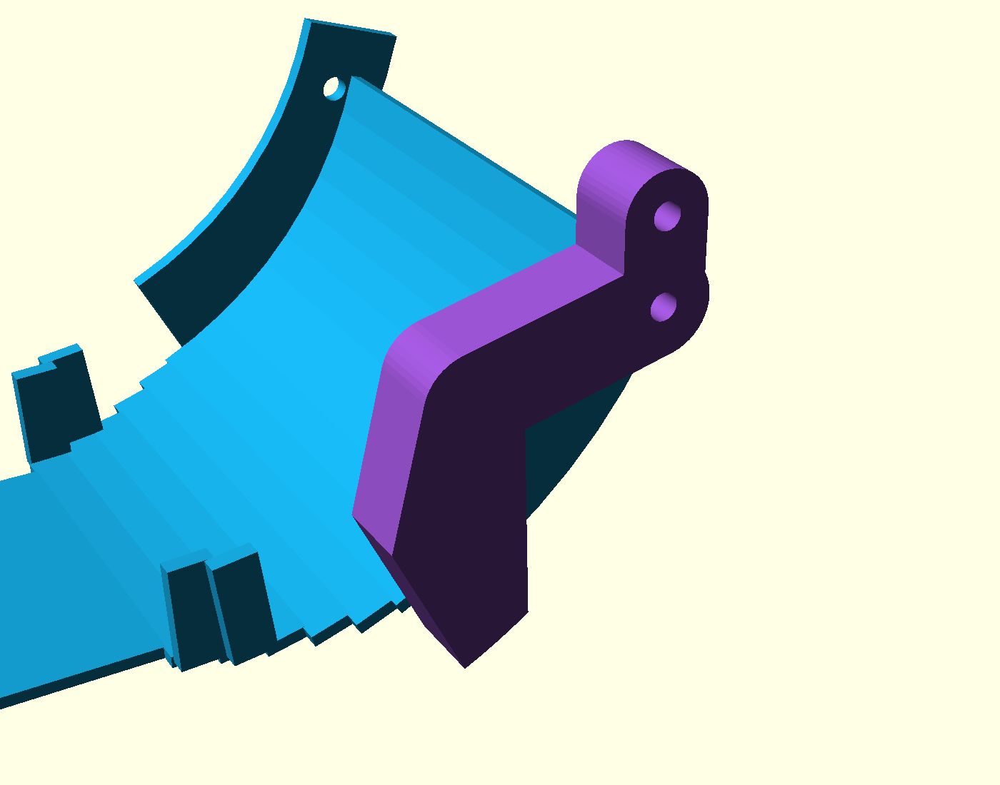

# P2-85 — βιδωτός βατήρας R75/75° με διχάλα τοιχώματος

> **2026-10-20 P2-85 (αντικαθιστά P2-73 brackets και retrofit spacers):** το
> P2-73 `x300-ski-bracket` έσπασε στην τοποθέτηση. Η σχισμή του έβγαινε ανοιχτή
> πάνω από το web και άφηνε δύο «δόντια» 2,75×6 mm, τυπωμένα με στρώσεις
> κάθετα στο φορτίο. Επιπλέον ο βατήρας κρεμόταν από μία M4 ανά πλευρά και
> μόνο η τριβή τον εμπόδιζε να περιστραφεί. Τώρα: κλειστή σχισμή, web 8 mm,
> εκτύπωση στο πλάι, και μία **διχάλα** ανά πλευρά. Η διχάλα αγκαλιάζει τις
> δύο ακμές του τοιχώματος του βατήρα στο τόξο t26…35° και κλειδώνει στο
> bracket με δεύτερη βίδα στην ίδια σχισμή. Ο **ήδη τυπωμένος βατήρας χωρίς
> bosses δουλεύει όπως είναι, χωρίς τρύπημα**.
> Αναφορά: `docs/mechanism/p285-ski-bracket-el.md`.

## Κομμάτια (ενεργά)

| STL | Τεμ. | Σημείωση |
| --- | --- | --- |
| `r75-75-ski.stl` | 1 | Exact-solid ίσο με το frozen `p267_ski(75)`, **χωρίς bosses** (= ο ήδη τυπωμένος). Οπή Ø4,5 στο X315. Μην τον ξανατυπώσεις αν τον έχεις ήδη. |
| `x300-ski-bracket-left.stl` | 1 | Νέο P2-85. Κλειστή σχισμή Ø4,5 μήκους 34 + 4,5 mm. |
| `x300-ski-bracket-right.stl` | 1 | Κατοπτρικό. |
| `p285-ski-wall-fork-left.stl` | 1 | Διχάλα: hub στη βίδα X315, χείλη στις ακμές του τοιχώματος, hex pocket για τη βίδα κλειδώματος. |
| `p285-ski-wall-fork-right.stl` | 1 | Κατοπτρικό. |

**Καταργήθηκε:** `ski-boss-spacer.stl`. Τον ρόλο του έχει πλέον το hub της
διχάλας (Y50…60,7) και το superseded STL αφαιρέθηκε από το release.

Τα κενά στα πλαϊνά τοιχώματα, στο flat και στα τμήματα τόξου 3–5, είναι
σκόπιμα (D200/throat sweep). Μην τα γεμίσεις.

## Εκτύπωση P2S / PETG — όλα χωρίς supports

- **Brackets:** όπως είναι στο STL, δηλαδή **ξαπλωμένα στην επίπεδη εσωτερική
  παρειά του web (Y61)**. Το πέλμα και οι νευρώσεις στέκονται κατακόρυφα.
  Έτσι οι στρώσεις είναι παράλληλες στο επίπεδο του web, και τα φορτία της
  σχισμής (X/Z) πέφτουν μέσα στις στρώσεις. Οι οπές του πέλματος βγαίνουν
  οριζόντιες, Ø4,5, και γεφυρώνονται χωρίς support.
- **Διχάλες:** όπως είναι στο STL, με την εξωτερική παρειά (Y60,7) στο bed.
  Χείλη, αυλάκι τοιχώματος και hex pocket είναι από επάνω.
- **Βατήρας** (μόνο αν χρειαστεί νέος): το tangent underside στο bed, με
  supports **μόνο από το bed** κάτω από το απότομο τόξο.
- Ρυθμίσεις: layer 0,20 mm, **5 perimeters**, 5 top/bottom, 40% gyroid στα
  brackets και στις διχάλες. Απόρριψε το κομμάτι αν έχει delamination στη
  σχισμή.
- Bounding boxes: bracket 44,25×64,6×49 mm, διχάλα 52,3×72,3×12,7 mm.

## Βίδες (ανά ακμή: ×2 για όλο το σετ, εκτός αν σημειώνεται)

- 4× **M4×35** για το πέλμα στο X300 grid (`Y=±75`, `Y=±100`), με ροδέλες και
  nyloc από κάτω. Αμετάβλητο από το P2-73.
- 2× **M4×30 χαμηλής/στρογγυλής κεφαλής** (ISO 7380 ή DIN 7984) στο X315.
  Η κεφαλή μπαίνει μέσα στον βατήρα. Η σειρά είναι: τοίχωμα 3 mm, hub
  διχάλας, σχισμή bracket 8 mm, ροδέλα Ø12 και nyloc έξω.
- 2× **M4×30 εξάγωνης κεφαλής DIN 933** για το κλείδωμα της διχάλας. Η κεφαλή
  κάθεται στο hex pocket της διχάλας, 14 mm πάνω από το X315. Μετά περνά τη
  σχισμή bracket και κλείνει έξω με ροδέλα Ø12 και nyloc.
- Ροπή M4 σε PETG: **≈1,5 N·m**. Έλεγξε ξανά μετά από 24 ώρες, γιατί το
  PETG κάνει creep.

## Συναρμολόγηση

1. Βίδωσε **χαλαρά** τα δύο brackets στο X300 grid.
2. Ρίξε μια M4×30 DIN 933 στο hex pocket κάθε διχάλας.
3. Πίεσε κάθε διχάλα στην εξωτερική παρειά του τοιχώματος. Το τοίχωμα
   μπαίνει στο αυλάκι και τα δύο χείλη πιάνουν τις ακμές του στο κάτω
   τόξο. Το hub ευθυγραμμίζεται με την οπή X315.
4. Κατέβασε τον βατήρα μαζί με τις διχάλες ανάμεσα στα brackets. Ανά
   πλευρά υπάρχει 0,3 mm κενό, και τα χαλαρά brackets ανοίγουν ±0,25 mm.
   Πέρασε τις βίδες κλειδώματος από τις σχισμές.
5. Βάλε τις M4×30 χαμηλής κεφαλής **από μέσα**: τοίχωμα, hub, σχισμή.
6. Και οι δύο βίδες πάνε στο **κάτω άκρο** της ρύθμισης (ονομαστικό ύψος):
   η X315 στο κάτω άκρο της σχισμής και η βίδα κλειδώματος 14 mm πάνω της.
   Σφίξε πρώτα τις X315, μετά τις βίδες κλειδώματος, μετά τα τέσσερα X300
   bolts. Επανέλεγξε μετά τις πρώτες 20 χειροκίνητες βολές.

## Κρίσιμη ρύθμιση ύψους (αμετάβλητη από P2-73)

Ονομαστική θέση: το κάτω άκρο της σχισμής. Το CAD datum είναι FIT0403 με τον
άξονα επάνω. Έλεγχος: η κάτω πλευρά του επίπεδου τμήματος πρέπει να απέχει
**9–10 mm από το πάτωμα**. Αν χρειαστεί αλλαγή ύψους, η μονάδα flywheel και ο
βατήρας με τις διχάλες ανεβαίνουν **μαζί 1:1**, έως +20 mm. Οι δύο βίδες
κινούνται μαζί στη σχισμή.

Πριν από κίνηση ή βολή επιβεβαίωσε χειροκίνητα, χωρίς τροφοδοσία, ότι:

- τα rails Y±55 κινούνται ελεύθερα στις +15/+20°,
- η μονάδα περνά −10…+20° (οι οδηγοί throat περνούν 1,5 mm από τα χείλη),
- η fail-closed θύρα κλείνει πλήρως,
- κανένα καλώδιο δεν περνά από τις σχισμές ή κάτω από τον βατήρα.

Πηγή CAD: `../shared-flywheel-p273-bolted-ski.scad`. Export με έλεγχο ενός
σώματος: `../export-ski-mount-stls.sh`. Exact-solid QA: `../p285-qa.sh`.
Έλεγχος αντοχής: `../p285-ski-bracket-loads.py`.
