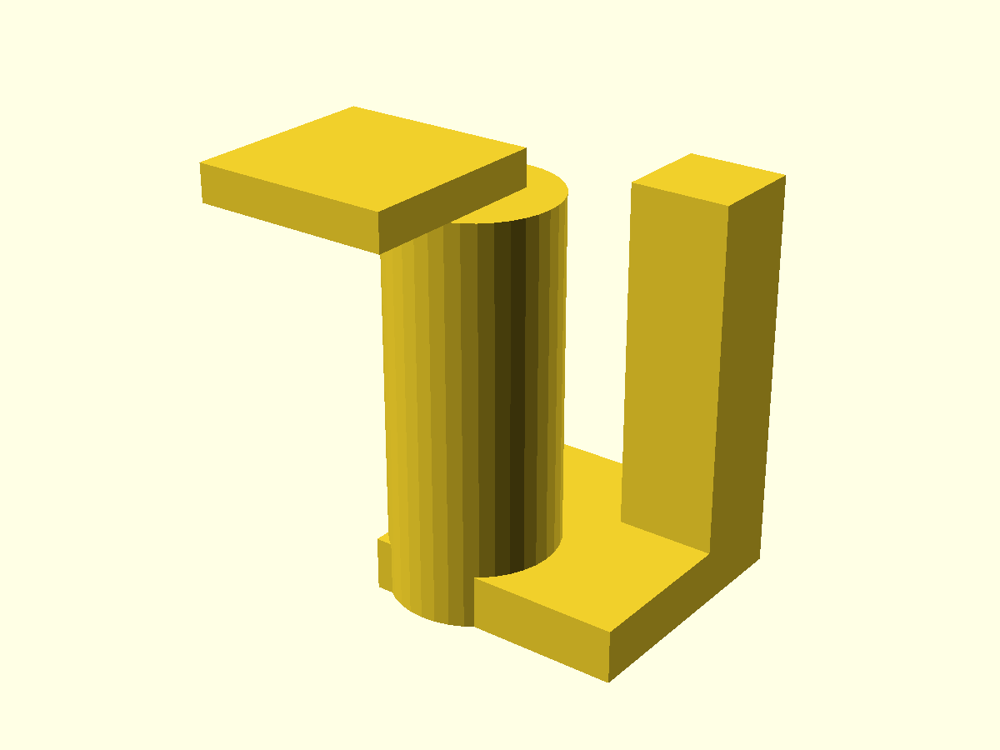
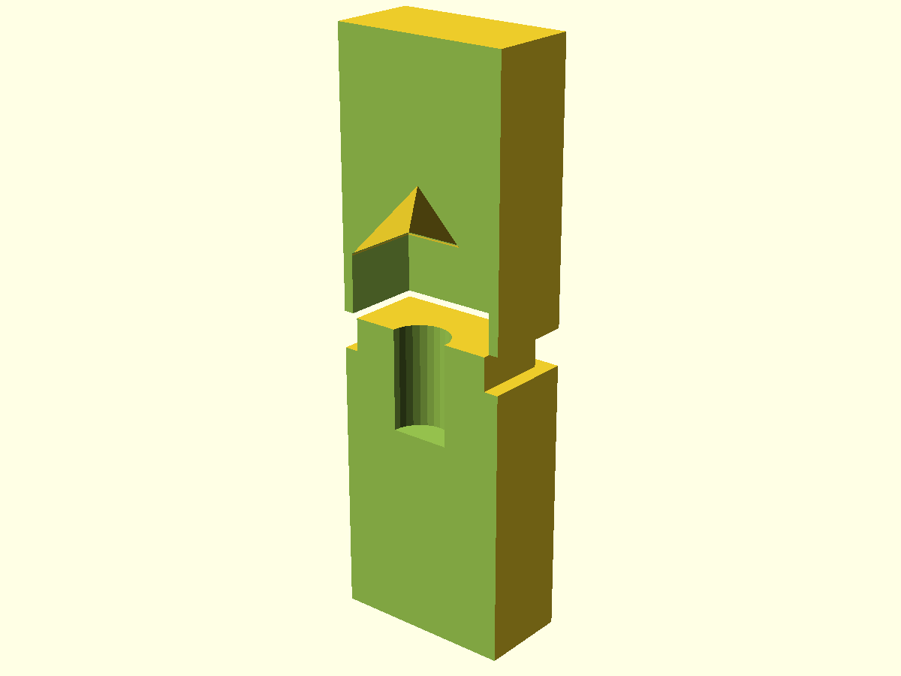

# P2-97 Phase 1 — FIT-CHECK stackable electronics tower

Status: **FIT-CHECK, do not print the power box yet.**  All parts are support-free in
the exported orientation and fit a 250 x 250 mm bed.  The common nominal box
footprint is 138 x 190 mm; small keyed/seam details keep every exported mesh
below 143 x 195 mm.

The BTS height measurement is still open.  Measure from the PCB underside to
the highest point of the fitted heatsink and export with
`P297_BTS_HEIGHT_MM=<measured mm>`.  The export script now stops before writing
any STL if that value is absent, zero or non-numeric.

The power and logic floors use a plain through-M3 mounting grid: Ø3.4 mm
holes on a 20 mm pitch, carried by 8 mm orthogonal ribs.  This is not
Gridfinity and has no bins, baseplates, magnets or proprietary pitch.  The
measured BTS positions and the removable Mega/perfboard/Pi carriers remain.

## What differs from the expected rod tower

The four continuous M5 rods were not selected.  Each floor is a separately
removable open-rear box.  Four 10 x 10 x 2.2 mm keys at every seam take shear;
four M3 screws provide clamp load into Ruthex RX-M3x5.7 inserts in the box
below.  The screws are reached from inside the box above, so the chassis/base
joint and all lower seams stay assembled during floor service.

The old 300 mm-high thin-post load path is also gone.  Lateral load goes from
the existing control panel into the collar, the X-braced side/front walls, the
keyed seams and the adapter rails, then through the existing P2-90d base holes.
No chassis hole is added.

## Installed stack and access

Installed datums are measured from ground/chassis coordinates:

- base adapter: Z64..72, seated on the existing P2-90d locating bosses;
- empty Phase-1 energy spacer: Z72.25..142.25 (rear open; no provisional drawers);
- power box: Z142.50..212.50, four measured 50 x 50 BTS7960 boards on measured
  40 x 40 patterns, plus adjustable fuse/DC-DC lands.  The BTS PCB underside
  is Z153.70 and the envelope top is `Z153.70 + measured BTS height`;
- logic box: Z212.75..294.75, three rear-removable horizontal trays at Z+10/+36/+62;
- collar: Z295.00..319.00;
- existing control-panel top: Z323; E-stop mushroom top: approximately Z344.

Mega and Pi USB extension leads rise in the continuous rear cable channel and
exit through the existing 24 x 8 panel slot.  The panel keeps its four existing
Ø8.6 locating holes; M4 washers/nylocs clamp it to the collar.

Mounting patterns used by the FIT-CHECK carriers:

- Mega 2560 in the user's measured 60 x 110 acrylic case: upper pair 50 mm,
  lower/middle pair 37 mm, as recorded in `motion-electronics-tray/params.scad`;
- user's 80 x 120 perfboard: measured 75 x 115 mm hole centres, represented by
  8 mm cross-slots because the source measurement was made with a ruler;
- Raspberry Pi 5 bare PCB: official 58 x 49 mm pattern, M2.5 fasteners;
- BTS7960/HW-039: measured 40 x 40 mm pattern on 50 x 50 boards.

The BTS centres are X=±30, Y=±40 mm.  The positive-Y pair has its terminal
edge toward +Y; the negative-Y pair is rotated 180° toward −Y.  This leaves
26.8 mm between each 50 mm board edge and the inner wall face, exceeding the
25 mm screwdriver/1.5 mm² cable requirement.  Signal headers face the 30 mm
central aisle and then the open −X rear/cable channel.  Four framed 52 mm-wide
side-lattice windows align with the terminal edges for motor-cable exit; their
upper edge is generated from the measured BTS height plus 5 mm.

If the Pi 5 is to remain in its metal/M.2 case, measure that case's mounting
holes before printing; the official bare-PCB holes are not assumed to pass
through the case.

## Corner section and support-free undersides

Each seam now uses a full-height 12 x 12 mm solid corner column centred at
X=±44, Y=±82 mm.  Its complete footprint stays inside the 138 x 190 mm outline
and overlaps the solid perimeter node below.  The Ø4.0 insert pocket is
centred: the column leaves 4.0 mm radial material and the narrower 10 mm shear
key still leaves 3.0 mm, both above the required 2 mm.  The pocket is 6.7 mm
deep and is surrounded by uninterrupted column material for its full depth.
The female key bay retains a 3.95 mm straight relief region, then closes with a
45° pyramidal roof instead of an unsupported horizontal ceiling.

Before: the old 6 mm post, insert boss and shear key used separate axes, and
the post exceeded the nominal outline.

After: section through two assembled corner nodes; the lower centred insert
bay and upper 45° female-key roof are visible.

All formerly flat elevated undersides were changed to 45° V/chamfered forms:
the wall rails, BTS service-window rails, six logic tray rails, collar lands
and key-pocket roofs.  `check-stl-downward-faces.py` groups connected
coplanar downward triangles and rejects any elevated patch over 40 mm².  In
the test export the worst patches are 12.00 mm² on the logic box and 9.43 mm²
on the power box; every one of the eight STL files passes.

For the user's 0.6 mm nozzle profile, the assumed extrusion width is 0.62 mm.
The X braces have a 4.10 x 3.20 mm minimum section, corresponding to 6.61 and
5.16 extrusion widths respectively—at least five paths in the thinner axis,
well above the required two.  At 0.30 mm layers the 45° chamfers advance only
0.30 mm per layer, less than one 0.62 mm extrusion width.

## PETG and print-time planning estimate

The repository has no configured slicer profile, so these are geometry-based
planning numbers, not G-code times.  They use watertight STL volume, PETG at
1.27 g/cm³, and retain a conservative effective 32 g/h floor plus a small
per-part allowance.  The user's 0.6 mm nozzle / 0.30 mm layer profile should
not be slower, but the actual slicer remains the acceptance source.

| STL | PETG | Estimated time |
| --- | ---: | ---: |
| `p297_base_adapter.stl` | 80 g | 2.6 h |
| `p297_energy_spacer.stl` | 116 g | 3.8 h |
| `p297_power_box.stl` | 176 g | 5.6 h |
| `p297_logic_box.stl` | 219 g | 7.0 h |
| `p297_collar.stl` | 62 g | 2.1 h |
| `p297_mega_carrier.stl` | 30 g | 1.1 h |
| `p297_perf_carrier.stl` | 43 g | 1.5 h |
| `p297_pi5_carrier.stl` | 23 g | 0.8 h |
| **Phase 1 total** | **about 750 g** | **about 24.4 h** |

The values above are rounded targets; regenerate the table from final meshes
if geometry changes.  No individual estimate exceeds 8 h.

## 50 N stiffness comparison

This is a conservative first-order truss estimate, not FEA.  It uses printed
PETG E=1.2 GPa, the 4.1 x 3.2 mm diagonal section, axial X-brace stiffness
`2EA/L * (b/L)^2`, and adds explicit allowances for panel bending, adapter/
collar bending and joint slip.

| Load-path term at 50 N | Bolted keyed boxes | Four M5 rods + same lattice |
| --- | ---: | ---: |
| lattice shear, floors in series | 0.32 mm | 0.32 mm |
| panel + collar + base adapter | 0.62 mm | 0.62 mm |
| four seams / clamp slip allowance | 0.24 mm | 0.12 mm |
| **estimated E-stop displacement** | **1.18 mm** | **1.06 mm** |

Both clear the 1.5 mm requirement.  The box system is selected because the
~0.12 mm stiffness penalty is small and the service split is much better.
Four M5 steel rods would be cut to about **285 mm** (259 mm clamp stack plus
washers/nuts and adjustment), weighing about 176 g before hardware.  Sixteen
M3 screws/inserts plus printed seam keys/bosses are about 43 g.  The rod variant
would save roughly 0.7 h and 22 g of printed seam material, but finishes about
108 g heavier overall and requires disturbing the whole stack to remove a
middle floor.

The support-free corner and rail revision remains below the 25 h Phase-1
planning target, and no individual part exceeds 8 h.  These values use a
20 mm BTS height only as a geometry-test fixture; regenerate the power-box
row after the real BTS height is supplied.

## Hardware — Phase 1

- 16 x Ruthex RX-M3x5.7 heat-set inserts (four per seam);
- 16 x M3x10 socket-head screws and M3 washers;
- 4 x existing-base M4x20 screws, washers and nylocs for the adapter;
- 4 x M4x20 screws, broad washers and nylocs for the existing panel holes;
- 16 x M3 board screws plus 16 x 20 mm spacers for the four BTS7960 boards;
- 4 x M3 screws/spacers for the measured Mega acrylic case;
- 4 x M3 screws/spacers for the user's perfboard cross-slots;
- 4 x M2.5 screws, washers and 6 mm spacers for a bare Raspberry Pi 5;
- 2 x short panel-mount USB extensions (Mega and Pi), length selected after
  the real cable route is checked;
- fuse/DC-DC fasteners remain FIT-CHECK slots until those two bodies are
  measured.

## Retired P2-90d/P2-90 assets

The Phase-1 current scene no longer uses `side_frame.stl`, `panel_posts.stl`,
`vertical_electronics_plate.stl`, `pi_shelf.stl`, `parkside_dock_left/right.stl`,
`parkside_drawer_left/right.stl`, `ugreen_post_holder.stl`,
`ugreen_clamp_caps.stl`, or `ugreen_rear_retainer.stl`.  The existing
`base_left.stl`, `base_right.stl`, `corner_tie.stl`, and `control_panel.stl`
remain active/reused.

Phase 2 begins only after measuring the real Parkside batteries/contact docks;
the empty energy spacer is intentionally not a guessed drawer system.
