> **P2-90d / 2026-10-23:** τα cups του P2-90c ήταν σωστά, αλλά ο αρχικός
> λαιμός του web από κάτω παρέμενε μόνο 8×8 mm και έφθανε περίπου 45 MPa.
> Κάθε cup συνδέεται πλέον συνεχώς στο αντίστοιχο πόδι με tapered solid
> spine 36×24 mm. Στο πίσω πόδι μένει διαμπερές lateral wrench slot 18 mm
> και στο εμπρός η Ø7 tool chimney· δεν άλλαξε καμία οπή ή παγωμένο part.
> Το `side_frame.stl` εξάγεται τώρα **όρθιο**, πάνω στα δύο πλατιά πέλματα,
> με brim και χωρίς χωρισμό σε δεύτερο part. **Μόνο το side frame
> επανεξήχθη.**
>
> **P2-90c / 2026-10-23:** τα ενδιάμεσα external forks του P2-90b ήταν
> συναρμολογήσιμα αλλά υπερβολικά λεπτά: περίπου 35–40 MPa στη ρίζα και
> φόρτιση κάθετα στις στρώσεις όταν το frame τυπώνεται ξαπλωμένο. Το νέο
> `side_frame.stl` έχει ανοικτά ποτήρια με 0,3 mm ακτινικό clearance,
> 8 mm τοίχωμα στο επίπεδο της M4 και πλατιά washer/nut lands. Δέχεται
> ολόκληρο το ήδη τυπωμένο κάτω άκρο του post και κρατά ακριβώς τον παλιό
> άξονα `Z154`. Σύνδεση: 4×M4×60, ροδέλες και nyloc. **Μόνο το side frame
> επανεξήχθη· bases, panel_posts, control_panel και UGREEN clamps δεν άλλαξαν.**
>
> **P2-90b / 2026-10-23 (ιστορικό, τα post forks αντικαταστάθηκαν από
> P2-90c):** τα κλειστά P2-90 collars με σχισμή 7 mm δεν
> μπορούσαν να περάσουν πλάγια πάνω από Ø23 post ούτε να συρθούν πάνω στον
> λυγισμένο +Y post. Αντικαταστάθηκαν από πίσω ημικύκλιο ενσωματωμένο στη
> θήκη και δύο ξεχωριστά εφαπτομενικά caps, 2×M3/Ruthex ανά post. Τα caps
> μπαίνουν από την εξωτερική πλευρά χωρίς λύσιμο panel/posts. Ο καθολικός
> installation-path gate αποκάλυψε επίσης ότι το παλιό side-frame centre rib
> δεν μπορούσε να μπει στην τυφλή clevis του τυπωμένου post και είχε οπή M4
> στον λάθος άξονα. Η ενδιάμεση έκδοση χρησιμοποίησε εξωτερικά forks με
> την ίδια, ήδη τυπωμένη M4 θέση στον X. **Οι τυπωμένες βάσεις, panel_posts
> και control_panel δεν άλλαξαν ούτε επανεξήχθησαν.**
>
> **P2-90 / 2026-10-23:** η πραγματική συσκευή μετρήθηκε **115×45×45 mm**.
> Η ενδιάμεση διεύρυνση 46,8 mm δεν λύνει τη συναρμολόγηση: οι ήδη τυπωμένοι
> +Y posts αφήνουν περίπου 93 mm και εμποδίζουν εισαγωγή του μήκους 115 mm.
> Η τελική θήκη μετακινεί το UGREEN στον κεντρικό διάδρομο, με θύρες προς −X
> και κουμπί προς +Y, και το εισάγει από πίσω με αφαιρεμένο μόνο το `rear_hi`.
> **Δεν άλλαξαν ούτε επανεξήχθησαν οι τυπωμένες βάσεις, posts ή control panel.**
> Τύπωσε `ugreen_post_holder.stl`, `ugreen_clamp_caps.stl` (print plate δύο
> caps) και `ugreen_rear_retainer.stl` από το παρόν
> release· μην τυπώσεις την ενδιάμεση έκδοση +6 mm.

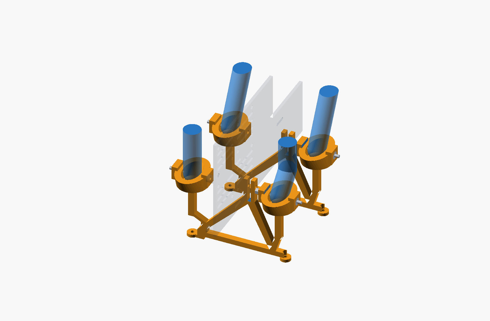

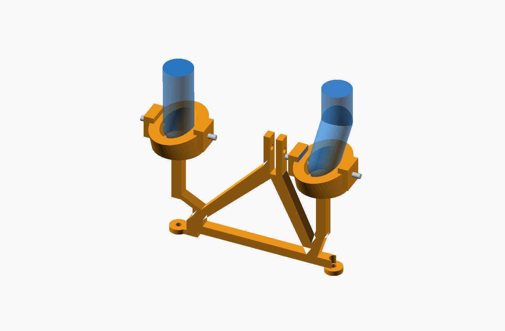

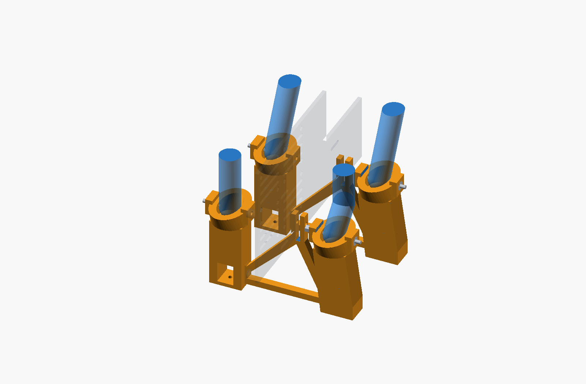

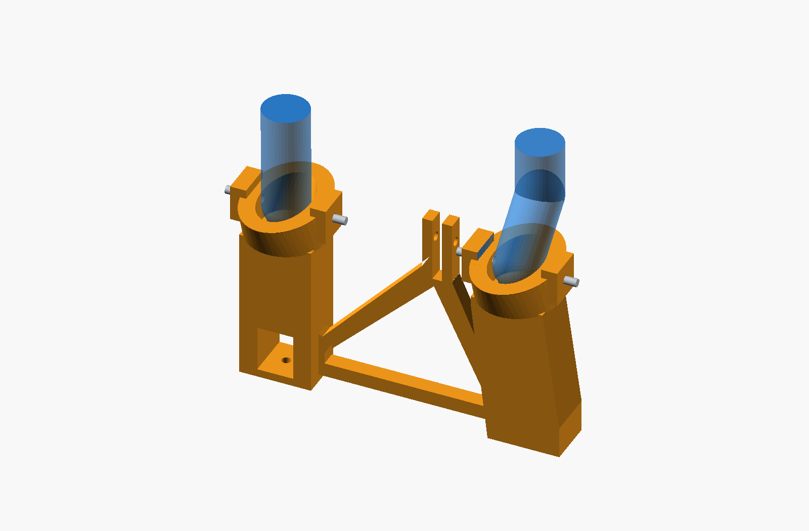

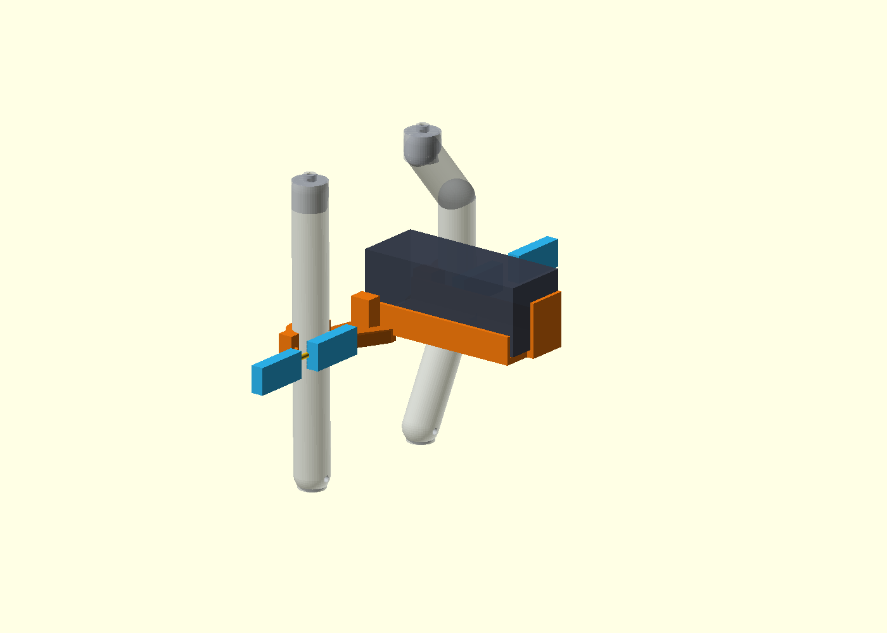

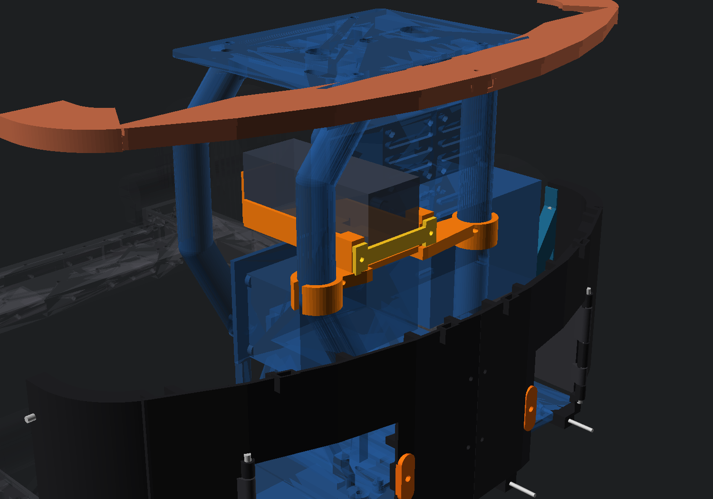

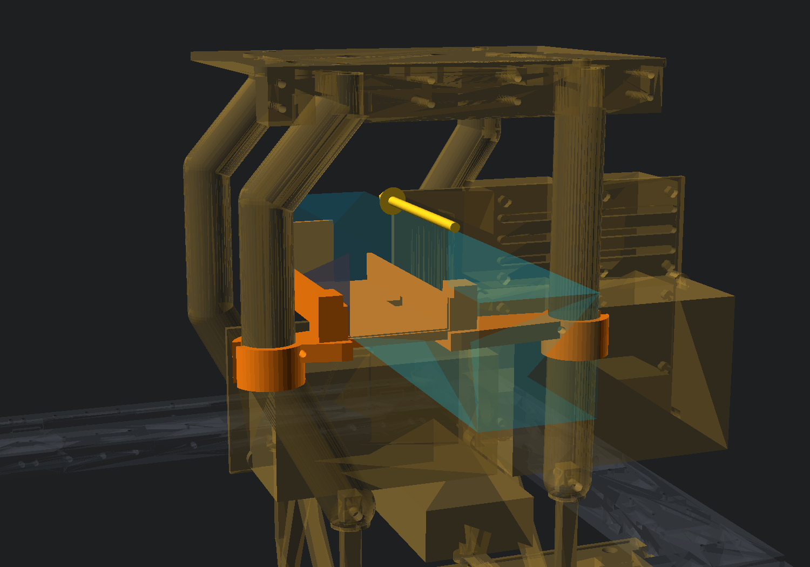

# τι διαφέρει από το αναμενόμενο — P2-88 συναρμολογήσιμο side frame και power docks

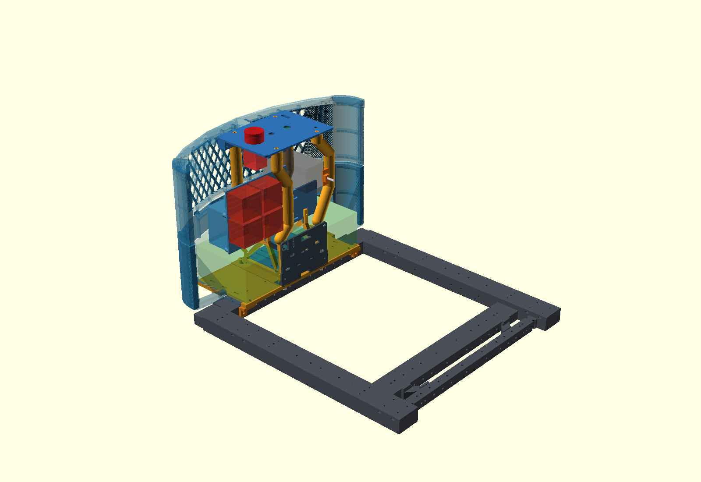

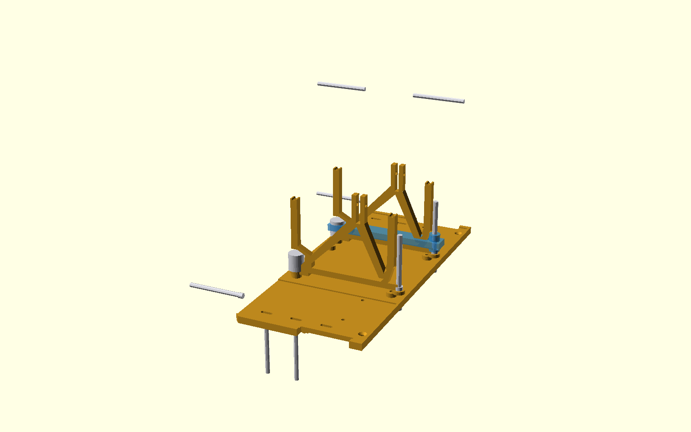

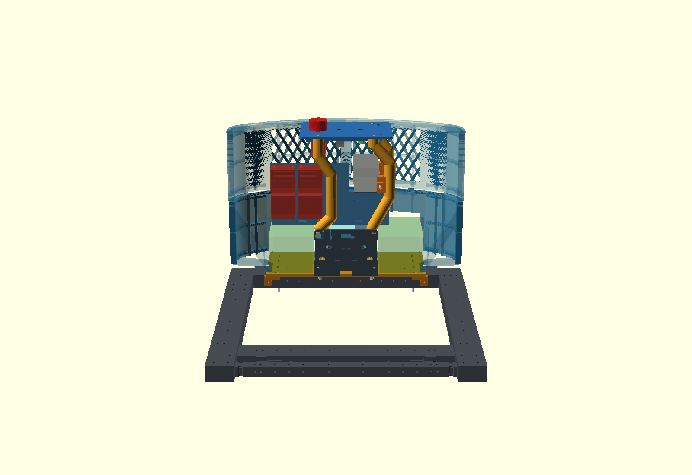

Οι `base_left/right` είναι ήδη τυπωμένες P2-86b και **δεν άλλαξαν ούτε
επανεξήχθησαν**. Τα παλιά `side_frame.stl` P2-79/P2-88/P2-90b
καταργούνται: οι δύο
κατακόρυφες M4 του δεν μπορούσαν να συναρμολογηθούν. Το P2-88 κρατά ακριβώς
τη δοκιμασμένη σιαγόνα 4,8 mm, γλωττίδα 4 mm, jaw M4 και τα cross-bolts των
posts, αλλά αλλάζει μόνο τα κάτω πόδια:

- πίσω M4 στην υπάρχουσα οπή `X−256,5/Y±54`, βίδα από κάτω, επίπεδη
  `rear_foot_wedge_washer.stl`, ροδέλα/nyloc στο ανοικτό επάνω pocket,
- εμπρός M4 στη νέα θέση `X−132/Y±54`, έξω από την τραβέρσα, κεφαλή από
  πάνω και ροδέλα/nyloc από κάτω,
- η νέα Ø4,5 οπή της ήδη τυπωμένης βάσης ανοίγεται **μόνο** με
  `side_frame_base_drill_jig.stl`, το οποίο εντοπίζεται από τις δύο παλιές
  οπές με δύο προσωρινές M4. Αφαιρείται η βάση από το σασί πριν το τρύπημα.

Βίδες side frames: 2×M4×25 εμπρός και 2×M4×35 πίσω, με μεγάλες ροδέλες και
nyloc· οι τέσσερις post cups χρησιμοποιούν 4×M4×60 με ροδέλες/nyloc.
Επιβεβαίωση μήκους στο πραγματικό stack-up. Δεν υπάρχει M4 insert.

### Αντοχή πλήρους διαδρομής φορτίου P2-90c/P2-90d

Δυσμενής χειροκίνητος έλεγχος, χωρίς να πιστώνεται κατανομή στα τέσσερα
posts: ολόκληρα 20 N σε έναν post με βραχίονα 200 mm δίνουν 4.000 Nmm.
Με ενεργό ύψος cup 15,3 mm, η bearing force είναι 261,4 N. Σε δύο τοιχώματα
8×4 mm η τάση bearing είναι **4,09 MPa**. Η συντηρητική ροπή αντίστασης δύο
τοιχωμάτων 8×19,5 mm είναι 1.014 mm³, άρα **3,94 MPa** στη ρίζα. Και οι δύο
τιμές είναι κάτω από το αυστηρό όριο **5 MPa κάθετα στις στρώσεις**· σε
πραγματική κατανομή σε ≥2 posts πέφτουν τουλάχιστον στο μισό. Η M4 σε διπλή
διάτμηση βλέπει 14,9 MPa στο ίδιο δυσμενές σενάριο. Τα 30 N κατακόρυφα σε
έναν post δίνουν 1,71 MPa στη M4 και 0,47 MPa bearing. Τα φορτία 2 g της
μάζας ~1 kg (19,6 N) και 0,5 g (4,9 N) είναι μικρότερα.

Ο πλήρης δυσμενής έλεγχος ενός post συνεχίζει μέχρι τη βάση. Για printed
PETG χρησιμοποιείται `E⊥=1.200 MPa`, επειδή το νέο όρθιο print φορτίζει το Z
κάθετα στις στρώσεις:

- printed post Ø23, μήκος 193 mm: `Z=1.194 mm³`, 3,23 MPa και 2,91 mm
  μετατόπιση αν πάρει μόνο του ολόκληρα τα 20 N,
- cup: 4,09 MPa bearing και 3,94 MPa root bending από τον P2-90c έλεγχο,
- rear spine στη μικρότερη διατομή γύρω από το 18 mm wrench slot:
  `Z=1.728 mm³`, 3,28 MPa για 5.660 Nmm· το front spine με Ø7 chimney είναι
  ισχυρότερο,
- foot/base: με ενεργό μοχλοβραχίονα 12 mm, single-post bolt tension 472 N.
  M4 tension 53,7 MPa και bearing κάτω από μεγάλη ροδέλα OD14 είναι
  3,42 MPa. Στη διεύθυνση X το ζεύγος ποδιών απέχει 124,5 mm και απαιτεί
  μόνο 45,5 N couple force.

Άρα το συντηρητικό *ένα post* περνά τις τάσεις αλλά μετακινείται περίπου
3,64 mm και δεν αποτελεί τη λειτουργική διάταξη. Με το πραγματικό άκαμπτα
δεμένο panel + 4 posts + δύο side frames + carrier, το γραμμικό upper bound
διαιρεί το φορτίο στα τέσσερα: **0,91 mm** σε 20 N τόσο κατά X όσο και κατά
Y. Στα 30 N κατακόρυφα η στήριξη συμπιέζεται <0,01 mm και η τοπική κάμψη
panel μένει στο όριο P2-81 ≤0,3 mm. Τα 2 g της ψηλής μάζας ~1 kg είναι
19,6 N και το 0,5 g 4,9 N, άρα καλύπτονται από τα παραπάνω cases.

Όλες οι printed τάσεις είναι ≤3,94 MPa στη ρίζα/στρώση και ≤4,09 MPa
τοπικό bearing, κάτω από 5 MPa κάθετα και 10 MPa μέσα στη στρώση. Οι τέσσερις
base M4 χρειάζονται ροδέλες OD14 και nyloc. Ο αναλυτικός έλεγχος προϋποθέτει
σφιγμένο panel/carrier· ένα μεμονωμένο post δεν πρέπει να χρησιμοποιείται ως
λαβή ή proof test.

## Parkside X20V — provisional, ΔΕΝ ΤΥΠΩΝΕΤΑΙ πριν από μέτρηση

Τα `parkside_dock_left/right.stl` και `parkside_drawer_left/right.stl`
είναι παραμετρικό packaging prototype μέσα στο reservation 141×91×81. Κάθε
dock χρησιμοποιεί τις υπάρχουσες base slots `X−245` και `X−210`, με άξονα
`Y±146,5` για επίπεδη έδραση έξω από τη νεύρωση. Δύο M3×12 από κάτω
βιδώνουν σε Ruthex RX-M3x5.7. Μία rear-access M3 κλειδώνει θετικά το drawer·
οι οδηγοί και το +X stop παίρνουν τα φορτία. Το ηλεκτρικό carrier έχει δύο
M3 slots και έξοδο καλωδίου προς τον εσωτερικό καλωδιοδιάδρομο.

Για μπαταρία 0,65 kg: 2 g κατακόρυφα = 12,8 N, 0,5 g = 3,2 N. Worst
single-M3 nominal shear ≈1,8 MPa και bearing σε 10 mm PETG ≈0,43 MPa. Πριν
από εκτύπωση μετρώνται πραγματικά: L/W/H, ράγες/κωνικότητα, release tabs και
διαδρομή, επαφές/contact module, bend radius καλωδίου και κέντρο μάζας.

## UGREEN 115×45×45 — P2-90/P2-90b

Το `ugreen_post_holder.stl` είναι μονοκόμματη σέλα με ένα πίσω ημικύκλιο
ανά πίσω Ø23 post. Το `ugreen_clamp_caps.stl` περιέχει δύο ανεξάρτητα
εφαπτομενικά caps. Κάθε cap μπαίνει από την εξωτερική πλευρά σε σταθερό X,
χωρίς να περάσει πάνω από καμπύλη post ή electronics, και κλείνει με δύο
M3 σε Ruthex RX-M3x5.7. Οι άξονες M3 είναι στα ±15 mm από το post centre,
άρα δεν διαπερνούν τον Ø23 στύλο. Η συσκευή εγκαθίσταται κατά X στο
`[-266,5…−151,5]`, `Y11,5…56,5`, `Z235,5…280,5`: θύρες προς −X, πλαϊνό
κουμπί προς +Y. Η φυσική συσκευή έχει 4 mm από το ψηλότερο rear-electronics
envelope και τουλάχιστον 3 mm από τα υπόλοιπα μη επιτρεπόμενα solids.

Service χωρίς λύσιμο του pod: (1) αφαιρείς μόνο το `rear_hi`, (2) λύνεις τις
δύο M3 του `ugreen_rear_retainer.stl`, (3) αποσυνδέεις τα καλώδια από την
ανοικτή πίσω έδρα και (4) σύρεις τη συσκευή ευθεία προς −X. Η αντίστροφη
διαδρομή εισαγωγής είναι +X από `X−350` έως `X−209`. Το swept-solid gate
είναι EMPTY έναντι βάσεων, posts, carrier/electronics, controls, Parkside,
frame και των panels F σε service κατάσταση. Το λουράκι είναι μόνο
δευτερεύον.

Βίδες: 4×M3×30 για τα δύο clamp caps και 2×M3×12 για τον πίσω retainer,
σε συνολικά 6× Ruthex RX-M3x5.7. Οι οδηγοί εργαλείου έχουν ≥60 mm
καθαρή πίσω προσέγγιση. Δεν χρησιμοποιείται M3 σε κύρια M4 φέρουσα ένωση.

Το μόνιμο insertion gate ελέγχει επίσης Parkside drawer extraction. Για
service της γυμνής όρθιας πλάκας απαιτείται πρώτα αφαίρεση rear_hi, control
panel, posts και side frames, επειδή τα integral rear bosses δεν περνούν από
τις παγωμένες σιαγόνες 4,8 mm. Το Pi αφαιρείται κατακόρυφα μετά την πλάκα.
Και οι τέσσερις service διαδρομές (`UGREEN`, `Parkside`, plate, `Pi`) και
οι δέκα installation διαδρομές (ties, bases, plate/frame subassembly,
posts, panel, docks, holder, caps, stays) περνούν EMPTY.

Ruthex datum: `L=5,7`, `OD=4,6`, pilot `Ø4,0`, βάθος `≥6,7`, PETG γύρω από
insert `≥2,0 mm`. Τα inserts είναι μόνο για docks/θήκη, ποτέ για κύρια M4.

Σειρά P2-90d: (1) βγάζεις τις βάσεις, (2) στερεώνεις το jig στις παλιές οπές
και τρυπάς Ø4,5 στο X−132, (3) επανατοποθετείς bases/ties, (4) συναρμολογείς
carrier+side frames ως υποσύνολο 100 mm πάνω από το pod, (5) το κατεβάζεις
μαζί και στερεώνεις front M4/rear wedge+M4, (6) κατεβάζεις τα posts στα
ανοικτά cups και κλείνεις τις 4×M4×60 πριν μπουν electronics/docks/panel,
(7) σύρεις docks και UGREEN holder από πίσω, (8) εισάγεις τα caps από έξω
και τα βιδώνεις από πίσω, (9) βάζεις retainer. Το permanent QA μοντελοποιεί
hardware, ≥60 mm tool
paths και τα P2-90 swept solids. Τα P2-88 paths, chassis axes, P2-85 ski,
P2-86 panels και P2-90 insertion paths είναι EMPTY. Ο P2-90c/P2-90d gate εισάγει
τα πραγματικά release STL στη σωστή installed pose και ελέγχει EMPTY για
pair intersection, Ø2 bolt-axis probes, κατακόρυφη εισαγωγή, ανοικτό cup,
≥2 mm υλικό γύρω από την οπή, continuous load-spine corner probes σε τέσσερα
ύψη, Allen ≥59 mm και open-wrench access.

# τι διαφέρει από το αναμενόμενο — P2-86 φέρον interface panels F

> **ΜΗΝ ΤΥΠΩΣΕΙΣ τα παλιά P2-84 exports** των `base_left/right` και
> `control_panel`. Τα τρία τρέχοντα STL είναι νέο export P2-86.

Το pod δεν άλλαξε envelope, control apertures, οπές σασί ή την επιβεβαιωμένη
σιαγόνα 4,8 mm/γλωττίδα 4 mm/θέση M4. Τα στενά lands `Y±164` αντικαταστάθηκαν
από πλήρη 12 mm lands `Y±145`, με τον φέροντα διάδρομο στο `Z47,5…57,5`
κάτω από το Parkside sweep και σύνδεση προς το skin έξω από `Y161`.

Το `control_panel` κρατά την οπή LED Ø8 και αποκτά συνεχή πίσω δοκό εντός
του ίδιου X/Y envelope. Δύο ανεξάρτητες σειρές through-M3 (`Z334` rear_hi,
`Z344` deck) δίνουν δύο φέροντα σημεία ανά panel half. Το βαθύ beam relief
ακολουθεί το πραγματικό dogleg του +Y rear post· η επαφή post–panel μένει
μόνο στους τέσσερις επίπεδους ώμους P2-81.

Hardware pod→F: 4×M3 περίπου 45 mm προς τις βάσεις, 4×M3 περίπου 35 mm
rear_hi και 4×M3 περίπου 30 mm deck, όλα με ροδέλες/nyloc ή captive nuts
όπως αναλύεται στο `../../body-panels/stl-f-rear/README.md`. Δεν υπάρχει
self-tap ή insert. Επανεξήχθησαν μόνο `base_left.stl`, `base_right.stl` και
`control_panel.stl`, όλα ακριβώς ένα σώμα.

# τι διαφέρει από το αναμενόμενο — P2-86b base/stay/corner tie

Ο μόνιμος axis probe έδειξε ότι η P2-83 rail-side παραδοχή δεν ήταν
συμμετρική στο πραγματικό/assembly frame. Το tie δεν χρησιμοποιεί πλέον
`X−135/Y±195`. Μένει μονοκόμματο κάτω από τη βάση, αλλά το front leg του
μοιράζεται τώρα την **υπάρχουσα rear-crossbar transverse M4
`Y±165/Z37`** με το P2-86b corner stay στην πίσω παρειά. Μία μακρύτερη
through-M4 σφίγγει tie → crossbar → stay. Η φρεζάτη base M4
`X−134/Y±145` παραμένει.

Οι `base_left/right` έχουν μόνο τοπική εγκοπή `X−198…−139/Y±156,8…168,5`
για τη flush stay saddle `Z52…57,5`. Δεν αλλάζει το pod envelope και δεν
ανοίγεται τρύπα σασί. **Τα P2-86 base exports είναι superseded· τύπωσε μόνο
τα P2-86b STL.**

# Ιστορικό — P2-83 μονοκόμματο corner tie (superseded fastener axis)

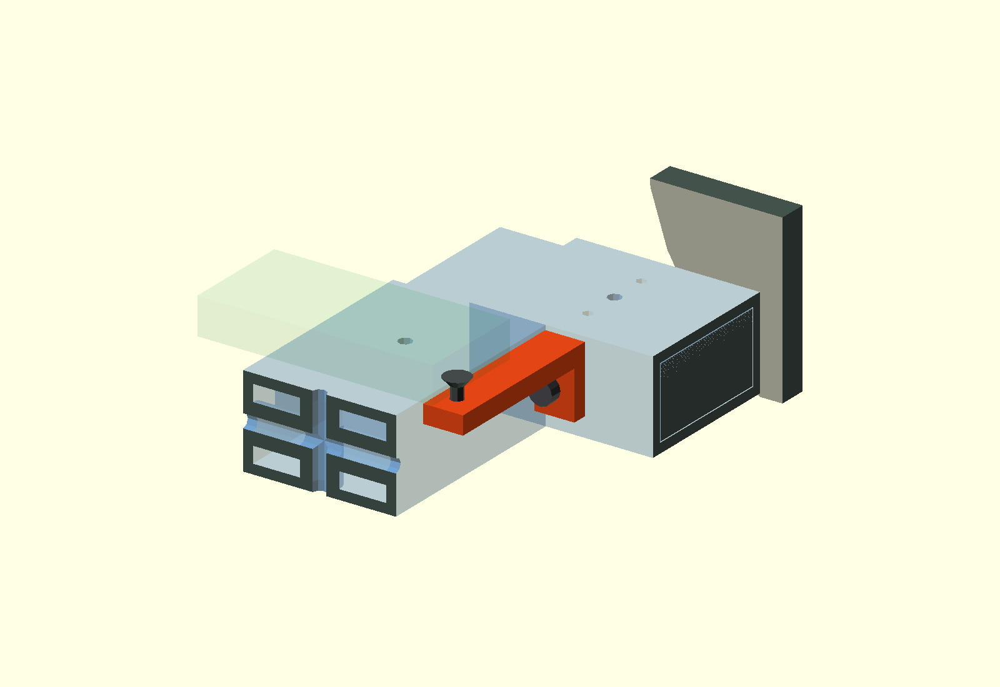

Το `corner_tie.stl` του P2-79 ήταν τρία ασύνδετα σώματα και η εγκατεστημένη
επάνω διαδρομή του έτεμνε τη βάση. Επιπλέον, η κατακόρυφη M4 στο
`X−140/Y±145` άφηνε κεφαλή μέσα στο Parkside reservation.

Το P2-83 το αντικατέστησε αρχικά με ένα μονοκόμματο L κάτω από τη βάση:

- flange/bridge `Z45…51`, χωρίς πέρασμα πάνω από τη ράγα,
- κατακόρυφο σκέλος `Z29…51` στην εσωτερική πλευρά της ράγας,
- παλιά παραδοχή πλευρικής M4 `X−135/Z37` (**superseded από P2-86b**),
- 1 mm M4 washer shim ανάμεσα στο tie και την παρειά `Y±195`, ώστε το
  τυπωμένο part να έχει πραγματικό tolerance gap,
- νέα φρεζάτη M4 βάσης στο `X−134/Y±145`, flush στο τοπικό `Z57,5`, με
  0,5 mm clearance μέχρι το Parkside drawer sweep.

Βίδες ενεργού P2-86b: 2×M4×20 90° countersunk για βάση→tie και 2× through-M4
στο `Y±165/Z37`, μήκος από το πραγματικό tie+50 mm crossbar+stay stack-up,
με ροδέλα/locknut. Η παλιά M4×65/washer-shim λίστα δεν ισχύει.

Exact-solid empty/PASS: tie–base, tie–πλήρες `frame_assembly` μαζί με rear
FIT0403/motor/cable/wheel envelopes, tie/κεφαλές βιδών–πλήρες Parkside
drawer sweep και ζώνη ground `Z<15`. Το χαμηλότερο
σημείο του tie είναι CAD `Z29`, δηλαδή περίπου physical `Z27` με το σασί
2 mm χαμηλότερα. Επανεξήχθησαν μόνο `base_left.stl`, `base_right.stl` και
`corner_tie.stl`· καθένα είναι ακριβώς ένα σώμα.

Τα τέσσερα ενεργά export scripts εκτελούν πλέον μόνιμο STL body-count gate.
Τα σκόπιμα print plates δηλώνουν 4 posts, 27 pins, 32 clips, 18 BTS spacers
και 2 coupon pieces· κάθε άλλο ενεργό STL απαιτεί ακριβώς ένα σώμα.

# τι διαφέρει από το αναμενόμενο — P2-81 control panel + κορυφή posts

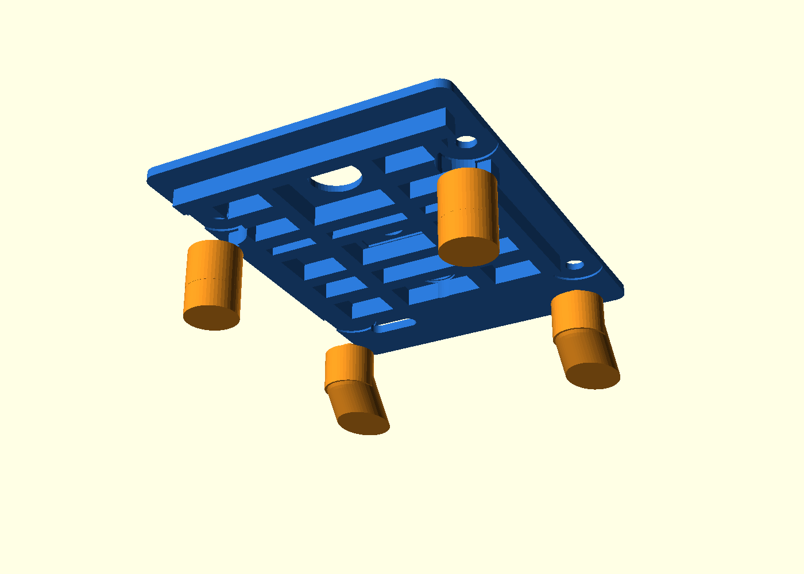

Ο έλεγχος του ενισχυμένου panel αποκάλυψε ότι οι σφαιρικές κορυφές των Ø23
posts του P2-79 έμπαιναν κατά 3 mm στο παλιό panel skin. Το P2-81 διορθώνει
την ίδια διεπαφή χωρίς αλλαγή envelope ή θέσεων οπών:

- κάθε post τελειώνει με επίπεδο Ø23 ώμο ακριβώς στο local `Z198`, δηλαδή
  στο global κάτω επίπεδο panel `Z347`,
- μόνο ο Ø8,2 οδηγός συνεχίζει μέσα στην αμετάβλητη Ø8,6 οπή,
- η συγκράτηση παραμένει διαμπερής M4 με ροδέλα και nyloc· δεν υπάρχει
  τυπωμένο φέρον σπείρωμα,
- το panel διατηρεί ακριβώς τις οπές Ø22,5 / Ø12,3 / Ø16,3 και τις τέσσερις
  Ø8,6 οπές στήριξης,
- το κάτω grid έχει βάθος 8 mm, άρα συνολικό ενεργό βάθος 12 mm, με χωριστά
  keepouts για E-stop, toggle, START και τα τέσσερα post lands.

Με συντηρητικό effective top width 40 mm και μόνο 16 mm συνολικό credited rib
width, ο γραμμικός PETG screen δίνει 0,1882 mm κάμψη panel και 0,0024 mm
βράχυνση posts: **0,1906 mm συνολικά στα 30 N**, με περιθώριο 0,1094 mm ως
προς το όριο 0,3 mm. Παραμένει υποχρεωτικό πραγματικό proof-load 30 N λόγω
ανισοτροπίας, creep και seating των βιδών.

Exact-solid empty/PASS για διείσδυση panel έναντι control bodies, Ugreen,
carrier και posts. Η μοναδική post–panel επαφή είναι οι τέσσερις συνεπίπεδοι
Ø23 ώμοι στο Z347· οι Ø8,2 οδηγοί έχουν 0,2 mm ακτινικό clearance μέσα στις
Ø8,6 οπές.

Ξαναεξήχθησαν **μόνο** `control_panel.stl` και `panel_posts.stl`, και τα δύο
manifold. Οι βίδες παραμένουν οι P2-79: 4×M4×20 με ροδέλες/nyloc στο panel,
με τελικό μήκος να επιβεβαιωθεί στο πραγματικό stack-up.

Το P2-80 παραμένει μελλοντικό πλήρως τυπωμένο stackable PETG cage, χωρίς
αλουμίνιο. Box sections περίπου 35×35 mm δεν χωρούν στη διαθέσιμη λωρίδα
`Y161…167`, οπότε θέσεις/διατομές κολονών θα ξανακριθούν μαζί με τα panels F.

# τι διαφέρει από το αναμενόμενο — P2-79 ακαμψία rear pod v2

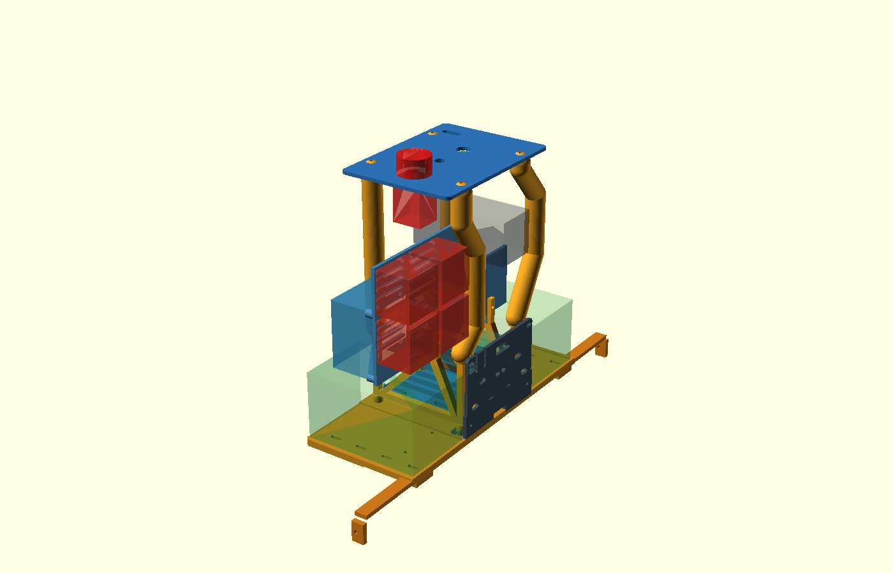

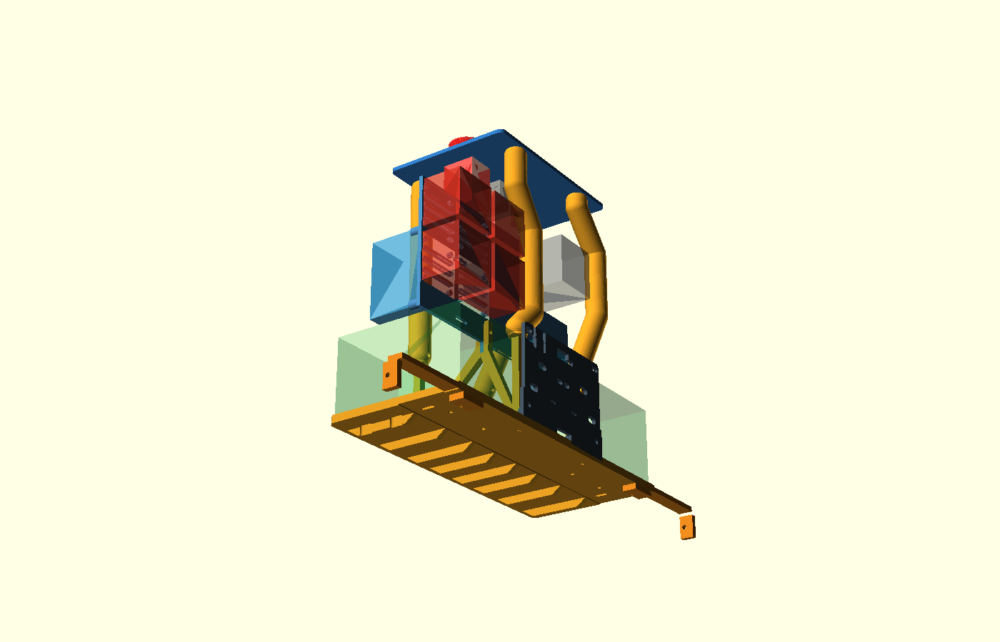

Το P2-79 αλλάζει μόνο τη φέρουσα βάση/ενώσεις του P2-76. Οι θέσεις
electronics, Parkside, Ugreen, Pi, controls και το παγωμένο envelope δεν
άλλαξαν.

- Η βάση είναι 8 mm nominal, 7 mm πάνω στη full-width σέλα της πίσω
  τραβέρσας και 6,5 mm κάτω από το Parkside sweep. Τέσσερις rear-only
  νευρώσεις ανά μισό κατεβαίνουν έως CAD Z43 / περίπου physical Z41.
- Η σέλα πατά σε όλο το `X−190…−140` αντί για τέσσερις spacers 3 mm.
- Η περιγραφή του P2-79 corner tie έχει αντικατασταθεί από το P2-83 παραπάνω.
- Side frames, κάτω post clevises και panel retention είναι πλέον
  διαμπερή M4 με ροδέλα/nyloc. Δεν υπάρχει τυπωμένο σπείρωμα σε φέρον κόμβο.
- Οι τέσσερις post διατομές έγιναν Ø23 και το θετικό detour πήγε στο Y90,
  χωρίς αλλαγή εξωτερικού envelope ή collision με Ugreen/controls.

Μόνο τα `base_left.stl`, `base_right.stl`, `side_frame.stl`,
`panel_posts.stl` και νέο `corner_tie.stl` ξαναεξήχθησαν. Όλα είναι
manifold. Τα exact-solid chassis (εκτός των δηλωμένων mating faces),
Parkside drawer sweep, Parkside/Ugreen/controls, Pi και hole-axis difference
είναι empty/PASS.

Screen στα 30 N κατακόρυφα: 0,886 mm με full-panel effective-width bound,
αλλά 3,051 mm στο συντηρητικό 40 mm strip sensitivity. Στα 20 N πλάγια ή
εμπρός/πίσω: 0,628 mm. Το panel-width sensitivity είναι ο λόγος που το
P2-80 εξετάζει top frame με κοντινότερα control rails.

### Βίδες P2-79/P2-88/P2-90d (υπερισχύει της παλιάς λίστας P2-76)

- 4×M4×45, μεγάλες ροδέλες και nyloc: base saddle προς rear crossbar,
- για τα corner ties ισχύει αποκλειστικά η λίστα P2-86b παραπάνω,
- 2×M4×25 εμπρός και 2×M4×35 πίσω με wedge/ροδέλες/nyloc: side frames
  διαμπερώς προς τις βάσεις,
- 4×M4×60 με ροδέλες/nyloc: κάτω cups των ήδη τυπωμένων panel posts,
- 4×M4×20 με ροδέλες/nyloc: panel προς τα άνω post pegs,
- 2×M4×25 με ροδέλες/nyloc: σιαγόνες όρθιας πλάκας,
- οι μη φέρουσες M3 του Pi shelf παραμένουν όπως στο P2-76.

Οι τελικές βίδες πρέπει να επιβεβαιωθούν με πραγματικό stack-up ροδέλας και
nyloc πριν την αγορά/κοπή. Ακολουθεί η διατηρούμενη τεκμηρίωση P2-76 για
electronics, service και προσανατολισμό· όπου μιλά για M3 στα side frames ή
posts, υπερισχύει η παραπάνω ενοποιημένη λίστα.

# P2-76 όρθια πλακέτα — διατηρούμενη τεκμηρίωση

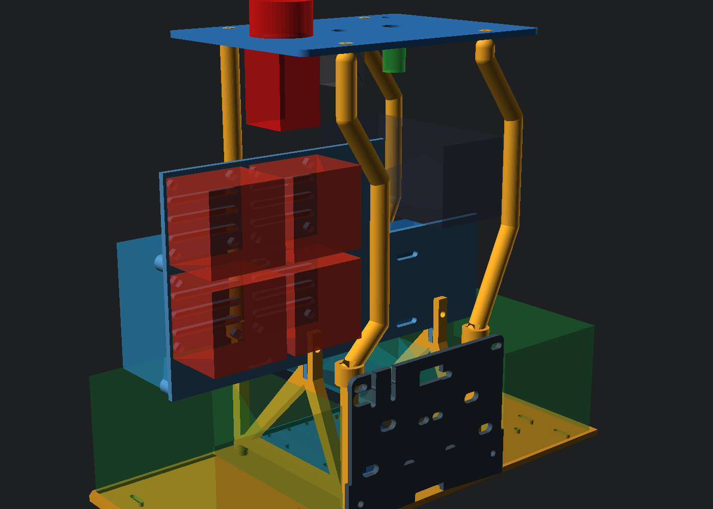

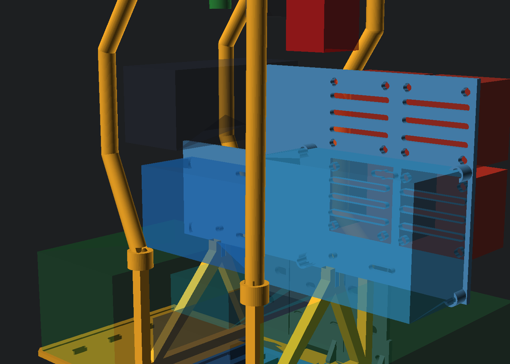

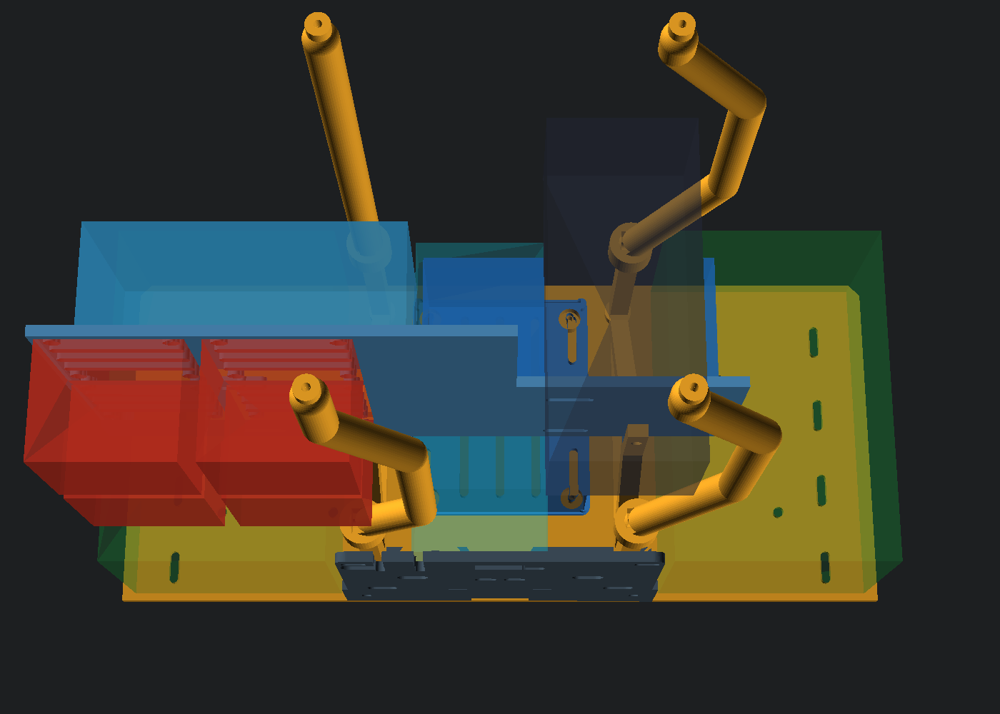

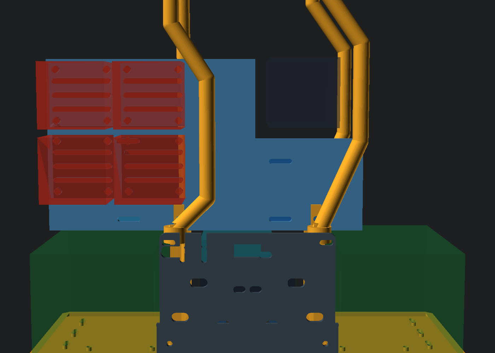

Το P2-70 Ugreen δεν βρίσκεται στο προσωρινό ghost `Y112` της v1 αλλά στο
δεσμευμένο κέντρο `[-195,42,258]`, δηλαδή καθαρό envelope
`X−255,5…−134,5 / Y16…68 / Z232…284`. Μία ορθογώνια πλάκα με όλα τα
εξαρτήματα στην πίσω όψη είτε θα έτεμνε αυτόν τον όγκο είτε θα ξεπερνούσε
το όριο εκτύπωσης 250×250 mm.

Η v2 χρησιμοποιεί **μία** όρθια πλάκα με εγκοπή γύρω από το Ugreen:

- Mega και perfboard/keyed faceplate v2 είναι στην πίσω/service όψη `−X`.
- Τα τέσσερα BTS7960 είναι σε διάταξη 2×2 στην εμπρός όψη της ίδιας
  πλάκας. Τρία χρησιμοποιούνται (δύο κίνηση, ένα FIT0186) και ένα μένει
  εφεδρικό. Δεν υπάρχει L298N.
- Τα BTS κρατούν τους χωριστούς αποστάτες 20 mm. Οι ψύκτρες είναι όρθιες,
  οι σχισμές αερισμού κατακόρυφες και η περιοχή εμπρός τους μένει ανοικτή.
- Οι δύο θετικοί στύλοι του panel παρακάμπτουν το Ugreen προς `Y84`, ώστε
  να παραμένει ελεύθερη η εξαγωγή του προς `−X`.

Δεν άλλαξε το παγωμένο envelope `X−272…−125`, `Y±167`, `Z≤375`. Μέχρι το
P2-79 το πάνω panel ήταν byte-identical με τη v1· το P2-81 πρόσθεσε μόνο
κάτω νευρώσεις και κράτησε τις οπές Ø22,5 / Ø12,3 / Ø16,3.

## Καθαρά περιθώρια CAD

- κύρια πλάκα πάνω από Parkside: **10 mm** (`Z149` έναντι `Z139`),
- κάτω σκαλοπάτι πλάκας προς Ugreen: **10 mm** (`Z222` έναντι `Z232`),
- άνω ακμή πλάκας προς Ugreen: **10 mm** (`Y6` έναντι `Y16`),
- πλάκα/BTS προς χαμηλότερο control body: **13 mm** (`Z284` έναντι
  E-stop body `Z297`),
- keyed faceplate + plug + καμπύλη 20 mm προς πίσω envelope: **14,3 mm**,
- BTS front envelope προς `X−125`: **10 mm**,
- Pi clear top `Z114` προς κάτω καλωδιοδιάδρομο `Z124`: **10 mm**.

Οι τιμές είναι ονομαστικές CAD. Η πραγματική καμπύλη καλωδίου, τα σώματα
των βυσμάτων και οι ψύκτρες παραμένουν `ΜΕΤΡΗΣΗ/ΕΠΙΒΕΒΑΙΩΣΗ ΧΡΗΣΤΗ`.
Τα exact-solid QA `qa_priority_collision` (Parkside/Ugreen/controls) και
`qa_pi_collision` επέστρεψαν κενό αντικείμενο.

## Τυπωμένα κομμάτια και ποσότητες

- `base_left.stl`, `base_right.stl` ×1: ενισχυμένες P2-79 βάσεις με
  full-width saddle και διαμπερείς M4 για τα side frames.
- `pi_shelf.stl` ×1: clear 98×74×46, λεπτός αφρός και δύο λουριά.
- `vertical_electronics_plate.stl` ×1: 248×146 mm outline, 4 mm πάχος.
- `side_frame.stl` ×2: κάτω στήριξη panel και σφιγκτήρας της όρθιας πλάκας.
- `panel_posts.stl` ×1 plate: τέσσερις διαφορετικά δρομολογημένοι στύλοι.
- `component_pins.stl` ×1 και `component_clips.stl` ×1: 24 απαιτούμενα
  pin/clip συν ανταλλακτικά για Mega, perfboard και 4×BTS7960.
- `bts_spacers.stl` ×1: 16 απαιτούμενοι αποστάτες 20 mm +2 ανταλλακτικοί.
- `upright_mount_fit_coupon.stl` ×1: μόνο η νέα εφαρμογή πλάκας/σιαγόνας.
- `cable_bulkhead.stl`, `bulkhead_foot.stl`: διατηρούμενα P2-75 parts.
  Το `control_panel.stl` υπερκαλύπτεται από τη νευρωμένη έκδοση P2-81 στην
  αρχή του README. Τα παλιά `mpu6050_mount` και `chassis_spacers` δεν είναι
  ενεργά και βρίσκονται στο `../archive/p276-inactive-assets/`.

Όλα τα STL είναι manifold. Το μεγαλύτερο footprint είναι η όρθια πλάκα
248×146 mm· όλα είναι εντός 250×250 mm.

## Πρώτα το fit coupon

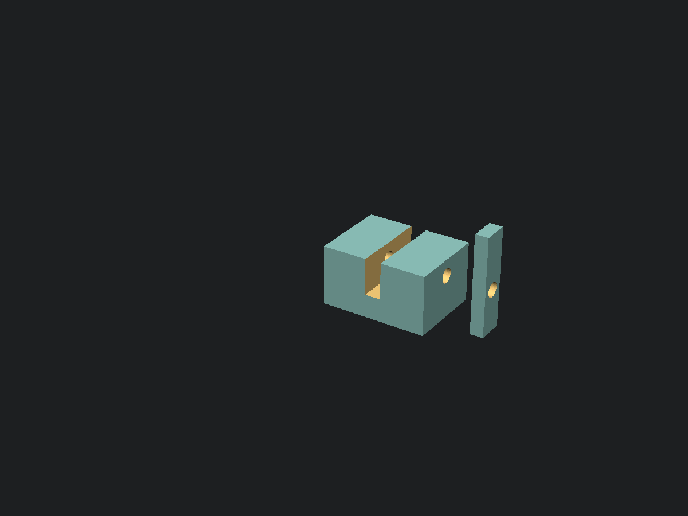

Τύπωσε πρώτα το `upright_mount_fit_coupon.stl`. Το αποσπώμενο tongue είναι
πραγματικό πάχος 4,0 mm και η σιαγόνα έχει άνοιγμα 4,8 mm. Επιβεβαίωσε ότι:

1. το tongue μπαίνει χωρίς σφυρί αλλά δεν κουνιέται αισθητά,
2. περνά M4 από τις δύο οπές χωρίς να ραγίζει το PETG,
3. μετά το σφίξιμο με ροδέλα/nyloc το tongue δεν περιστρέφεται με το χέρι.

Αν αποτύχει, διόρθωσε μόνο το clearance της σιαγόνας σύμφωνα με τη
βαθμονόμηση του εκτυπωτή· δεν αλλάζει καμία θέση component ή envelope.

## Προσανατολισμός και supports

- Βάσεις, Pi shelf, pins, clips, spacers και coupon: όπως είναι στο STL,
  με τη μεγαλύτερη επίπεδη πλευρά στο bed.
- Όρθια πλάκα: επίπεδη, με τα ενσωματωμένα rear bosses προς τα πάνω.
- `side_frame.stl`: **όρθιο όπως εξάγεται**, πάνω στα δύο 36×24 mm πέλματα,
  με brim. Οι Ø4,5/Ø7 οριζόντιες γέφυρες είναι μικρές· supports μόνο αν το
  συγκεκριμένο προφίλ εκτυπωτή δεν γεφυρώνει 7 mm. Μην το γυρίσεις στην
  παλιά πλατιά πλευρά: το 8 mm web θα μείνει 8 mm πάνω από το bed.
- `panel_posts.stl`: όρθιο όπως εξάγεται, με brim. Τα λοξά τμήματα είναι
  ≤45° και δεν χρειάζονται supports σε σωστά ρυθμισμένο PETG printer.
- `control_panel`: επίπεδη άνω όψη στο bed με τις νευρώσεις προς τα πάνω·
  bulkhead και MPU mount: οδηγίες v1.

Δεν απαιτούνται supports στα υπόλοιπα κομμάτια. Υλικό: PETG.

## Βίδες

Ισχύει μόνο η ενοποιημένη λίστα **«Βίδες P2-79/P2-88/P2-90d»** παραπάνω,
μαζί με την P2-81 επίπεδη κορυφή posts. Οι παλιές οδηγίες P2-76 με M3×16/M3×10 έχουν
αρχειοθετηθεί και **δεν εφαρμόζονται**. Μόνο το μη φέρον Pi shelf κρατά τις
4×M3. Τα component PCBs χρησιμοποιούν grooved pins/C-clips και οι BTS τους
χωριστούς spacer 20 mm.

## Σειρά συναρμολόγησης και καλωδίωσης

1. Δοκίμασε το coupon και έλεγξε τις πραγματικές διαστάσεις Ugreen,
   Parkside, plugs και ψυκτρών.
2. Βίδωσε τις δύο v2 βάσεις στο σασί και το Pi shelf στα τέσσερα κεντρικά
   bosses. Βάλε λεπτό αφρό, Pi και δύο λουριά.
3. Βίδωσε τα δύο `side_frame` στα bosses `Y±54`.
4. Με την όρθια πλάκα εκτός pod, βάλε πίσω Mega και perfboard με pins/
   C-clips. Το keyed faceplate και όλα τα βύσματα κοιτούν προς `−X`.
5. Βάλε στην εμπρός όψη 16 spacer 20 mm, 4×BTS7960, pins και C-clips.
   Σήμανε DRIVE-L, DRIVE-R, TILT και SPARE.
6. Καλωδίωσε πρώτα Mega/perfboard. Τα πίσω βύσματα κατεβαίνουν κάτω από
   την πλάκα με καμπύλη ≥20 mm. Τα BTS περνούν απευθείας στην εμπρός
   πλευρά. Και οι δύο κλάδοι ενώνονται στον ελεύθερο διάδρομο
   `X−260…−130 / Y−35…19 / Z124…149` και καταλήγουν στην εμπρός
   καλωδιοπλάτη `X−125…−130`.
7. Κατέβασε τα δύο tongues στις σιαγόνες, βάλε τις 2×M4 και σφίξε αφού
   επιβεβαιώσεις ότι κανένα καλώδιο δεν παγιδεύεται.
8. Κατέβασε τα τέσσερα upper posts στα ανοικτά cups και βάλε 4×M4×60:
   κεφαλή στην εξωτερική παρειά, ροδέλα/nyloc στην εσωτερική. Κράτησε το
   nyloc με ανοικτό κλειδί από την εξωτερική πλευρά Y. Έπειτα πέρασε το Ugreen από
   `−X`, πρόσθεσε αφρό/λουράκι και τέλος βίδωσε το P2-81 control panel.

Για service της πλακέτας: βγάζεις panel/posts αν απαιτείται πρόσβαση,
αποσυνδέεις τα βύσματα, λύνεις μόνο τις δύο M4 σιαγόνες και σηκώνεις την
πλάκα. Το Pi shelf και οι δύο μελλοντικές Parkside θέσεις μένουν στη θέση
τους.

## Τι κρατιέται και τι καταργείται από v1

Κρατιούνται: εξωτερικό/οπές βάσης, περίγραμμα και apertures control panel,
εμπρός καλωδιοπλάτη και feet, MPU mount, chassis spacers, γεωμετρία grooved
pins/C-clips. Το P2-81 αλλάζει μόνο την κάτω νεύρωση του panel και τις άνω
κορυφές των posts.

Καταργούνται πλήρως: `mega_shelf`, `perf_shelf`, `bts_shelf`, όλα τα
`pillars_*`, το παλιό `pi_shelf`, `shelf_couplers`, το v1 `fit_coupon`, το
v1 pin pack των δύο BTS και κάθε λογική στοιβαζόμενων ραφιών. Δεν υπάρχει
L298N ούτε χωριστή οπή LED.

Δεν έγινε firmware, Gazebo, commit, push ή PR.
