# Εξωτερικά panels στο πραγματικό v3 — πρόταση D (καμπύλες / επίπεδες όψεις)

> **Νεότερη κατεύθυνση (2026-10-17):** μετά τη συζήτηση με τον χρήστη το
> προτιμώμενο concept είναι το **F «planter»** στο
> [`panels-concept-f-el.md`](panels-concept-f-el.md). Εκεί τα πλαϊνά κρύβουν
> το καλάθι, η μορφή δεν θυμίζει αυτοκίνητο και οι τροχοί μένουν απ' έξω
> χωρίς φτερά. Η D μένει ως τεκμηριωμένη εναλλακτική. Ενδιάμεσα δοκιμάστηκε
> και η παραλλαγή **E «flow»** (`style="flow"`, renders
> `renders-v3/E-flow-*.png`): η D-curved με γραμμή drift, πόρτες σε σχήμα
> χαπιού και gills-βεντάλια. Δεν έτρεξε πλήρης έλεγχος γι' αυτήν, και την
> αντικατέστησε το F.

Κατάσταση: `BODY_PANELS_V3_CONCEPT_D_CURVED_RECOMMENDED_11_OF_12_GATES_POD_SLIDE_INHERITED_NO_STL`.
Concept, όχι print release. Δεν έγινε STL, Gazebo, ROS, Docker, commit, push ή PR.
Δεν τροποποιήθηκε κανένα αρχείο του μηχανισμού. Η γεωμετρία διαβάζεται
read-only με `use` από το ίδιο σύνολο αρχείων που συνθέτει το
`cad/modular-test-chassis/full-robot-v3.scad` (κατάσταση 2026-10-17):

- πλαίσιο v3 με T-clamps (P2-65),
- γερμένη αψίδα X318→X390 με LiDAR X390 και κάμερα X410 (P2-67),
- μαλακό ταμπλό X250/Z363→X360/Z343 (P2-67),
- όρθιο μπροστινό grid X225/Z235 με fail-closed θύρα (P2-68/P2-71),
- πίσω pod (P2-70),
- grid καλαθιού με όρθιο πίσω τοίχωμα X−118 (P2-71).

Αντικαθιστά την πρόταση B του `panels-concept-el.md`, η οποία είχε σχεδιαστεί
πριν από αυτές τις αλλαγές.

| Αρχείο | Περιεχόμενο |
|---|---|
| `cad/body-panels/archive/concepts-a-e/body-panels-v3.scad` | Πρόταση D, `style="curved"` ή `"faceted"`, keep-outs και QA views |
| `cad/body-panels/archive/concepts-a-e/render-v3.sh` | Όλα τα renders (μόνο PNG, πλήρες Manifold render) |
| `cad/body-panels/qa-clearance-v3.py` | Exact-solid gates, αριθμητικά διάκενα, ακτίνα κάτοψης, μάζα |
| `cad/body-panels/archive/concepts-a-e/qa-results-v3.json` | Πλήρη αποτελέσματα και των δύο στυλ |
| `cad/body-panels/archive/concepts-a-e/renders-v3/*.png` | Ισομετρικά, πλάγιες, κατόψεις, τομές, keep-outs |

Σύμβαση όψεων: +X μπροστά, +Y αριστερά, +Z πάνω. Οι πλάγιες όψεις κοιτούν από
το −Y, με το μπροστά δεξιά. Κάθε render ελέγχθηκε οπτικά.

## 1. Τι άλλαξε και τι σημαίνει για τα panels

| Δομική αλλαγή | Συνέπεια |
|---|---|
| **Κύκλος επιτόπιας στροφής R425 γύρω από X117** (P2-70) | Νέος σκληρός περιορισμός κάτοψης. Τα εμπρός guards της B (X548/Y241 → **R494**) αποκλείονται. Τα φτερά κόβονται στην κάτοψη. Όριο panels: **R≤421**, δηλαδή 4 mm μέσα. |
| Πίσω pod P2-70: X−272…−125, Y±167, Z55…350, E-stop/διακόπτες πάνω στο Z350…374 | Το πίσω pod της B (καπάκια/πόρτες/κονσόλα) καταργείται. Προτείνω μόνο **εξωτερικό κέλυφος** με το ίδιο envelope και τις ίδιες διεπαφές. |
| Γερμένη αψίδα, κάμερα X410/Z305, LiDAR X390 | Ώμοι και brow ξανασχεδιάστηκαν πάνω στη νέα κλίση. Το brow σταματά στο X404 λόγω FOV. |
| Ταμπλό + R75/75 ski, μπάλα που ανεβαίνει προς τα πίσω από X≈311 | Τίποτα μέσα στο \|Y\|<176 πάνω από το καλάθι. Το brow είναι μπροστά από την τροχιά. |
| Grid καλαθιού Y±172, πίσω X−118 | Τα sills μένουν στο Y≥179, δηλαδή 5,5 mm από το grid. |
| Προσωρινή κονσόλα δοκιμών στην αριστερή ράγα X45…185 | Συγκρούεται με το αριστερό sill (0 mm). Τοποθετείται **μετά** τη δοκιμή κίνησης, όταν τα controls έχουν περάσει στο pod. |

**Απόκλιση που πρέπει να ξέρετε:** ο πραγματικός κύκλος στροφής δεν είναι
R425. Οι εξωτερικές γωνίες των τροχών κίνησης (X385/Y338,5 και X−150/Y338,5)
βρίσκονται στα **431,7 και 431,1 mm** από το X117. Το R425 του P2-70 προκύπτει
μόνο από το εμπρός άκρο του flywheel (X542). Κρατώ το 421 για να μην αλλάξω
το envelope του P2-70. Αν όμως γίνει δεκτό ότι το πραγματικό όριο είναι
~432 mm (στο ύψος του άξονα), τα φτερά και οι γοφοί μπορούν να μεγαλώσουν
κατά ~10 mm.

## 2. Καμπύλες ή όχι — απάντηση

Οι καμπύλες βγαίνουν **και πιο όμορφες και πιο λειτουργικές**, με έναν όρο:
**μόνο απλής καμπυλότητας**, δηλαδή τόξα που βρίσκονται σε ένα επίπεδο,
συν μεγάλα fillets. Διπλής καμπυλότητας δέρματα απορρίπτονται. Σε κρεβάτι
250×250 θέλουν supports, χάνουν το σταθερό πάχος 2,2 mm και δεν κερδίζουν
κάτι λειτουργικό.

Οι καμπύλες που κρατήθηκαν έχουν όλες λειτουργικό λόγο:

1. **Κάτοψη πάνω στον κύκλο στροφής.** Το πίσω περίγραμμα είναι τόξο R420 και
   οι γωνίες των φτερών κόβονται στο R421. Όταν το ρομπότ στρίβει επιτόπου
   κοντά στο δίχτυ ή το φράχτη, καμία γωνία δεν «σκουπίζει» έξω από τον
   κύκλο. Το σχήμα κάνει ορατό αυτό που ήδη ισχύει.
2. **Μεγάλο πάνω fillet R40 στο pod και R42 στα sills.** Απομακρύνει νερό και
   σκόνη από τις ακμές, δεν έχει αιχμηρή γωνία για χέρια, και δίνει πιο
   άκαμπτο κέλυφος με το ίδιο πάχος.
3. **Φτερά τόξου R97,** ομόκεντρα στους τροχούς, με σταθερό διάκενο 12 mm σε
   όλο το τόξο.
4. **Ώμοι με μπροστινή ακμή παράλληλη στη γερμένη αψίδα (20,5°).** Το ρομπότ
   «γέρνει» με τον μηχανισμό του αντί να τον κρύβει.
5. **Στρογγυλεμένες άκρες κάτοψης R28** στα sills, και πλευρικό φούσκωμα +6 mm
   μόνο ανάμεσα στους τροχούς.

Η `faceted` εκδοχή, με την ίδια διάταξη αλλά λοξές ακμές και 4 επίπεδες όψεις
στα φτερά, περνά όλα τα ίδια gates και έχει ίδια μάζα (2.194 έναντι 2.196 g).
Δεν είναι ευκολότερη στην εκτύπωση: όλα τα τόξα είναι ήδη επίπεδα και
τυπώνονται χωρίς supports. Άρα η επιλογή είναι καθαρά αισθητική. Προτείνω
**curved**: φιλικό «appliance» αντί για «utility», και καλύτερη ανάγνωση του
κύκλου στροφής. Η `faceted` κρατιέται ως ισότιμη εναλλακτική.

## 3. Renders

### Curved (προτεινόμενη)

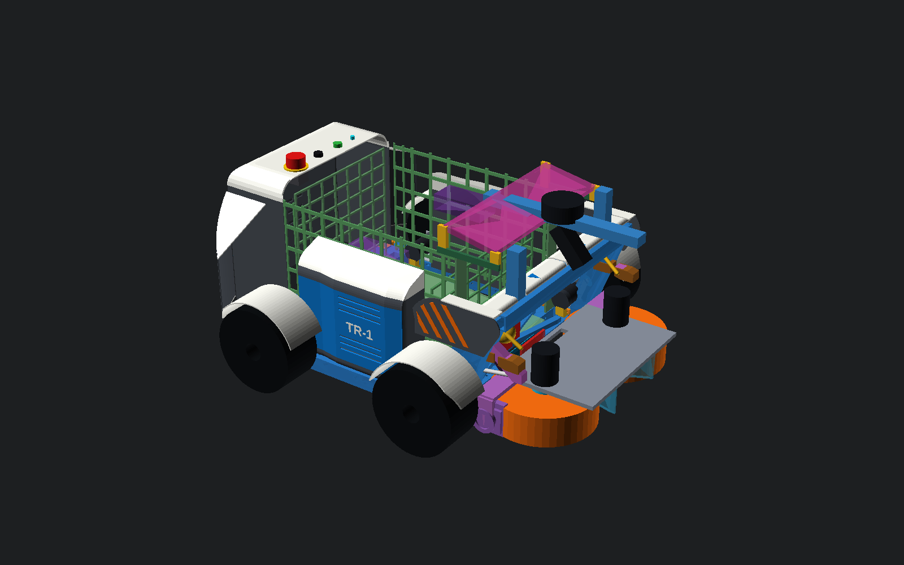
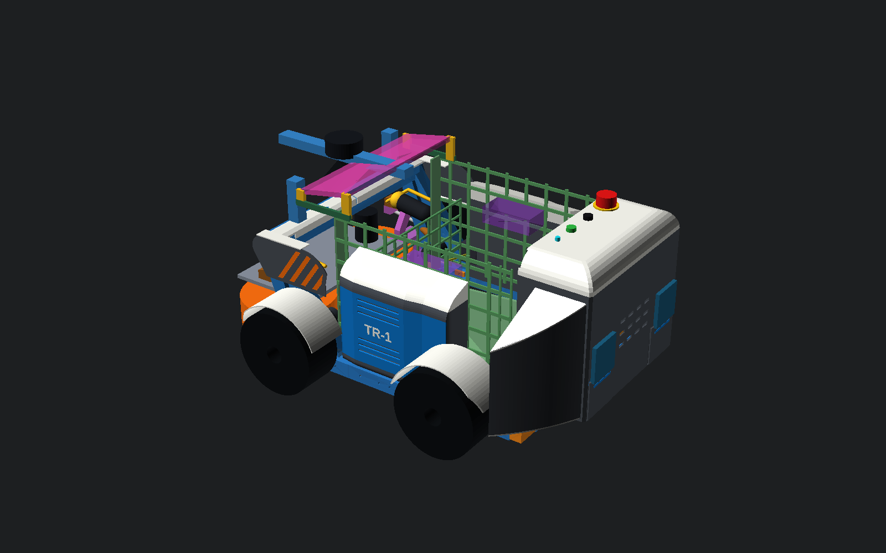
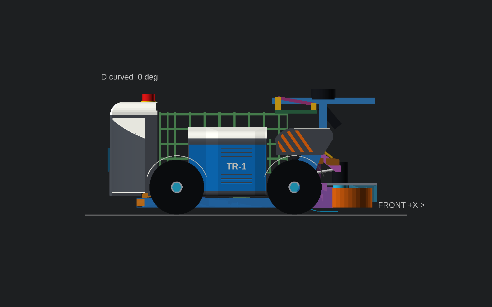
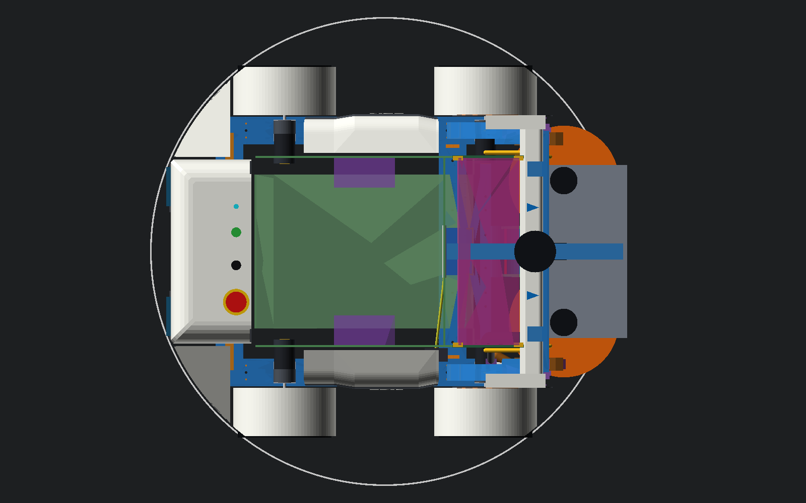
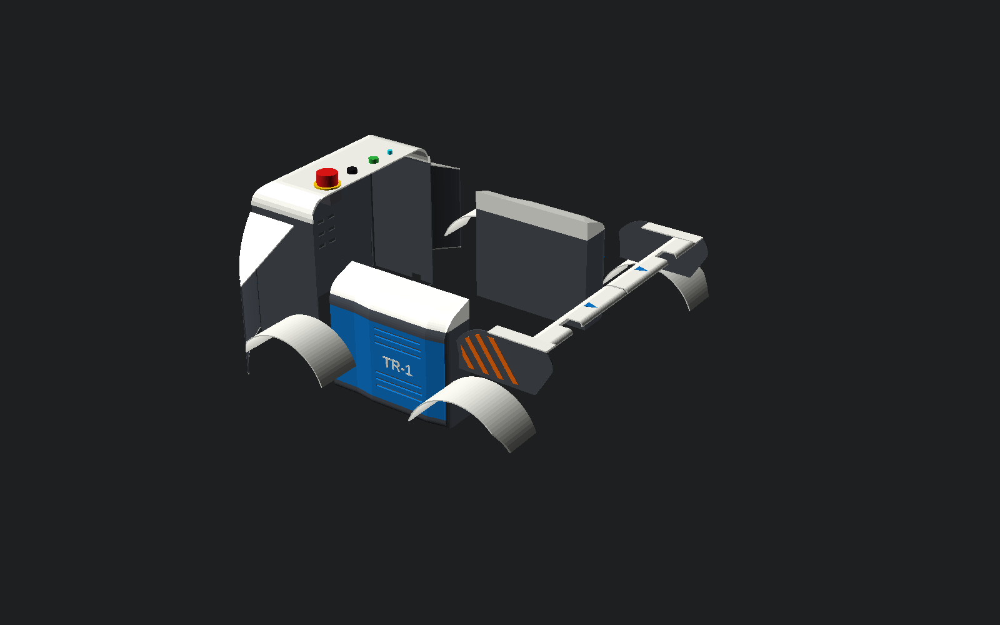

### Faceted (εναλλακτική)

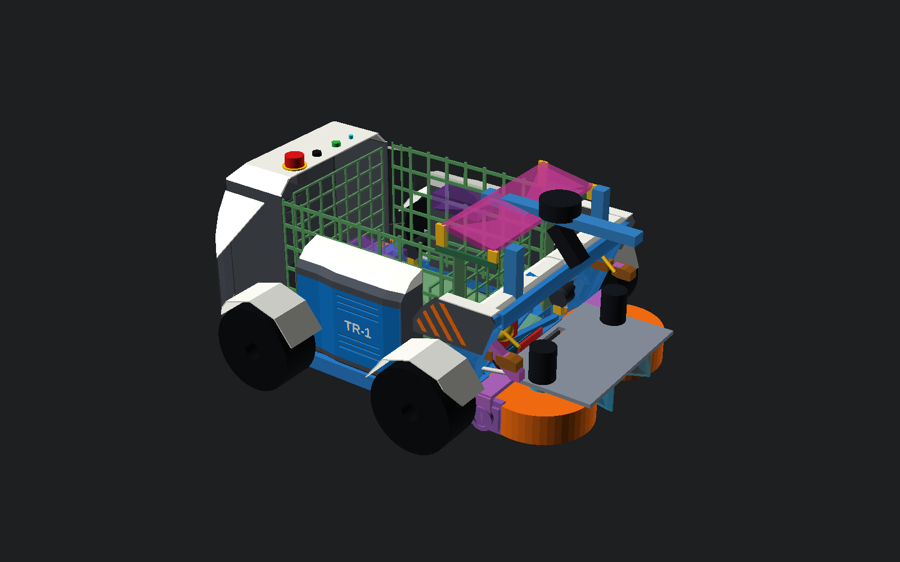
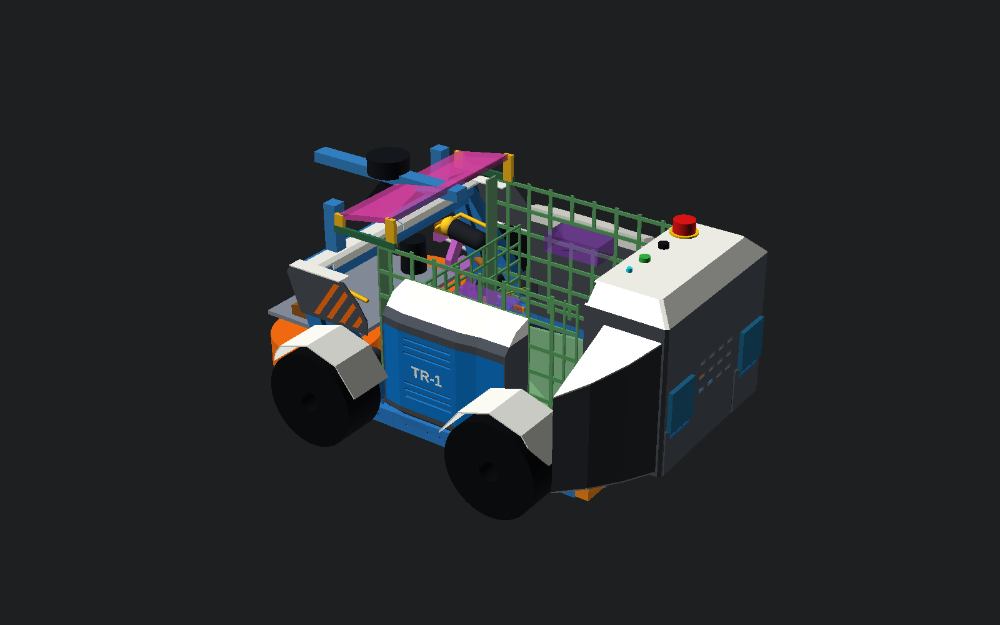

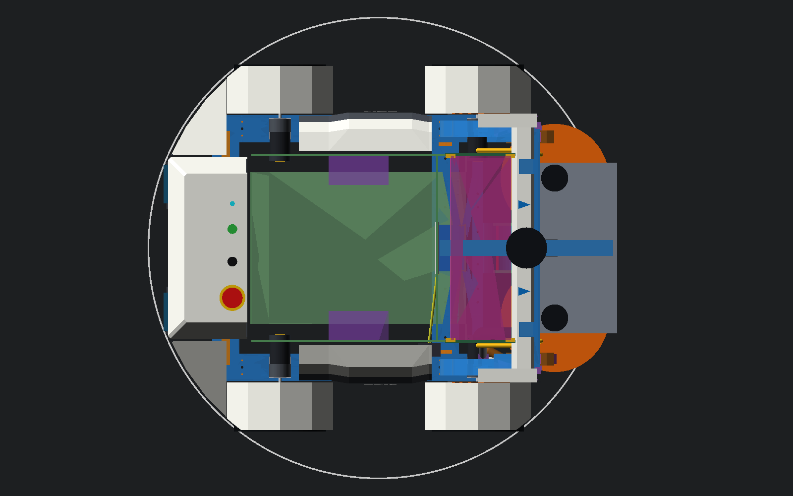
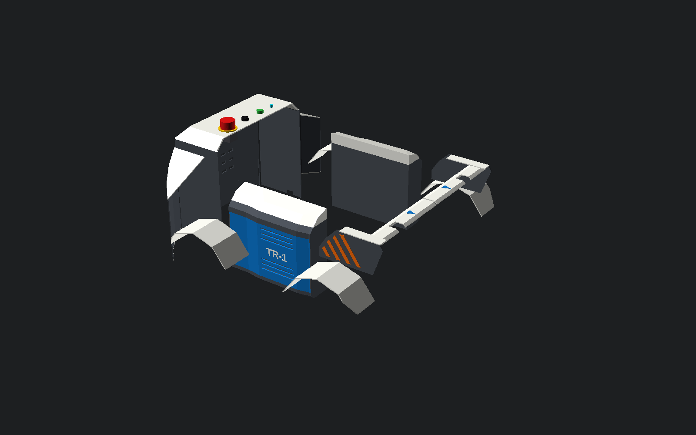

### Τρεις καταστάσεις λειτουργίας (τομή Y=0, φαίνονται τα αριστερά panels)

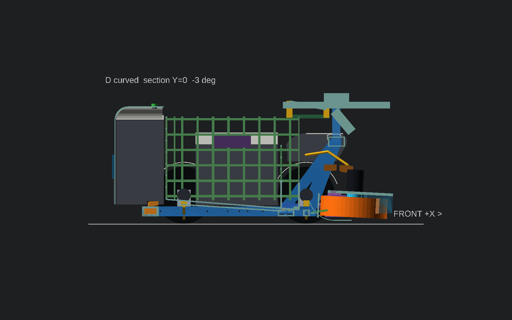
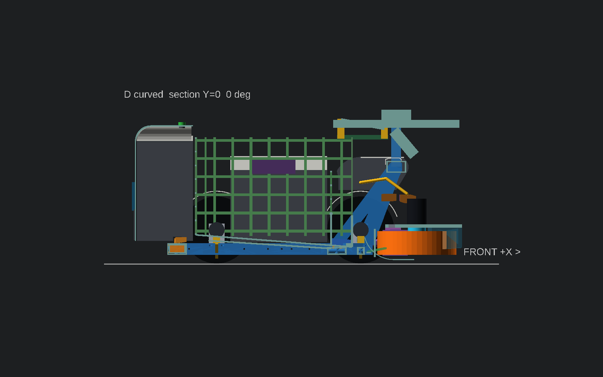
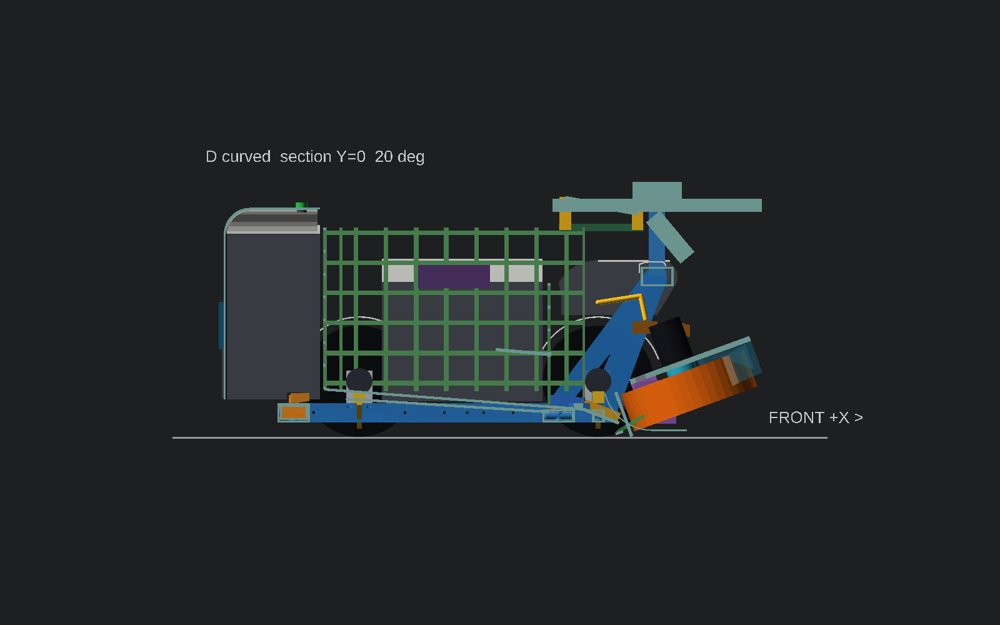

Keep-outs στις +20°: κώνος εκτόξευσης ±10°/±10° με κόκκινο, FOV κάμερας
P2-67 με κυανό.

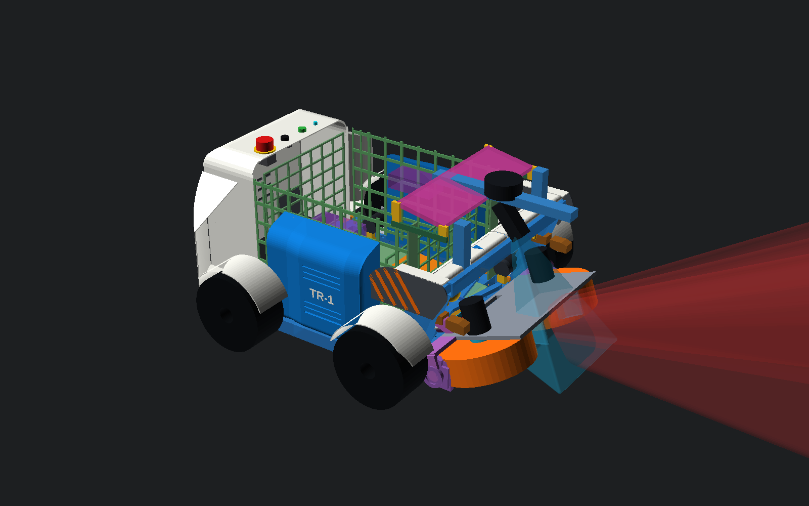

Η σύγκρουση με την προσωρινή κονσόλα δοκιμών (κίτρινη) φαίνεται εδώ:


## 4. Λίστα panels (curved)

Μάζα από τον όγκο του solid model με PETG 1,27 g/cm³. Οι μάζες της faceted
διαφέρουν ±2 g. Όλα τα κομμάτια χωρούν σε 250×250 footprint και ≤256 ύψος.
Κανένα δεν θέλει νέα τρύπα σε κλειδωμένο stl-v3.

| Κομμάτι | Τεμ. | Bbox (mm) | g/τεμ. | Στερέωση | Εκτύπωση |
|---|---:|---|---:|---|---|
| `pod_upper` κέλυφος pod πάνω L/R (ραφή Y0, Z200) | 2 | 147×167×150 | 248 | Πάνω στη βάση/πλάτη του P2-70. Πάνω panel με τα controls του P2-70 | Ανάποδα, με το fillet R40 στο bed |
| `pod_lower` κέλυφος pod κάτω L/R | 2 | 147×167×143 | 113 | P2-70 πόδια M4 στην πίσω τραβέρσα Y±75/±125. Εγκοπή για τα anti-racking αυτιά | Όρθιο |
| `rear_quarter` πίσω γοφός L/R | 2 | 102×140×232 | 118 | Clip στο πλαϊνό του pod + bracket στην υπάρχουσα πλευρική M4 του corner clamp | Όρθιο, τόξο στο bed |
| `sill_body` σώμα sill L/R (θέση D5065 controller) | 2 | 245×71×218 | 332 | Clip-saddles στη ράγα + M4 thumb screws στο grid X100/X125 της rail extension | Όρθιο στο πίσω άκρο |
| `sill_door` πόρτα sill με gills L/R | 2 | 241×16×144 | 92 | **Χωρίς εργαλεία:** γάντζος κάτω + 2 captive thumb screws/¼-turn | Όρθια |
| `fender_rear` L/R | 2 | 186×88×66 | 58 | Στο πίσω άκρο του sill και στον γοφό | Στο πλάι |
| `fender_front` L/R | 2 | 186×88×66 | 58 | Στο εμπρός άκρο του sill + clip στο σκέλος της αψίδας | Στο πλάι |
| `shoulder` ώμος L/R | 2 | 182×26×84 | 45 | 2 C-clips στο γερμένο σκέλος αψίδας + έδραση στο φτερό | Επίπεδο |
| `brow` L/R | 2 | 42×236×19 | 34 | Snap-cap πάνω στην τραβέρσα X365…415, εγκοπή στους ορθοστάτες LiDAR | Ανάποδα |
| **Σύνολο** | **18** | | **≈2.196 g** | | |

Από αυτά, τα 722 g είναι το κέλυφος του pod, που **αντικαθιστά** το κέλυφος
του P2-70 (proxy εκεί 770 g) και δεν είναι πρόσθετο βάρος. **Καθαρά πρόσθετα
panels: 1,474 kg.**

Κέντρο βάρους: με το ledger του P2-70 (18,880 kg, CG X146,86, 58,04% εμπρός)
και τα πρόσθετα panels (CG X74,7) το σύνολο γίνεται **20,354 kg, CG X141,6,
56,61% εμπρός** (−1,4 μονάδες). Το βαρύτερο κομμάτι είναι το `sill_body`
(663 g το ζεύγος). Ελάφρυνση: ανοιχτό lattice στο εσωτερικό τοίχωμα, αφού
δίπλα υπάρχει ήδη το grid του καλαθιού, και τοιχώματα 1,8 mm με νευρώσεις.
Περίπου −250 g.

### Πρόσβαση, ασφάλεια, αερισμός

- **E-stop, καλυμμένος διακόπτης, ARM, LED:** ακριβώς όπως στο P2-70, στο
  πάνω επίπεδο τμήμα του pod (E-stop στο X−153/Y−92, έως Z374). Το fillet R40
  αφήνει επίπεδο τμήμα \|Y\|≤127 και X≥−232, οπότε όλα χωρούν.
- **Parkside:** τα συρτάρια του P2-70 βγαίνουν προς −X από τα ανοίγματα του
  πίσω τοιχώματος (91×81). Οι γοφοί είναι στο \|Y\|≥170 και δεν εμποδίζουν.
- **Ugreen / Pi:** από την ίδια πίσω πρόσβαση του P2-70.
- **D5065 controllers:** στα sills. Η πόρτα βγαίνει με 2 thumb screws.
- **Άδειασμα καλαθιού:** τίποτα πάνω από το καλάθι. Τα sills και το pod είναι
  στα πλάγια/πίσω.
- **Αερισμός sills:** gills στην πόρτα, κάτω ζώνη Z≈100…130 και άνω
  Z≈180…210. Οι σχισμές ανεβαίνουν προς τα μέσα, οπότε το εξωτερικό άνοιγμα
  είναι χαμηλότερα από το εσωτερικό και η ψιχάλα δεν βρίσκει δρόμο. Καμία
  τρύπα σε πάνω επιφάνεια. Τα top των sills γέρνουν προς τα έξω.
- **Αερισμός pod:** louvres και G2 hoods του P2-70, στις ίδιες θέσεις.
- **Χρώματα:** όπως στη B. Λευκό ASA οι πάνω επιφάνειες (top pod, fillets,
  top sills, φτερά, καπάκι γοφών, brow), γραφίτης τα κατακόρυφα, signal blue
  οι πόρτες των sills, πορτοκαλί/μαύρη σήμανση εκτόξευσης στους ώμους.
  Αποφεύγεται το κιτρινοπράσινο της μπάλας.

## 5. Έλεγχος

### Μέθοδος

- **Exact-solid gates (OpenSCAD Manifold).** Το κινούμενο σύνολο είναι η
  ένωση, −10…+20° ανά 1°, των εξής:
  - P2-40 μονάδα (τροχοί, D5065, πλάκα, yokes/trunnions, throat/gate),
  - P2-44 cheeks,
  - P2-54 actuator (Tr8, FIT0186, belt carrier, moving arm με stop tongues),
  - cam,
  - καλώδια D5065,
  - **P2-68 θύρα και selector nose**.

  Επίσης: τροχοί κίνησης, σταθερός κόσμος, κρατήσεις περιεχομένων pod P2-70,
  κώνος εκτόξευσης (+15…+20°, ±10°/±10° + ακτίνα μπάλας), FOV κάμερας P2-67,
  Z≥375, διαδρομή μπάλας (προσέγγιση, nip, R75/75 ski, πτήση, ταμπλό,
  καλάθι, με +10 mm), feed path, και κάτοψη έξω από R421. Τα gates της
  κινούμενης μονάδας και των τροχών επαναλήφθηκαν με panels φουσκωμένα κατά
  10 mm.
- **Αριθμητικά ελάχιστα** με global δειγματοληψία και ακριβή απόσταση
  σημείου–τριγώνου, ±1 mm. Το «>80» σημαίνει ότι δεν βρέθηκε στόχος σε 80 mm.

### Gates

| Gate | curved | faceted |
|---|:---:|:---:|
| Κινούμενο σύνολο −10…+20° | PASS | PASS |
| **Κινούμενο σύνολο, panels +10 mm** | PASS | PASS |
| Τροχοί κίνησης | PASS | PASS |
| **Τροχοί κίνησης, panels +10 mm** | PASS | PASS |
| Σταθερός κόσμος | PASS | PASS |
| Κώνος εκτόξευσης | PASS | PASS |
| FOV κάμερας P2-67 | PASS | PASS |
| Τίποτα πάνω από Z375 | PASS | PASS |
| Διαδρομή μπάλας / ταμπλό / καλάθι | PASS | PASS |
| Feed path X278/Z42 | PASS | PASS |
| Κάτοψη ≤ R421 (νέα panels) | PASS | PASS |
| Κρατήσεις περιεχομένων P2-70 | **0,0 mm** (κληρονομημένο, βλ. §6.1) | **0,0 mm** |

### Ελάχιστα διάκενα, curved (mm)

| Κομμάτι | Κινούμενο (γωνία) | Αερισμός D5065 | Τροχοί | Stops | Κώνος | FOV | Μπάλα* | Κονσόλα (προσωρ.) | R κάτοψης | Zmax |
|---|---:|---:|---:|---:|---:|---:|---:|---:|---:|---:|
| pod_upper | >80 | >80 | >80 | >80 | >80 | >80 | 3,0 | >80 | 421,4** | 350 |
| pod_lower | >80 | >80 | >80 | >80 | >80 | >80 | 3,0 | >80 | 421,4** | 200 |
| rear_quarter | >80 | >80 | 14,2 | >80 | >80 | >80 | 42,2 | >80 | 420,0 | 300 |
| sill_body | 77,6 (+5°) | >80 | **11,5** | >80 | >80 | >80 | 3,0 | 0,0 | 283 | 272 |
| sill_door | >80 | >80 | **11,5** | >80 | >80 | >80 | 58,0 | 0,0 | 283 | 218 |
| fender_rear | >80 | >80 | **12,0** | >80 | >80 | >80 | 72,0 | 17,7 | 421,0 | 184 |
| fender_front | 22,1 (+14°) | >80 | **12,0** | 31,0 | >80 | >80 | 72,0 | 22,5 | 421,0 | 184 |
| shoulder | 32,0 (+13°) | 84,0 | 17,6 | 30,3 | >80 | >80 | 46,0 | >80 | 392,7 | 270 |
| brow | **28,3** (+20°) | 63,3 | >80 | 73,0 | >80 | **14,1** | 7,0 | >80 | 372,8 | 269 |

\* Από το keep-out, που περιλαμβάνει ήδη +10 mm από την επιφάνεια της μπάλας.
Το 3,0 mm του pod και του sill είναι ως το κουτί όγκου καλαθιού
(Y±176/X−122). Το πραγματικό κενό ως το grid είναι 5,5 mm για το sill και
5,0 mm για το pod (P2-70).
\*\* Ίδιο με το envelope του P2-70 (R421,4, μέσα στο R425).

Faceted: ίδια νούμερα ±1,6 mm. Brow FOV 13,6 mm, fender_front κινούμενο
23,7 mm, τροχοί 11,5/12,0 mm.

Το QA εντόπισε και διόρθωσε, πριν από την παράδοση, τα εξής:

- κέλυφος pod πάνω στα anti-racking αυτιά του P2-70 → εγκοπή,
- τοίχωμα 3 mm σε επαφή με τις κρατήσεις του P2-70 → 2,5 mm,
- εσωτερική λοξή γωνία 5 mm πάνω στην κράτηση Parkside → 2 mm,
- brow 9,8 mm από το FOV στη faceted → X404 (13,6 mm),
- brow συμπαγές 96 g → κέλυφος 34 g,
- ψευδές fail κύκλου στροφής, όπου ο ίδιος ο κύκλος ελέγχου είχε 12 πλευρές → 360.

## 6. Ανοιχτά σημεία

1. **Επαφή pod / ράγας συρταριού, κληρονομημένη από το P2-70.** Η κράτηση της
   ράγας Parkside (`[141,97,3]` στο Z55…58) φτάνει στο Y±164, δηλαδή ακριβώς
   στην εσωτερική παρειά του τοιχώματος 3 mm του P2-70. Στην πίσω γωνία
   πατά τη λοξή 5 mm του envelope. Με κανένα πάχος τοιχώματος δεν χωρά εκεί.
   Λύση για τον μηχανισμό: ράγα πλάτους ≤93 mm, ή μετακίνηση 2 mm προς τα μέσα.
   Δεν το άλλαξα.
2. **Ο πραγματικός κύκλος στροφής είναι ~432 mm λόγω των τροχών, όχι 425.**
   Αν γίνει δεκτό, φτερά και γοφοί μπορούν να μεγαλώσουν. Αλλιώς, το R425
   του P2-70 είναι μη συντηρητικό για την πρόσκρουση των τροχών σε φράχτη.
3. Η **θέση των D5065 controllers** στο CAD είναι ακόμη μέσα στο καλάθι
   (`d5065_controller_envelopes`, Y116…174 έναντι grid Y±172). Το P2-70
   μιλά για «πλευρικούς» controllers με καλώδιο 0,6 m, κάτι συμβατό με τα
   sills (X40…150, Y195…230). Απόφαση του μηχανισμού.
4. **Προσωρινή κονσόλα δοκιμών:** 0 mm με το αριστερό sill. Το sill μπαίνει
   μετά τη δοκιμή κίνησης.
5. **Κέλυφος pod:** είναι πρόταση εμφάνισης πάνω στο P2-70, με ίδιο envelope,
   ίδια ανοίγματα και ίδια controls. Ο διαχωρισμός σε βάση/πλάτη/πλαϊνά/top
   του P2-70 πρέπει να συμφωνήσει με τον δικό μου (ραφές Y0 και Z200).
6. Τα 12 mm των φτερών πάνω σε Ø170 envelope περιμένουν το πραγματικό
   loaded radius και τη λάσπη στο πέλμα.
7. Το FOV της κάμερας είναι το hull του repo μετατοπισμένο +60 mm (P2-67),
   με V=54° προσωρινό. Μετά το mount OAK-D χρειάζεται επανέλεγχος του brow
   (14,1 mm).
8. Clips στα 50×30 και στο γερμένο σκέλος αψίδας χρειάζονται coupon. Ειδικά
   στο σκέλος, η στερέωση δεν πρέπει να προσθέτει φορτίο στο P2-67 beam
   screen.
9. Δεν υπάρχουν πια εμπρός προστατευτικά flywheel. Με R425 χωρούν μόνο
   ~33 mm μήκους, κάτι άχρηστο. Η προστασία δακτύλων στα πλάγια των
   flywheels πρέπει να λυθεί από τον μηχανισμό ή με σήμανση/διαδικασία.
10. Δεν μπαίνει σταθερό καπάκι βροχής πάνω από τη μονάδα flywheel. Το θέμα
    παραμένει ανοιχτό, όπως στη B.

## 7. Αναπαραγωγή

```bash
cad/body-panels/archive/concepts-a-e/render-v3.sh
```

```bash
python3 cad/body-panels/qa-clearance-v3.py curved faceted
```

Ενδιάμεσα meshes μόνο στο `cad/body-panels/_build/`, που σβήνεται μετά.
Χρόνος ≈9,5 min.

ΠΑΥΣΗ.
