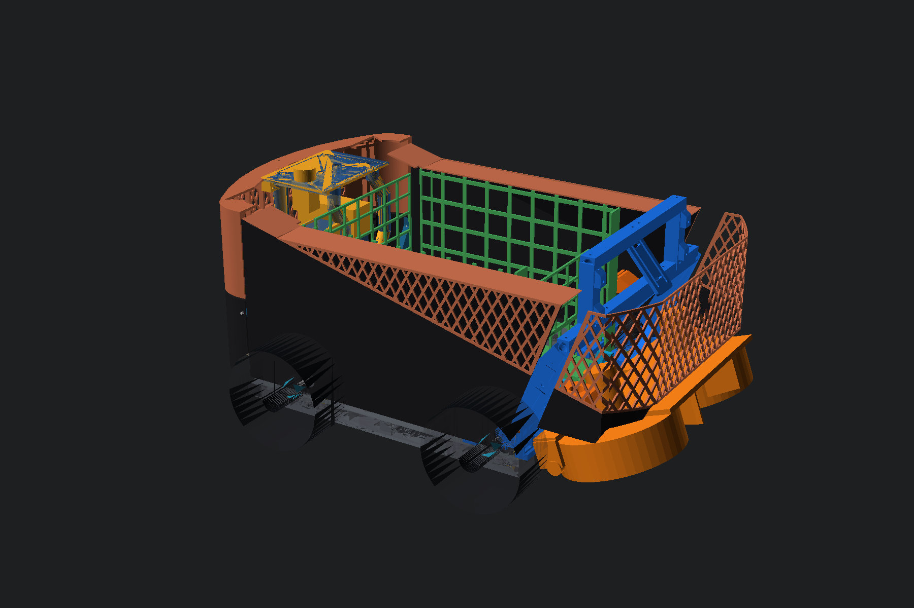
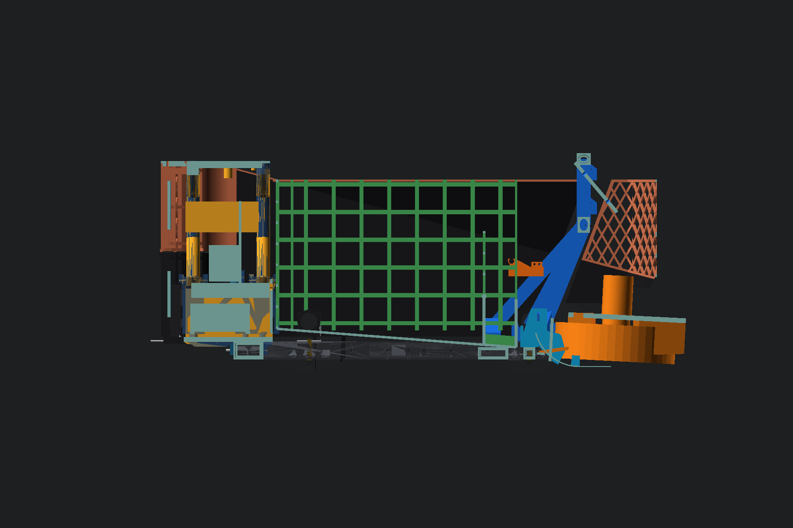
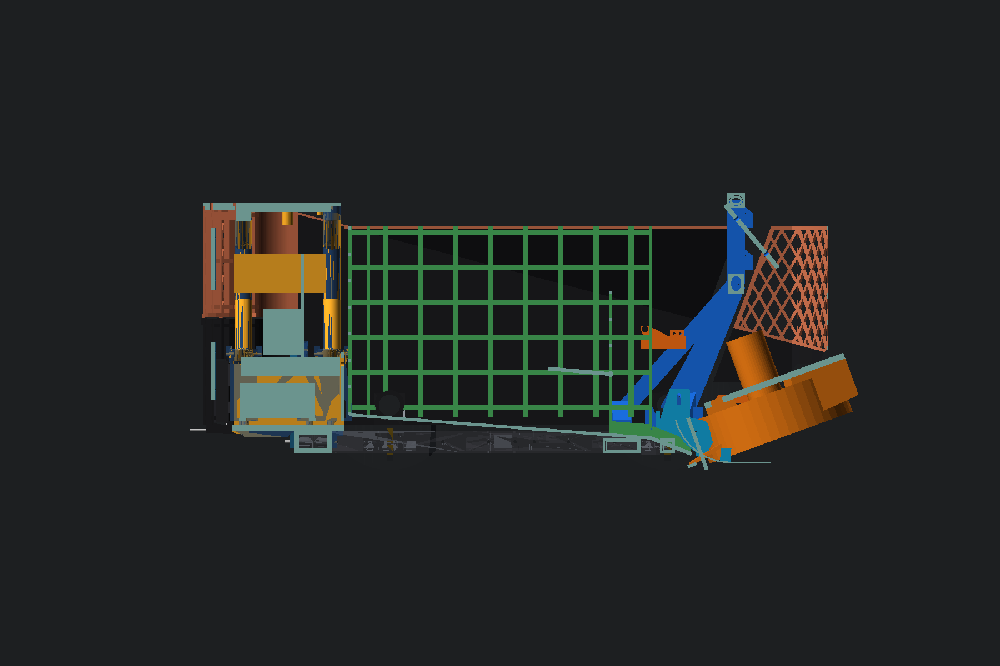
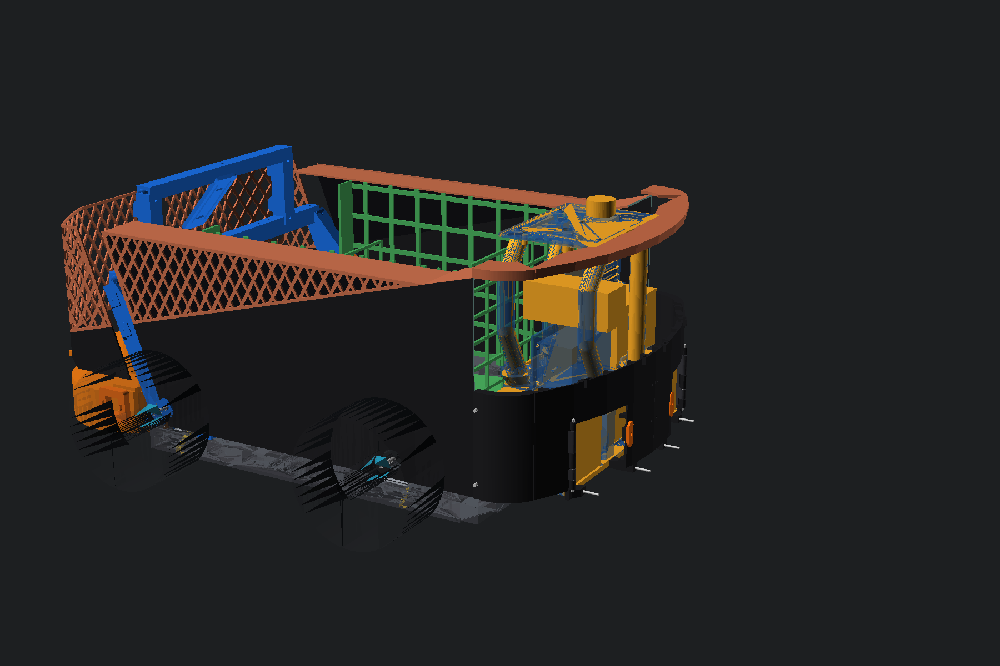
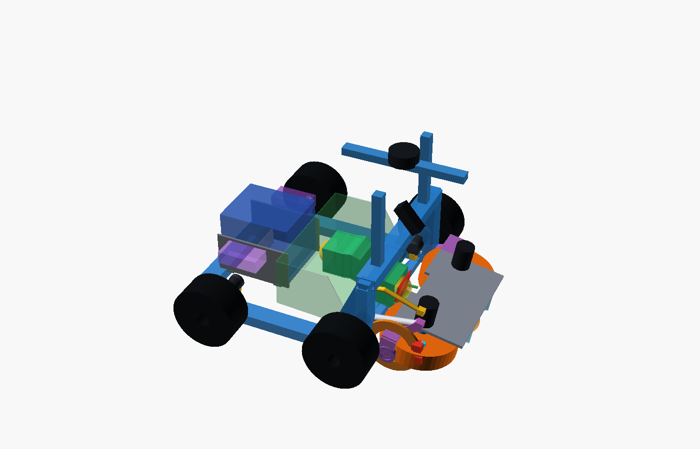
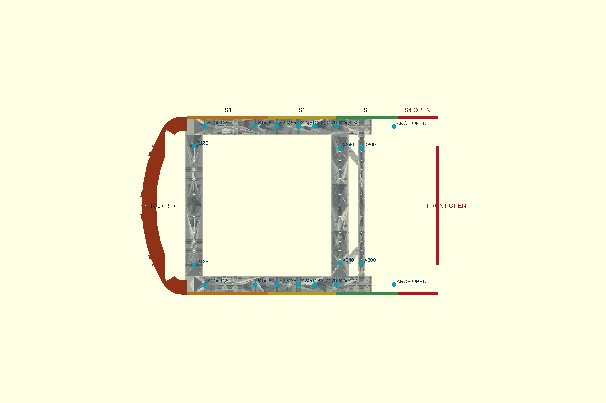

# Τρέχον design του tennis robot

Κατάσταση: **P2-93 — 2026-10-27**. Αυτό είναι το κεντρικό σημείο εκκίνησης
για τη σημερινή αρχιτεκτονική. Το φυσικό print status παραμένει στο
[`cad/ACTIVE-PRINT-SET.md`](../cad/ACTIVE-PRINT-SET.md), ενώ το πλήρες ιστορικό
πειραμάτων βρίσκεται στο
[`shared-flywheel-intake-launcher-debug-log-el.md`](mechanism/shared-flywheel-intake-launcher-debug-log-el.md).

## Αρχιτεκτονική με μία ματιά

- 4WD skid-steer βάση με modular v3 PETG σασί και τέσσερις FIT0403.
- Ένα κοινό περιστρεφόμενο ζεύγος flywheels για συλλογή και εκτόξευση.
- Καλάθι P2-71 με τέσσερις πλευρές πλέγματος, παθητικός βατήρας R75/75°,
  αψίδα P2-93 και μόνο μία συμπαγή fail-closed θύρα τροφοδοσίας `80×80 mm`.
- Rear pod v2 για Mega, perfboard, BTS7960, Pi 5, UGREEN και τις μελλοντικές
  Parkside μπαταρίες.
- Body concept F, το μοναδικό ενεργό body concept. Τα πίσω P2-86b panels
  είναι exact/release-candidate· τα πλαϊνά/εμπρός περιμένουν το basket mockup.
- Canonical runtime: Ubuntu 24.04 + ROS 2 Jazzy + Gazebo Harmonic. Στο Ubuntu
  26.04 development PC χρησιμοποιείται το `docker/jazzy/run.sh`.

*Exact/released context: P2-78 chassis, rear pod v2/P2-90d, P2-93 arch/tilt,
P2-85 ski και P2-86b rear panels. Concept: πλαϊνά/εμπρός F και κινητή μονάδα
P2-40 μέχρι τις φυσικές μετρήσεις τροχών/D5065.*

*Θέση συλλογής `−3°`. Τα ίδια concept όρια ισχύουν για F side/front και
moving flywheel module.*

*Θέση βολής `+20°`. Η απόδοση/αντοχή της κινητής μονάδας δεν έχει φυσικά
επικυρωθεί.*

*P2-86b rear service: οι Parkside doors είναι ανοικτές και τα αφαιρούμενα
`rear_hi` panels λείπουν. Τα Parkside docks παραμένουν provisional μέχρι
μέτρηση πραγματικής μπαταρίας/dock.*

## Αλλαγές P2-90…P2-93

- P2-90/P2-90b: πραγματική UGREEN `115×45×45 mm`, holder με split caps και
  rear retainer, insertion από −X.
- P2-90c/P2-90d: open post cups, συνεχείς 36×24 load spines, προσβάσιμα M4
  pockets και support-free roofs. Τα side frames τυπώθηκαν και
  συναρμολογήθηκαν με posts/control panel.
- Bench bring-up: ο οδηγός `hardware/bench-bringup-no-motors-el.md`, το CLI
  `scripts/bench_check_mega.py` και το UI `scripts/mega_buttons_panel.py`
  ελέγχουν Mega/E-stop/START/LED χωρίς μοτέρ. Από 2026-10-23 το START οπλίζει
  τοπικά στο Mega με τα safety gates ενεργά.
- P2-93: πρώτο release αψίδας/κλίσης, 20 one-body STL / 33 prints. Το arch
  core είναι release-ready· FIT/KFL/Tr8/AS5600 interfaces είναι fit-check
  μέχρι μετρήσεις. Με επιλογή A, τα endpoint switches μεταφέρονται στην
  κινητή μονάδα και η αψίδα μένει αμετάβλητη.

## Κοινό περιστρεφόμενο flywheel

Δύο counter-rotating τροχοί σχηματίζουν το nip και οδηγούνται απευθείας από
δύο D5065-270KV. Περιστρέφεται ολόκληρη η μονάδα, όχι κάθε μοτέρ χωριστά:

- συλλογή: `−3°`,
- μεταφορά: `0°`,
- εκτόξευση με ακίνητο όχημα: `+15…+20°`.

Η γεωμετρία P2-40 είναι παγωμένη ως CAD baseline. Αυτό **δεν** αποτελεί
πιστοποίηση φυσικής πρόσφυσης, ταχύτητας εξόδου ή αντοχής. Η απόδοση παραμένει
παγωμένη μέχρι να επιβεβαιωθεί η φυσική κίνηση του robot και τα physical
traction/contact gates.

Η επιλογή κοινού μηχανισμού έγινε από τον χρήστη για συμπαγέστερη
αρχιτεκτονική και μικρότερο κόστος αγορών: κάθε D5065 αναφέρεται περίπου
`99 €`, ενώ ξεχωριστό dual-wheel intake και dual-wheel launcher θα
διπλασίαζαν μοτέρ και drivers. Πλήρης ποσοτική σύγκριση κόστους:
**ΤΕΚΜΗΡΙΩΣΗ ΛΕΙΠΕΙ**.

### Τροχοί flywheel

Στις 2026-10-22 παραγγέλθηκαν δύο pneumatic AliExpress τροχοί, nominal
`200×50 mm`, από την ίδια παρτίδα. Τα στοιχεία πωλητή —όχι μετρήσεις— είναι:

- πραγματική δηλωμένη εξωτερική διάμετρος `192 mm`,
- πλάτος πέλματος `48 mm`,
- μάζα `760 g` ανά τροχό,
- άξονας/έδρα `10 mm` με 6200 bearings.

Το frozen CAD έχει D5065 axes `Y±129 mm`, απόσταση `258 mm`, για D200 και nip
`58 mm`. Με D192 το ίδιο datum δίνει περίπου `66 mm`, σχεδόν χωρίς συμπίεση
μπάλας. Η λύση κατευθύνεται σε **ρυθμιζόμενη απόσταση αξόνων**, αλλά μένει
ΑΝΟΙΧΤΗ μέχρι να μετρηθούν και οι δύο τροχοί στην παραλαβή. Το `Y≈±125 mm`
είναι μόνο πρώτη γεωμετρική εκτίμηση, όχι release dimension.

Το exact geometry audit P2-53 χρησιμοποίησε frozen τροχούς `Ø200×60 mm`.
Οι παραγγελμένοι έχουν seller-reported πέλμα 48 mm, δηλαδή είναι 12 mm
στενότεροι από αυτό το surrogate. Αυτό ανοίγει ξανά lateral hub/cheek,
service-loop και wheel-position checks μετά τη φυσική μέτρηση.

## Μηχανισμός κλίσης

Η αποφασισμένη baseline μετά τα P2-53/P2-54 είναι ένας υπάρχων
**FIT0186 με μονόσπειρη Tr8×2**, offset 1:1 toothed-belt drive και anti-rotation
nut carriage. Το παλιότερο Actuonix `P16-50-256-12-S` των P2-11/P2-12
παραμένει compact direct fallback, όχι current actuator.

Η λειτουργική διαδρομή είναι `−3°` συλλογή → `0°` μεταφορά → `+15…+20°`
εκτόξευση. Για το FIT0186/Tr8 η υπολογισμένη διαδρομή `−3→+20°` είναι
33,976 mm: 4,20 s ideal/no-load και **4,5…6 s design range** μέχρι να
μετρηθούν continuous torque, θερμοκρασία, πραγματική απόδοση ιμάντα,
backdrive και backlash. Ένας actuator αρκεί στο analytical screen.

Στο `+20°` ο actuator κρατά μικρή ελεγχόμενη προφόρτιση πάνω στα seating
stops. Το δεύτερο συμμετρικό stop είναι υποχρεωτικό: η αντίδραση εκτόξευσης
περνά `yoke → stops → arch`, όχι από Tr8/actuator. Δύο εξωτερικά endpoint
switches στα `−3°/+20°` παρέχουν homing και επιβεβαίωση θέσης. Ανεξάρτητα
μηχανικά emergency stops περιορίζουν τη διαδρομή στα `−12°/+22°`.

Primary feedback είναι **AS5600 στο hinge**, fixed I²C address `0x36`, για
απόλυτη γωνία. Τα endpoint switches `−3°/+20°` παρέχουν ανεξάρτητο
homing/reference και επιβεβαίωση. Ο encoder του FIT0186 είναι
προαιρετικός/διαγνωστικός για screw/motor motion, stall και backlash· δεν
είναι το authoritative position feedback.

Επιτρέπεται manual, spring-retained transport pin μόνο με τη μονάδα ακίνητη
και χωρίς τροφοδοσία· δεν είναι runtime lock. FIT0186, KFL08, Tr8 nut, GT2
parts και microswitches έχουν παραληφθεί, αλλά περιμένουν φυσικές μετρήσεις.
Το AS5600 board/magnet AZ1 έχει παραγγελθεί (2026-10-25): έρχεται ως 3,3 V
board και σε ένα από τα τέσσερα θα αφαιρεθεί η `R1` 0 Ω για δοκιμή σε 5 V.
Το ρυθμιζόμενο 12 V power stage παραμένει ανοικτό.

## Διαδρομή μπάλας και καλάθι

- P2-73/P2-85: τυπωμένος βατήρας R75/75° με νέα brackets και wall forks.
- P2-74: selector rails στα `Y±55 mm`.
- P2-67: γερμένη αψίδα `X390/Z245` και deflector· η R75/75 baseline πέρασε
  90/90 cases και το συνολικό P2-67 matrix 180/180.
- P2-68/P2-69/P2-71: τέσσερις πλευρές πλέγματος. Μόνο η fail-closed θύρα
  clear `80×80 mm` είναι συμπαγής και χρησιμοποιείται για τροφοδοσία βολών.
  Η τελική front-wall λεπτομέρεια παραμένει υπό basket mockup.
- P2-71: το καλάθι σχεδιάζεται για 45 μπάλες, αλλά το φυσικό acceptance είναι
  **40 υποχρεωτικές / 41–45 best-effort** μέχρι basket mockup και pile test.

Το cardboard basket mockup, η συγκράτηση σωρού και το ski hand test παραμένουν
υποχρεωτικά πριν κλειδώσουν τα πλαϊνά panels και οι εσωτερικές επιφάνειες.

## Σασί και κίνηση

Το modular v3/P2-78 σασί είναι πλήρως τυπωμένο, μαζί με sockets, terminal
sleeves, side braces, corners και crossbars. Τα εύθραυστα T-clamps και το
P2-77 centre torsion node έχουν καταργηθεί. Το μόνο ενεργό MPU mount είναι το
P2-77 rail-side mount.

Η βάση είναι 4WD skid-steer με τέσσερις FIT0403. Έχει επιβεβαιωθεί **ένα
ζευγάρι / δύο τεμάχια** HPI Baja rear `170×80 mm`. Η ταυτότητα/διάσταση των
άλλων δύο drive wheels απαιτεί **ΕΠΙΒΕΒΑΙΩΣΗ ΧΡΗΣΤΗ**· δεν θεωρούνται αυτόματα
ίδια.

Δεν ανοίγεται νέα οπή στο ήδη τυπωμένο σασί. Οι κοινές συνδέσεις πρέπει να
χρησιμοποιούν υπάρχουσες οπές και να περνούν τους μόνιμους ελέγχους:

- hole-axis probe έναντι του πραγματικού `frame_assembly`,
- ακριβώς ένα σώμα ανά ενεργό STL, εκτός δηλωμένων print plates,
- πλήρες hardware και ≥60 mm tool-access cylinder στη σειρά συναρμολόγησης.

## Rear pod v2, P2-90d και ηλεκτρονικά

Το rear pod v2 καλύπτει τα P2-75…P2-90d. Οι P2-86b βάσεις έχουν τυπωθεί και
είναι κλειδωμένες. Η πραγματική UGREEN είναι `115×45×45 mm` και το P2-90b
holder χρησιμοποιεί split side-installable caps και rear retainer. Τα
P2-90d side frames είναι τυπωμένα/συναρμολογημένα με open post cups,
36×24 load spines και support-free 45° roofs. Το upright
jaw coupon τυπώθηκε και πέρασε, άρα η σιαγόνα `4,8 mm`, η γλωττίδα `4 mm`
και η αντίστοιχη M4 θέση δεν αλλάζουν.

Η σημερινή, **μη τροποποιημένη** Rev-C perfboard και το επαληθευμένο firmware
`motion_intake_mega.ino` εξακολουθούν να αντιστοιχούν τα τέσσερα BTS7960 ως:

1. drive left — `D5/D6`, enable `D30`,
2. drive right — `D9/D10`, enable `D31`,
3. intake left — `D44/D45`, enable `D40`,
4. intake right — `D46/D11`, enable `D42`.

Τα δύο intake BTS οδηγούν από ένα FIT0186 στο σημερινό bring-up firmware.
Το tilt actuator και οι endpoint sensors **δεν υπάρχουν** στη Rev-C netlist.

Η αποφασισμένη τελική κατανομή καναλιών, της οποίας η υλοποίηση εκκρεμεί,
είναι:

1. BTS #1 — drive left, `D5/D6`, EN `D30`, ζεύγος μοτέρ αριστερής πλευράς,
2. BTS #2 — drive right, `D9/D10`, EN `D31`, ζεύγος μοτέρ δεξιάς πλευράς,
3. BTS #3 — tilt FIT0186+Tr8×2, `D44/D45`, EN `D40`,
4. BTS #4 — ρεζέρβα, σημερινά `D46/D11`, EN `D42`.

Οι απαιτήσεις της μελλοντικής netlist/firmware υλοποίησης είναι:

- primary absolute angle από AS5600 `0x36` στο κοινό I²C `D20/D21`, μαζί
  με το MPU6050 `0x68/0x69`, αφού ελεγχθούν breakout voltage/pull-ups,
- προαιρετικός FIT0186 quadrature encoder μόνο για diagnostics. Αν
  χρησιμοποιηθεί, τα `A8…A15` είναι `PCINT16…23`: το `A10/A11` είναι ήδη
  δρομολογημένο ως `J_ENC_IL`, τα `A8/A9` επίσης απελευθερώνονται, ενώ τα
  `A12…A15` δεν υπάρχουν στο σημερινό 34-pin harness,
- δύο endpoint switches `−3°/+20°` και deterministic homing,
- direction-specific hardware limit: κάθε endpoint αποκόπτει μόνο το
  `R_EN` ή `L_EN` της κίνησης προς το αντίστοιχο όριο. Η σημερινή Rev-C
  γεφυρώνει R_EN/L_EN, άρα αυτό απαιτεί νέα, ελεγμένη netlist,
- stall detection από τα BTS `R_IS/L_IS`, τα οποία επίσης δεν δρομολογούνται
  στο σημερινό control harness· ADC pins και thresholds μένουν να οριστούν.
  Το IS χρειάζεται bench calibration και λειτουργεί μαζί με fuse/timeout,
  όχι ως τεκμηριωμένο precision closed-loop current limit.

Το BTS #3/FIT0186 τροφοδοτείται από **ξεχωριστή fused regulated 12 V rail**
από το Parkside power tree. Το P2-70 έχει δεσμεύσει χώρο για αυτό το DC-DC,
αλλά ο converter δεν έχει αγοραστεί/επιλεγεί και η Rev-C δεν μεταφέρει motor
power. Direct raw Parkside 15–21 V με duty cap είναι μόνο προσωρινό contingency
του P2-52, όχι η αποφασισμένη tilt τροφοδοσία.

Firmware και Rev-C/netlist δεν αλλάζουν πριν ολοκληρωθεί το drive test και
δοθεί νέα ρητή έγκριση χρήστη. Οι D5065 controllers παραμένουν ξεχωριστή,
μη επιλεγμένη αγορά και δεν ταυτίζονται με BTS7960.

Άλλα βασικά στοιχεία: Mega 2560, keyed perfboard, Pi 5, UGREEN power bank,
MPU6050, PCA9685, E-stop `D33`, START `D32`, ARMED LED `D34` και break beams
`D36/D37`. Τα δύο Parkside X20V packs/docks είναι provisional και δεν έχουν
αγοραστεί.

Από 2026-10-23 το START οπλίζει **τοπικά στο Mega** από DISARMED, μόνο όταν
το E-stop είναι κλειστό και το CPR έγκυρο· δεν εξαρτάται από host command.
Ο οδηγός πάγκου χωρίς μοτέρ είναι το
[`bench-bringup-no-motors-el.md`](hardware/bench-bringup-no-motors-el.md),
με CLI `scripts/bench_check_mega.py` και browser UI
`scripts/mega_buttons_panel.py`.

Τα Ruthex RX-M3x5.7 heat-set inserts επιτρέπονται για καλύμματα, θήκες και
docks μέτριου φορτίου. Δεν χρησιμοποιούνται στις κύριες M4 φέρουσες
συνδέσεις, οι οποίες παραμένουν διαμπερείς με ροδέλα/nyloc.

## Body concept F

Το F είναι το μόνο ενεργό body concept. Τα A–E και v3 είναι archived. Τα
πίσω `rear_lo`, `rear_hi`, `deck_rear`, Parkside doors, stays και splices
έχουν σχεδιαστεί στο P2-84…P2-86b αλλά παραμένουν **ΔΕΝ ΤΥΠΩΝΕΤΑΙ ΑΚΟΜΑ**.
Ο περιμετρικός χάρτης P2-86b ορίζει το R60 fillet και τις μελλοντικές ραφές.

Τα πλαϊνά και εμπρός panels περιμένουν το basket mockup. Οι S4/front
στηρίξεις πλέον έχουν P2-93 lands στην αψίδα, αλλά η τελική panel γεωμετρία
παραμένει ανοικτή μέχρι το mockup. Δεν επιτρέπεται νέα οπή στο τυπωμένο σασί.

## Runtime

- Κανονικό περιβάλλον: native Ubuntu 24.04, ROS 2 Jazzy, Gazebo Harmonic,
  είσοδος `./run_native.sh`.
- Ubuntu 26.04 development PC: `docker/jazzy/run.sh`, δηλαδή το ίδιο
  Ubuntu 24.04/Jazzy runtime μέσα σε container.
- Το παλιό Docker/Humble είναι obsolete και δεν αποτελεί fallback.

## Τι είναι τυπωμένο και τι εκκρεμεί

Τυπωμένα/επιβεβαιωμένα:

- ολόκληρο modular chassis v3/P2-78,
- R75/75 ski,
- rear-pod P2-86b base left/right,
- P2-90d side frames, panel posts και control panel συναρμολογημένα,
- upright jaw coupon — fit PASS.

Σε εκτύπωση τώρα: P2-85 X300 brackets/wall forks και το πρώτο κύμα P2-93
αψίδας. Τα FIT/KFL/Tr8/AS5600 interfaces είναι fit-check μέχρι μέτρηση.

Κύρια ανοικτά φυσικά gates:

- drive test με PSU,
- μέτρηση τριβής TPU `μ`,
- basket mockup και pile retention 40/45,
- ski hand test,
- proof-load 30 N του control panel,
- tilt implementation: νέα netlist/harness, firmware, homing/endpoints,
  AS5600 calibration, direction-specific hardware limits, IS stall thresholds,
  regulated 12 V stage και FIT0186/Tr8 current/thermal/backdrive test,
- μετρήσεις των AliExpress flywheel wheels και των μελλοντικών Parkside.

Με απόφαση χρήστη, δεν γίνονται άλλες κύριες αγορές πριν επιβεβαιωθεί η φυσική
κίνηση. Εξαιρούνται φθηνά samples που αγοράζονται αποκλειστικά για μέτρηση.

## Πηγές αλήθειας

- Physical print status: [`cad/ACTIVE-PRINT-SET.md`](../cad/ACTIVE-PRINT-SET.md)
- P2 history: [`shared-flywheel-intake-launcher-debug-log-el.md`](mechanism/shared-flywheel-intake-launcher-debug-log-el.md)
- Decisions: [`decisions/decision-log-el.md`](decisions/decision-log-el.md)
- Parts actually ordered: [`hardware/ordered-parts.md`](hardware/ordered-parts.md)
- Rev-C wiring: [`hardware/unified-keyed-perfboard-wiring-el.md`](hardware/unified-keyed-perfboard-wiring-el.md)
- Body F perimeter: [`design/body-panels/p286b-perimeter-map-el.md`](design/body-panels/p286b-perimeter-map-el.md)
