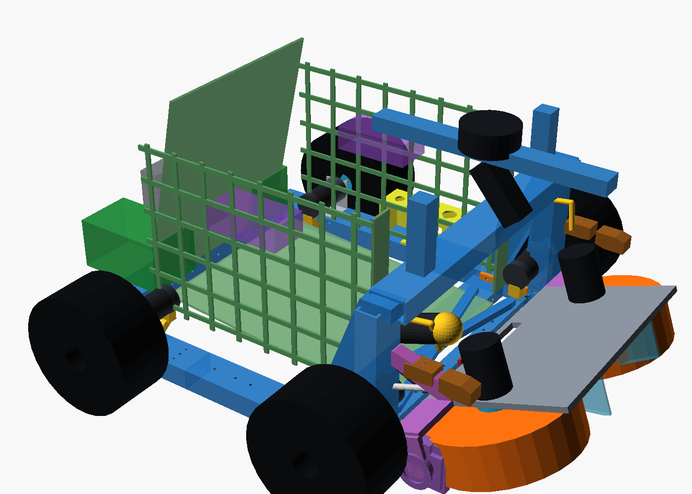

# Τρέχον design του tennis robot

Κατάσταση: **P2-89 — 2026-10-22**. Αυτό είναι το κεντρικό σημείο εκκίνησης
για τη σημερινή αρχιτεκτονική. Το φυσικό print status παραμένει στο
[`cad/ACTIVE-PRINT-SET.md`](../cad/ACTIVE-PRINT-SET.md), ενώ το πλήρες ιστορικό
πειραμάτων βρίσκεται στο
[`shared-flywheel-intake-launcher-debug-log-el.md`](mechanism/shared-flywheel-intake-launcher-debug-log-el.md).

## Αρχιτεκτονική με μία ματιά

- 4WD skid-steer βάση με modular v3 PETG σασί και τέσσερις FIT0403.
- Ένα κοινό περιστρεφόμενο ζεύγος flywheels για συλλογή και εκτόξευση.
- Σταθερό καλάθι, παθητικός βατήρας R75/75°, γερμένη εμπρός αψίδα και
  fail-closed θύρα τροφοδοσίας.
- Rear pod v2 για Mega, perfboard, BTS7960, Pi 5, UGREEN και τις μελλοντικές
  Parkside μπαταρίες.
- Body concept F. Μόνο τα πίσω panels είναι σχεδιασμένα και παραμένουν σε
  αναμονή· τα πλαϊνά/εμπρός περιμένουν το basket mockup.
- Canonical runtime: Ubuntu 24.04 + ROS 2 Jazzy + Gazebo Harmonic. Στο Ubuntu
  26.04 development PC χρησιμοποιείται το `docker/jazzy/run.sh`.

## Κοινό περιστρεφόμενο flywheel

Δύο counter-rotating τροχοί σχηματίζουν το nip και οδηγούνται απευθείας από
δύο D5065-270KV. Περιστρέφεται ολόκληρη η μονάδα, όχι κάθε μοτέρ χωριστά:

- συλλογή: `−3°`,
- μεταφορά: `0°`,
- εκτόξευση με ακίνητο όχημα: `+15…+20°`.

Η γεωμετρία P2-40 είναι παγωμένη ως CAD baseline. Αυτό **δεν** αποτελεί
πιστοποίηση φυσικής πρόσφυσης, ταχύτητας εξόδου ή αντοχής. Η απόδοση παραμένει
παγωμένη μέχρι να επιβεβαιωθεί η φυσική κίνηση του robot και τα physical
traction/contact gates.

Η επιλογή κοινού μηχανισμού έγινε από τον χρήστη για συμπαγέστερη
αρχιτεκτονική και μικρότερο κόστος αγορών: κάθε D5065 αναφέρεται περίπου
`99 €`, ενώ ξεχωριστό dual-wheel intake και dual-wheel launcher θα
διπλασίαζαν μοτέρ και drivers. Πλήρης ποσοτική σύγκριση κόστους:
**ΤΕΚΜΗΡΙΩΣΗ ΛΕΙΠΕΙ**.

### Τροχοί flywheel

Στις 2026-10-22 παραγγέλθηκαν δύο pneumatic AliExpress τροχοί, nominal
`200×50 mm`, από την ίδια παρτίδα. Τα στοιχεία πωλητή —όχι μετρήσεις— είναι:

- πραγματική δηλωμένη εξωτερική διάμετρος `192 mm`,
- πλάτος πέλματος `48 mm`,
- μάζα `760 g` ανά τροχό,
- άξονας/έδρα `10 mm` με 6200 bearings.

Το frozen CAD έχει D5065 axes `Y±129 mm`, απόσταση `258 mm`, για D200 και nip
`58 mm`. Με D192 το ίδιο datum δίνει περίπου `66 mm`, σχεδόν χωρίς συμπίεση
μπάλας. Η λύση κατευθύνεται σε **ρυθμιζόμενη απόσταση αξόνων**, αλλά μένει
ΑΝΟΙΧΤΗ μέχρι να μετρηθούν και οι δύο τροχοί στην παραλαβή. Το `Y≈±125 mm`
είναι μόνο πρώτη γεωμετρική εκτίμηση, όχι release dimension.

## Διαδρομή μπάλας και καλάθι

- P2-73/P2-85: τυπωμένος βατήρας R75/75° με νέα brackets και wall forks.
- P2-74: selector rails στα `Y±55 mm`.
- P2-67: γερμένη αψίδα `X390/Z245` και deflector· η R75/75 baseline πέρασε
  90/90 cases και το συνολικό P2-67 matrix 180/180.
- P2-68/P2-69: όρθιο εμπρός τοίχωμα `X225`, top `Z235`, και fail-closed
  θύρα clear `80×80 mm`, επιβεβαιωμένα 30/30 στο σχετικό matrix.
- P2-71: το καλάθι σχεδιάζεται για 45 μπάλες, αλλά το φυσικό acceptance είναι
  **40 υποχρεωτικές / 41–45 best-effort** μέχρι basket mockup και pile test.

Το cardboard basket mockup, η συγκράτηση σωρού και το ski hand test παραμένουν
υποχρεωτικά πριν κλειδώσουν τα πλαϊνά panels και οι εσωτερικές επιφάνειες.

## Σασί και κίνηση

Το modular v3/P2-78 σασί είναι πλήρως τυπωμένο, μαζί με sockets, terminal
sleeves, side braces, corners και crossbars. Τα εύθραυστα T-clamps και το
P2-77 centre torsion node έχουν καταργηθεί. Το μόνο ενεργό MPU mount είναι το
P2-77 rail-side mount.

Η βάση είναι 4WD skid-steer με τέσσερις FIT0403. Έχει επιβεβαιωθεί **ένα
ζευγάρι / δύο τεμάχια** HPI Baja rear `170×80 mm`. Η ταυτότητα/διάσταση των
άλλων δύο drive wheels απαιτεί **ΕΠΙΒΕΒΑΙΩΣΗ ΧΡΗΣΤΗ**· δεν θεωρούνται αυτόματα
ίδια.

Δεν ανοίγεται νέα οπή στο ήδη τυπωμένο σασί. Οι κοινές συνδέσεις πρέπει να
χρησιμοποιούν υπάρχουσες οπές και να περνούν τους μόνιμους ελέγχους:

- hole-axis probe έναντι του πραγματικού `frame_assembly`,
- ακριβώς ένα σώμα ανά ενεργό STL, εκτός δηλωμένων print plates,
- πλήρες hardware και ≥60 mm tool-access cylinder στη σειρά συναρμολόγησης.

## Rear pod v2 και ηλεκτρονικά

Το rear pod v2 καλύπτει τα P2-75…P2-88. Οι P2-86b βάσεις έχουν τυπωθεί και
είναι κλειδωμένες. Τα παλιά side frames τυπώθηκαν αλλά καταργούνται λόγω
μη συναρμολογήσιμων M4· αντικαθίστανται από τα P2-88 side frames. Το upright
jaw coupon τυπώθηκε και πέρασε, άρα η σιαγόνα `4,8 mm`, η γλωττίδα `4 mm`
και η αντίστοιχη M4 θέση δεν αλλάζουν.

Η ενεργή Rev-C perfboard και το επαληθευμένο firmware
`motion_intake_mega.ino` αντιστοιχούν τα τέσσερα BTS7960 ως:

1. drive left — `D5/D6`, enable `D30`,
2. drive right — `D9/D10`, enable `D31`,
3. intake left — `D44/D45`, enable `D40`,
4. intake right — `D46/D11`, enable `D42`.

Τα δύο intake BTS οδηγούν από ένα FIT0186 στο σημερινό bring-up firmware.
Το throw/launcher δεν περιλαμβάνεται στη Rev-C netlist. Οι D5065 controllers
είναι ξεχωριστή, μη επιλεγμένη ακόμη αγορά και δεν ταυτίζονται με BTS7960.

Άλλα βασικά στοιχεία: Mega 2560, keyed perfboard, Pi 5, UGREEN power bank,
MPU6050, PCA9685, E-stop `D33`, START `D32`, ARMED LED `D34` και break beams
`D36/D37`. Τα δύο Parkside X20V packs/docks είναι provisional και δεν έχουν
αγοραστεί.

Τα Ruthex RX-M3x5.7 heat-set inserts επιτρέπονται για καλύμματα, θήκες και
docks μέτριου φορτίου. Δεν χρησιμοποιούνται στις κύριες M4 φέρουσες
συνδέσεις, οι οποίες παραμένουν διαμπερείς με ροδέλα/nyloc.

## Body concept F

Το F είναι το μόνο ενεργό body concept. Τα A–E και v3 είναι archived. Τα
πίσω `rear_lo`, `rear_hi`, `deck_rear`, Parkside doors, stays και splices
έχουν σχεδιαστεί στο P2-84…P2-86b αλλά παραμένουν **ΔΕΝ ΤΥΠΩΝΕΤΑΙ ΑΚΟΜΑ**.
Ο περιμετρικός χάρτης P2-86b ορίζει το R60 fillet και τις μελλοντικές ραφές.

Τα πλαϊνά και εμπρός panels περιμένουν το basket mockup. Οι S4/front
στηρίξεις κοντά στην αψίδα παραμένουν ανοικτές επειδή δεν υπάρχει υφιστάμενη
οπή· δεν επιτρέπεται να προστεθεί οπή στο τυπωμένο σασί.

## Runtime

- Κανονικό περιβάλλον: native Ubuntu 24.04, ROS 2 Jazzy, Gazebo Harmonic,
  είσοδος `./run_native.sh`.
- Ubuntu 26.04 development PC: `docker/jazzy/run.sh`, δηλαδή το ίδιο
  Ubuntu 24.04/Jazzy runtime μέσα σε container.
- Το παλιό Docker/Humble είναι obsolete και δεν αποτελεί fallback.

## Τι είναι τυπωμένο και τι εκκρεμεί

Τυπωμένα/επιβεβαιωμένα:

- ολόκληρο modular chassis v3/P2-78,
- R75/75 ski,
- rear-pod P2-86b base left/right,
- παλιά side frames — **superseded, δεν χρησιμοποιούνται**,
- upright jaw coupon — fit PASS.

Σε εκτύπωση τώρα: P2-85 X300 brackets και wall forks.

Κύρια ανοικτά φυσικά gates:

- drive test με PSU,
- μέτρηση τριβής TPU `μ`,
- basket mockup και pile retention 40/45,
- ski hand test,
- proof-load 30 N του control panel,
- μετρήσεις των AliExpress flywheel wheels και των μελλοντικών Parkside.

Με απόφαση χρήστη, δεν γίνονται άλλες κύριες αγορές πριν επιβεβαιωθεί η φυσική
κίνηση. Εξαιρούνται φθηνά samples που αγοράζονται αποκλειστικά για μέτρηση.

## Πηγές αλήθειας

- Physical print status: [`cad/ACTIVE-PRINT-SET.md`](../cad/ACTIVE-PRINT-SET.md)
- P2 history: [`shared-flywheel-intake-launcher-debug-log-el.md`](mechanism/shared-flywheel-intake-launcher-debug-log-el.md)
- Decisions: [`decisions/decision-log-el.md`](decisions/decision-log-el.md)
- Parts actually ordered: [`hardware/ordered-parts.md`](hardware/ordered-parts.md)
- Rev-C wiring: [`hardware/unified-keyed-perfboard-wiring-el.md`](hardware/unified-keyed-perfboard-wiring-el.md)
- Body F perimeter: [`design/body-panels/p286b-perimeter-map-el.md`](design/body-panels/p286b-perimeter-map-el.md)
