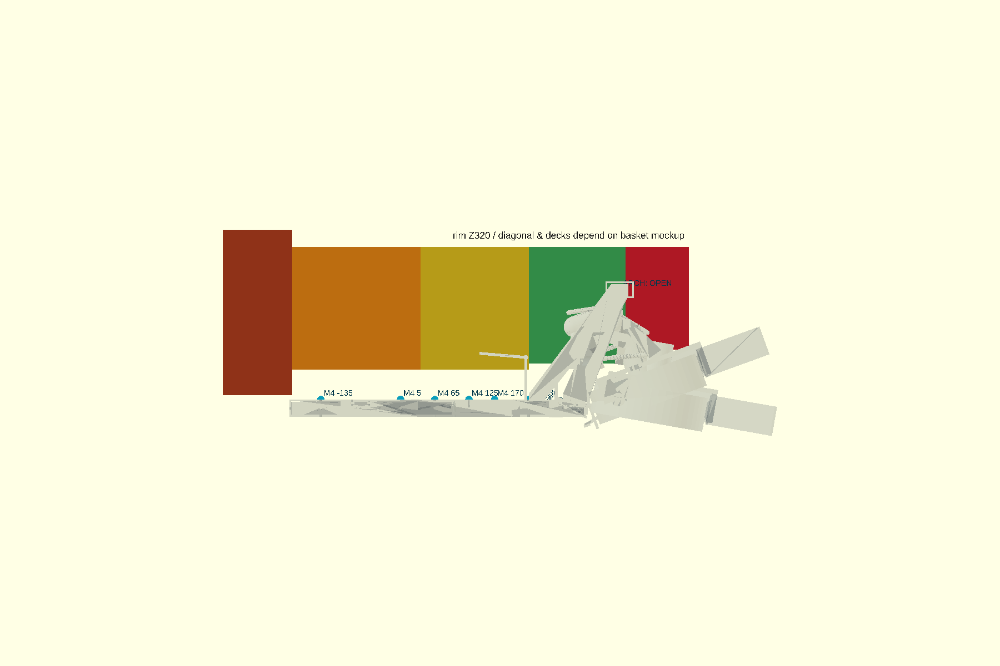

# P2-86b — χάρτης περιμέτρου F και υπαρχόντων σημείων στήριξης

Κατάσταση: **χάρτης interface, όχι τελικό CAD πλαϊνών/εμπρός και όχι για
εκτύπωση**. Το basket mockup παραμένει προϋπόθεση για P2-87.

## Σταθερά δεδομένα

- Πίσω datum `R424,5` γύρω από `X117`.
- Εφαπτόμενο fillet `R60`: κέντρο `X−197,36/Y±184,5`, επαφή με το πίσω
  τόξο `X−249,10/Y±214,87` και επαφή με την ευθεία στο
  `X−197,36/Y±244,5`. Η νέα P2-87 ραφή είναι **μετά** το fillet, στο
  `X−185/Y±244,5`.
- Πλαϊνή εσωτερική παρειά `Y±244,5`; εξωτερική παρειά PETG `Y±247,0`.
- Δεν ανοίγεται καμία νέα οπή στο ήδη τυπωμένο σασί. Όλοι οι παρακάτω
  άξονες πέρασαν το `check-active-chassis-hole-alignment.sh` ως
  `PASS_EMPTY` απέναντι στο `frame_assembly()`.

## Τμήματα και load paths

| Τμήμα ανά πλευρά | Όρια / μέγιστη διάσταση | Φέρον στοιχείο και ≥2 σημεία | Υπάρχοντες άξονες M4 που ελέγχθηκαν | Κενά / κατάσταση |
|---|---|---|---|---|
| `R-L`, `R-R` πίσω + R60 | Y0…±247, X−308…−185, επιμέρους STL ≤250 mm | pod base + control-panel beam + P2-86b corner stay | rear crossbar `X−165/Y±75,±125`; end-lock top+side `X−165/Y±165/Z37`; corner tie μοιράζεται την side M4 | Pod ≥3 mm, Parkside sweep, FIT0403/τροχοί, moving −10…+20° και ground: **OK** |
| `S1-L/R` πίσω πλαϊνό | X−185…40, μήκος 225 mm | πίσω seam/stay και δύο rail brackets | longitudinal rail `X−135` και `X5`, `Y±220` | Δεν πλησιάζει ski/FIT· εξωτερικό περίγραμμα ανεξάρτητο καλαθιού: **OK interface** |
| `S2-L/R` μέσο πλαϊνό | X40…230, μήκος 190 mm | τουλάχιστον δύο rail brackets· διαθέσιμα πέντε σημεία | rail `X65/100/125/170/230`, `Y±220` | MPU στο +Y `X100/125/Z37` πρέπει να μείνει serviceable· moving/σκελετός: **OK interface** |
| `S3-L/R` τροχός / νέα στήριξη X240 | X230…400, μήκος 170 mm | P2-78 X240 και X300 socket nodes + side brace· όχι παλιό T-clamp | top M4 `X240,Y±150/±160` και `X300,Y±150/±160` | Τροχός 11 mm από Y244,5 (≥10), P2-85 brackets/nyloc και FIT0403 integration PASS: **OK interface**, απαιτεί bracket CAD |
| `S4-L/R` προς σκέλος αψίδας | X400…511, μήκος 111 mm | πρέπει να δεθεί σε δύο σημεία του P2-67 arch leg/crossbar | **καμία released οπή στο P2-67 CAD** | Moving minimum του concept 10,3 mm, αλλά στήριξη **ΑΝΟΙΧΤΟ** |
| `F-L`, `F-R` εμπρός μισά | Y0…±164, μήκος 164 mm | δύο σημεία ανά half στο arch/mast, μετά φυσική μέτρηση | **καμία released οπή** | Κώνος/FOV/airflow εξαρτώνται από τελική camera/arch release: **ΑΝΟΙΧΤΟ** |
| `D1…D4` εσωτερικά decks | ίδια X seams με S1…S4 | ίδια brackets, αλλά ανεξάρτητες βίδες/lands | κληρονομούν τους παραπάνω άξονες | **ΑΝΟΙΧΤΟ — basket mockup** |

Πρόταση για τα ανοικτά `S4/F`: διμερής through-bolted clamp γύρω από το
σκέλος/πάνω δοκό της αψίδας, με δύο διαμπερείς M4 στο **νέο clamp**, όχι
στο σασί ή στο σκέλος. Απαιτεί νέα απόφαση αφού μετρηθεί η πραγματική
αψίδα· δεν σχεδιάστηκε στο P2-86b.

## Τι εξαρτάται από το καλάθι

Δεν εξαρτώνται: R424,5/R60/Y244,5, οι X seams, οι παραπάνω chassis axes,
το πέρασμα τροχών/FIT0403, το P2-85 envelope και η πίσω release γεωμετρία.

Εξαρτώνται από το basket mockup: rim `Z320`, ακριβής διαγώνια γραμμή,
ύψος/άνοιγμα πλέγματος, εσωτερικό βάθος και κλίση decks, πρόσβαση pile,
τελική θέση φίλτρων και οι πάνω βίδες των S1…S4. Άρα ο χάρτης αποδεικνύει
ότι υπάρχει συνεχής περιμετρική διαδρομή, όχι ότι τα side/front STL είναι
έτοιμα.

## Λαβή μεταφοράς — πρόταση, όχι νέο κομμάτι

Τα PETG rails και τα skins/deck δεν είναι λαβές. Για 10 kg και 2 g το
σχεδιαστικό φορτίο είναι `196 N`. Προτεινόμενο μελλοντικό load-spreader
handle δένει στις τέσσερις υπάρχουσες top M4 της πίσω τραβέρσας
`X−165/Y±75,±125`, δηλαδή `49,1 N/βίδα`: ονομαστική διάτμηση M4
`≈3,9 MPa` και printed bearing σε 6,5 mm PETG `≈1,9 MPa`. Χρειάζεται
ξεχωριστό packaging/proof-load 200 N πριν χαρακτηριστεί λαβή. Μέχρι τότε:
**μην σηκώνεις από deck, skins ή rails**.

