# Εξωτερικά panels — concept βιομηχανικού σχεδιασμού

> **Αντικαθίσταται (2026-10-17)** από το
> [`panels-concept-v3-el.md`](panels-concept-v3-el.md): πρόταση D πάνω στο
> πραγματικό `full-robot-v3.scad` (P2-65…P2-71). Οι A/B/C παρακάτω
> σχεδιάστηκαν πριν από τη γερμένη αψίδα, το pod P2-70 και τον κύκλο στροφής
> R425. Τα εμπρός guards της B θα έφταναν R≈494 και αποκλείονται.

Κατάσταση: `BODY_PANELS_CONCEPT_A_B_C_ALL_GATES_PASS_B_RECOMMENDED_NO_STL`.
Concept, όχι print release. Δεν έγινε STL για εκτύπωση, Gazebo, ROS, Docker,
commit, push ή PR. Δεν τροποποιήθηκε κανένα υπάρχον αρχείο. Η γεωμετρία
μηχανισμού διαβάζεται read-only με `use` από το
`cad/modular-test-chassis/shared-flywheel-transition-p252.scad`, δηλαδή
P2-40 launcher, P2-51 καλάθι/R75 ski, P2-54 actuator/FIT0186/arm,
P2-55 stops και AS5600.

Αρχεία:

| Αρχείο | Περιεχόμενο |
|---|---|
| `cad/body-panels/body-panels-concepts.scad` | Τρεις παραμετρικές προτάσεις `concept="A"/"B"/"C"`, keep-outs, προσωρινές ζώνες, QA views |
| `cad/body-panels/render-concepts.sh` | Όλα τα renders (μόνο PNG) |
| `cad/body-panels/qa-clearance.py` | Exact-solid gates και αριθμητικά ελάχιστα διάκενα ανά panel |
| `cad/body-panels/qa-results.json` | Πλήρη αποτελέσματα QA (A, B, C) |
| `cad/body-panels/renders/*.png` | Ισομετρικά εμπρός-δεξιά/πίσω-αριστερά, πλάγια, κάτοψη, τομές, keep-outs |

Σύμβαση όψεων: +X μπροστά, +Y αριστερά, +Z πάνω. Οι πλάγιες όψεις
κοιτάζουν από το −Y, με το μπροστά δεξιά και το +Z πάνω. Οι κατόψεις έχουν
+X δεξιά και +Y πάνω. Κάθε render ελέγχθηκε οπτικά.

## 1. Πλαίσιο που κυβερνά το σχήμα

Οι αριθμοί προέρχονται από το παγωμένο CAD, όχι από νέες υποθέσεις.

| Στοιχείο | Τιμή | Συνέπεια για τα panels |
|---|---|---|
| Τροχοί flywheel Ø200×60, κέντρα Y±129, **οριζόντιοι δίσκοι** | χείλος έως **\|Y\|=229**, X342…542 | Εμπρός, κάθε panel πρέπει να είναι στο \|Y\|≥239 ή πίσω από το X≈330 |
| Yoke/trunnion | έως \|Y\|=240 γύρω από το pivot X387 | Τα εμπρός guards ξεκινούν στο X430 |
| Κινητήριοι τροχοί Ø170×83 (envelope) | εσωτερική παρειά **Y±255,5**, εξωτερική ±338,5, άξονες X−65/300, Z85 | Ο πλευρικός διάδρομος για panel είναι Y≤245,5. Πάνω από Z180 επιτρέπεται έως Y±338 |
| Rails 50×30 | Y195…245, Z22…52 | Έδραση side pods |
| Καλάθι P2-51 | X−85…278, Y±172 (grid έως 173,5), rim Z320, backboard Z375 με κλίση 12° | Τίποτα πάνω από το καλάθι ή μέσα στο \|Y\|<176 |
| LiDAR | scan Z390, 360° | Όλα τα panels μένουν κάτω από Z375. Πραγματικό max: **B Z273**, C Z313 |
| Κάμερα | [350,0,305], FOV hull του repo | Το brow σταματά στο X346 |
| Nip εκτόξευσης | +15°: [440,0,66], +20°: [439,0,71] | Κώνος ±10°/±10° + ακτίνα μπάλας |
| Θύρα τροφοδοσίας | X278/Z42 → πίσω στόμιο nip [340,0,35] στις +20° | Προσωρινή ζώνη, χωρίς panel |

## 2. Τρεις προτάσεις

### A — Minimal (μόνο λειτουργικά καλύμματα)

Πίσω power pod (καπάκια, πόρτες μπαταριών, κονσόλα E-stop, πλαϊνά) και
δύο κοντά controller pods ανάμεσα στους τροχούς. Το καλάθι grid αποτελεί
το «σώμα». Τίποτα εμπρός από το X215. 11 κομμάτια, **≈1,40 kg PETG**.

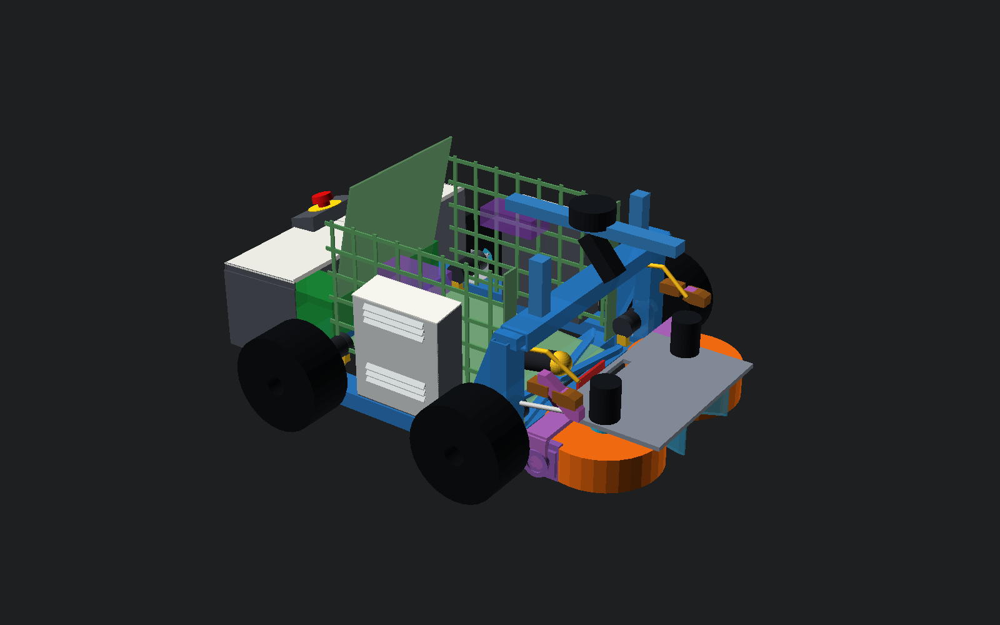
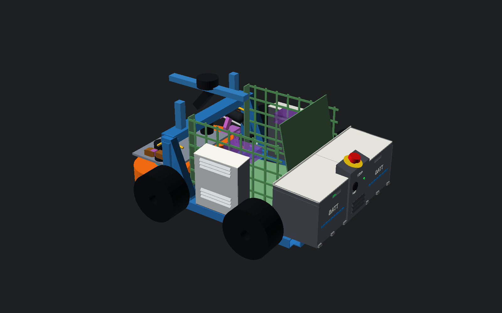
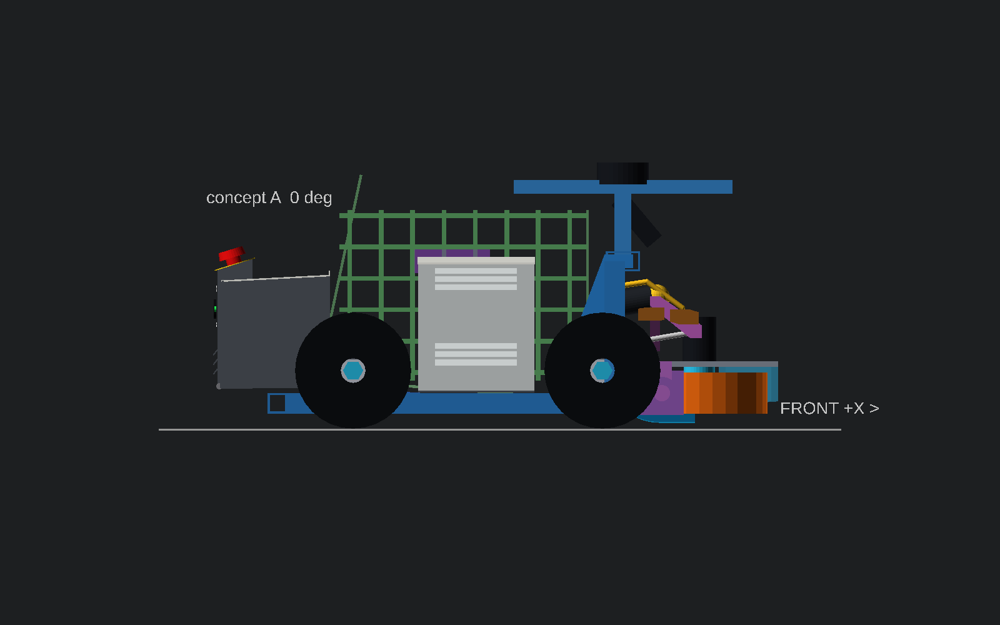
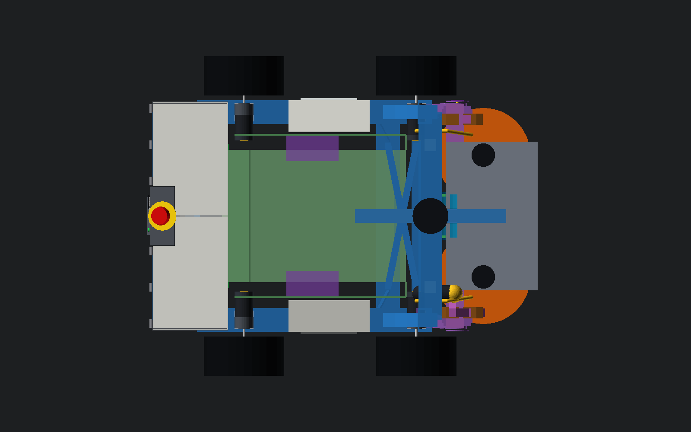

### B — Pods + fenders (ΠΡΟΤΕΙΝΟΜΕΝΗ)

Η A συν:

- πλήρη side pods X−30…215 με louvres,
- τέσσερα fenders πάνω από τους τροχούς, για τον «ουρανό» λάσπης κόκκινου χώματος,
- εμπρός shoulders πάνω από τα μπροστινά fenders, που κρύβουν πλευρικά actuator, belt και καλώδια,
- brow πάνω στην αψίδα,
- δύο προσωρινά πλευρικά guards στα flywheels.

21 κομμάτια, **≈2,16 kg PETG / ≈1,82 kg ASA**.

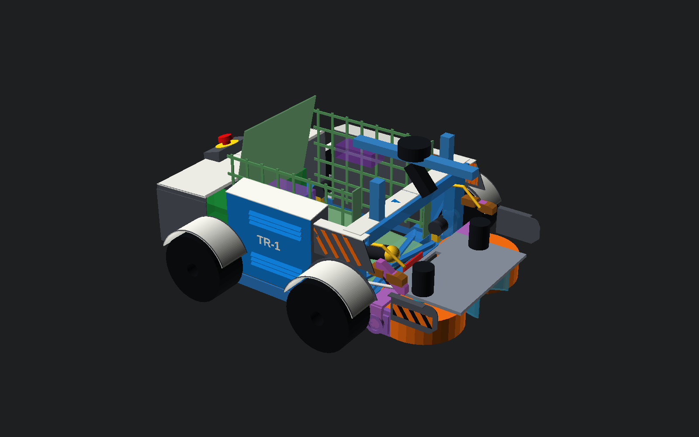
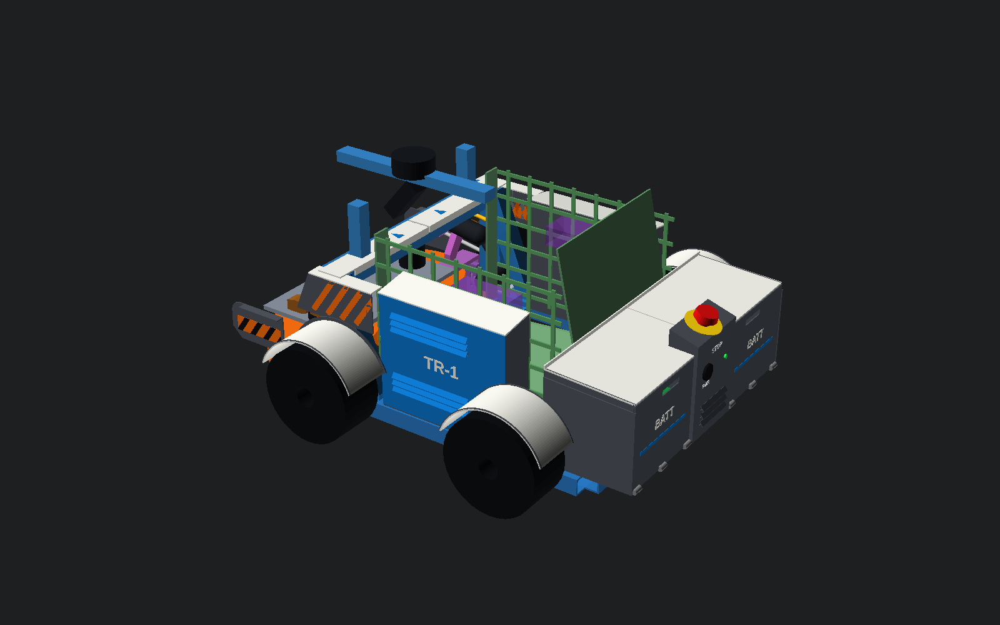
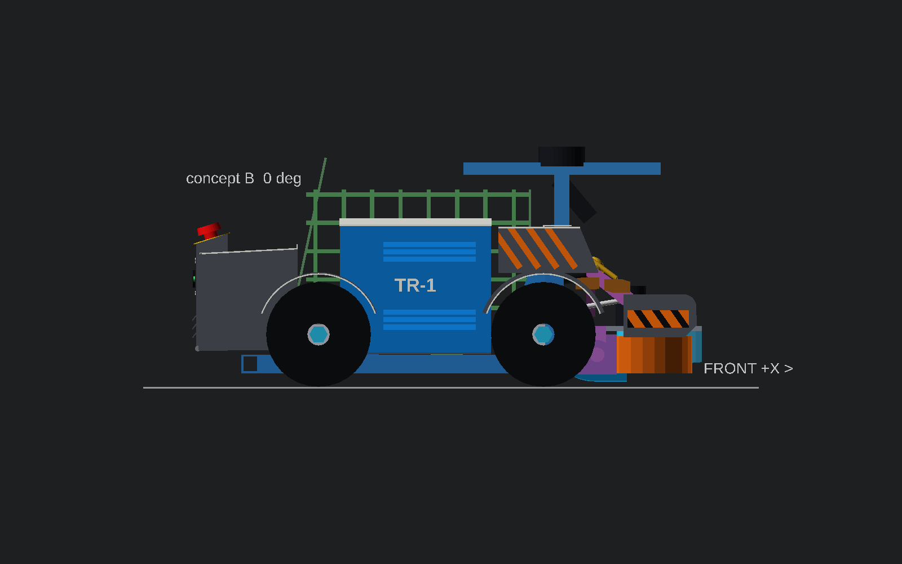
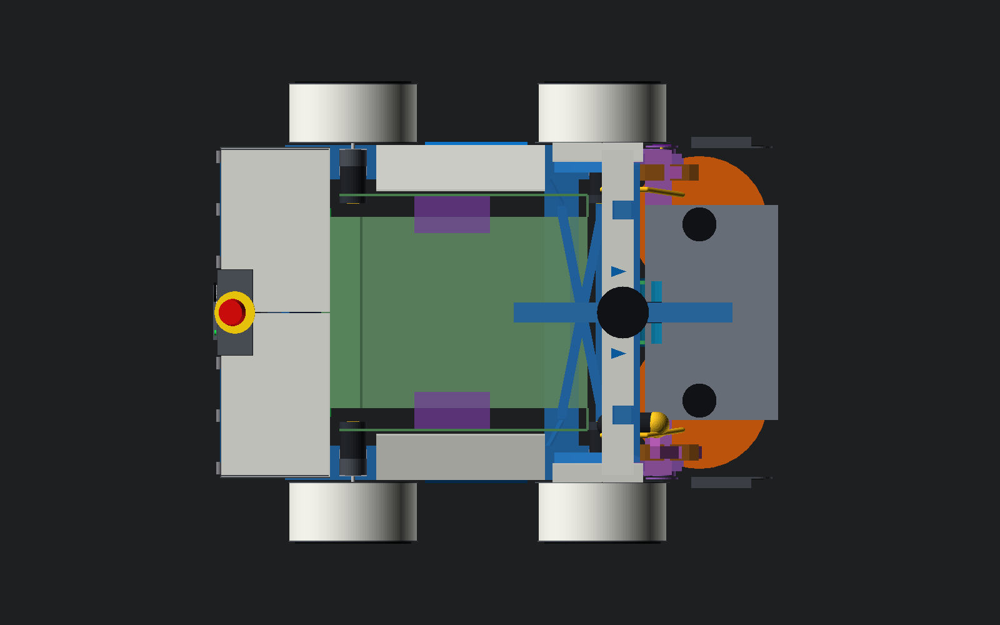

### C — Shell (συνεχές περίβλημα)

Συνεχές πλαϊνό δέρμα Y242…244 από X−259 έως X208, ύψους έως Z300. Έχει
tumblehome top deck έως Z313, οπές Ø52 γύρω από τους άξονες, wedge πίσω
καπάκι, ψηλά shoulders έως Z300 και μεγαλύτερα guards έως Z190. Κρύβει όλη
την πλευρά του καλαθιού. 21 κομμάτια, **≈2,45 kg PETG**.

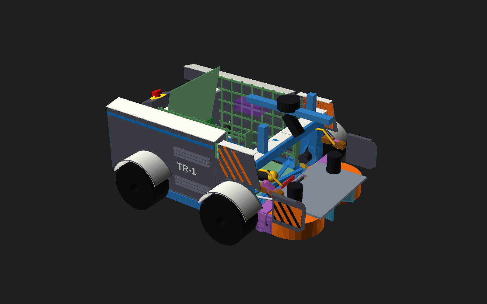
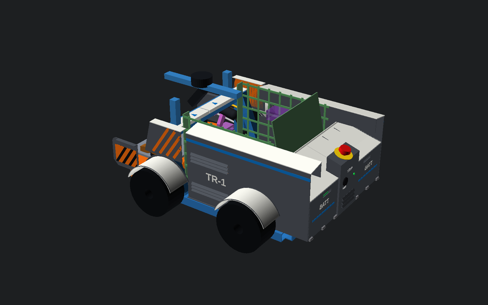
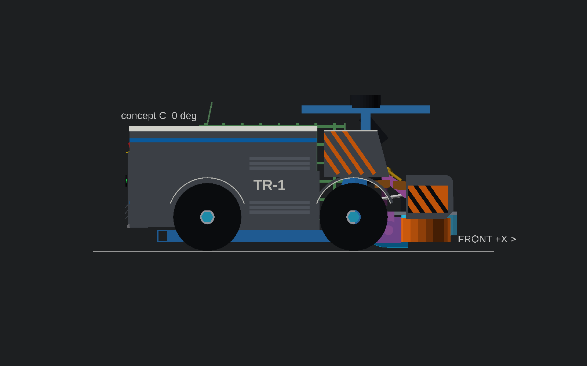
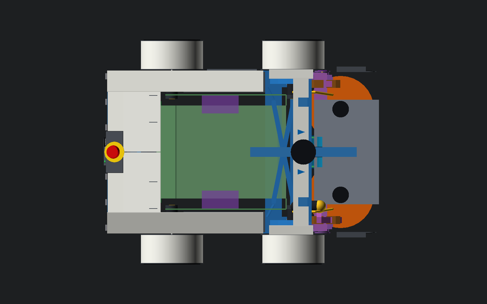

### Σύγκριση

| Κριτήριο | A | **B** | C |
|---|---|---|---|
| Κομμάτια | 11 | 21 | 21 |
| Μάζα PETG (solid model) | 1,40 kg | 2,16 kg | 2,45 kg |
| Εξωτ. διαστάσεις panels X × Y × Zmax | 471 × 500 × 267 | 819 × 672 × 273 | 819 × 672 × 313 |
| Προστασία ηλεκτρονικών/καλωδίων | μερική | καλή | πλήρης |
| Λάσπη από τροχούς | όχι | fenders | fenders |
| Προστασία δακτύλων στα flywheel | όχι | guards (προσωρινά) | guards (προσωρινά) |
| Ορατότητα καλαθιού/μπαλών από πλάι | πλήρης | από πάνω από τα pods | καμία (μόνο από πάνω) |
| Αερισμός controllers | louvres | louvres 2 ζωνών | louvres, μεγαλύτερος όγκος αέρα |
| Μετατόπιση CG (P2-17 baseline X169) | −17,0 mm | −16,8 mm | −20,8 mm |
| Ρίσκο | χαμηλό | χαμηλό | μεγαλύτερο βάρος, τοπικά 11,3 mm από τροχό σε όλο το μήκος |

Προτείνεται η B. Δίνει σχεδόν όλη την προστασία της C με 12% λιγότερη
μάζα, αφήνει ορατή την πλήρωση του καλαθιού από πάνω και πλάι, και
χτίζεται σταδιακά. Η A είναι υποσύνολο της B, οπότε πρώτα τυπώνεται το
πίσω pod και τα side pods και μετά fenders/shoulders.

## 3. Χρώματα και σήμανση (για όλες τις προτάσεις)

| Επιφάνεια | Χρώμα | Λόγος |
|---|---|---|
| Όλες οι **πάνω** επιφάνειες (καπάκια, top των pods, fenders, brow) | λευκό/πολύ ανοιχτό γκρι ASA (RAL 9003/9016) | Ηλιακό φορτίο, θερμοκρασία PETG/ASA, ορατότητα |
| Κατακόρυφες επιφάνειες | γραφίτης (RAL 7016) | Κρύβει λεκέδες κόκκινου χώματος |
| Πόρτες side pods | signal blue (RAL 5005) | Ταυτότητα, αντίθεση σε κόκκινο χώμα |
| Shoulders, front guards | γραφίτης με ζώνη RAL 2004 + μαύρα chevrons | Ζώνη εκτόξευσης/περιστρεφόμενου τροχού |
| E-stop | κόκκινο μανιτάρι σε κίτρινο δαχτυλίδι | ISO 13850 / EN 60204-1 |

Αποφεύγονται:

- **optic yellow/fluo κιτρινοπράσινο**, γιατί ο YOLO ball detector μπορεί να δώσει false positive πάνω στο ίδιο το όχημα ή σε αντανακλάσεις,
- **τερακότα/κόκκινο χώματος**, γιατί χάνεται οπτικά πάνω στο court,
- γυαλιστερή επιφάνεια κοντά στο FOV της κάμερας.

Σημάνσεις: `TR-1` στις πόρτες των pods, `BATT` και μπλε λωρίδα στις
πόρτες μπαταριών, `STOP`/`PWR` στην κονσόλα, βέλη `FRONT` στο brow, και
προειδοποίηση «ΖΩΝΗ ΕΚΤΟΞΕΥΣΗΣ — μείνετε μακριά 5 m» στα shoulders.
Προαιρετικά: retroreflective λωρίδες στις πίσω πόρτες.

## 4. Προτεινόμενη B — λίστα panels

Μάζα από τον όγκο του solid model, με PETG 1,27 g/cm³ και ASA 1,07 g/cm³.
Το filament είναι περίπου +8% για brim/purge/μικρά supports. Όλα τα
κομμάτια χωρούν σε 250×250 footprint και ≤256 ύψος (P2S).

| Κομμάτι | Τεμ. | Bbox (mm) | g/τεμ. PETG | Στερέωση | Εκτύπωση |
|---|---:|---|---:|---|---|
| `rp_lid` πίσω καπάκι L/R | 2 | 159×240×30 | 125 | **Χωρίς εργαλεία.** Σηκώνεται, 2 πείροι στην κονσόλα + μαγνήτης στο `rp_side` | Πάνω όψη στο bed, νευρώσεις προς τα πάνω |
| `rp_console` κεντρική κονσόλα | 1 | 62×124×209 | 222 | Βάση στο κεντρικό clamp sleeve του πίσω crossbar με τα **υπάρχοντα** M4 Y±30 (μακρύτερες βίδες). Σταθερή | Όρθια, κεκλιμένο top 17° |
| `rp_door` πόρτα μπαταρίας L/R | 2 | 16×175×157 | 82 | **Χωρίς εργαλεία.** Πέφτει προς τα κάτω. Printed pin hinge σε bracket στο υπάρχον grid του crossbar Y±100/±150, μαγνητικό κούμπωμα + λαβή | Επίπεδη, hinge print-in-place |
| `rp_side` πλαϊνό pod L/R | 2 | 161×2×152 | 67 | Υπάρχουσα πλευρική M4 του corner clamp (X−135) με αποστάτη + clip στο crossbar | Επίπεδη |
| `sp_shell` σώμα side pod L/R | 2 | 247×67×221 | 318 | Clip-saddles στο rail + M4 thumb screws στο **υπάρχον** grid του rail extension X100/X125 (top/side, με nut pockets) | Όρθιο στο πίσω άκρο, χωρίς supports |
| `sp_door` πόρτα pod με louvres L/R | 2 | 245×8×204 | 146 | **Χωρίς εργαλεία.** Γάντζος κάτω + 2 captive thumb screws/¼-turn πάνω | Όρθια, louvres ≈45° χωρίς supports |
| `fender_rear` L/R | 2 | 189×88×68 | 61 | Στο πίσω άκρο του `sp_shell` και στο `rp_side` (bracket) | Στο πλάι (προφίλ τόξου στο bed) |
| `fender_front` L/R | 2 | 198×88×72 | 63 | Στο εμπρός άκρο του `sp_shell` + clip στο σκέλος αψίδας X318 | Στο πλάι |
| `shoulder` L/R | 2 | 162×28×75 | 43 | Δύο C-clips στο σκέλος αψίδας + έδραση στο fender | Επίπεδη |
| `brow` L/R | 2 | 47×236×13 | 34 | Snap-clips πάνω στο crossbar αψίδας X305…355, notch στους ορθοστάτες LiDAR | Πάνω όψη στο bed |
| `front_guard` L/R **ΠΡΟΣΩΡΙΝΟ** | 2 | 119×16×70 | 28 | 2×M4 στη σταθερή πλάκα pivot support (εξαρτώμενο, όχι stl-v3) | Επίπεδη |
| **Σύνολο** | **21** | | **≈2.156 g** (ASA ≈1.815 g, filament ≈2,3 kg PETG) | | |

Ανά ομάδα: πίσω pod 770 g, side pods 928 g, fenders 248 g, shoulders 86 g,
brow 68 g, guards 56 g. Κανένα κομμάτι δεν απαιτεί νέα τρύπα στα κλειδωμένα
`stl-v3`. Όπου δεν υπάρχει grid hole, η στερέωση γίνεται με clip ή με
υπάρχοντα M4 με μακρύτερη βίδα.

Ελάφρυνση πριν την πρώτη εκτύπωση: στόχος B-lite ≈1,4–1,5 kg. Το
`sp_shell` είναι το βαρύτερο κομμάτι.

1. Αφαιρείται το floor tray, γιατί το rail φέρει τον controller tray.
2. Το inner wall γίνεται ανοιχτό lattice, αφού δίπλα υπάρχει ήδη το grid του καλαθιού.
3. Τοιχώματα 1,8 mm με νευρώσεις 1,6×8 mm στις μεγάλες επιφάνειες.

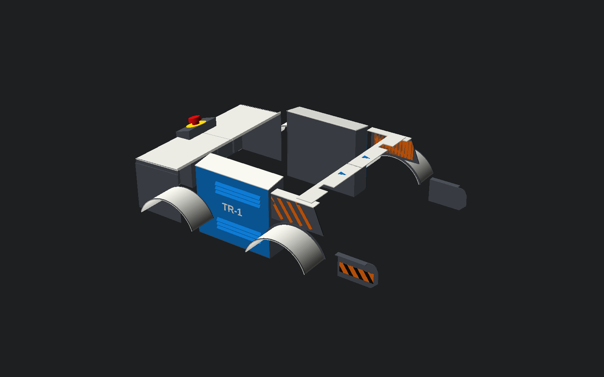
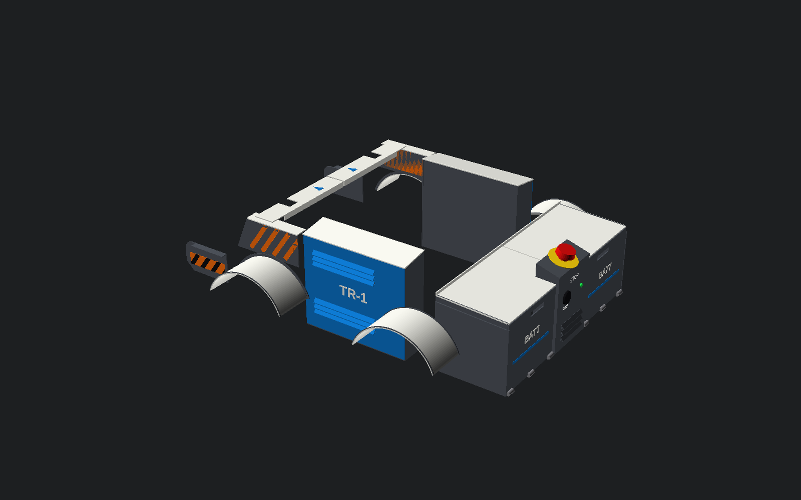

### Πρόσβαση χωρίς εργαλεία

| Εργασία | Πώς |
|---|---|
| Αλλαγή Parkside | Η πίσω πόρτα πέφτει προς τα κάτω και το pack βγαίνει προς τα πίσω (−X). Υπάρχουν 25 mm ελεύθερα πίσω από το pack. Αν τελικά τα docks βγαίνουν προς τα πάνω, το `rp_lid` σηκώνεται. |
| Ugreen / Pi power | Σηκώνεται το ένα ή και τα δύο `rp_lid`. Το Ugreen κάθεται στη ραφή Y0. |
| Άδειασμα καλαθιού | Τίποτα πάνω από το καλάθι. Τα pods έχουν εσωτερικό τοίχωμα στο Y177,9, άρα 4,4 mm από το grid Y173,5. Το καπάκι σταματά στο X−100, 12 mm πίσω από το backboard. Το brow αρχίζει στο X300, μπροστά από το καλάθι X278. Ανύψωση από το rim Z320, που είναι 47 mm πάνω από τα pods. |
| D5065 controllers | Η πόρτα του pod βγαίνει με 2 thumb screws. |
| **E-stop** | Κεντρική κονσόλα πίσω-πάνω: κέντρο [−238, 0, 240], top ≈Z263, κεκλιμένη όψη 17° προς τα πίσω-πάνω. Φτάνεται από πίσω και από τις δύο πλευρές, μακριά από τον κώνο εκτόξευσης και τα flywheels. Το όχημα συνήθως απομακρύνεται από τον χειριστή, άρα το πίσω μέρος είναι το φυσικό σημείο. |
| Κύριος διακόπτης / LED | Στην πίσω όψη της κονσόλας, Z175: key switch στο Y+30, LED κατάστασης στο Y−30. |
| Καθάρισμα feed path | Από κάτω και από μπροστά. Κανένα panel στη ζώνη X240…370, \|Y\|<80. |

### Αερισμός, σκόνη, ψιχάλα, ήλιος

- **Side pods**: louvres μόνο σε κατακόρυφη όψη, σε δύο ζώνες. Η κάτω ζώνη
  εισαγωγής είναι στο Z93…124 και η άνω εξαγωγής στο Z203…234, άρα έχουμε
  φαινόμενο καμινάδας. Κάθε louvre έχει κουκούλα 6 mm που ανοίγει προς τα
  κάτω-έξω. Ψιχάλα και σκόνη από πάνω δεν βρίσκουν άνοιγμα. Τα louvres
  μένουν στο X40…190, ανάμεσα στους τροχούς, άρα όχι απέναντι από
  πετάγματα του πέλματος. Προαιρετικά G2 φίλτρο-αφρός πίσω από την κάτω
  ζώνη.
- **Κονσόλα**: louvres στην πίσω όψη, Z80…114, με άνοιγμα προς τα κάτω,
  για το rear electronics bay.
- **Καμία οριζόντια τρύπα σε πάνω επιφάνεια.** Τα top των pods έχουν κλίση
  προς τα έξω (Z272→262). Τα καπάκια έχουν κλίση 3° προς τα πίσω, με drip
  ridge στο μπροστινό άκρο, γιατί μπροστά βρίσκεται το backboard. Το brow
  έχει πίσω drip lip.
- Υλικό: PETG για prototype, **ASA για τελικά** λόγω UV. Πάνω επιφάνειες
  ανοιχτόχρωμες.

## 5. Έλεγχος διακένων

### Μέθοδος

1. **Exact-solid gates** με OpenSCAD Manifold, zero-intersection, για όλα τα
   κομμάτια και τις δύο πλευρές. Το κινούμενο σύνολο τομής είναι η ένωση,
   −10…+20° ανά 1°, των εξής:
   - `p253_frozen_launcher`: πλάκα, τροχοί Ø200, D5065, yokes/trunnions, throat/gate, παλιά cheeks,
   - τα baseline P2-40 cheeks `p244_side_cheeks`,
   - `p253_actuator`: Tr8, clevises, FIT0186 + belt carrier, moving arm με τα stop tongues,
   - `p253_cam_moving`,
   - `p253_cables`, δηλαδή τα D5065 service loops.

   Επίσης: τροχοί κίνησης Ø170×83, σταθερός κόσμος (frame, αψίδα, LiDAR/κάμερα,
   καλάθι/ski/feed, ισχύς, AS5600, stops), κώνος εκτόξευσης, FOV κάμερας,
   πλάκα Z≥375, διαδρομή μπάλας, όγκος καλαθιού/ανύψωσης και προσωρινό
   feed path. Τα δύο κρίσιμα gates (sweep μονάδας, τροχοί) επαναλήφθηκαν με
   **όλα τα panels φουσκωμένα κατά 10 mm** (Minkowski, περιγεγραμμένη
   σφαίρα).
2. **Αριθμητικό ελάχιστο διάκενο ανά κομμάτι**: global δειγματοληψία 2,5 mm
   και μετά ακριβής απόσταση σημείου–τριγώνου από δείγματα 0,4 mm γύρω από
   τους καλύτερους υποψηφίους. Αβεβαιότητα ±1 mm. Το «>80» σημαίνει ότι
   δεν υπάρχει στόχος σε απόσταση 80 mm.

Keep-outs:

- **Κώνος εκτόξευσης**: κορυφή στο nip στις +15/+17,5/+20°, άξονας στη γωνία κλίσης, ±10° οριζόντια και ±10° κατακόρυφα, μήκος 1,6 m, φουσκωμένος κατά την ακτίνα μπάλας 33 mm.
- **Διαδρομή μπάλας**: προσέγγιση → nip στις −3° → ski R75/42° (σημεία P2-51, πλάτος ±47) → βαλλιστικό τόξο 4,41 m/s / 38° (P2-51 realized) έως το backboard, με ακτίνα 33+10 mm.
- **Feed path**: θύρα X278/Z42 → πίσω στόμιο nip στις +15/+20°, ±40 mm, 33+10 mm.
- **Καλάθι**: X−90…282, Y±176, Z60…440, για το άδειασμα με ανύψωση.

### Gates (και οι τρεις προτάσεις)

| Gate | A | B | C |
|---|:---:|:---:|:---:|
| Sweep μονάδας −10…+20° | PASS | PASS | PASS |
| **Sweep μονάδας, panels +10 mm** | PASS | PASS | PASS |
| Τροχοί κίνησης | PASS | PASS | PASS |
| **Τροχοί κίνησης, panels +10 mm** | PASS | PASS | PASS |
| Σταθερός κόσμος (χωρίς τομή) | PASS | PASS | PASS |
| Κώνος εκτόξευσης ±10°/±10° | PASS | PASS | PASS |
| FOV κάμερας | PASS | PASS | PASS |
| Τίποτα πάνω από Z375 | PASS | PASS | PASS |
| Διαδρομή nip → ski → καλάθι | PASS | PASS | PASS |
| Καλάθι ανοιχτό / ανύψωση | PASS | PASS | PASS |
| Feed path X278/Z42 (προσωρινό) | PASS | PASS | PASS |

### Ελάχιστα διάκενα — προτεινόμενη B (mm)

| Κομμάτι | Κινούμενη μονάδα (γωνία) | Αερισμός D5065 | Τροχοί κίνησης | Stops | Κώνος | FOV | Διαδρομή μπάλας* | Καλάθι** | Zmax |
|---|---:|---:|---:|---:|---:|---:|---:|---:|---:|
| rp_lid | >80 | >80 | 46,5 | >80 | >80 | >80 | 41,8 | 8,9 | 231 |
| rp_console | >80 | >80 | >80 | >80 | >80 | >80 | >80 | >80 | 267 |
| rp_door | >80 | >80 | >80 | >80 | >80 | >80 | >80 | >80 | 214 |
| rp_side | >80 | >80 | 13,3 | >80 | >80 | >80 | >80 | 64,6 | 211 |
| sp_shell | 77,6 (−7°) | >80 | 12,6 | >80 | >80 | >80 | 75,1 | 1,9 | 273 |
| sp_door | >80 | >80 | **11,5** | >80 | >80 | >80 | >80 | 65,8 | 260 |
| fender_rear | >80 | >80 | **12,0** | >80 | >80 | >80 | >80 | 72,0 | 186 |
| fender_front | 22,1 (+14°) | >80 | **12,0** | 31,0 | >80 | >80 | >80 | 72,0 | 190 |
| shoulder | 32,0 (−6°) | >80 | 16,6 | 30,0 | >80 | >80 | >80 | 44,9 | 260 |
| brow | 40,2 (−6°) | >80 | >80 | >80 | >80 | **11,9** | >80 | 17,5 | 263 |
| front_guard (προσωρ.) | **12,0** (+6°) | 79,0 | 46,7 | 24,1 | >80 | >80 | >80 | — | 150 |

\* Από το keep-out, που περιλαμβάνει ήδη +10 mm πάνω από την επιφάνεια της μπάλας.
\*\* Από τον όγκο ανύψωσης Y±176. Το πραγματικό πλευρικό κενό ως το grid
Y173,5 είναι 4,4 mm. Είναι κενό συναρμολόγησης σταθερών μερών, όχι
διάκενο κινούμενου.

Κυβερνούν τα εξής:

- Η κινούμενη μονάδα είναι στα **12,0 mm** από το προσωρινό guard (yoke web/trunnion, \|Y\|≤238).
  Το πρώτο σχέδιο είχε 9,3 mm στο −10°. Διορθώθηκε μεταφέροντας την αρχή του guard στο X430.
  Χωρίς τα guards, το ελάχιστο είναι 22,1 mm (front fender).
- Οι τροχοί κίνησης είναι στα **11,5 mm** (πόρτα pod Y244 ↔ εσωτερική παρειά τροχού Y255,5) και 12,0 mm ακτινικά στα fenders.
- Για τον κώνο εκτόξευσης ισχύει ≥177 mm σε όλες τις προτάσεις.
  Τα shoulders και τα fenders είναι πίσω από το nip, και τα guards είναι στο \|Y\|≥241, ενώ το μισό πλάτος του κώνου στο X548 είναι ≈52 mm.
- Το FOV κάμερας απέχει 11,9 mm από το brow. Το όριο είναι το hull FOV του repo, με V=54° ως προσωρινή τιμή.

Στην πρώτη πλήρη εκτέλεση το QA εντόπισε και διόρθωσε, πριν από την
παράδοση, τα εξής:

- louvres πόρτας pod 5,5 mm από τον πίσω τροχό, που μεταφέρθηκαν στο X40…190,
- εμπρός χείλος brow μέσα στο crossbar αψίδας X305…355, που αφαιρέθηκε,
- πίσω χείλος brow πάνω στις διαγώνιες αψίδας \|Y\|205…235, που κόπηκε στο \|Y\|≤200,
- shoulder cap 0,6 mm μέσα στο dogleg αψίδας, που ανέβηκε στο Z258,
- C skin 252 mm, άνω του 250, που κόπηκε σε 248.

### Οι τρεις καταστάσεις λειτουργίας (B, τομή Y=0, φαίνονται τα αριστερά panels)


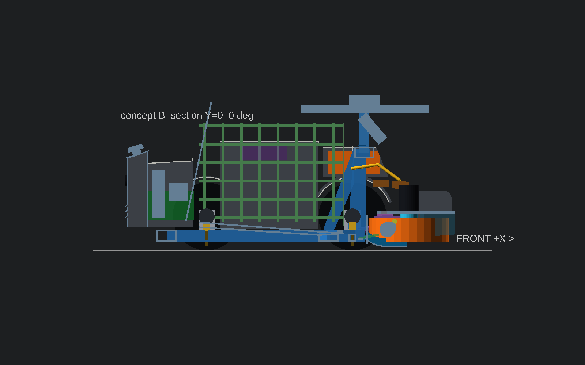
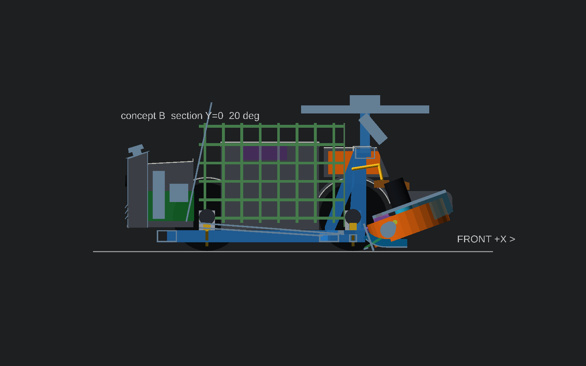

Keep-outs: κώνος εκτόξευσης με κόκκινο, FOV κάμερας με κυανό, διαδρομή
μπάλας με κίτρινο, όλα στις +20°.

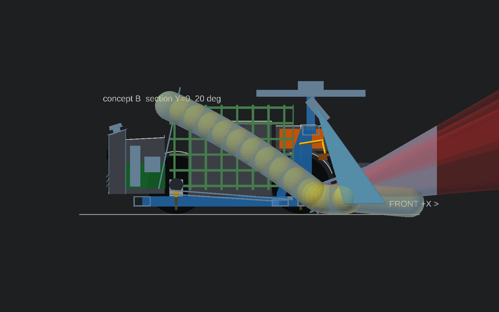
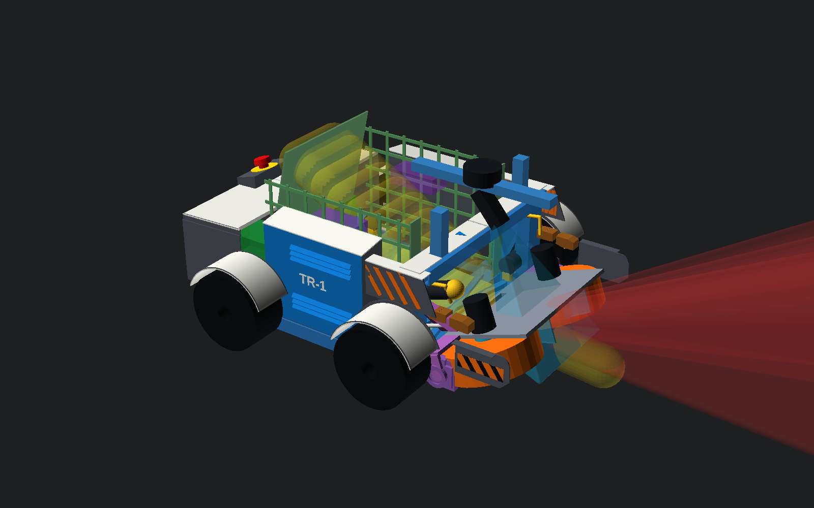
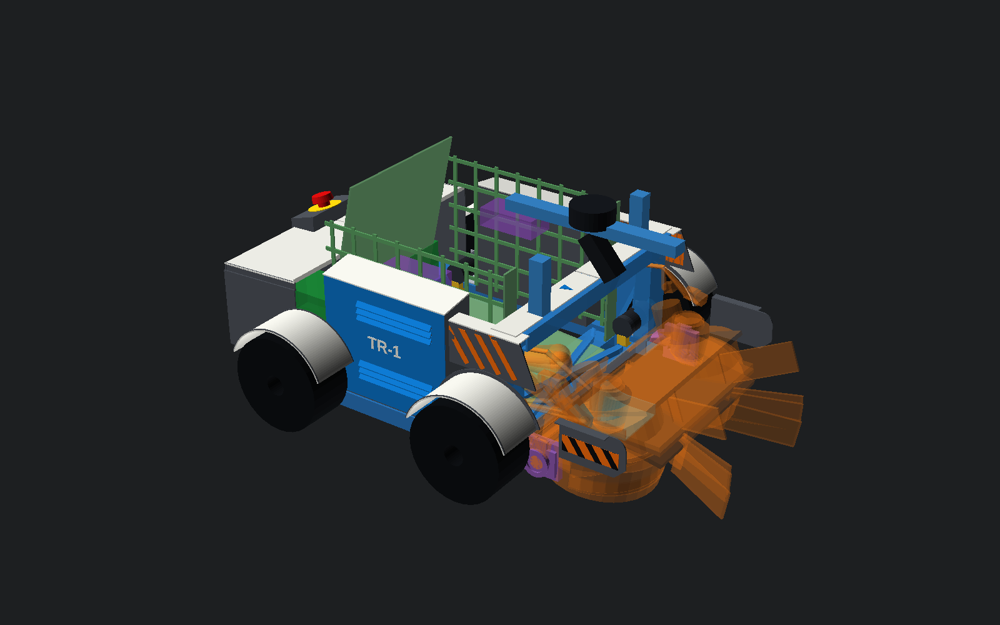

### Απεμπλοκή και απορριπτόμενες μπάλες

Σε σφήνωμα οι τροχοί αναστρέφουν και οι μπάλες φεύγουν μπροστά/πλάγια
έως ~5 m (P2-56).

- Μπροστά από το X391 υπάρχουν μόνο τα δύο guards. Βρίσκονται στο
  \|Y\|241…243, έξω από τον κώνο και έξω από το capture ±100 mm.
- Η κάτω ακμή τους είναι στο **Z80**. Μπάλα Ø66 με κέντρο στο Z33 περνά
  από κάτω, άρα το guard δεν «οργώνει» και δεν επαναλαμβάνει το πρόβλημα
  snowplough των P2-57 shields.
- Η εσωτερική όψη είναι κατακόρυφη, χωρίς επιφάνεια με κλίση προς τα πάνω
  απέναντι από το nip. Μπάλα που χτυπά εκτρέπεται οριζόντια και ποτέ προς
  LiDAR/κάμερα. Για το detail design προτείνεται overhang 3–6° (πάνω ακμή
  προς τα μέσα), ώστε η εκτροπή να είναι προς τα κάτω.
- Fenders, shoulders και brow βρίσκονται πίσω από το nip και δεν είναι
  στη διαδρομή εκτίναξης.

## 6. Προσωρινές ζώνες (σημειωμένες, όχι κλειδωμένες)

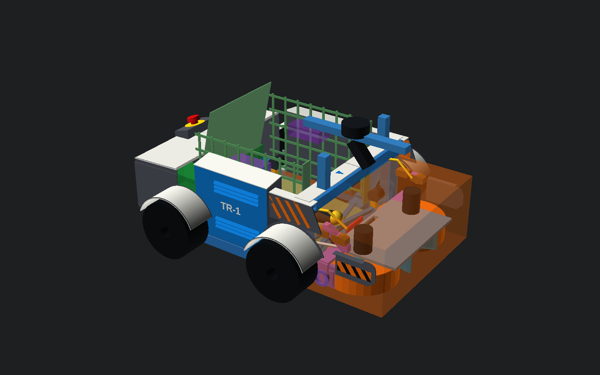

| Ζώνη | Όγκος | Panels |
|---|---|---|
| Εμπρός cheeks/flywheel | X330…570, \|Y\|≤240, Z0…200 | Κανένα panel μέσα. Τα guards (Y241), τα shoulders και το front fender είναι ακριβώς έξω, αλλά δηλώνονται **ΠΡΟΣΩΡΙΝΑ** μαζί με τη ζώνη |
| Θύρα τροφοδοσίας X278/Z42 → πίσω στόμιο nip | X240…370, \|Y\|≤80, Z0…120 | Κανένα, ελεύθερη για καθάρισμα |
| Κάτω από το καλάθι πίσω (5d singulator/break-beam) | X−85…278, \|Y\|≤172, Z0…70 | Κανένα, χωρίς belly pan |

## 7. Ανοιχτά σημεία

1. **Προϋπάρχουσα σύγκρουση D5065 controllers / καλαθιού.** Το
   `d5065_controller_envelopes()` (X25…135, Y116…174, Z227…262), που
   περιλαμβάνεται στο P2-53 `p253_power`, βρίσκεται **μέσα** στο P2-51
   καλάθι (Y±172, rim Z320). Φαίνεται με μωβ στα renders. Προτείνεται νέα
   θέση στα side pods: όρθιοι controllers 110×35×58 στο X40…150,
   Y195…230, Z140…198, με louvres και τα D5065 service loops να μπαίνουν
   από το μπροστινό τοίχωμα του pod. Απόφαση και θερμικός/καλωδιακός
   έλεγχος ανήκουν στον μηχανισμό. Δεν το τροποποίησα.
2. Το Parkside pack/adapter είναι ακόμη placeholder 135×85×75 (P2-17),
   χωρίς γνωστή κατεύθυνση αφαίρεσης. Πόρτα και καπάκι εξαρτώνται από τη
   μέτρηση.
3. Τα εμπρός guards, shoulders και front fenders είναι προσωρινά μέχρι να
   κλειδώσει η εμπρός ζώνη. Το guard στερεώνεται στο εξαρτώμενο pivot
   support, όχι σε stl-v3.
4. **Βροχή στη μονάδα flywheel** (D5065, FIT0186/belt). Σταθερό panel από
   πάνω δεν χωράει λόγω κώνου, FOV και sweep. Χρειάζεται κάλυμμα που
   κινείται με τη μονάδα (θέμα μηχανισμού) ή αποδοχή του ρίσκου. Το brow
   καλύπτει μόνο ό,τι είναι πίσω από το X346.
5. Οι τροχοί κίνησης είναι envelope Ø170 χωρίς μετρημένο loaded radius.
   Επίσης ο πηλός κολλά στο πέλμα. Τα 12 mm ακτινικά των fenders πρέπει
   να επιβεβαιωθούν με πραγματικό τροχό και λάσπη. Αν χρειαστεί, R_in
   97→100, με κόστος μόνο σε ύψος.
6. Το κενό καλαθιού–pod 4,4 mm είναι σταθερό αλλά μικρό για τυπωμένο
   καλάθι με ανοχές. Χρειάζεται fit check. Το καλάθι χρειάζεται επίσης
   λαβές στο rim.
7. Clips στα 50×30 rails/αψίδα και μακρύτερα M4 στα υπάρχοντα σημεία
   χρειάζονται coupon (σύσφιξη, κραδασμοί, ASA creep).
8. Θερμικό: θερμοκρασία controllers με κλειστές πόρτες και με/χωρίς
   φίλτρο-αφρό. Το ρεύμα D5065 είναι ήδη measurement gate.
9. Το FOV της κάμερας είναι το προσωρινό hull του repo (V=54°). Μετά το
   πραγματικό mount OAK-D χρειάζεται επανέλεγχος του brow (σήμερα 11,9 mm).
10. Βάρος: η B προσθέτει ≈2,16 kg (≈+12%) και μετακινεί το CG κατά
    −16,8 mm προς τα πίσω (X169→152), άρα αλλάζει το φορτίο του εμπρός
    άξονα από το P2-17. Πρέπει να μπει στον επόμενο υπολογισμό αξόνων
    μαζί με την ελάφρυνση B-lite.
11. Δεν έγινε ανάλυση ακαμψίας, ανεμοπίεσης ή κρούσης panels. Είναι μη
    φέροντα και δεν προορίζονται για πάτημα ή ανύψωση του οχήματος.

## 8. Αναπαραγωγή

```bash
cad/body-panels/render-concepts.sh
```

```bash
python3 cad/body-panels/qa-clearance.py A B C
```

Το QA γράφει ενδιάμεσα meshes μόνο στο `cad/body-panels/_build/`,
προσωρινό φάκελο που σβήνεται μετά. Χρειάζεται `/snap/bin/openscad-nightly`
(Manifold) και system `python3` με numpy/scipy. Χρόνος ≈12 min, κυρίως τα
gates Minkowski 10 mm.

ΠΑΥΣΗ.
