# Concept F «planter» — λεκάνη με διαγώνιο κολάρο και πλέγμα

Κατάσταση: `BODY_CONCEPT_F_PLANTER_UNIFIED_FRONT_CAMERA_FWD_ALL_GATES_PASS_CONSOLE_TEMP_CONFLICT_NO_STL`.
Concept, όχι print release. Δεν έγινε STL, Gazebo, ROS, Docker, commit, push ή
PR. Ο μηχανισμός διαβάζεται read-only με `use`, σε κατάσταση
`full-robot-v3.scad` 2026-10-17 (P2-65…P2-71). Κανένα αρχείο του δεν άλλαξε.

## Κατεύθυνση (από τον χρήστη)

- Τα πλαϊνά να **κρύβουν το καλάθι**.
- **Να μη μοιάζει με αυτοκίνητο.**
- **Τροχοί απ' έξω, χωρίς φτερά.**
- Αναφορά: εικόνα του *povoa bonsai planter* (h3li0 design). Πήραμε μόνο τις
  γραμμές, όχι αντιγραφή: πλέγμα με διαγώνιες ράβδους μέσα σε σκούρο,
  συμπαγές «κολάρο» με **διαγώνια** πάνω ακμή και κάτοψη με στρογγυλεμένες
  γωνίες.

Δεν μπόρεσα να δω άλλες δουλειές του σχεδιαστή. Printables, Cults3D,
MakerWorld και Thangs απαντούν με Cloudflare/403 και δεν παρέκαμψα τον έλεγχο
bot. Η ερμηνεία βασίζεται στη μία εικόνα που έδωσες.

| Αρχείο | Περιεχόμενο |
|---|---|
| `cad/body-panels/body-panels-f.scad` | Concept F: λεκάνη, κολάρο, πλέγμα, decks, κομμάτια εκτύπωσης, QA views |
| `cad/body-panels/render-f.sh` | Renders (μόνο PNG) |
| `cad/body-panels/qa-clearance-f.py` | Exact-solid gates, διάκενα, ακτίνα κάτοψης, μάζα |
| `cad/body-panels/qa-results-f.json` | Αποτελέσματα |
| `cad/body-panels/renders-f/*.png` | Ισομετρικά, πλάγιες, κάτοψη, λεπτομέρεια, τομές |

## 1. Μορφή

- **Κάτοψη σε σχήμα χαπιού.** Ευθείες πλευρές στο Y±244,5, δηλαδή 11 mm μέσα
  από την εσωτερική παρειά των τροχών (Y255,5). Οι τροχοί μένουν απ' έξω.
  Το πίσω άκρο είναι **τόξο R424,5 γύρω από το κέντρο επιτόπιας στροφής X117**,
  με fillets R60. Το τόξο τυλίγει τις γωνίες του pod P2-70 (R421,4) με
  τοίχωμα 2,5 mm και κενό 0,6 mm και μένει μέσα στο R425 του P2-70.
- **Μπροστά ανοιχτό.** Το flywheel, το ski και η γερμένη αψίδα είναι το
  «πρόσωπο». Τα πλαϊνά τελειώνουν σε επίπεδο παράλληλο με το γερμένο σκέλος
  της αψίδας P2-67, 25 mm πίσω από τον άξονά του.
- **Κολάρο (σκούρο, συμπαγές):** από Z60 έως μια **διαγώνια γραμμή**, Z350
  πίσω, στο ύψος του pod, και Z185 μπροστά.
- **Πλέγμα:** από τη γραμμή έως το rim Z320. Διαμάντια με ράβδους ±60°,
  βήμα 20 mm, ράβδος 3,6 mm, πλαίσιο 4 mm. Οι ράβδοι στις 60° είναι 30° από
  την κατακόρυφο, άρα **τυπώνονται χωρίς supports**, όπως στο planter. Το
  πλέγμα ξεκινά εκεί που η γραμμή κατεβαίνει κάτω από Z320 (X≈−116), δηλαδή
  ακριβώς πάνω από όλο το μήκος του καλαθιού.
- **Φίλτρο G2 πίσω από το πλέγμα:** φύλλο αφρού ή spacer fabric ~5 mm, που
  δεν τυπώνεται. Δίνει το σκούρο εσωτερικό του planter και **κρύβει πλήρως
  το καλάθι**. Αφήνει τα διαμερίσματα των controllers να αναπνέουν και
  σταματά τη σκόνη χώματος και τις πιτσιλιές των τροχών, που κινούνται ακριβώς
  δίπλα στο τοίχωμα.
- **Decks:**
  - **Rim Z320** (Y180…τοίχωμα, ελαφριά κλίση προς τα έξω): κλείνει από πάνω
    τα πλαϊνά διαμερίσματα και είναι 5 mm από τη ράγα του ταμπλό P2-67.
  - **Πάνω από το pod:** ακολουθεί τη διαγώνια.
  - **Δαχτυλίδι Z350 πίσω:** γύρω από το πάνω panel του P2-70, που μένει
    ίδιο, με το E-stop στο X−153/Y−92.
- **Πίσω:** καμπύλη επιφάνεια με δύο **πόρτες συρταριών σε σχήμα χαπιού**
  (Parkside, έξοδος προς −X) και ένα **παράθυρο-πλέγμα** μπροστά από τα
  louvres και G2 hoods του P2-70 (|Y|≤154, Z142…218). Οι τρύπες γύρω από
  τους άξονες των τροχών έχουν ακτίνα 14 mm, δηλαδή ≥10 mm από τον
  περιστρεφόμενο άξονα.
- **Ραφή εκτύπωσης = η διαγώνια γραμμή.** Κολάρο και πλέγμα είναι χωριστά
  κομμάτια και η ραφή χάνεται μέσα στο σχέδιο. Όπου το κολάρο ξεπερνά τα
  250 mm, σπάει στο Z200.
- **Καθόλου** φτερά, γοφοί, ώμοι ή «φρύδι», και καμία ευθεία ακμή αμαξώματος.

### Χρώματα

| Εκδοχή | Κολάρο | Πλέγμα / decks | Σχόλιο |
|---|---|---|---|
| **terracotta** | μαύρο/γραφίτης | τερακότα | Πιστό στην αναφορά. «Γεννημένο στο χώμα». Σε κόκκινο court το πλέγμα χάνεται οπτικά, αλλά το μαύρο κολάρο μένει έντονο. |
| **bone** | μαύρο/γραφίτης | ζεστό λευκό | Καλύτερη ορατότητα στο court, λιγότερη θερμότητα στον ήλιο στα decks. |

Το πάνω panel του P2-70 προτείνεται στο χρώμα του κολάρου. Το E-stop μένει
κόκκινο σε κίτρινο. Αποφεύγεται το κιτρινοπράσινο της μπάλας.

## 2. Renders

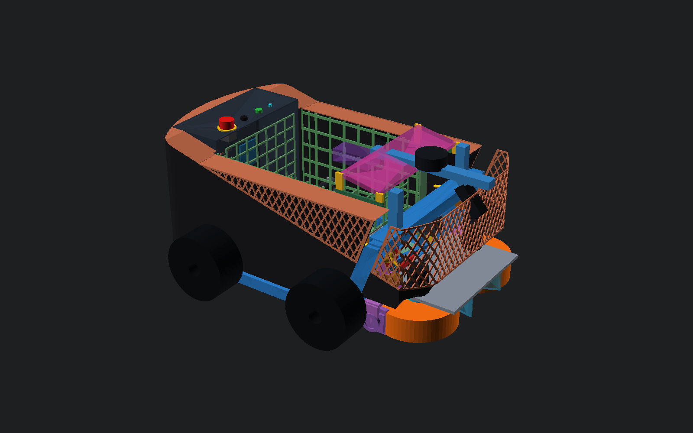
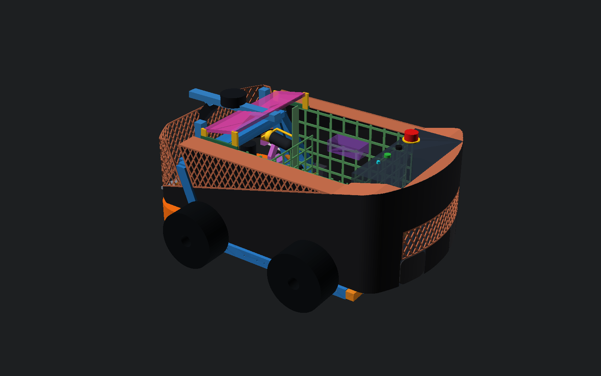
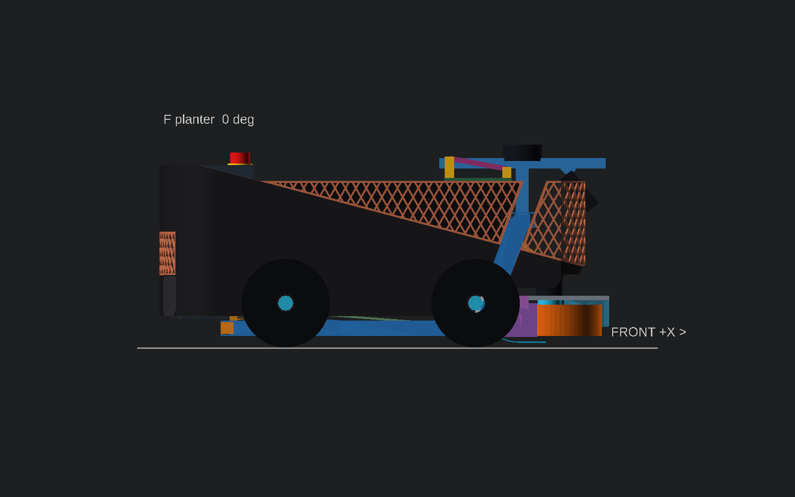
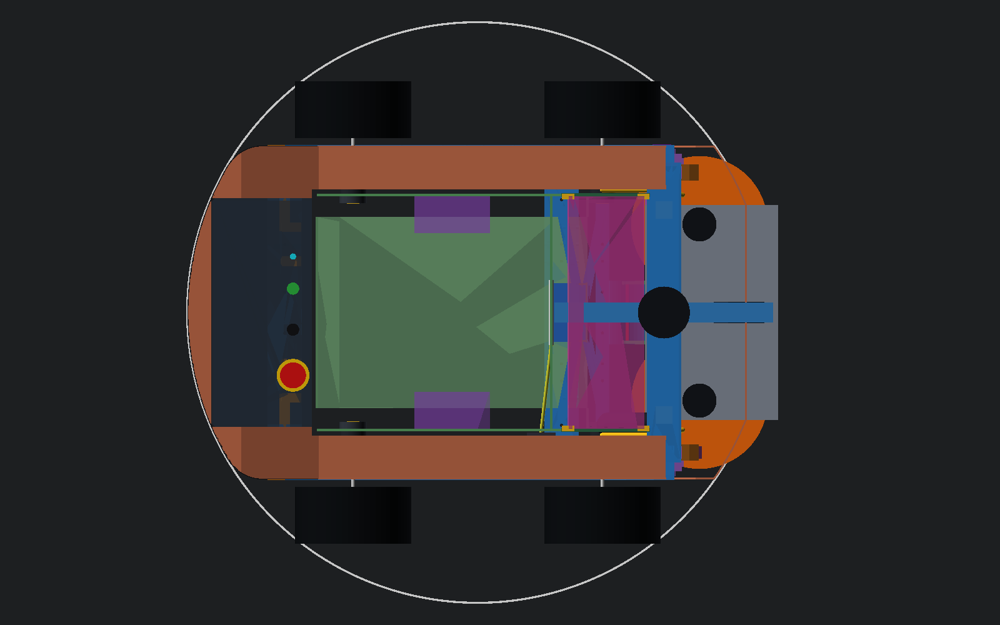
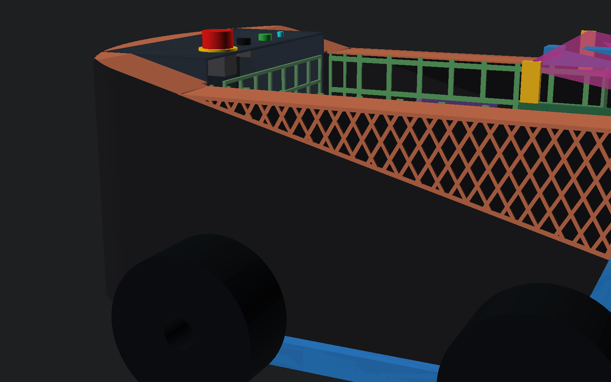
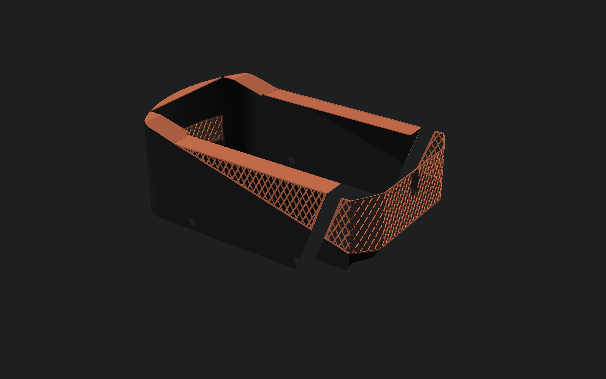
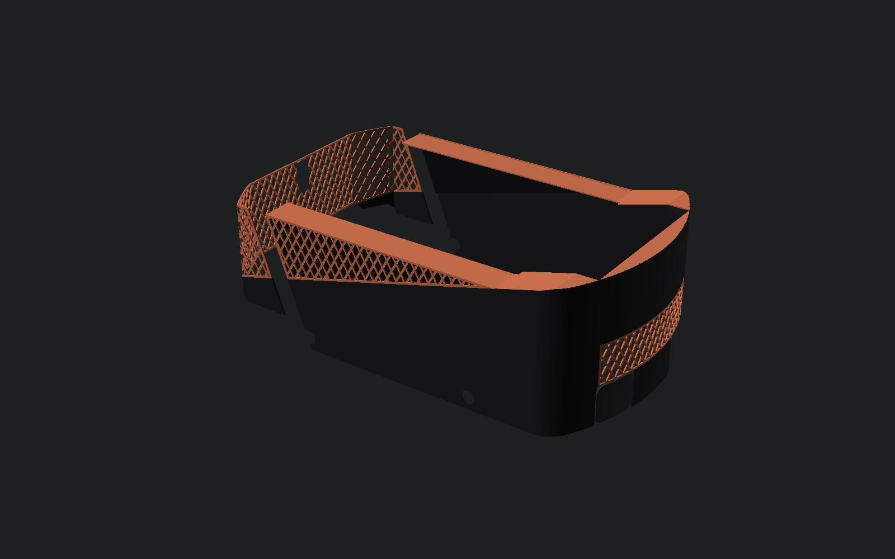

Εκδοχή bone:

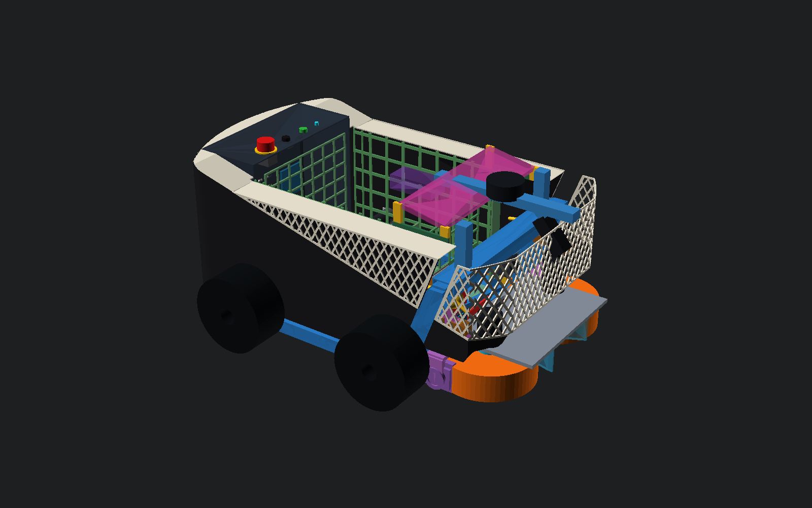
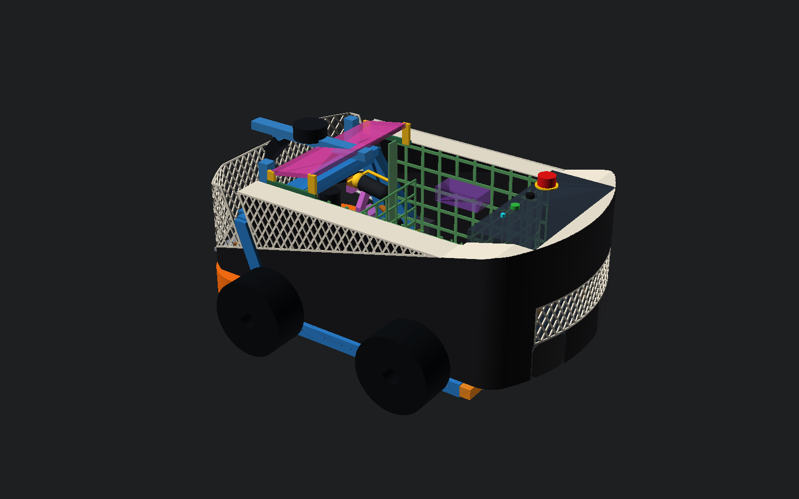
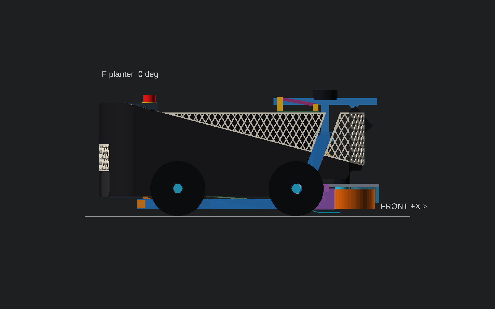

Τρεις καταστάσεις λειτουργίας (τομή Y=0):

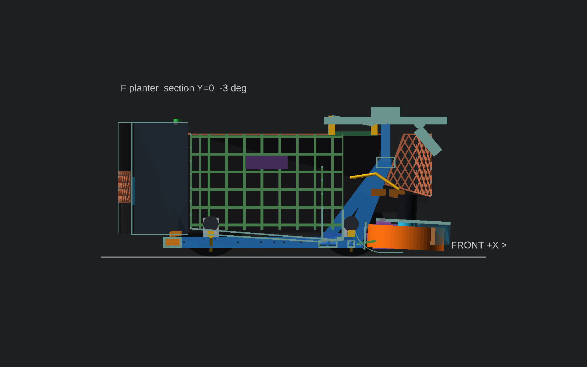
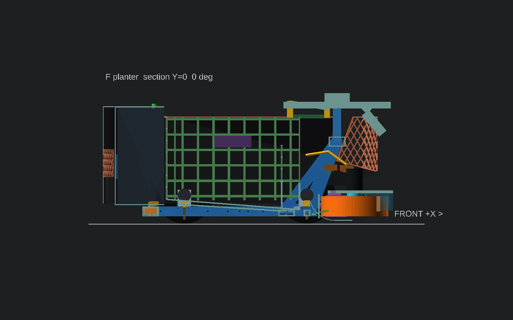
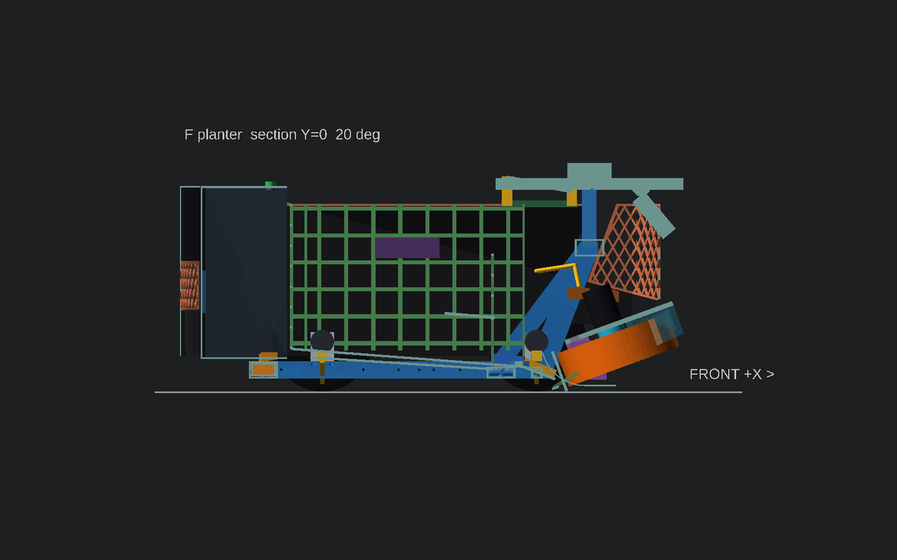

## 3. Κομμάτια

Τα κομμάτια είναι L/R, μέγιστο 250×250 footprint και ≤256 ύψος, PETG
1,27 g/cm³. Οι διαχωρισμοί στο X γίνονται στα −150/40/230.

| Κομμάτι | Bbox (mm) | g/τεμ. | Στερέωση |
|---|---|---:|---|
| `rear_lo` πίσω καμπύλη, κάτω | 158×245×140 | 106 | M4 στα πόδια/αυτιά του P2-70 (υπάρχουσες θέσεις) |
| `rear_hi` πίσω καμπύλη, πάνω (με το παράθυρο-πλέγμα) | 158×245×150 | 150 | κουμπώνει στο `rear_lo` + στο δαχτυλίδι |
| `c1_lo` / `c1_hi` κολάρο X−150…40 | 190×3×140 / 190×3×129 | 83 / 63 | clip-saddles στη ράγα, M4 στο grid X100/X125 |
| `c2` κολάρο X40…230 | 190×3×219 | 117 | ίδια ράγα, γλωττίδα στο T-clamp X240 |
| `c3` κολάρο μπροστά | 117×3×168 | 44 | clip στο σκέλος αψίδας |
| `l1` / `l2` / `l3` πλέγμα | 157×3×42 / 190×3×92 / 163×3×123 | 6 / 18 / 22 | κουμπώνει στη ραφή του κολάρου και στο rim |
| `deck_rear` δαχτυλίδι Z350 | 76×233×3 | 17 | στο τοίχωμα και στο πάνω χείλος του pod |
| `drawer_face` πόρτα συρταριού σε σχήμα χαπιού | 27×86×76 | 21 | στο μπροστινό μέρος του συρταριού P2-70 |
| `deck_s1` / `s2` / `s3` rim και κεκλιμένο deck | 210×76×34 / 210×63×4 / 203×63×4 | 50 / 43 / 41 | στο τοίχωμα και σε στηρίγματα στη ράγα |
| **Σύνολο 28 κομμάτια** | | **≈1.562 g** | + φίλτρο G2 (δεν τυπώνεται) |

**Χωρίς εργαλεία:**

- Τα συρτάρια Parkside βγαίνουν από την πίσω καμπύλη.
- Τα κομμάτια πλέγματος και τα rim decks (`l*`, `deck_s*`) κουμπώνουν με
  μαγνήτη ή clip. Τα βγάζεις και φτάνεις στους D5065 controllers στα πλαϊνά
  διαμερίσματα, σε χώρο X−125…300, πλάτους ~68 mm.
- Το καλάθι βγαίνει προς τα πάνω. Τίποτα από το F δεν περνά πάνω από το
  καλάθι.

## 4. Έλεγχος

Μέθοδος ίδια με τη D:

- **Exact-solid gates** στο σύνολο των panels. Κινούμενο σύνολο −10…+20° ανά
  1°: P2-40 μονάδα, P2-44 cheeks, P2-54 actuator/arm/FIT0186/belt, cam, καλώδια
  D5065, θύρα και selector P2-68. Το sweep και οι τροχοί επαναλαμβάνονται και
  με panels φουσκωμένα κατά 10 mm.
- **Αριθμητικά διάκενα** ±1 mm.

| Gate | Αποτέλεσμα |
|---|:---:|
| Κινούμενο σύνολο −10…+20° | PASS |
| **Κινούμενο σύνολο, panels +10 mm** | PASS |
| Τροχοί κίνησης | PASS |
| **Τροχοί κίνησης, panels +10 mm** | PASS |
| Σταθερός κόσμος + κέλυφος/envelope P2-70 | PASS |
| Κρατήσεις περιεχομένων P2-70 | PASS |
| Κώνος εκτόξευσης | PASS |
| FOV κάμερας P2-67 | PASS |
| Τίποτα πάνω από Z375 | PASS |
| Διαδρομή μπάλας / ταμπλό / όγκος καλαθιού | PASS |
| Feed path X278/Z42 | PASS |
| Κάτοψη ≤ R424,5 | PASS |
| Προσωρινή κονσόλα δοκιμών | **INTERSECTS** (αναμενόμενο, βλ. §5) |

Ελάχιστα (mm):

| Από τι | Ελάχιστο | Πού |
|---|---:|---|
| Κινούμενη μονάδα / actuator | **27,0** (−10°) | εμπρός κολάρο `c3` |
| Τροχοί κίνησης | **11,0** | πλαϊνά τοιχώματα και πίσω καμπύλη |
| Stops | 27,9 | |
| Κώνος εκτόξευσης | ≥241 | |
| FOV κάμερας | ≥172 | |
| Διαδρομή μπάλας (keep-out +10 mm) | ≥3,0 | rim deck Y180. Ως το grid του καλαθιού 6,5 mm |
| Κρατήσεις pod P2-70 | 3,3 | |
| Μέγιστο ύψος | Z350 | το E-stop του P2-70 φτάνει Z374 |
| Μέγιστη ακτίνα κάτοψης | 424,5 | |

Το QA βρήκε και διόρθωσε μία επαφή πριν από την παράδοση: το κεκλιμένο deck
συνέχιζε με εσωτερική ακμή Y167 και μετά το pod, πάνω στο πίσω grid του
καλαθιού. Χωρίστηκε σε Y167,5 πάνω από το pod και Y180 πάνω από το καλάθι.

## 5. Ανοιχτά σημεία

1. **Κέντρο βάρους.** Το F (1,553 kg, κέντρο X−49,6) μεταφέρει τον εμπρός
   άξονα από 58,0% (ledger P2-70) σε **54,0%** (20,43 kg, CG X131,9). Αν
   χρειάζεται εμπρός φορτίο, οι επιλογές είναι:
   - κολάρο 2,0 mm αντί 2,5,
   - πίσω καμπύλη με ανοίγματα/πλέγμα και στο κάτω μέρος,
   - ή αποδοχή, αφού το P2-70 ήδη δείχνει ότι το ≈65% δεν τεκμηριώνεται.

   Το τελικό νούμερο το δίνει ζύγιση στους τέσσερις τροχούς.
2. **Προσωρινή κονσόλα δοκιμών** (αριστερή ράγα X45…185): 0 mm με το
   αριστερό κολάρο. Το F μπαίνει μετά τη δοκιμή κίνησης, όταν τα controls
   έχουν περάσει στο pod.
3. **Πιτσιλιές τροχών.** Οι τροχοί είναι 11 mm από το τοίχωμα, χωρίς φτερά.
   Το κολάρο σε αυτό το ύψος είναι συμπαγές, άρα στεγνό. Στο πλέγμα πάνω
   από Z185…350 στηρίζεται το φίλτρο G2, που πρέπει να είναι αφαιρούμενο ή
   πλενόμενο. Οι controllers στα πλαϊνά διαμερίσματα θέλουν δικό τους
   drip-shield από πάνω, αν το rim deck δεν κλείνει τέλεια.
4. **Ο πραγματικός κύκλος στροφής είναι ~432 mm λόγω τροχών** (βλ.
   `panels-concept-v3-el.md` §1). Το πίσω τόξο κρατά 424,5, μέσα στο R425
   του P2-70.
5. **Ράγα συρταριού P2-70.** Στο F η πίσω καμπύλη είναι 17 mm πίσω από το
   pod, οπότε η κληρονομημένη επαφή της D εδώ δεν υπάρχει. Το ίδιο το
   κέλυφος του P2-70 όμως έχει ακόμα το θέμα (`panels-concept-v3-el.md` §6.1).
6. **Συρτάρια μέσα από την καμπύλη.** Η πρόσοψη του συρταριού πρέπει να
   επεκταθεί ~17–20 mm ώστε να φτάνει στην επιφάνεια. Διάσταση συρταριού
   ΜΕΤΡΗΣΗ ΧΡΗΣΤΗ μετά την αγορά.
7. **Θέση D5065 controllers:** μέσα στο καλάθι στο CAD του μηχανισμού (ίδιο
   με D). Στο F υπάρχει μεγάλο πλαϊνό διαμέρισμα ~68 mm × 425 mm × 260 mm.
8. **Προστασία δακτύλων στα πλάγια των flywheels:** όχι από panels (κύκλος
   R425). Θέμα μηχανισμού ή σήμανσης.
9. **Ακαμψία πλέγματος:** ράβδοι 3,6 mm με πλαίσιο 4 mm, μη φέρον. Δεν
   πατιέται και δεν χρησιμοποιείται για ανύψωση του οχήματος. Πρώτα coupon.


## 7. Ενιαία μπροστινή συνέχεια και κάμερα μπροστά (2026-10-18)

Οδηγίες χρήστη:

- Το πορτοκαλί να περνά **και από μπροστά**, να κρύβει τα D5065 και να μην
  εμποδίζει την κλίση.
- **Όχι** ως ξεχωριστό στεφάνι πάνω στη μονάδα, αλλά **ενιαίο**: η λεκάνη
  συνεχίζει **μετά τα μπλε σκέλη**.
- Το πλέγμα φτάνει **σχεδόν ως τη μπλε δοκό, στο ίδιο ύψος με το πίσω**.
- **Κάμερα πιο μπροστά**, με **άνοιγμα στις διαστάσεις της**.

Ένα στεφάνι στερεωμένο πάνω στη μονάδα (`crown_on`) δοκιμάστηκε και
**απορρίφθηκε**. Ο κώδικας μένει μόνο για αναφορά, απενεργοποιημένος.

### Γεωμετρία

- **Κάτοψη:** τα πλαϊνά Y±244,5 συνεχίζουν μετά το γερμένο σκέλος της αψίδας.
  Τελειώνουν στο ίδιο **τόξο R424,5 του κύκλου στροφής** με το πίσω άκρο και
  σε ίσιο μπροστινό τμήμα στο X511 (|Y|≤158). Η κάτοψη είναι πλέον
  **ολόκληρο χάπι**: πίσω τόξο, ευθείες, μπρος τόξο.
- **Ύψος:** όπως πίσω.
  - **σκούρο κολάρο κάτω από τη διαγώνια γραμμή**, που συνεχίζει μέσα από το σκέλος,
  - **πορτοκαλί πλέγμα** από πάνω ως το **rim Z320**, όσο και η λεκάνη πίσω.
- **Κάτω ακμή:**
  - Z115 στα πλάγια, πάνω από το yoke web που γέρνει,
  - Z140 στις γωνίες, πάνω από τους δίσκους flywheel που στις +20° φτάνουν Z≈127,
  - **Z158 μπροστά**, ≥10 mm πάνω από την πλάκα στις +20° και πάνω από τον
    κώνο εκτόξευσης.
  - Γι' αυτό τα D5065 φαίνονται μπροστά **μόνο κάτω από τη στεφάνη**. Από
    το πλάι κρύβονται.
- **Κάμερα (πρόταση, αλλάζει το P2-67):** από X410/Z305 σε **X500/Z300**,
  κρεμασμένη από τη διαμήκη μπλε δοκό του LiDAR, που φτάνει ως το X550 στο
  Z344. Η όψη έχει **άνοιγμα 44 mm × Z226…320**: σώμα κάμερας +3 mm, και
  λίγα mm επιπλέον από κάτω για το στόμιο του FOV. Οφέλη:
  - η μπροστινή όψη μπορεί να ανέβει ως Z320 χωρίς να κόβει το πεδίο,
  - η κάμερα βλέπει πιο κοντά πάνω από την ακμή της πλάκας. Η τυφλή ζώνη
    μπροστά μειώνεται περίπου 40 mm, από ~X628 σε ~X588 στο έδαφος (στις 0°).

Η κάμερα στη νέα θέση πρέπει να επανελεγχθεί από τον μηχανισμό ως προς
κραδασμούς (P2-13), καλώδιο (P2-70: 1,1 m) και perception calibration.


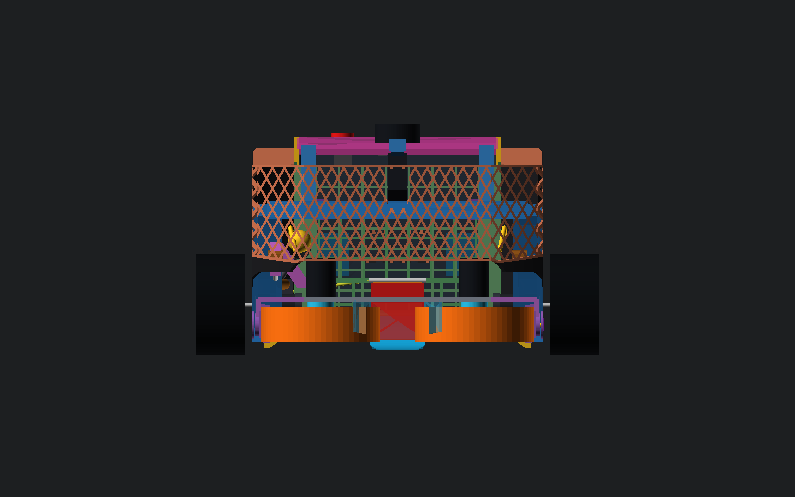
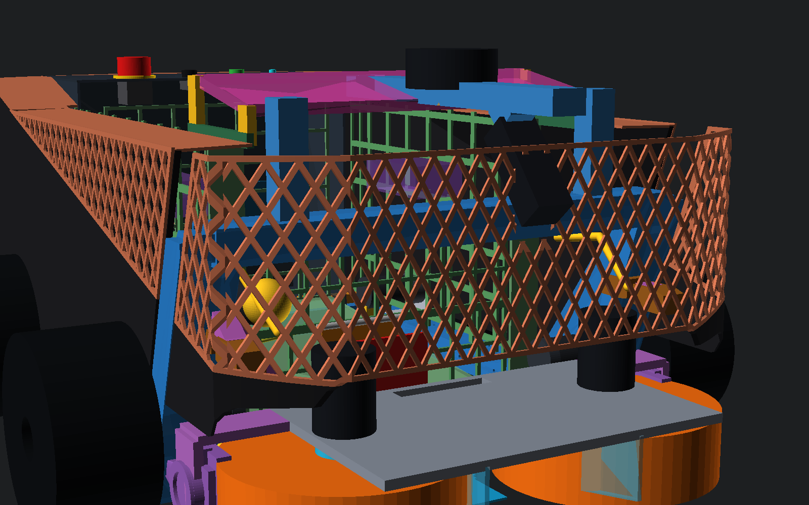


### Έλεγχος

| Gate | Αποτέλεσμα |
|---|:---:|
| Κινούμενο σύνολο −10…+20° (μαζί με θύρα P2-68) | PASS |
| **Μπροστινή συνέχεια, φουσκωμένη +10 mm, απέναντι στο κινούμενο σύνολο** | PASS |
| Τροχοί, σταθερός κόσμος, περιεχόμενα P2-70, μπάλα/καλάθι, feed, κάτοψη ≤R424,5, Z≤375 | PASS |
| Κώνος εκτόξευσης, ανά γωνία +15…+20° | PASS |
| FOV νέας κάμερας μπροστά από τον φακό, −10…+20° | PASS (μετά τη διεύρυνση του ανοίγματος κάτω) |
| Νέα κάμερα: κινούμενο σύνολο, σταθερός κόσμος (χωρίς την παλιά θέση), LiDAR | PASS |

Ελάχιστα της μπροστινής συνέχειας (mm):

| Γωνία | Κινούμενο | Αερισμός D5065 |
|---:|---:|---:|
| −10° | 14,9 | **12,8** |
| −3° | 16,9 | 27,0 |
| 0° | 18,0 | 33,5 |
| +10° | 16,4 | 50,1 |
| +20° | **10,3** (πλάκα κάτω από το μπροστινό rim) | 61,6 |

Άλλα στοιχεία:

- Τροχοί: 11,0 mm.
- Νέα κάμερα: >130 mm από κάθε κινούμενο μέρος, R κάτοψης 420,4, Z≤344.
- Μάζα μπροστινής συνέχειας: **172 g**, σε ~6 κομμάτια ≤250 mm (L/R
  πλάι+γωνία, L/R μπροστά, μικρά κολάρα).

Το QA εντόπισε και διόρθωσε, πριν από την παράδοση, τα εξής:

- γωνίες πάνω στους δίσκους flywheel στις +20° → Z140,
- κάτω ακμή στα πλάγια 7,6 mm από το yoke → Z115,
- rim 7,8 mm από τον αερισμό στις −10° → X511,
- rim 8,5 mm από την πλάκα στις +20° → Z158,
- κάμερα 1 mm μέσα στη δοκό LiDAR → Z300,
- extrusion ±500 που άφηνε το μπροστινό πλέγμα κενό → ±1000,
- FOV κάτω από το σώμα της κάμερας → άνοιγμα +στόμιο.

### Νέα ανοιχτά σημεία

1. **Η θέση της κάμερας αλλάζει το P2-67.** Απόφαση του μηχανισμού: κραδασμός
   του προβόλου στη δοκό LiDAR, καλώδιο, βαθμονόμηση perception.
2. Η μπροστινή όψη (328 mm άνοιγμα) στηρίζεται στα πλάγια/τόξα και στον
   κόμβο της κάμερας. Χρειάζεται coupon ακαμψίας, γιατί δεν πρέπει να
   ταλαντώνεται μέσα στο κάδρο της κάμερας.
3. Τα D5065 μένουν ορατά από μπροστά κάτω από το Z158. Χαμηλότερα δεν
   γίνεται, λόγω πλάκας και κώνου στις +20°.
4. Το πλέγμα μπροστά δεν έχει φίλτρο G2, επειδή τα D5065 θέλουν αέρα. Βροχή
   και σκόνη στη μονάδα παραμένουν ανοιχτό θέμα.

## 6. Αναπαραγωγή

```bash
cad/body-panels/render-f.sh
```

```bash
python3 cad/body-panels/qa-clearance-f.py
```

Ενδιάμεσα meshes μόνο στο `cad/body-panels/_build/`, που σβήνεται μετά.

ΠΑΥΣΗ.
