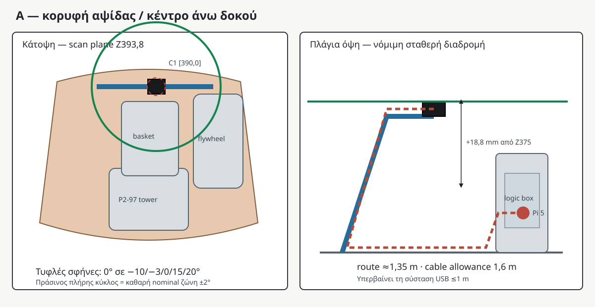
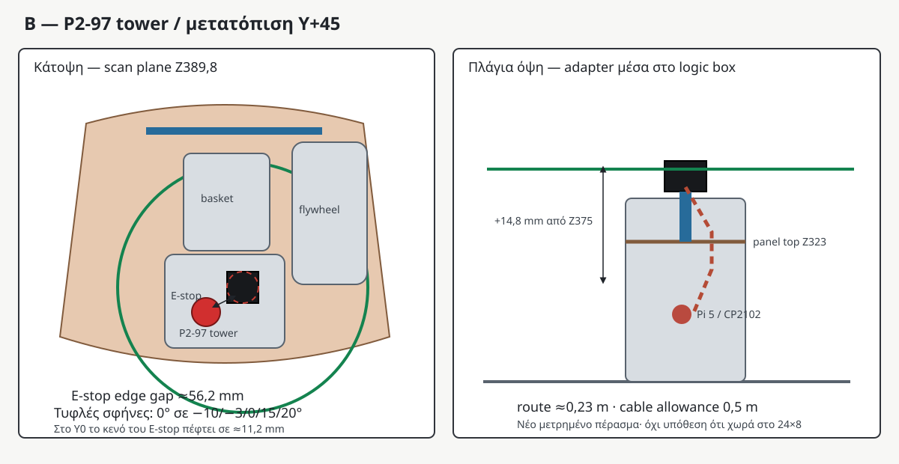
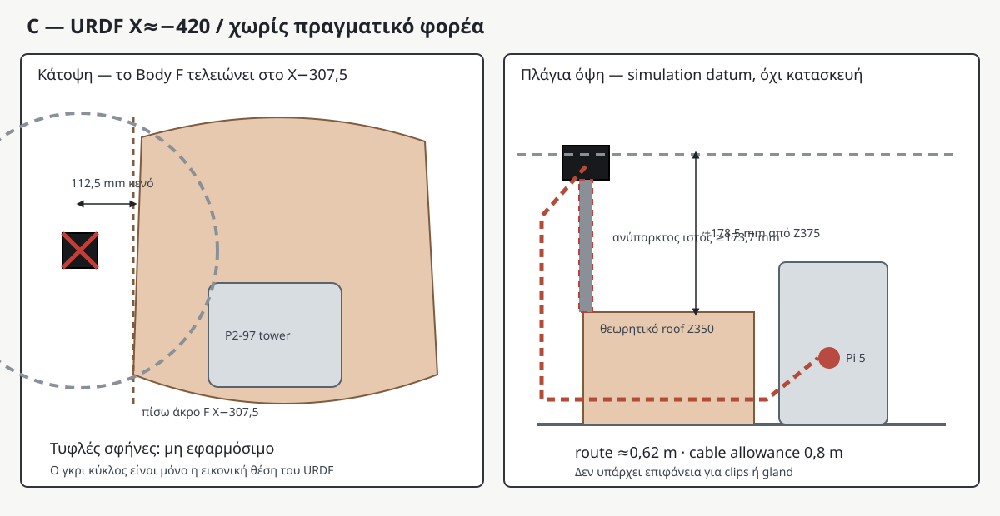

# τι διαφέρει από το αναμενόμενο

1. **Δεν υπάρχει σήμερα LiDAR mount στο ενεργό CAD.** Τα ονόματα
   `lidar_mast` / `lidar_half` είναι ιστορικά: στο ενεργό P2-93/P2-96 set τα
   αντίστοιχα τυπωμένα στοιχεία σχηματίζουν την άνω δοκό και κρατούν την OAK-D.
   Δεν έχουν τις 4×M2.5 οπές 43×43 mm του C1 και δεν αποτελούν άδεια να δεθεί
   αισθητήρας επάνω τους.
2. **Η θέση C του URDF δεν έχει φυσική οροφή.** Το Body F έχει πίσω άκρο
   `X = 117 - 424,5 = -307,5 mm`, ενώ το `lidar_xyz.x=-0,42 m` δείχνει περίπου
   X−420: 112,5 mm πίσω από το ενεργό περίγραμμα. Το παλιό
   `lidar-pod-study.scad` περιγράφει άλλο, v0 κέλυφος με roof Z466 και δεν είναι
   φορέας του σημερινού F.
3. **Το πραγματικό C1 δεν συμφωνεί με το simulation surrogate.** Το επίσημο
   επίπεδο εκπομπής/λήψης είναι 29,8 mm πάνω από τη βάση. Το xacro χρησιμοποιεί
   sim-only offset 35 mm και σώμα Ø94×45 mm, ενώ το C1 είναι 55,6×55,6×41,3 mm.
4. **Το επίσημο `range_min` είναι 0,05 m, όχι 0,10 m.** Το sim κρατά 0,15 m
   σκόπιμα για απόρριψη self-hits· το σχόλιο του xacro που αποδίδει 0,10 m στο
   C1 είναι λανθασμένο. Δεν αλλάζει σε αυτή τη μελέτη.
5. **Η κεντρική B εμποδίζει την προσέγγιση στο E-stop.** Στο Y0 μένουν μόνο
   περίπου 11 mm ανάμεσα στην κάτοψη του C1 και στο Ø38 μανιτάρι. Η B που
   συγκρίνεται παρακάτω είναι προσωρινά στο Y+45 mm και δίνει ~56 mm καθαρό
   οριζόντιο κενό. Η ανθρώπινη πρόσβαση πρέπει να δοκιμαστεί πριν σχεδιαστεί
   mount.
6. **Το υπάρχον panel slot 24×8 mm δεν θεωρείται διέλευση USB.** Η SLAMTEC δεν
   δίνει envelope του Type-C βύσματος, του overmould ή του adapter. Η μεγαλύτερη
   πραγματική κεφαλή βύσματος πρέπει να μετρηθεί από τον χρήστη.

**Απόφαση αυτής της φάσης:** προτείνεται η **B, επάνω στο P2-97, μετατοπισμένη
στο Y+45 mm**, με scan plane Z389,8 mm. Η πρόταση είναι επιλογή θέσης, όχι σχέδιο
mount. **STOP: δεν σχεδιάζεται βάση, ιστός, τρύπα ή STL πριν από απόφαση του
χρήστη και τις μετρήσεις του §8.**

## 1. Πηγές, σύστημα αναφοράς και βαθμός βεβαιότητας

Επίσημες πηγές SLAMTEC:

- [RPLIDAR C1 datasheet v1.1, 2024-03-12](https://bucket-download.slamtec.com/2d4664be9f9f5c748f3b608f2cf1862962b168eb/SLAMTEC_rplidar_datasheet_C1_v1.1_en.pdf),
  ειδικά pp. 9, 11–15, 18.
- [RPLIDAR C1 Development Kit User Manual v1.1, 2024-10-23](https://bucket-download.slamtec.com/9ab6ef03f6f98de7ee825a0c403cffc2a6bb5f22/SLAMTEC_rplidarkit_usermanual_C1_v1.1_en.pdf),
  pp. 3–5 και 11–12.
- [Επίσημη σελίδα υποστήριξης C1](https://www.slamtec.com/en/support) και
  [επίσημο FAQ RPLIDAR](https://wiki.slamtec.com/display/SD/RPLIDAR%20FAQ),
  το οποίο δεν συνιστά εξωτερική USB καλωδίωση πάνω από 1 m.

Οι συντεταγμένες CAD είναι mm, ground frame, +X εμπρός, +Y αριστερά, +Z πάνω.
Το `lidar_xyz` είναι στο `base_link`, του οποίου το Z είναι 45 mm πάνω από το
έδαφος. Οι A/B είναι σταθερές δομές του σασί, όχι compact mechanism geometry,
οπότε τα προσωρινά X/Y παρακάτω μεταφέρονται 1:1 από το chassis CAD και **δεν**
παίρνουν το `functional_shift_x=-100 mm`. Πριν από αλλαγή xacro χρειάζεται
έλεγχος στο generated URDF· δεν αντιγράφεται τυφλά CAD X.

Οι χαρακτηρισμοί σημαίνουν:

- **Βέβαιο:** ρητή διάσταση επίσημου εγγράφου ή ενεργού CAD.
- **Προσωρινό:** datum που επιλέγεται μόνο για ίση σύγκριση των θέσεων.
- **Να μετρηθεί από τον χρήστη:** δεν υπάρχει αξιόπιστη διάσταση στην επίσημη
  τεκμηρίωση ή στο ενεργό CAD.

## 2. RPLIDAR C1 — μηχανικό και ηλεκτρικό συμβόλαιο

| Στοιχείο | Τιμή | Κατάσταση |
| --- | ---: | --- |
| Σώμα | 55,6×55,6×41,3 mm | επίσημο datasheet, ανοχή ±0,2 mm |
| Επίπεδο εκπομπής/λήψης από κάτω έδρα | **29,8 mm** | επίσημο datasheet |
| Κάτω τμήμα βάσης | 23,1 mm | επίσημο datasheet |
| Στερέωση | 4×M2.5, κάνναβος 43×43 mm | επίσημο datasheet |
| Μέγιστη είσοδος βίδας στη βάση | **4 mm** | επίσημο datasheet· βαθύτερη βίδα μπορεί να προκαλέσει ζημιά |
| Μάζα | 110 g | επίσημο datasheet |
| Εύρος | 0,05–12 m λευκό / 0,05–6 m μαύρο | επίσημο datasheet |
| Scan field flatness | 0…1,5° | επίσημο datasheet |
| Τροφοδοσία | 5 V, 230 mA typ., 260 mA max., 800 mA startup | επίσημο datasheet |
| Αισθητήρας → adapter | XH2.54-5P, TTL UART 460800 | επίσημο datasheet/manual |
| Adapter → host | USB Type-C cable, CP2102 adapter | επίσημο manual |
| Μήκος captive lead, adapter envelope, βύσματα/overmould | — | **να μετρηθεί από τον χρήστη** |
| Ελάχιστη ακτίνα κάμψης του kit cable | — | **να μετρηθεί από τον χρήστη**· δεν δίνεται από SLAMTEC |

Για packaging χρησιμοποιείται προσωρινά **R≥30 mm σε σταθερή διαδρομή και
R≥50 mm στο service loop**, ή το μεγαλύτερο όριο του πραγματικού καλωδίου.
Αυτό είναι συντηρητικός κανόνας μελέτης, όχι προδιαγραφή SLAMTEC. Το υπάρχον
`perf_cable_bend=20 mm` του pod δεν πιστοποιεί το άγνωστο USB cable.

## 3. Κοινή μέθοδος ελέγχου δέσμης

Για κάθε θέση ελέγχθηκε η ίδια οπτική ζώνη: κώνος ±2° γύρω από το οριζόντιο
scan plane, 360° σε κάτοψη, στις πέντε στάσεις του moving module
−10/−3/0/15/20°. Ένα σώμα με οριζόντια απόσταση `r` μπορεί να κόψει τη ζώνη
μόνο αν φτάνει στο `Zscan ± r·tan(2°)`.

Ελέγχθηκαν flywheel module, καλάθι/backboard, αψίδα/OAK, P2-97 tower,
E-stop και Body F. Οι τυφλές γωνίες παρακάτω είναι **γεωμετρικές γωνίες CAD**,
όχι μετρημένη απόδοση lidar. Δεν μετρήθηκαν ακόμη βίδες, δεματικά, πραγματικό
καλώδιο, χέρια/λαβές ή αποκλίσεις εκτύπωσης.

## 4. A — κορυφή αψίδας, κέντρο άνω δοκού

Προσωρινό κέντρο αισθητήρα: CAD `[390, 0]`. Η επάνω επιφάνεια της πραγματικής
δοκού είναι Z364. Το C1 πατά απευθείας σε προσωρινό datum Z364, άρα:

| Μέγεθος | Τιμή |
| --- | ---: |
| βάση C1 | Z364,0 |
| scan plane | **Z393,8** |
| επάνω άκρο C1 | Z405,3 |
| απόσταση scan από `ko_lidar` / Z375 | **+18,8 mm** |
| προσωρινό `lidar_xyz` | περίπου `[+0,390, 0, +0,3138] m` με sim offset 35 mm |

| Tilt | Flywheel | Καλάθι | Αψίδα/OAK | Tower/E-stop | Body F | Σύνολο τυφλών |
| ---: | ---: | ---: | ---: | ---: | ---: | ---: |
| −10° | 0° | 0° | 0° | 0° | 0° | **0°** |
| −3° | 0° | 0° | 0° | 0° | 0° | **0°** |
| 0° | 0° | 0° | 0° | 0° | 0° | **0°** |
| 15° | 0° | 0° | 0° | 0° | 0° | **0°** |
| 20° | 0° | 0° | 0° | 0° | 0° | **0°** |

Η δοκός και η OAK είναι κάτω από την κάτω ακτίνα της ζώνης. Δεν υπάρχει
τυφλή σφήνα από το ίδιο το μελλοντικό mount μόνο αν **κανένα** στήριγμα,
κεφαλή βίδας ή καλώδιο δεν ανέβει μέσα στο Zscan±2°. Η ελάχιστη εμβέλεια
0,05 m δεν είναι άδεια να βάλουμε αδιαφανές στήριγμα μπροστά στο optical
window.

- **E-stop:** απόσταση κέντρων περίπου 0,60 m· πατιέται χωρίς γειτνίαση με το
  C1. Η διαδρομή χεριού δεν περνά από τη θέση A.
- **Ακαμψία/κραδασμοί:** θετικό το διπλό portal και η μικρή πρόσθετη ανύψωση·
  αρνητικά το X+390, η OAK στην ίδια δοκό και η άμεση μετάδοση κραδασμών από
  το εμπρός flywheel/arch. Το ενεργό set παραμένει FIT-CHECK και δεν υπάρχει
  proof-load για πρόσθετη μάζα 110 g. **Να μετρηθεί από τον χρήστη** η ιδιοσυχνότητα
  ή τουλάχιστον η επιτάχυνση στη δοκό με flywheels σε όλο το RPM range.
- **URDF/sim/nav:** αλλάζει X/Z του fixed joint και η αληθινή γεωμετρία του
  head. Με σταθερό yaw=0 δεν αλλάζουν οι συμβάσεις γωνιών `/scan`. Χρειάζονται
  regenerate URDF, TF check, Gazebo self-hit/coverage sweep, Nav2 costmap και
  SLAM remap regression.

## 5. B — κορυφή P2-97, μικρός ιστός

Η θέση στο γεωμετρικό κέντρο Y0 απορρίπτεται ως προς το E-stop. Για ισότιμη
σύγκριση ορίζεται προσωρινά κέντρο CAD `[-198,5, +45]`, επάνω από το panel,
και βάση C1 Z360. Το panel top είναι Z323, άρα ο καθαρός μοχλός έως την έδρα
είναι 37 mm. Δεν είναι σχέδιο ιστού.

| Μέγεθος | Τιμή |
| --- | ---: |
| panel top | Z323,0 |
| προσωρινή βάση C1 | Z360,0 |
| scan plane | **Z389,8** |
| επάνω άκρο C1 | Z401,3 |
| απόσταση scan από `ko_lidar` / Z375 | **+14,8 mm** |
| προσωρινό `lidar_xyz` | περίπου `[−0,1985, +0,045, +0,3098] m` με sim offset 35 mm |

| Tilt | Flywheel | Καλάθι | Αψίδα/OAK | Tower/E-stop | Body F | Σύνολο τυφλών |
| ---: | ---: | ---: | ---: | ---: | ---: | ---: |
| −10° | 0° | 0° | 0° | 0° | 0° | **0°** |
| −3° | 0° | 0° | 0° | 0° | 0° | **0°** |
| 0° | 0° | 0° | 0° | 0° | 0° | **0°** |
| 15° | 0° | 0° | 0° | 0° | 0° | **0°** |
| 20° | 0° | 0° | 0° | 0° | 0° | **0°** |

- **E-stop:** κέντρο μανιταριού `[−198,5,−58]`, Ø38. Στο Y+45 η οριζόντια
  edge-to-edge απόσταση είναι `103−27,8−19 ≈ 56,2 mm`. Το μανιτάρι είναι
  χαμηλότερα, αλλά απαιτείται πραγματικό glove/hand test από πίσω και από τις
  δύο πλευρές. Στο Y0 το αντίστοιχο κενό είναι μόνο 11,2 mm και δεν γίνεται
  αποδεκτό.
- **Ακαμψία/κραδασμοί:** μόνο 37 mm νέος μοχλός, αλλά ο φορέας είναι ο
  PETG stack P2-97 από Z64 έως το panel. Οι συνεχείς τριπλές ραφές και τα
  corner nodes είναι καλύτερα από λεπτή οροφή F, όχι όμως πιστοποιημένα για
  lidar. Να γίνει accelerometer/scan-wall test με drive και flywheel on/off.
- **URDF/sim/nav:** ίδια κατηγορία αλλαγών με A. Η πλευρική μετατόπιση Y+45
  πρέπει να περάσει σε TF· διαφορετικά οι στροφές θα μεταφράζουν λάθος τα
  scans. Το yaw μένει 0 και η έξοδος του καλωδίου δεν ορίζει τον οπτικό +X.

## 6. C — X≈−420, θέση URDF πάνω από Body F

Η C δεν είναι mountable στο σημερινό CAD. Παρακάτω καταγράφεται μόνο το
υφιστάμενο **simulation datum**, ώστε να φανεί το κόστος αν κατασκευαζόταν
νέος πραγματικός φορέας.

| Μέγεθος | Τιμή |
| --- | ---: |
| φυσικός φορέας στο X−420 | **δεν υπάρχει** |
| scan plane URDF | **Z553,5** |
| απαιτούμενη έδρα πραγματικού C1 | Z523,7 |
| επάνω άκρο πραγματικού C1 | Z565,0 |
| απόσταση scan από `ko_lidar` / Z375 | **+178,5 mm** |
| τρέχον `lidar_xyz` | `[−0,420, 0, +0,4735] m` με sim offset 35 mm |

| Tilt | Flywheel | Καλάθι | Αψίδα/OAK | Tower/E-stop | Body F | Τυφλές γωνίες |
| ---: | --- | --- | --- | --- | --- | --- |
| −10° | — | — | — | — | — | **μη εφαρμόσιμο** |
| −3° | — | — | — | — | — | **μη εφαρμόσιμο** |
| 0° | — | — | — | — | — | **μη εφαρμόσιμο** |
| 15° | — | — | — | — | — | **μη εφαρμόσιμο** |
| 20° | — | — | — | — | — | **μη εφαρμόσιμο** |

Αν προστεθεί αυθαίρετα φορέας και διατηρηθεί Z553,5, τα σημερινά σώματα είναι
κάτω από τη ζώνη και η προβολή τους δίνει 0°. Δεν καταγράφεται ως αποτέλεσμα
θέσης C, επειδή ο άγνωστος νέος φορέας είναι ακριβώς αυτός που μπορεί να
δημιουργήσει τυφλές σφήνες.

- **E-stop:** μεγάλη απόσταση σε X/Z, χωρίς σύγκρουση χεριού.
- **Ακαμψία/κραδασμοί:** από θεωρητική roof Z350 έως έδρα Z523,7 απαιτείται
  μοχλός ≥173,7 mm επάνω σε ανύπαρκτη οροφή. Είναι η χειρότερη PETG επιλογή.
- **URDF/sim/nav:** έχει το μικρότερο software delta μόνο επειδή είναι ήδη το
  simulation fiction. Η διατήρησή του θα έκρυβε φυσικό TF error, άρα δεν είναι
  πλεονέκτημα.

## 7. Διαδρομή έως το Pi 5

Το Pi 5 βρίσκεται στο P2-97 logic box Z212,75…294,75. Ο ενεργός πίσω channel
είναι στο τοπικό X−60 περίπου (global X−258,5), με καθαρή τομή 10×14 mm και
Z περίπου 214,75…274,75. Το control panel έχει capsule slot 24×8 mm στο
global περίπου `[X−240,5,Y+70,Z319]`.

Η προτιμώμενη αρχιτεκτονική είναι: C1 XH2.54-5P lead → **adapter στερεωμένος
μέσα στο logic box** → κοντό Type-C USB cable → Pi 5. Έτσι ο CP2102 adapter,
το Type-C joint και η ανακούφιση έλξης μένουν στεγνά και serviceable. Αν το
εργοστασιακό XH2.54 lead δεν φτάνει, δεν αυτοσχεδιάζεται επέκταση πριν ελεγχθούν
πτώση 5 V, pinout και μήκος: **να μετρηθεί από τον χρήστη**.

| Θέση | Πραγματική διαδρομή, μακριά από κινούμενα | Μήκος με service margin | Είσοδος tower | Ανακούφιση έλξης |
| --- | --- | ---: | --- | --- |
| A | επάνω δοκός → +Y σταθερός mast/arch leg → σταθερή ράγα σασί → ανοικτή πίσω όψη logic box. Όχι πάνω από tilt, launcher cable sweep ή καλάθι | route ≈1,35 m· προμήθεια **1,6 m** | από ανοικτό −X service face στο ύψος logic box· όχι από panel slot | clamp στη δοκό, δεύτερο clamp πριν το arch leg, τρίτο στο tower· R50 service loop στο C1 και στο Pi |
| B | 37 mm mast → +Y πλευρά panel → panel/channel → Pi. Δεν περνά από tilt ή καλάθι | route ≈0,23 m· προμήθεια **0,5 m** | νέο μετρημένο gland/slot δίπλα στο +Y πίσω άκρο, ευθυγραμμισμένο με channel | clamp κάτω από την έδρα, P-clip πριν από το πέρασμα, clamp μέσα στο collar· R50 loop |
| C | υποθετικός πίσω mast → προς X+ στο πίσω F/tower → channel → Pi. Δεν υπάρχει σήμερα επιφάνεια για clips | route ≈0,62 m· προμήθεια **0,8 m** | νέο πίσω πέρασμα· το 24×8 δεν τεκμηριώνεται | δύο clamps στον νέο φορέα και gland στο κέλυφος· μη αξιολογήσιμο χωρίς φορέα |

Η A υπερβαίνει την επίσημη σύσταση για USB extension ≤1 m. Το μήκος 1,6 m
είναι μηχανική απαίτηση διαδρομής, όχι ηλεκτρική έγκριση. Για A θα χρειαζόταν
τεκμηριωμένη διαφορετική τοποθέτηση adapter/τροφοδοσίας ή active solution·
αυτό είναι νέο electrical design και όχι μέρος της παρούσας μελέτης.

### Απαιτούμενο άνοιγμα

Το 24×8 mm slot μπορεί να χρησιμοποιηθεί μόνο αν ο **μετρημένος** connector
και το overmould περνούν με τουλάχιστον 1 mm περιμετρικό κενό και χωρίς να
παραβιάζεται η ελάχιστη ακτίνα κάμψης. Δεν θεωρείται ότι περνούν.

Για B/C δεσμεύεται αρχικά νέο rounded opening
`(Wmax+2 mm) × (Tmax+2 mm)`, όπου Wmax/Tmax είναι η μεγαλύτερη κεφαλή που
πρέπει πραγματικά να περάσει. **Προσωρινό packaging envelope 16×10 mm** είναι
αποδεκτό μόνο αν η μέτρηση δείξει βύσμα ≤14×8 mm· αλλιώς μεγαλώνει με βάση τη
μέτρηση. Το άνοιγμα δεν σχεδιάζεται τώρα και πρέπει να ελεγχθεί ως προς τις
panel ribs, το E-stop keepout και το P2-97 seam.

## 8. Συγκριτική απόφαση

| Κριτήριο | A | B, Y+45 | C |
| --- | --- | --- | --- |
| 360° ζώνη ±2° | PASS, 0° nominal | PASS, 0° nominal | μη εφαρμόσιμο χωρίς φορέα |
| Περιθώριο πάνω από Z375 | +18,8 mm | +14,8 mm | +178,5 mm αλλά εικονικό |
| E-stop | άνετο | ~56 mm edge gap, θέλει hand test | άνετο |
| Νέος μοχλός | πρακτικά 0 mm πάνω στη δοκό | 37 mm | ≥173,7 mm και χωρίς roof |
| USB | ~1,6 m, ηλεκτρικά προβληματικό | ~0,5 m, καλύτερο | ~0,8 m, αλλά χωρίς route support |
| Φορέας | διπλό portal, FIT-CHECK | P2-97 stack, FIT-CHECK | απών |
| Software delta | μεγάλο X/Z | X/Y/Z | μικρό μόνο επειδή το URDF είναι λάθος φυσικά |

**Πρόταση: B στο Y+45 mm, scan Z389,8 mm.** Έχει μηδενική nominal απόκρυψη
και τη μόνη σύντομη, serviceable διαδρομή που μένει καθαρή από tilt/καλάθι και
κάτω από 1 m. Η A είναι οπτικά και δομικά ελκυστική, αλλά η νόμιμη διαδρομή
καλωδίου είναι πολύ μεγάλη και φορτώνει την ίδια δοκό με OAK και κραδασμούς
του εμπρός module. Η C απορρίπτεται επειδή δεν υπάρχει φορέας.

Πριν περάσουμε σε mount απαιτούνται από τον χρήστη:

1. μήκος και έξοδος του captive XH2.54 lead,
2. W×T×L του USB adapter και όλων των overmoulds,
3. OD και επιτρεπτή ακτίνα κάμψης του kit cable,
4. φωτογραφία/μέτρηση του Pi-side connector και της διαθέσιμης θύρας,
5. hand/glove test στο B/Y+45 με dummy 55,6×55,6×41,3 mm,
6. επιβεβαίωση ότι το panel/collar δέχεται 110 g στο Y+45 χωρίς ορατή κάμψη,
7. πραγματικό 360° wall scan με drive και flywheels off/on μετά την κατασκευή.

## 9. Τι θα αλλάξει μετά την απόφαση — όχι σε αυτό το commit

- νέο mount CAD και fastener stack με M2.5 penetration ≤4 mm,
- πραγματικό cable opening/gland και clips μετά τις μετρήσεις,
- `lidar_xyz`, πραγματικό C1 visual/collision και συμφωνία physical scan plane
  ↔ sim sensor origin,
- διόρθωση του λανθασμένου σχολίου `range_min`; χωριστή απόφαση αν το sim
  πρέπει να μείνει 0,15 m για self-hit rejection,
- regenerate URDF και WSL 2/Docker checks: TF tree, Gazebo 360° scan στις
  −10/−3/0/15/20°, Nav2 local/global costmaps, SLAM/map regression και
  πραγματικό `/scan` frame `lidar_link`.

Καμία αλλαγή STL, SCAD, xacro, launch ή Nav2 έγινε στην P2-99a.
