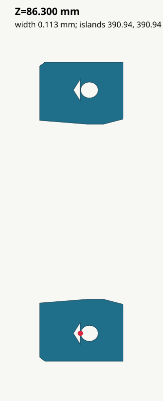
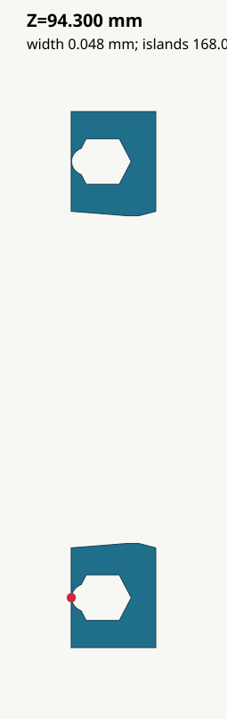
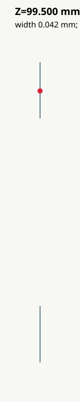

# P2-99e — OAK-D S2: θέση B, γωνία 25° και βραχίονας από την αψίδα

Κατάσταση: **FIT-CHECK — ΜΗΝ ΤΥΠΩΣΕΙΣ ακόμη.** Ημερομηνία: 2026-11-19.
Έγκριση χρήστη: θέση B, φακός CAD [508, 0, 300], `oak_pitch_deg` default 25°,
βραχίονας από την άνω δοκό της αψίδας· το F front δεν είναι φέρον.

## τι διαφέρει από το αναμενόμενο

1. **Η μάζα της κάμερας ΔΕΝ δίνεται στο datasheet** ούτε στη σελίδα της
   Luxonis. Η βύθιση και η ιδιοσυχνότητα δίνονται ως ευαισθησία για
   0,10–0,25 kg· **να ζυγιστεί η κάμερα.**
2. **Το επίσημο STEP δεν συνδέεται από τη σελίδα τεκμηρίωσης της Luxonis**
   (η σελίδα δίνει μόνο το datasheet). Συνδέεται από το επίσημο repository
   `luxonis/oak-hardware` (Mechanical/README) προς το CDN της Luxonis· από
   εκεί κατέβηκε (§1). Δεν έχει revision label· καταγράφονται το εσωτερικό
   όνομα/ημερομηνία του STEP, το Last-Modified και το sha256.
3. **Το S2 δεν στερεώνεται κεντρικά στη βάση.** Το ¼"-20 είναι κάτω από τον
   έναν stereo φακό (X 7,5 mm από την άκρη, όχι στο κέντρο). Ο βραχίονας
   χρησιμοποιεί λοιπόν τις **2× M4 VESA 75** της πλάτης, οι οποίες είναι
   ευθυγραμμισμένες με τους stereo φακούς, **4,8 mm κάτω από τον οπτικό
   άξονα**.
4. **Πρόσβαση στις M4 της κάμερας μόνο με κλειδί Allen L** (ελεύθερος χώρος
   Ø10 × 25 mm πίσω από την πλάκα). Ευθύ κατσαβίδι 70 mm δεν χωρά, γιατί τα
   τοιχώματα συγκλίνουν στα pads.
5. **Δεν χρησιμοποιήθηκαν δύο struts ανά πλευρά.** Έγινε ένα ενιαίο τριγωνικό
   τοίχωμα 9 mm ανά πλευρά: τα ξεχωριστά struts και η οπή έδιναν λεπτές τομές
   στην εκτύπωση. Επίσης τα pads μεγάλωσαν σε 12×16×20 mm με **captive
   παξιμάδι M4** (κανόνας: φέρουσα M4 = βίδα + παξιμάδι). Η M4×40 μπαίνει από
   πίσω από τη δοκό.
6. **Τρεις ακμές μετάβασης στη slice gate δηλώθηκαν ρητά** (allow-z στο
   `check-stl-printability.sh`, με εικόνες): η αιχμή στο πάτωμα της φωλιάς του
   παξιμαδιού, η έξοδος οπής/φωλιάς στην επιφάνεια επαφής με τη δοκό και η
   κορυφή του pad. Τα πραγματικά τοιχώματα γύρω από τη φωλιά είναι ≥3,2 mm.
7. **Ονομαστικό κενό 0,2 mm** μεταξύ πλάτης κάμερας και πλάκας (`seat_gap`),
   ώστε το scene gate να μη μετρά την επαφή ως νέο ζεύγος. Κλείνει με τη
   σύσφιξη.
8. **Η επιβεβαίωση συλλογής δεν μπορεί να γίνει με την κάμερα.** Η κορυφή της
   μπάλας χάνεται 216–224 mm πριν από την πρώτη επαφή με το flywheel και
   ολόκληρη η μπάλα 282–290 mm πριν (§5) → D36/D37 (ανοιχτό θέμα CAD).
9. Ο φακός, όπως εγκρίθηκε, είναι στο X508. Η πάνω μπροστινή ακμή του
   enclosure φτάνει στο X512,2, δηλαδή 1,2 mm πέρα από την εξωτερική όψη του F
   (X511), μέσα στο νέο «μάτι». Όχι σύγκρουση· το F είναι concept.

## 1. Επίσημες πηγές

| Πηγή | Τι δίνει | Έκδοση / ταυτότητα |
| --- | --- | --- |
| <https://docs.luxonis.com/hardware/products/OAK-D%20S2> | αισθητήρες, FOV, baseline, depth, link στο datasheet | — |
| `OAK-D-S2_Datasheet.pdf` (<https://github.com/luxonis/depthai-hardware/blob/master/DM9098_OAK-D-S2/Datasheet/OAK-D-S2_Datasheet.pdf>, link από τη σελίδα docs) | 97 × 29,5 × 22,9 mm· ¼"-20 στη βάση· VESA 75 M4 (βάθος 8) στην πλάτη· 3 κάμερες σε ύψος 19,51 mm· FOV (σελ. 4–5) | «Dec, 2021»· PDF Mod 2022-09-01· sha256 `2c49bbdf…79bbf` |
| `DM9098S2_enclosure.stp` (<https://oak-files.fra1.cdn.digitaloceanspaces.com/OAK-D-S2/DM9098S2_enclosure.stp>, link από `github.com/luxonis/oak-hardware/tree/master/DM9098_OAK-D-S2/Mechanical`) | ακριβής γεωμετρία enclosure, οπές, παράθυρα φακών | STEP `010-00009-02_ASM`, 2022-06-03· HTTP Last-Modified 2023-05-11· 8.850.849 B· sha256 `bedf072b…85cdf` |

Μετρήσεις από το STEP με OpenCascade (μόνο για ανάλυση· το αρχείο δεν μπαίνει
στο repo):

| Στοιχείο | Τιμή |
| --- | --- |
| Enclosure (μαζί με τα πτερύγια πλάτης) | 97,1 × 29,7 × 23,4 mm |
| Φακοί | μία γραμμή, 19,67 mm από τη βάση· RGB στο κέντρο, stereo ±37,5 mm |
| Πλάτη | 2× M4 (drill Ø3,3) στο ±37,5 mm, 14,87 mm από τη βάση = **4,8 mm κάτω από τον άξονα** |
| Βάση | ¼"-20 (minor Ø5,1) κάτω από τον έναν stereo φακό, 6,2 mm από την πλάτη |
| FOV | RGB FF 69 × 55°· RGB AF 66 × 54°· stereo 80 × 55°· baseline 75 mm |
| Depth | MinZ ~0,2 m (400P + extended) / ~0,4 m / ~0,8 m· ideal 0,8–12 m· χωρίς IR |
| Μάζα | **δεν δίνεται — να ζυγιστεί** |

## 2. Θέση και γωνία (εγκεκριμένα)

Παράμετροι στο `cad/arch-tilt-p293/p299e-oak-s2.scad` (μία πηγή για βραχίονα
και «μάτι» του F): φακός RGB στο **CAD [508, 0, 300]**, κλίση **25°** προς τα
κάτω (`oak_pitch_deg`), envelope και διεπαφή από το STEP.

Επανάληψη της μελέτης FOV (ray casting πάνω στα STL του `current_robot` στις
−3/0/+20, `scripts/sim_debug/p299e_oak_fov_raycast.py`):

| Κλίση | Σώματα στο πεδίο (RGB/stereo) | Έδαφος από | Ορίζοντας |
| --- | --- | --- | --- |
| **25°** | **0 %** σε όλες τις στάσεις | X738 (0,23 m μπροστά από τον φακό) | ναι (5,2 % ουρανός) |
| 35° | 0 % | X664 | όχι |
| 50° | μονάδα 3,1 % (−3/0) | X583 | όχι |

Η θέση A (πλάκα της αψίδας, X470) απορρίφθηκε: στις 25° η μπροστινή όψη του
F κρύβει 21,7 % της RGB εικόνας.

## 3. Βραχίονας `p299e_oak_bracket`

Πηγή `cad/arch-tilt-p293/p299e-oak-bracket.scad`, export
`export-p299e-oak.sh`, STL `print-arch/p299e_oak_bracket.stl`.

- **Διεπαφή με την αψίδα:** οι **υπάρχουσες** δύο οπές M4 κατά X της άνω δοκού
  στο [*, ±35, 354] (ίδια διεπαφή με το `p293d_oak_mount`). Τα pads
  12×16×20 mm πατούν στην εμπρός όψη της δοκού (X402). Βίδα M4×40 από πίσω από
  τη δοκό σε captive παξιμάδι μέσα στο pad (το παξιμάδι μπαίνει από την
  επιφάνεια επαφής πριν το δέσιμο). **Καμία νέα τρύπα** σε σασί ή αψίδα.
- **Διεπαφή με την κάμερα:** πλάκα 6 mm κάθετη στον οπτικό άξονα, 96 × 30 mm,
  2× Ø4,6 για M4×12 στις VESA 75 της S2· κενό 0,2 mm έως την πλάτη (κλείνει με
  τη σύσφιξη).
- **Ακαμψία:** ένα συμπαγές τριγωνικό τοίχωμα 9 mm ανά πλευρά, από το pad προς
  την πάνω και την κάτω ακμή της πλάκας (βάθος ~25–30 mm), που στενεύει από
  Y±35 στο pad προς Y±20 στην πλάκα (τριγωνισμός και σε κάτοψη). Η δοκός δένει
  τα pads και η πλάκα τα τοιχώματα.
- **Εκτύπωση:** πλάκα στο bed, τοιχώματα κατακόρυφα, χωρίς supports· 115 g
  PETG (συμπαγές, 1,27 g/cm³).
- **Απόσταση από τη μονάδα:** ≥168 mm σε −3/0/+20· η κορυφή της εστίας βολής
  στις +20° βρίσκεται 158 mm κάτω από τον φακό.

### Βύθιση και ιδιοσυχνότητα (μόνο ο βραχίονας)

Πρόβολος 89 mm (πλάκα→pad κατά τον άξονα), δύο τοιχώματα 9 × ~25 mm,
E_PETG ≈ 2000 MPa, I = 23.438 mm⁴, k = 199 N/mm.

| Μάζα κάμερας | Στατική βύθιση στο άκρο | 1ος τρόπος κάμψης |
| --- | --- | --- |
| 0,10 kg | 7 µm | ~198 Hz |
| 0,15 kg | 9 µm | ~168 Hz |
| 0,25 kg | 14 µm | ~135 Hz |

Δεν περιλαμβάνονται η ενδοτικότητα των βιδών, της άνω δοκού και των ποδιών της
αψίδας, οπότε η πραγματική συχνότητα θα είναι χαμηλότερη. Αναφορά: η 1×
διέγερση των D5065 στα 320 rad/s είναι 51 Hz. Επιβεβαίωση: tap test στο
συναρμολογημένο τόξο (υποχρεωτικό πριν το RELEASED).

## 4. Gates

| Gate | Αποτέλεσμα |
| --- | --- |
| `check-stl-printability.sh p299e_oak_bracket.stl 1` | 1 σώμα· 0 floating islands· downward max 0 mm²· slice PASS (3 δηλωμένες ακμές μετάβασης) |
| Πρόσβαση κλειδιού L (Ø10 × 25 mm) | όγκος τομής 0 mm³ |
| Scene gate (`check-current-scene.sh`) | 95 σώματα ανά γωνία (βραχίονας στη θέση του oak_mount + S2 envelope), 0 contained, **48 ζεύγη, ίδια λίστα, κανένα νέο** |
| Ζώνη LiDAR (ko_lidar Z375) | ψηλότερο σημείο του βραχίονα Z364 |

Δηλωμένες ακμές (εικόνες τομών):
- Z85,7–86,3: αιχμή του πατώματος της φωλιάς του παξιμαδιού στην οπή —
  
- Z93,7–94,3: έξοδος οπής/φωλιάς στην επιφάνεια επαφής με τη δοκό —
  
- Z98,9–99,5: κεκλιμένη κορυφή του pad —
  

## 5. Τυφλή ζώνη από τη μύτη (μπάλα στον άξονα)

`scripts/sim_debug/p299e_oak_blind_zone.py`. Πρώτη επαφή = μεγαλύτερο X του
κέντρου μιας μπάλας r33 που ακουμπά τη μονάδα (flywheels).

| Στάση | Πρώτη επαφή (κέντρο X) | Κορυφή ορατή ως X | **Τυφλό (κορυφή)** | Ολόκληρη ορατή ως X | **Τυφλό (ολόκληρη)** |
| --- | --- | --- | --- | --- | --- |
| −3° | 471 | 689 | **218 mm** | 755 | **284 mm** |
| 0° | 472 | 688 | **216 mm** | 754 | **282 mm** |
| +20° | 465 | 689 | **224 mm** | 755 | **290 mm** |

Ίδιο για RGB και stereo (καθορίζεται από το κάτω όριο του VFOV, 55°).

## 6. `camera_link` για το βήμα (β) του sim

| Πεδίο | Τιμή |
| --- | --- |
| Σημείο | οπτικό κέντρο του RGB στη μπροστινή γυάλινη όψη (sim: `camera_link`, sensor pose 0) |
| CAD (ground) | [508, 0, 300] mm, pitch +25° (προς τα κάτω) |
| `base_link` (D1) | **xyz `0.3905 0 0.255`**, **rpy `0 0.436332 0`** |
| Ύψος από το έδαφος | 0,300 m |
| Stereo φακοί | ±0,0375 m στον Y του `camera_link`, ίδιο επίπεδο |
| FOV στο sim | RGB 1,204 rad (69°, FF)· το depth ευθυγραμμίζεται στο RGB (ίδιο FOV, όπως σήμερα)· η παραλλαγή AF (66°) εκκρεμεί μέχρι την αγορά |
| Μάζα | άγνωστη (να ζυγιστεί)· το sim κρατά 0,03 kg |
| Optical frame | REP-103 όπως σήμερα (`camera_link_optical_frame`) |

## 7. Ανοιχτά

- Ζύγιση της κάμερας· fit-check της S2 στην πλάκα (M4×12) και του captive
  παξιμαδιού· tap test.
- Η OAK-D S2 δεν έχει αγοραστεί (δεν είναι στο `ordered-parts.md`).
- Θέσεις των δεσμών D36/D37 για την επιβεβαίωση συλλογής.
- Body F: το «μάτι» ακολουθεί την παράμετρο· η τελική λεπτομέρεια του front
  panel παραμένει concept.
