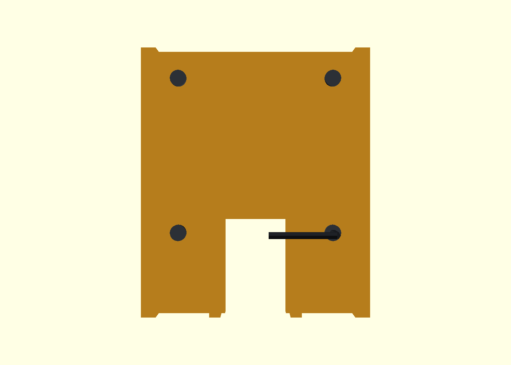
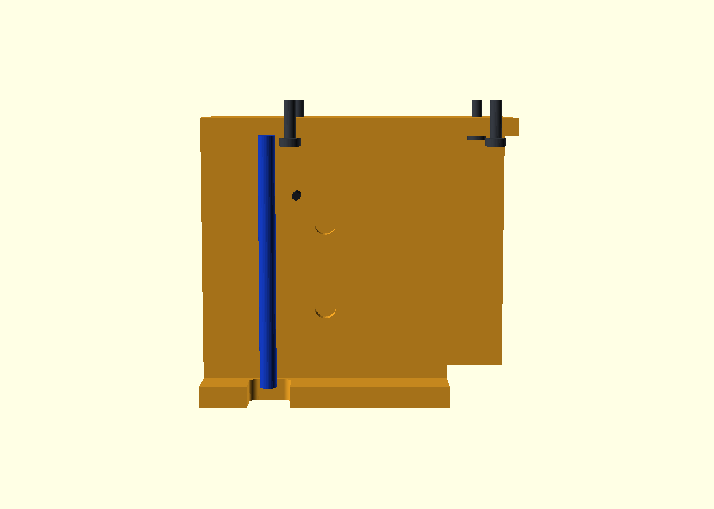

# τι διαφέρει από το αναμενόμενο

Η πρώτη εκτύπωση απέτυχε παρότι ο κάνναβος 43×43 mm ήταν σωστός. Οι βίδες
M2.5 δεν περνούσαν από τις παλιές Ø2,8 οπές και τα τέσσερα ανεξάρτητα
6,5×6,5×4 mm pads έσπασαν στη συναρμολόγηση. Επιπλέον, ο άξονας κάθε οπής
ήταν στο X=±21,5 και η εσωτερική παρειά στο X=±23: έμεναν μόνο 1,5 mm από
τον άξονα, λιγότερα από την ακτίνα περίπου 2,25 mm της κεφαλής M2.5 και
χωρίς πρακτική διαδρομή για L-κλειδί 2 mm.

Η P2-99f αντικαθιστά μόνο το `p299_c1_pedestal`. Το
`p299_panel_collar.stl` και ολόκληρη η κάτω μηχανική διεπαφή του βάθρου
μένουν αμετάβλητα.

## Διόρθωση γεωμετρίας

| Χαρακτηριστικό | P2-99b πρώτη εκτύπωση | P2-99f |
| --- | ---: | ---: |
| Στήριξη C1 | 4 ανεξάρτητα pads 6,5×6,5×4 | ενιαία πλάκα 62×73×4 mm |
| Οπές C1 | 4×Ø2,8 | 4×Ø2,9, ίδιος κάνναβος 43×43 |
| Εσωτερικές παρειές | X=±23 | X=±27 σε όλο το ωφέλιμο ύψος |
| Απόσταση άξονα–παρειάς | 1,5 mm | 5,5 mm |
| Κάτω πέλμα | 58×58×5 mm | **ακριβώς ίδιο** |
| Στήριξη/δέσιμο | V cross-tie + 2 χωριστά ears | 2 συνεχή service webs με 4 tie passages |

Η ενιαία πλάκα έχει ακριβώς 4,0 mm πάχος. Επομένως M2.5×8 περνά τα 4 mm
της πλάκας και εισέρχεται ακριβώς 4 mm στη βάση του C1, όσο επιτρέπει το
επίσημο σχέδιο. Η πλάκα καλύπτει ολόκληρο το footprint 55,6×55,6 mm και
τις φαρδύτερες παρειές. Τα δύο service webs αφήνουν κεντρικό προστατευμένο
κανάλι 19 mm και αντικαθιστούν και το cross-tie και τα floating cable ears.

Ο ανεξάρτητος exact-solid έλεγχος τέμνει το τελικό STL με τέσσερις
κατακόρυφους κυλίνδρους Ø4,5 mm από Z5,2 ως την κάτω όψη της πλάκας. Το
αποτέλεσμα είναι **0,000000 mm³**. Το κάτω όριο βρίσκεται 0,2 mm πάνω από
το αμετάβλητο πέλμα, από όπου το L-κλειδί εισέρχεται από την ανοικτή πλευρά.

## Καλώδιο C1

Το επίσημο μηχανολογικό σχέδιο δείχνει το captive lead να βγαίνει στο μέσο
της πλευράς ανάμεσα στο ένα ζεύγος οπών M2.5, στο επίπεδο της κάτω επιφάνειας
της βάσης. Η πλευρά αυτή προσανατολίζεται προς −Y, δηλαδή κατευθείαν προς το
υπάρχον άνοιγμα XH στο `[0,+82]`. Πηγή: [SLAMTEC RPLIDAR C1 datasheet v1.1,
Figure 4-1](https://bucket-download.slamtec.com/2d4664be9f9f5c748f3b608f2cf1862962b168eb/SLAMTEC_rplidar_datasheet_C1_v1.1_en.pdf).

Η πλάκα έχει κεντρική εγκοπή 17×26,2 mm από την ακμή της ως το εσωτερικό
κανάλι. Το lead κατεβαίνει ανάμεσα στα service webs προς το αμετάβλητο
17×10 mm XH opening, χωρίς να πατιέται από τη βάση C1. Τέσσερα Ø5 tie
passages επιτρέπουν επαναχρησιμοποιούμενο δεματικό χωρίς floating islands.

## Κάτω διεπαφή και panel_collar

Δεν άλλαξαν:

- το πέλμα 58×58×5 mm,
- οι τέσσερις ασύμμετρες θέσεις M3
  `[−18,72]`, `[18,72]`, `[−18,90]`, `[22,88]`,
- το άνοιγμα XH 17×10 mm και το κέντρο του,
- το module/export του `p299_panel_collar`.

Ο πλήρης exporter επανέγραψε τα αρχεία ντετερμινιστικά και το
`p299_panel_collar.stl` παρέμεινε byte-for-byte ίδιο:
`SHA-256 eaa195f79fb6537c4158aed38d38fa3da7ef8b4762005d306b7460be94440cbe`.
Οι τέσσερις M3 και οι τέσσερις νέες M2.5 διαδρομές πέρασαν 8/8 στο
through-axis gate.

## Προσανατολισμός εκτύπωσης

Το STL εξάγεται **ανάποδα, με την ενιαία πλάκα πάνω στο bed**. Αυτό δίνει
την επιφάνεια επαφής του C1 επίπεδη και χωρίς supports. Οι παρειές και τα
service webs ξεκινούν απευθείας από την πλάκα. Το αμετάβλητο πέλμα βρίσκεται
στο Z62…67 της εκτύπωσης, αλλά τα δύο webs χωρίζουν την κάτω του επιφάνεια
σε τρία πραγματικά γεφυρώματα 19,0 / 14,5 / 14,5 mm. Δεν υπάρχει γέφυρα
πάνω από 50 mm και το downward-face gate αναφέρει 0 unsupported faces.

## Εικόνες

Κάτοψη από κάτω, με τις τέσσερις κεφαλές και ένα L-κλειδί 2 mm:

Πλάγια τομή X=0, με μπλε τη διαδρομή του captive lead προς το XH:

## Gates

| Gate | Αποτέλεσμα |
| --- | --- |
| `check-stl-components.py` | 1/1 σώμα PASS |
| floating islands | 0 PASS |
| downward faces | 0 unsupported, 3 supported bridges PASS |
| slice geometry | 332 τομές, width ≥1,600 mm, min island 79,50 mm² PASS |
| C1 + M3 through axes | 8/8 PASS |
| Ø4,5 head/key corridors | τομή **0,000000 mm³** PASS |
| full scene −10/−3/0/15/20° | 95 bodies/angle, 0 exports, 0 contained, **48 ίδια ιστορικά pairs** PASS |
| βάση C1 | Z390,0 mm PASS |
| scan plane | **Z419,8 mm αμετάβλητο** PASS |
| γεωμετρική ζώνη scan ±2° | 0 offenders PASS |

Τελικό STL: bbox 62×73×67 mm σε print coordinates, όγκος 85.980,91 mm³
(περίπου 109 g για PETG 1,27 g/cm³, πριν από slicer settings).

**Κατάσταση: ΕΤΟΙΜΟ ΓΙΑ ΕΚΤΥΠΩΣΗ (2026-11-23).**
