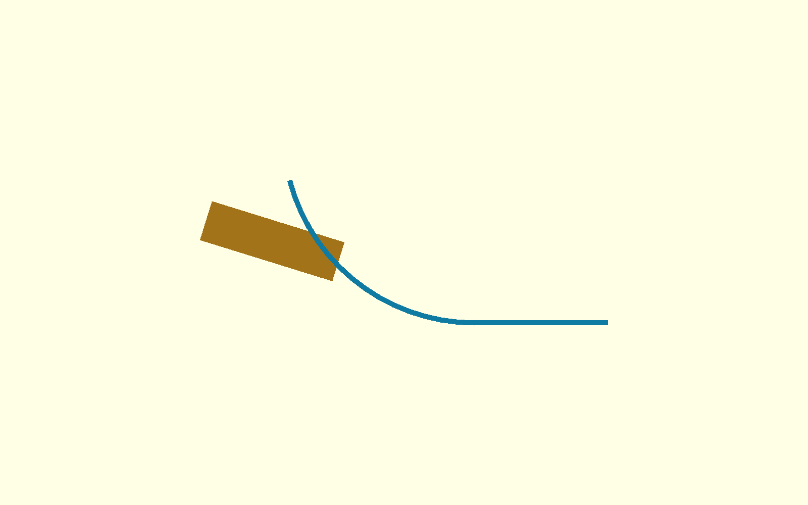
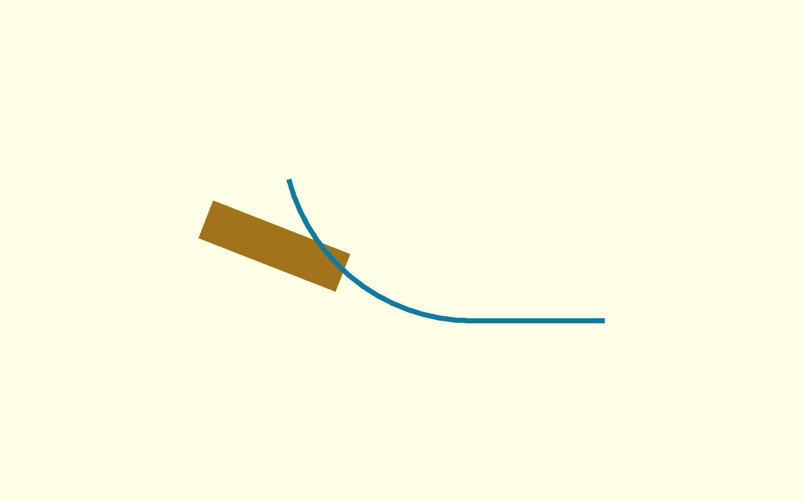

# τι διαφέρει από το αναμενόμενο — P2-73

> **ΙΣΤΟΡΙΚΟ — δεν περιγράφει το τρέχον design.** Διατηρείται ως evidence
> της απόφασης/δοκιμής της εποχής του. Δες
> [το τρέχον design](../current-design-el.md).

Ο ίδιος ο παγωμένος `p267_ski(75)` τέμνει ήδη τα δύο πλαϊνά rails του
παγωμένου P2-68 selector nose στα +15° και +20°. Η αστοχία υπάρχει πριν
προστεθούν πλαϊνά τοιχώματα, βάση ή οποιοδήποτε στήριγμα από την X300.
Συνεπώς το P2-73 σταμάτησε στο πρώτο geometry gate και δεν σχεδιάστηκε
βιδωτή στήριξη ούτε παράχθηκε STL.

## Έλεγχος από τα υπάρχοντα δεδομένα

Ο βατήρας ελέγχθηκε ακριβώς στη θέση του `full-robot-v3.scad`:

- R75, tangent 52 mm, 75°.
- Flat από X435 έως X383 στο Z10.
- Τόξο έως περίπου X310,56/Z65,59.
- Το frozen surface έχει πλάτος έως 94 mm, άρα καλύπτει Y±47 στην περιοχή
  όπου φτάνει ο selector.

Το selector nose έχει κεντρικό floor πλάτους 72 mm και δύο rails πάχους
3 mm/ύψους 16 mm. Τα rails βρίσκονται με κέντρα στο Y±37,5, δηλαδή μέσα
στο πλάτος του ski.

Exact-solid OpenSCAD αποτελέσματα:

- Στα +15° η τομή `ski ∩ complete feed channel` είναι κλειστό manifold με
  120 facets. Η ξεχωριστή τομή με το κεντρικό floor είναι κενή, ενώ η τομή
  με τα δύο rails έχει ακριβώς τα ίδια 120 facets.
- Στα +20° η πλήρης τομή είναι κλειστό manifold με 160 facets. Το κεντρικό
  floor είναι πάλι κενό και όλη η σύγκρουση, 160 facets, προέρχεται από τα
  rails.

Άρα δεν πρόκειται για σκόπιμη επαφή floor-to-nip. Τα πλαϊνά rails περνούν
μέσα από την επιφάνεια κύλισης του βατήρα κοντά στο πίσω στόμιο του nip.
Η προσθήκη του πλήρους hand-test profile ή στηρίξεων δεν μπορεί να κάνει
την ήδη υπάρχουσα τομή κενή χωρίς αλλαγή σε κάποια παγωμένη διεπαφή.

## Έλεγχοι που δεν εκτελέστηκαν μετά την πρώτη αποτυχία

- Δεν σχεδιάστηκαν X300/front-terminal brackets ή σχισμές ±10 mm.
- Δεν έγινε sweep έναντι flywheel −10…+20°, τροχών ή supports.
- Δεν δημιουργήθηκε `cad/modular-test-chassis/stl-ski-mount/` και δεν
  παράχθηκε κανένα manufacturing STL/README.
- Δεν έγινε firmware, Gazebo, commit, push ή PR.

Για αναφορά μόνο, το frozen thin ski έχει κατώτερη παρειά περίπου Z9, άρα
9 mm ονομαστικό κενό από το σημερινό Z0. Αν ολόκληρο το σασί χαμηλώσει
8 mm χωρίς αντιστάθμιση, αυτό γίνεται περίπου 1 mm. Δεν χαρακτηρίζεται ως
clearance τυπώσιμου εξαρτήματος, επειδή η κατασκευαστική γεωμετρία δεν
πέρασε το προηγούμενο feed-path gate.

Απαιτείται νέα απόφαση για το ποια από τις δύο παγωμένες διεπαφές μπορεί να
αλλάξει: ο βατήρας ή τα selector rails. Καμία από τις δύο δεν τροποποιήθηκε
στο P2-73.

Κατάσταση: `P2_73_FAIL_FROZEN_SKI_INTERSECTS_SELECTOR_RAILS_PAUSED`.

ΠΑΥΣΗ.
