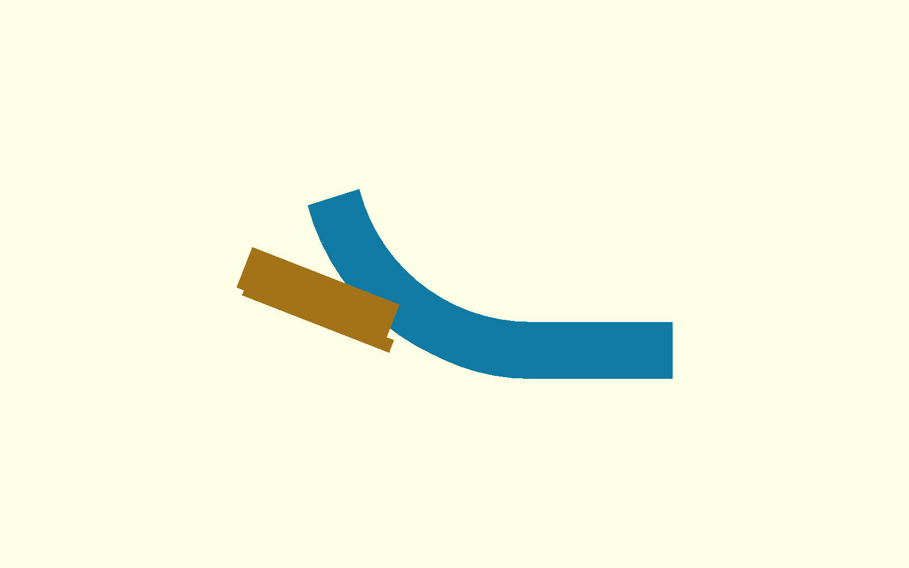
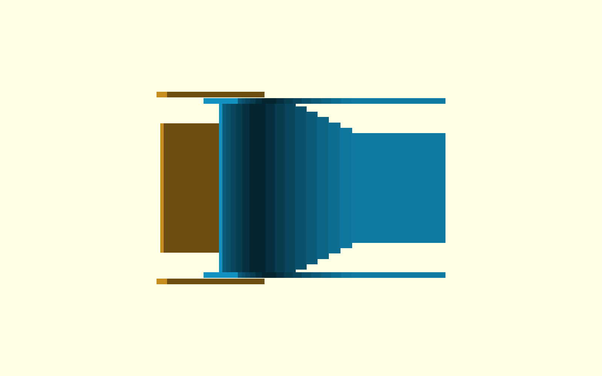

# τι διαφέρει από το αναμενόμενο — P2-74

Ο selector nose χωρά έξω από το R75/75° ski με κέντρα rails στο **Y±52 mm**.
Δεν χρειάζεται Y±55: το ±52 είναι το μικρότερο δοκιμασμένο πλάτος με θετικό
γεωμετρικό κενό από τα ski walls. Άλλαξε μόνο η πλευρική θέση των δύο rails.
Το floor nose, το σταθερό κανάλι, η θύρα, το ski, η μονάδα και ο P2-40 core
έμειναν αμετάβλητα.

## Γεωμετρία

- Ski running surface στην κρίσιμη περιοχή: Y±47 mm.
- Ski walls: πάχος 3 mm, κέντρα Y±48,5, outer faces Y±50.
- Νέα rails: πάχος 3 mm, κέντρα Y±52, inner faces Y±50,5.
- Ονομαστικό rail-to-wall κενό: 0,5 mm ανά πλευρά.
- Αναλυτικό όριο μηδενικής επαφής: rail centre |Y|=51,5 mm. Επιλέχθηκε
  52 mm ώστε να υπάρχει θετικό και όχι μηδενικό CAD clearance.
- Διαμήκης επικάλυψη rail/wall: περίπου 18,6 mm στα +15° και 20,9 mm στα
  +20°, άρα δεν δημιουργείται ανοικτή πλευρική έξοδος στη μετάβαση.

## Exact-solid αποτελέσματα

Για Y±52 ελέγχθηκαν χωριστά +15° και +20°:

- Selector rails έναντι complete ski surface + walls: empty/empty.
- Αμετάβλητο selector floor έναντι ski: empty/empty.
- Rails έναντι frozen upper-plate sweep −10…+20°: empty/empty.
- Floor έναντι frozen upper-plate sweep −10…+20°: empty/empty.
- Rails έναντι D200 wheel/motor sweep −10…+20°: empty/empty.
- Floor έναντι D200 wheel/motor sweep −10…+20°: empty/empty.
- Rails και floor έναντι fail-closed door: όλα empty.
- Rails έναντι fixed feed channel: empty/empty.

Το floor έχει την αναμενόμενη μικρή solid τομή με το fixed channel ακριβώς
στο seam X278: 8 vertices/12 facets και στα δύο endpoints. Επίσης τέμνει το
moving throat όταν ελέγχεται ολόκληρο το `p253_frozen_launcher()`. Αυτές είναι
οι δύο σκόπιμες συνδέσεις της αμετάβλητης διαδρομής τροφοδοσίας, όχι επαφή με
τροχό ή πλάκα. Τα μετακινημένα rails είναι empty ακόμη και έναντι ολόκληρου
του launcher sweep.

## Περιθώριο μπάλας Ø67

- Μεταξύ των νέων inner rail faces υπάρχει clear width 101 mm. Μία Ø67 μπάλα
  έχει 34 mm συνολικό πλευρικό περιθώριο, 17 mm ανά πλευρά όταν είναι κεντραρισμένη.
- Μεταξύ των ski-wall inner faces υπάρχει clear width 94 mm: 27 mm συνολικά,
  13,5 mm ανά πλευρά.
- Στο αμετάβλητο fixed channel το clear width είναι 80 mm: 13 mm συνολικά,
  6,5 mm ανά πλευρά.
- Η μετάβαση 101→94 mm απαιτεί το πολύ 3,5 mm επανακέντρωση ανά πλευρά.
  Το ελάχιστο πέρασμα παραμένει 27 mm φαρδύτερο από την μπάλα.
- Το φυσικό slot rail-to-ski-wall είναι 0,5 mm, πολύ μικρότερο από Ø67, και
  καλύπτεται διαμήκως. Άρα η μπάλα δεν μπορεί γεωμετρικά να βγει ή να
  σφηνώσει ανάμεσα στα δύο. Παραμόρφωση felt/PETG και print tolerance δεν
  μοντελοποιήθηκαν και ελέγχονται στη φυσική μακέτα.

## Ενσωμάτωση

Το `shared-flywheel-p268-upright-wall.scad` έχει πλέον
`p268_selector_rail_y = 52` και ειδικό rail placement μόνο για το launch
selector nose. Τα rails του σταθερού καναλιού παραμένουν στις παλιές θέσεις.
Το `full-robot-v3.scad` ενημερώθηκε και έκανε compile με angle +20°.

QA πηγή:
`cad/modular-test-chassis/shared-flywheel-p274-outboard-selector.scad`.

Δεν παράχθηκε STL και δεν έγινε Gazebo, firmware, commit, push ή PR.

Κατάσταση: `P2_74_SELECTOR_RAILS_Y52_EXACT_SOLID_PASS`.

ΠΑΥΣΗ.

