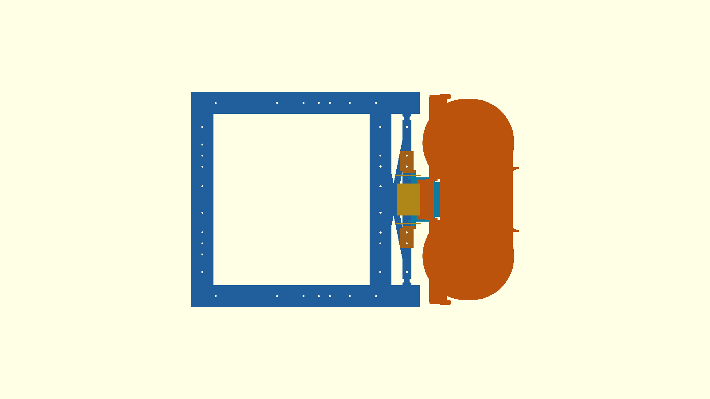

# τι διαφέρει από το αναμενόμενο — P2-73 printable release

Το προηγούμενο constant-width shell αντικαταστάθηκε από επιφάνεια ακριβώς
ίδια με το frozen `p267_ski(75)`. Και οι δύο κατευθύνσεις solid difference
(`printable−frozen`, `frozen−printable`) είναι empty. Διατηρούνται R75,
75°, tangent 52 mm, t2 και τα πλάτη ανά segment 61, 67, 73, 79, 85, 91,
94… mm.

Το X400 flat boss/strut αφαιρέθηκε. Η στήριξη χρησιμοποιεί μόνο X315,
δύο brackets στο X300 grid και μία M4 ανά πλευρά. Τα πλαϊνά τοιχώματα
απουσιάζουν από το flat και από τα arc segments 3–5: οι αφαιρέσεις είναι
βοηθητική συμμόρφωση στο frozen D200/throat envelope, όχι αλλαγή της
επιφάνειας της μπάλας.

## Exact-solid αποτελέσματα

- Selector floor/rails Y±55, +15/+20°: empty σε όλη τη ρύθμιση 0…+20 mm.
- Hard launcher geometry χωρίς το intentional throat handoff, −10…+20°:
  empty στο nominal και στη συζευγμένη ρύθμιση 0…+20 mm.
- Νέα sidewalls έναντι moving throat, −10…+20° και συζευγμένη ρύθμιση:
  empty μετά την αφαίρεση των segments 3–5.
- D200 wheels/motors, upper plate, cheeks και trunnions: empty.
- Drive hardware/FIT0403, frame, κλειστή θύρα και σταθερό κανάλι: empty.
- Ground probe: empty· nominal minimum περίπου 9,0 mm.

Η επαφή frozen floor–`moving_throat_and_guide` παραμένει το σκόπιμο
handoff που είχε ήδη καταγραφεί στο P2-74. Δεν μετρήθηκε ως collision.

Η ασύζευκτη ανύψωση μόνο του ski δεν επιτρέπεται. Η μηχανική οδηγία είναι
1:1 μεταβολή ski και μονάδας· για την αναμενόμενη πτώση σασί ≈8 mm,
ρυθμίζονται και τα δύο περίπου +8 mm.

## Παραδοτέα

Τρία manifold STL γράφτηκαν στο
`cad/modular-test-chassis/stl-ski-mount/`. Μέγιστο footprint
133,55×124,00 mm, κάτω από το όριο P2S 250×250 mm. Το ski τυπώνεται με
το tangent underside στο bed και περιορισμένα bed-only supports κάτω από
το απότομο τόξο· τα brackets χωρίς supports. Πλήρεις οδηγίες και βίδες
στο `stl-ski-mount/README.md`.

Το `full-robot-v3.scad` ενημερώθηκε ώστε να εμφανίζει το printable
ski/mount. Δεν έγινε Gazebo, firmware, commit, push ή PR.

Κατάσταση: `P2_73_PRINTABLE_R75_75_SKI_MOUNT_PASS_PAUSED`.

