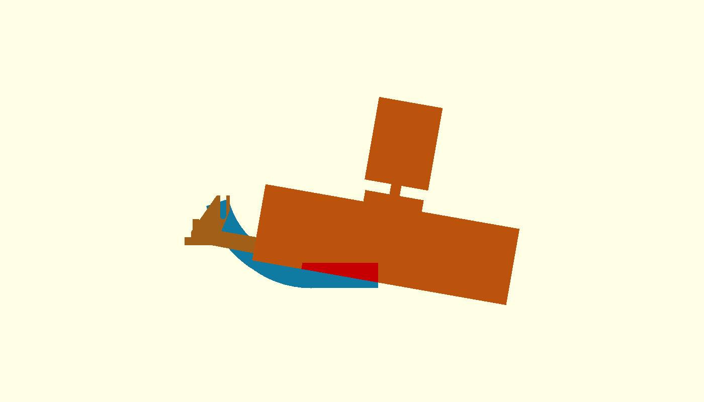
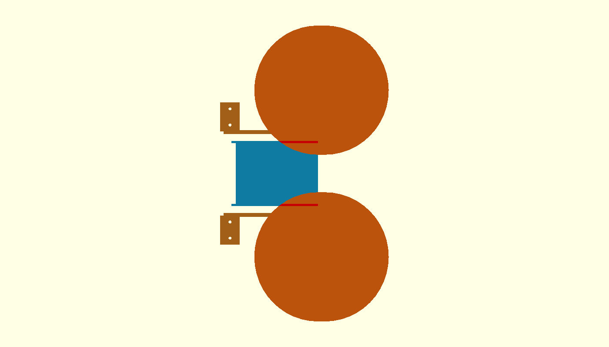

# τι διαφέρει από το αναμενόμενο — P2-73 δεύτερη προσπάθεια

> **ΙΣΤΟΡΙΚΟ — δεν περιγράφει το τρέχον design.** Διατηρείται ως evidence
> της απόφασης/δοκιμής της εποχής του. Δες
> [το τρέχον design](../current-design-el.md).

Η εγκεκριμένη μετατόπιση των selector rails σε `Y=±55` παραμένει
κλειδωμένη. Το boss `X327/Y±56` αφαιρέθηκε. Η δεύτερη υποψήφια στήριξη
κρατά μόνο το αποδεδειγμένα καθαρό πίσω boss `X315` και μεταφέρει το κύριο
φορτίο σε boss `X400` πάνω στο επίπεδο τμήμα του ski, με εξωτερικές
νευρώσεις στο `Y=±64` από το X300.

Ο πρώτος exact-solid έλεγχος selector πέρασε: πλήρες ski, bosses, βίδες
και brackets είναι empty έναντι floor/rails τόσο στο `+15°` όσο και στο
`+20°`. Η εσωτερική παρειά των νευρώσεων είναι Y±61, δηλαδή 4,5 mm έξω
από την εξωτερική παρειά των rails Y±56,5.

Η πρώτη αποτυχία εμφανίζεται στο αμέσως επόμενο κριτήριο, στην αρχική
γωνία του sweep της μονάδας, **−10°**. Το ίδιο το printable ski path
τέμνει τους δύο D200 τροχούς. Η απομονωμένη τομή path–wheels έχει 41
vertices / 74 facets· η άνω πλάκα είναι empty. Η κόκκινη περιοχή στις
εικόνες είναι ο exact κοινός όγκος.

Αιτία: το υποψήφιο printable shell χρησιμοποίησε σταθερό καθαρό πλάτος
94 mm μέχρι το επίπεδο εμπρός τμήμα. Το παγωμένο `p267_ski(75)` είναι
στενότερο εκεί: ξεκινά με πλάτος 61 mm και ανοίγει τμηματικά έως 94 mm.
Η επέκταση του επίπεδου τμήματος έως Y±47 φέρνει το ski μέσα στα inward
τμήματα των D200 στο −10°. Άρα η αποτυχία υπάρχει πριν αξιολογηθεί η
αντοχή ή η χρησιμότητα της νέας στήριξης.

## Απόφαση stop

- Δεν άλλαξε τίποτε μετά την πρώτη αποτυχία του launcher sweep.
- Δεν συνεχίστηκαν ground, door/channel ή τελικοί manufacturing checks.
- Η υποψήφια γεωμετρία μένει μόνο ως diagnostic CAD και δεν ενεργοποιήθηκε
  στο `full-robot-v3.scad`.
- Δεν δημιουργήθηκαν STL ή README.
- Δεν έγινε Gazebo, firmware, commit, push ή PR.

**ΠΑΥΣΗ — απαιτείται έγκριση για printable shell που διατηρεί το
κλιμακωτό πλάτος 61→94 mm του παγωμένου `p267_ski(75)`.**
