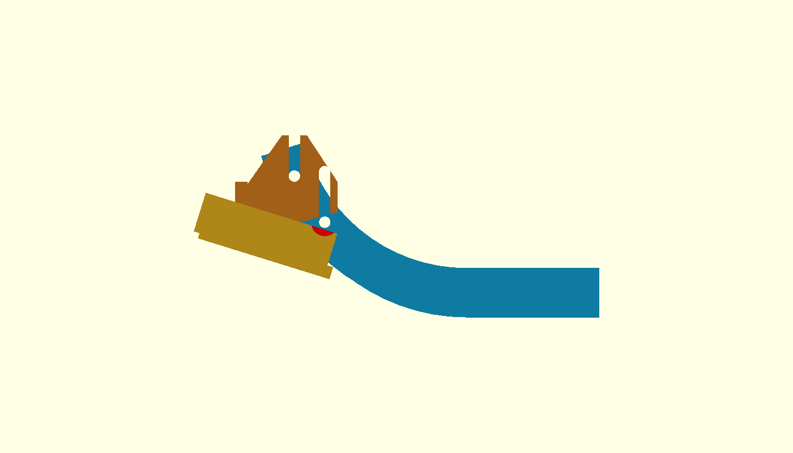
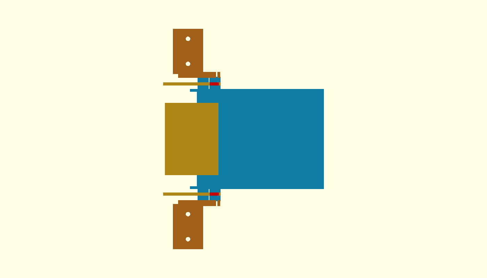

# τι διαφέρει από το αναμενόμενο — P2-74 Y±55 / P2-73 stop

Το αναμενόμενο κενό rail–ski wall διορθώθηκε: με κέντρα rails στο
`Y=±55`, πάχος rail 3 mm και εξωτερική ακμή ski wall στο `Y=±50`, το
ονομαστικό κενό είναι **3,5 mm ανά πλευρά**. Οι επαναληπτικοί exact-solid
έλεγχοι του P2-74 είναι κενοί στα `+15°` και `+20°` για ski, floor,
plate, wheels/motors, κλειστή θύρα και σταθερό κανάλι. Επομένως η αλλαγή
`Y±55` πέρασε και καταγράφηκε στο P2-68/full robot.

Η πρώτη αποτυχία εμφανίζεται στο αμέσως επόμενο βήμα, στην υποψήφια
βιδωτή στήριξη του P2-73: το πίσω boss M4 του ski στο **X327** τέμνει το
κινούμενο selector rail στο `+15°`. Το exact-solid intersection έχει 72
vertices / 136 facets. Το boss στο X315 είναι καθαρό και τα δύο κύρια
brackets είναι επίσης καθαρά· η τομή προέρχεται από το boss X327 και από
το αντίστοιχο envelope κεφαλής/βίδας. Η κόκκινη περιοχή στις εικόνες είναι
ο πραγματικός κοινός όγκος, όχι απλή προβολική επικάλυψη.

## Απόφαση stop

- Η παγωμένη γεωμετρία `R75/75°`, το floor nose, το κανάλι, η θύρα, η
  μονάδα P2-40 και τα rails `Y±55` δεν άλλαξαν μετά την αποτυχία.
- Το υποψήφιο mount παραμένει μόνο ως διαγνωστικό CAD στο
  `shared-flywheel-p273-bolted-ski.scad` και **δεν** ενεργοποιήθηκε στο
  `full-robot-v3.scad`.
- Δεν δημιουργήθηκαν STL και δεν συντάχθηκε README εκτύπωσης, επειδή η
  προϋπόθεση «αν περάσει» δεν ικανοποιήθηκε.
- Δεν έγινε Gazebo, firmware, commit, push ή PR.

## Παρατήρηση ρύθμισης ύψους

Στο nominal datum η κάτω ακμή του κελύφους είναι περίπου `Z=8,5 mm`, άρα
ολόκληρη συμμετρική κάθοδος −10 mm θα περνούσε κάτω από το έδαφος. Η
υποψήφια διάταξη είχε σχισμή 20 mm με το nominal datum στο χαμηλό άκρο
(ρύθμιση `0…+20 mm`), ώστε μετά τη μείωση ύψους του σασί κατά περίπου
8 mm να μπορεί να επανέλθει η ίδια απόσταση από το έδαφος. Η λεπτομέρεια
δεν αποτελεί αποδεκτό σχέδιο, επειδή προηγήθηκε η σύγκρουση X327.

**ΠΑΥΣΗ — απαιτείται νέα απόφαση για τη θέση/μορφή των bosses πριν από
οποιαδήποτε αλλαγή ή εξαγωγή STL.**
