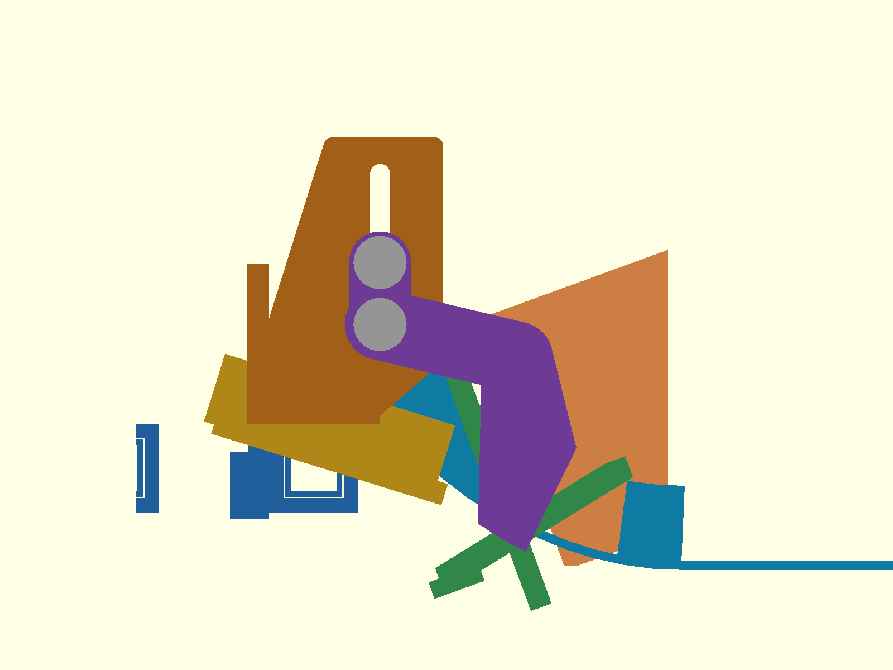
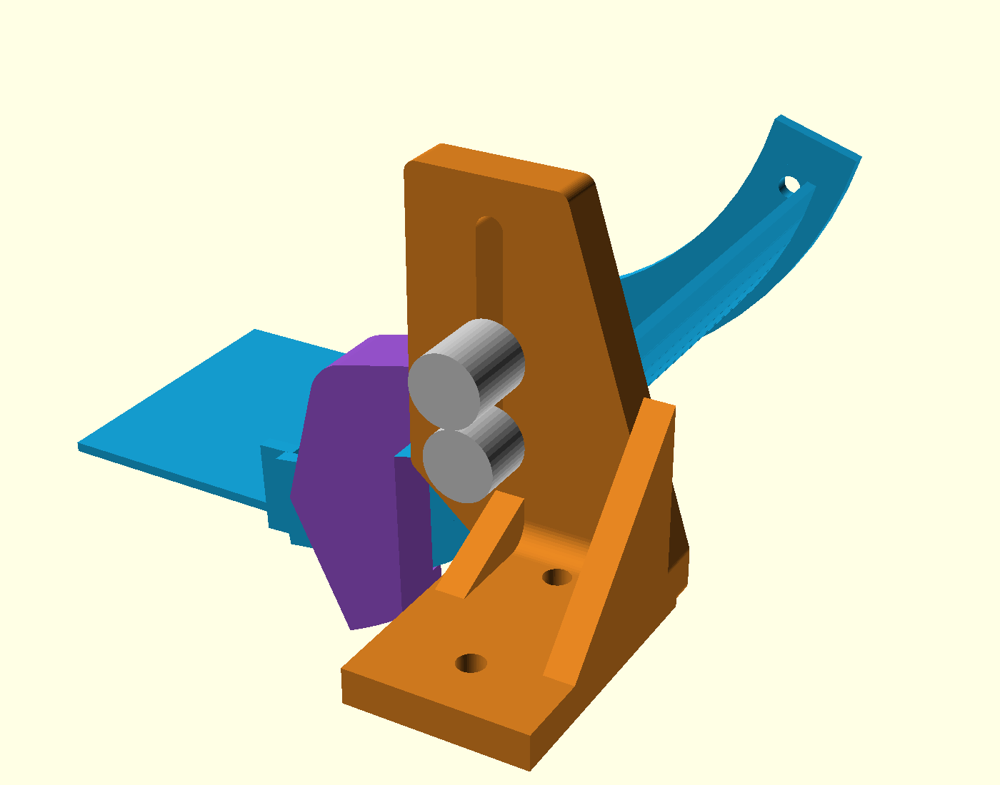
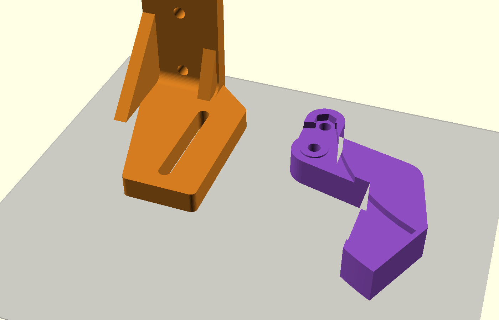

# P2-85 — στήριξη βατήρα: κλειστή σχισμή + διχάλα τοιχώματος

## Τι διαφέρει από το αναμενόμενο

1. **Η δεύτερη βίδα μέσα από τον βατήρα δεν χωρά πουθενά.** Δοκιμάστηκε
   πρώτα δεύτερη M4 ανά πλευρά στο X≈347/Z≈26 (t32°, μετά το τέλος των rails).
   Απέτυχε exact-solid σε δύο σημεία. (α) Η κεφαλή μέσα στον βατήρα
   (Y43,5…47) τέμνει τους οδηγούς του throat (Y41,5…46,5): 1104 mm³. (β) Η
   ροδέλα με το nyloc έξω τέμνει το D200 sweep: 83 mm³. Πιο πίσω/ψηλά το
   boss/αποστάτης πέφτει πάνω στα rails Y±55 (όπως το παλιό X327). Μέσα στο
   κανάλι, ο οδηγός throat απέχει 0,5 mm από το τοίχωμα σε όλο το τόξο, άρα
   καμία κεφαλή δεν χωρά.
2. **Λύση: «στοπ» στις ακμές του τοιχώματος αντί για δεύτερη τρύπα.** Μια
   διχάλα ανά πλευρά κρέμεται από τη βίδα X315 και πιάνει **και τις δύο
   ακμές** του τοιχώματος στο τόξο t26…35°, με 0,3 mm διάκενο. Κλειδώνει στο
   bracket με δεύτερη βίδα στην **ίδια** κατακόρυφη σχισμή, 14 mm πιο πάνω.
   Ο ήδη τυπωμένος βατήρας **δεν χρειάζεται τρύπημα ούτε jig**. Ο
   `ski-boss-spacer` καταργείται, γιατί το hub της διχάλας παίζει τον ρόλο
   του.
3. **Ο ενεργός βατήρας γίνεται χωρίς bosses.** Τα bosses του P2-73 θα
   έπεφταν πάνω στο hub. Το νέο `r75-75-ski.stl` είναι γεωμετρικά ο ήδη
   τυπωμένος βατήρας.
4. **Το bracket ψήλωσε:** Z έως 106,6 (ήταν 80,3), στα X 302,75…329,25,
   Y61…69, με τα nyloc έξω έως Y82. Η σχισμή πρέπει να χωρά δύο βίδες συν
   20 mm ρύθμιση. Exact-solid PASS έναντι launcher, closed feed, frame και
   P2-78 braces. **Δεν ελέγχθηκε έναντι των body panels** (εκτός scope, άλλος
   agent).
5. Το εμπρός ligament της σχισμής έγινε **12 mm** αντί 8 (≥8 που ζητήθηκε).
   Με 8 mm έβγαινε 18,6 MPa (fixed-fixed, 330 N), με 12 mm 8,4 MPa.
6. Ο οδηγός του throat απέχει **1,5 mm** από τα χείλη της διχάλας (Y48 έναντι
   Y46,5). Είναι εκ σχεδιασμού, αφού το ίδιο το τοίχωμα απέχει 0,5 mm. Στα
   rails Y±55 το περιθώριο είναι ≥2 mm. Στα D200, plate, cheeks, trunnions,
   drive και feed είναι ≥3 mm.

## Αιτία της θραύσης (επιβεβαίωση)

Στο P2-73 `p273_y_slot`: κέντρο `mount_z+10`, μήκος 20, Ø4,5, άρα η σχισμή
έφτανε έως `mount_z+22,25`. Το web τελείωνε στο `mount_z+16`, οπότε η σχισμή
ήταν ανοιχτή από πάνω. Αυτό άφηνε διχάλα με δόντια (10−4,5)/2 = 2,75 mm × 6
mm, τυπωμένη όρθια, με στρώσεις κάθετα στα δόντια. Η σύσφιξη της ροδέλας και
οποιοδήποτε πλευρικό φορτίο τα λύγιζε κατά μήκος των ενώσεων των στρώσεων.
Επιπλέον, με μία M4 ανά πλευρά ο βατήρας μπορεί να περιστραφεί γύρω από
αυτήν, και μόνο η τριβή το εμποδίζει.

## Σχεδίαση




Χρώματα: μπλε = βατήρας, πορτοκαλί = bracket, μωβ = διχάλα, γκρι = βίδες,
πράσινο = throat, κίτρινο = selector, ανοιχτό πορτοκαλί = D200, σκούρο μπλε =
X300.


 

- **Bracket** (`p273_mount_bracket`, ίδιο όνομα STL):
  - Πέλμα αμετάβλητο: X285…315, Y65…110, Z42…48, M4 στο Y75/Y100.
  - Web Y61…69 (8 mm, η εσωτερική παρειά Y61 μένει). Μία **κλειστή**
    κατακόρυφη σχισμή Ø4,5 με κέντρα από Z64,3 έως Z98,3.
  - Υλικό 6 mm πάνω/κάτω, 10 mm πίσω, 12 mm εμπρός.
  - Ακτίνα R2 σε όλες τις κυρτές γωνίες του προφίλ και R4 fillet στη γωνία
    πέλματος/web.
  - Δύο νευρώσεις πέλμα→web: πίσω X285…290 έως Z78, εμπρός X309…314 έως
    Z56, κάτω από το nyloc του X315.
- **Διχάλα** (`p285_fork`, Y48…60,7):
  - Hub Ø10 στο X315 που πατά στο τοίχωμα (Y50).
  - Βραχίονας R8 πάνω από τα rails έως X346/Z57.
  - Μπλοκ χειλιών στο τόξο t26…35°, s −5…+21, μείον το τοίχωμα μεγαλωμένο
    0,3 mm. Ο έλεγχος `lip_engage` επιβεβαιώνει ότι και τα δύο χείλη
    κλείνουν στα 0,4 mm.
  - Hex pocket AF7,25 για DIN 933 M4 στο Z78,3.
  - Μοχλοβραχίονας της κάθετης δύναμης χειλιών ως προς το X315: 48,1 mm.

## Exact-solid QA (`cad/modular-test-chassis/p285-qa.sh`, manifold)

Όλα EMPTY στο ονομαστικό. «coupled» σημαίνει ότι βατήρας, διχάλες, βίδες και
μονάδα ανεβαίνουν μαζί h = 0…20 mm, με τα brackets σταθερά.

| Probe | Αποτέλεσμα |
| --- | --- |
| ski ↔ brackets, h 0…20 | EMPTY |
| βίδες ↔ brackets (περνούν στη σχισμή), h 0…20 | EMPTY (επαφή ροδέλας 0 mm³) |
| διχάλα ↔ βατήρας | επαφή hub/τοίχωμα 0,000 mm³, χείλη EMPTY |
| διχάλα ↔ bracket, h 0…20 | EMPTY |
| όλα ↔ selector Y±55, σταθερό, +15/+20 | EMPTY |
| brackets ↔ selector που κινείται με τη μονάδα, +15/+20 | EMPTY |
| όλα ↔ hard sweep −10…+20 (D200, plate, trunnions, cheeks), coupled | EMPTY |
| διχάλες, βίδες, brackets, τοιχώματα ↔ throat sweep, coupled | EMPTY |
| διχάλες, βίδες, brackets ↔ πλήρες frozen launcher sweep, coupled | EMPTY |
| drive/FIT0403, closed feed/door | EMPTY |
| brackets, βίδες, διχάλες, ski ↔ frame | EMPTY |
| ground | EMPTY |
| `p278-exact-qa` side braces / terminal ↔ νέα brackets | EMPTY |

Περιθώρια (grow): hard, drive και feed EMPTY στα +3 mm. Selector EMPTY στα
+2 mm. Throat EMPTY στο +1, SOLID στο +2 (χείλη Y48 έναντι Y46,5).

## Γρήγορος έλεγχος αντοχής (`p285-ski-bracket-loads.py`)

Φορτία:

- **Μπάλα:** 57 g στα 4,5 m/s, εκτροπή 75° στο R75. Δίνει Δp = 0,312 N·s σε
  21,8 ms, άρα μέση δύναμη 14,3 N, και κεντρομόλο 15,4 N. Η συνισταμένη του
  σταθερού φορτίου περνά από το κέντρο τόξου (383, 85) με διεύθυνση
  t = 37,5°, προς τα έξω/κάτω-πίσω.
- **Κορυφή 50 N:** σαρώθηκε όλο το τόξο. Η χειρότερη θέση είναι η είσοδος
  (t = 0, κατακόρυφα προς τα κάτω στο X383): 3,40 N·m ως προς το X315.
- **Χειρισμός 30 N:** στη μύτη X435, σε κάθε διεύθυνση. Χειρότερος
  συνδυασμός: 7,33 N·m στον βατήρα, άρα **3,67 N·m ανά πλευρά**.
- **Πλευρικά 30 N:** όλα σε ένα bracket.

| Θέση | Τάση | Στρώσεις |
| --- | --- | --- |
| Κάθετη δύναμη χειλιών N | 76 N ανά πλευρά | — |
| Δύναμη βίδας κλειδώματος (3,67 N·m / 14 mm) | 262 N | — |
| Bracket, έδραση βίδας X315 (≤333 N συντηρητικά) | 10,4 MPa | μέσα στη στρώση |
| Bracket, εμπρός ligament 12 mm, fixed-fixed 38,5 mm | 8,4 MPa | μέσα στη στρώση |
| Bracket, λαιμός web Z56 (3,82 N·m, πλάτος 26,6) | 4,0 MPa | μέσα στη στρώση |
| Bracket, ρίζα Y69 εκτός επιπέδου (1,42 N·m: Fz εκκεντρικά + 30 N πλευρικά) | 0,9 MPa | **κάθετα** |
| Πέλμα, εφελκυσμός βίδας Y75 | 101 N | — |
| Διχάλα, βραχίονας στο hub | 6,8 MPa | μέσα στη στρώση |
| Διχάλα, μεταφορά από χείλος σε σώμα (διάτμηση) | 1,8 MPa | **κάθετα** |
| Τοίχωμα βατήρα, έδραση ακμής | 3,8 MPa | — |

Τα Z φορτία στη σχισμή τα κρατά η τριβή: 250 N ανά βίδα (2 επιφάνειες,
μ 0,25, 500 N προένταση που απομένει στο PETG) έναντι 38 N, SF ≈13. Στόχος
κόπωσης: ≤10 MPa μέσα στη στρώση και ≤5 MPa κάθετα (PETG UTS ≈45–50 / ≈20–30).
Η έδραση 10,4 MPa είναι το άθροισμα όλων των δυνάμεων, χωρίς καμία πίστωση
τριβής. Είναι θλιπτική και backup: πρώτη κρατά η τριβή. Αποδεκτό.

Τζόγος: Ø4 βίδα σε σχισμή Ø4,5 δίνει ±0,25 mm. Αν γλιστρήσει η τριβή, η
διχάλα στρίβει ≈1° πριν πατήσει στη σχισμή. Αυτό είναι ≈1,6 mm στα χείλη και
≈2 mm στη μύτη. Physical gate: έλεγχος μετά τις 20 βολές.

## Εκτύπωση



Bracket στην παρειά Y61: στρώσεις παράλληλες στο web, σχισμή κατακόρυφη, χωρίς
supports. Διχάλα στην εξωτερική παρειά: χείλη και pocket από πάνω, χωρίς
supports. Και τα πέντε STL περνούν το `check-stl-components.py` ως 1 σώμα.

## Αρχεία

Αλλαγμένα ή νέα (δεν έγινε commit ή push):

- `cad/modular-test-chassis/shared-flywheel-p273-bolted-ski.scad`: P2-85
  bracket, διχάλα, βίδες, QA, views και print parts. Τα bosses του βατήρα
  απενεργοποιήθηκαν (`p285_ski_bosses=false`). Το
  `p273_ski_mount_assembly` περιλαμβάνει πλέον τις διχάλες, άρα το
  `full-robot-v3.scad` τις δείχνει αυτόματα.
- `cad/modular-test-chassis/stl-ski-mount/`:
  - `r75-75-ski.stl`, `x300-ski-bracket-left.stl`,
    `x300-ski-bracket-right.stl`: ξαναβγήκαν. Τα brackets είναι πλέον σε
    προσανατολισμό εκτύπωσης.
  - `p285-ski-wall-fork-left.stl`, `p285-ski-wall-fork-right.stl`: νέα.
  - `README.md`: ξαναγράφτηκε.
- `cad/modular-test-chassis/export-ski-mount-stls.sh`: export των 5
  ενεργών STL με μόνιμο έλεγχο ενός σώματος.
- `cad/modular-test-chassis/p285-qa.sh`: exact-solid probes.
  `P285_GROW="1 2 3"` για περιθώρια.
- `cad/modular-test-chassis/p285-stl-stats.py`: όγκος και bbox STL.
- `cad/modular-test-chassis/p285-ski-bracket-loads.py`: έλεγχος αντοχής.
- `docs/mechanism/p285-*.png`: εικόνες.

### Για ενσωμάτωση — ολοκληρώθηκε

1. Ο ενεργός `cad/modular-test-chassis/export-ski-mount-stls.sh`
   αντικαταστάθηκε από την έκδοση P2-85 και εξάγει πέντε STL.
2. Το καταργημένο
   `cad/modular-test-chassis/stl-ski-mount/ski-boss-spacer.stl` αφαιρέθηκε.
3. Το `cad/ACTIVE-PRINT-SET.md` ενημερώθηκε με τον ακόλουθο πίνακα:

```markdown
| Βατήρας R75/75° | `stl-ski-mount/r75-75-ski.stl` ×1 | P2-73, P2-85 χωρίς bosses | 2×M4×30 χαμηλής κεφαλής στο X315 (κεφαλή μέσα) | Ήδη τυπωμένος — ο ενεργός STL είναι πλέον γεωμετρικά ο ίδιος· δεν ξανατυπώνεται |
| Αριστερό/δεξί bracket X300 | `stl-ski-mount/x300-ski-bracket-left.stl` ×1, `x300-ski-bracket-right.stl` ×1 | P2-85 | 4×M4×35 στο X300 Y±75/±100, ροδέλες/nyloc | Προς εκτύπωση, ξαπλωμένο στην παρειά Y61 (όπως το STL), χωρίς supports· το P2-73 bracket καταργείται (έσπασε) |
| Διχάλα τοιχώματος βατήρα | `stl-ski-mount/p285-ski-wall-fork-left.stl` ×1, `p285-ski-wall-fork-right.stl` ×1 | P2-85 | Hub στη M4×30 του X315· κλείδωμα 2×M4×30 DIN 933 (κεφαλή στο hex pocket) + ροδέλα Ø12/nyloc | Προς εκτύπωση, εξωτερική παρειά στο bed, χωρίς supports· αντικαθιστά τους `ski-boss-spacer` |
```

Το manifest σημειώνει επίσης:
«`ski-boss-spacer.stl` (P2-73 fix 2026-10-19) — superseded από το hub της
διχάλας P2-85». Οι μετρητές του full dry-run ενημερώθηκαν από 4 σε 5 STL.

### Εγγραφή debug log (ενσωματώθηκε στο `shared-flywheel-intake-launcher-debug-log-el.md`)

```markdown
### P2-85 — στήριξη βατήρα: κλειστή σχισμή και διχάλα τοιχώματος

τι διαφέρει από το αναμενόμενο: η ζητούμενη δεύτερη βίδα ανά πλευρά μέσα
από τον βατήρα δεν χωρά. Δοκιμή X≈347/Z≈26 (t32°): η κεφαλή μέσα στον βατήρα
τέμνει τους οδηγούς throat (Y41,5…46,5, 1104 mm³) και το nyloc τέμνει το
D200 sweep (83 mm³). Πιο πίσω, το boss πέφτει στα rails Y±55. Ο οδηγός throat
απέχει 0,5 mm από το τοίχωμα σε όλο το τόξο.

Αιτία της φυσικής θραύσης του P2-73 bracket: η σχισμή `mount_z+10±10`, Ø4,5,
έφτανε στο +22,25 πάνω από web που τελείωνε στο +16. Έμεναν δόντια
2,75×6 mm τυπωμένα όρθια (στρώσεις κάθετα), και μόνο μία M4 ανά πλευρά, που
λειτουργούσε ως άξονας περιστροφής.

Λύση: bracket με κλειστή σχισμή (κέντρα Z64,3…98,3, ≥6 mm πάνω/κάτω,
10/12 mm πίσω/εμπρός), web 8 mm (Y61 κρατήθηκε), R2/R4 ακτίνες, νευρώσεις
πέλμα→web. Τυπώνεται στην παρειά Y61. Συν μία διχάλα ανά πλευρά: hub στη M4
X315 (αντικαθιστά τον retrofit spacer), χείλη στις δύο ακμές του τοιχώματος
στο t26…35° (διάκενο 0,3 mm, μοχλοβραχίονας 48,1 mm), κλείδωμα με M4×30
DIN 933 στην ίδια σχισμή, 14 mm πάνω. Ο ήδη τυπωμένος βατήρας χωρίς bosses
δουλεύει χωρίς τρύπημα. Ο ενεργός βατήρας είναι πλέον χωρίς bosses.

Exact-solid, ονομαστικό και coupled h 0…20 / −10…+20°: selector Y±55
(σταθερό και κινούμενο), hard sweep, throat, πλήρης launcher, drive, feed,
frame, ground, P2-78 braces: EMPTY. Περιθώρια ≥3 mm (hard/drive/feed),
≥2 mm (selector), 1,5 mm (throat, εκ σχεδιασμού). Αντοχή 50 N μπάλα (t=0) +
30 N στη μύτη: 3,67 N·m ανά πλευρά. Bracket in-layer ≤10,4 MPa (έδραση
συντηρητικά), across-layers 0,9 MPa. Διχάλα 6,8 / 1,8 MPa. Τριβή Z SF≈13.

Επανεξήχθησαν ski, brackets L/R και νέες διχάλες L/R, όλα ένα σώμα.
`ski-boss-spacer` καταργείται. Αναφορά: `docs/mechanism/p285-ski-bracket-el.md`.
Χωρίς firmware, Gazebo ή PR. Κατάσταση:
`P2_85_CLOSED_SLOT_WALL_FORK_EXACT_SOLID_AND_STRENGTH_PASS_PAUSED`. ΠΑΥΣΗ.
```

## Ανοιχτά (physical gates)

- Fit διχάλας στο πραγματικό τοίχωμα (διάκενο 0,3 mm, PETG ±0,2).
- Σφίξιμο 1,5 N·m και επανέλεγχος μετά από 24 ώρες και 20 βολές.
- Ύψος 9–10 mm του flat από το πάτωμα (αμετάβλητο gate P2-73).
- Body panels έναντι bracket Z έως 106,6 / nyloc Y έως 82: exact-solid
  EMPTY/PASS έναντι P2-84 rear panels και ολόκληρου του F concept.
