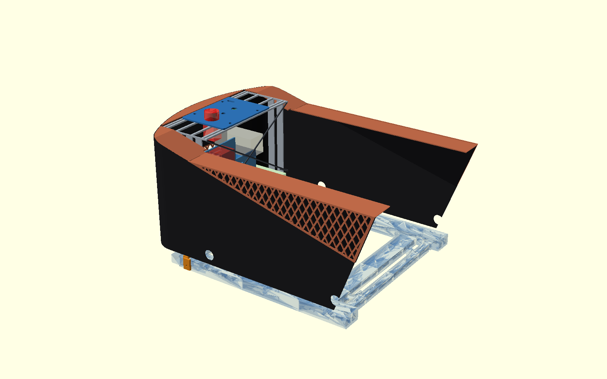
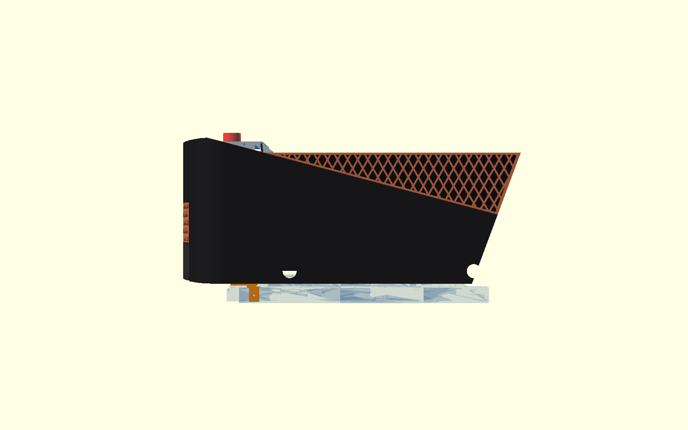
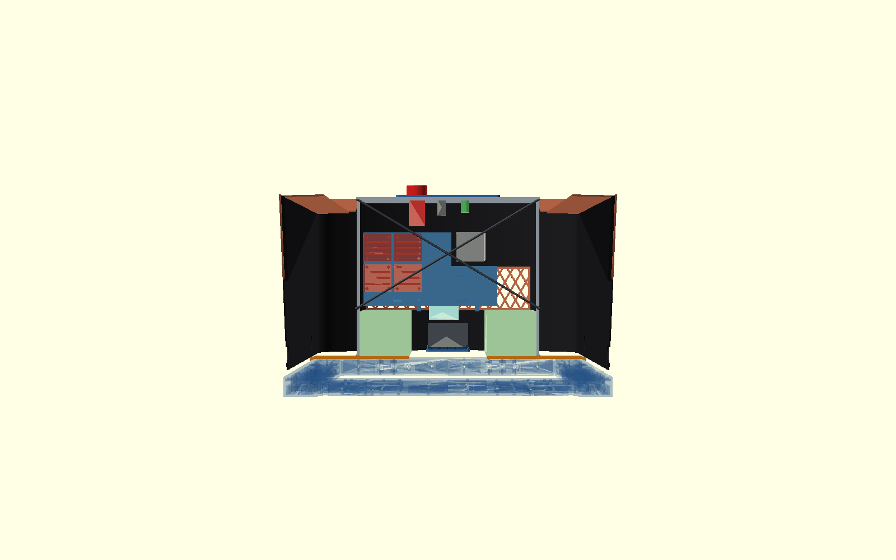
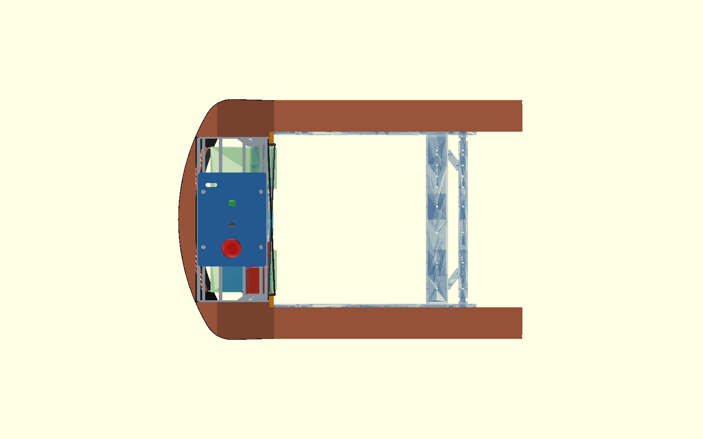

# τι διαφέρει από το αναμενόμενο — P2-80 rear cage

> **Κατεύθυνση μετά το P2-81:** το αλουμίνιο καταργείται επειδή δεν είναι
> διαθέσιμο/εύχρηστο για την κατασκευή. Το P2-80 παραμένει μόνο μελλοντική
> κατεύθυνση για πλήρως τυπωμένο, stackable PETG cage με διαμπερείς M4.
> Ενδεικτικά box sections περίπου 35×35 mm που θα χρειάζονταν για αντίστοιχη
> ακαμψία δεν χωρούν στη λωρίδα `Y161…167`. Επομένως οι θέσεις και οι
> διατομές των τεσσάρων κολονών θα ξανακριθούν μαζί με την πραγματική release
> των panels F. Η παρακάτω υβριδική ανάλυση διατηρείται μόνο ως ιστορικό
> benchmark και δεν είναι πλέον κατασκευαστική πρόταση.

## Αποτέλεσμα / βασική απόκλιση

Τέσσερις συνηθισμένες τυπωμένες κολόνες 15–20 mm δεν χωρούν κατακόρυφα
ανάμεσα στα παγωμένα Parkside/electronics και στο `Y±167`: τα Parkside
τελειώνουν στο `|Y|161`, άρα για 3 mm service clearance απομένει μόνο λωρίδα
3 mm μέχρι το envelope. Η πρόταση επομένως δεν είναι τέσσερις ογκώδεις PETG
κολόνες. Είναι υβριδικό cage με:

- 4× αλουμινένια flat bar **20×3 mm**, κέντρα `X−180/X−150`,
  `Y±165,5`, από `Z58` έως `Z343`,
- άνω αλουμινένιο πλαίσιο `Z343…347`, εξωτερικά `X−267…−125 / Y±167`,
- δύο προεντεταμένες M4 χαλύβδινες διαγώνιες στην εμπρός παρειά `X−127`,
  μόνο από `Z145` έως `Z343`,
- δύο τυπωμένες full-width σέλες πάνω στην πίσω τραβέρσα και δύο εξωτερικά
  lugs προς τις υπάρχουσες πλευρικές M4 στο `X−135`.

Οι διαγώνιες είναι υποχρεωτικές. Χωρίς αυτές τα 20×3 flats περνούν από το
service corridor αλλά είναι πολύ εύκαμπτα στον ασθενή άξονα. Αρχίζουν 6 mm
πάνω από το Parkside clear top `Z139`, είναι μπροστά από BTS/Ugreen και δεν
κόβουν την εξαγωγή των συρταριών προς `−X`.

## Κόμβοι και στηρίξεις

Κάθε πλευρική σέλα πατά στο πλήρες `X−190…−140` της πίσω τραβέρσας και
σφίγγεται από τις υπάρχουσες top M4 στα `X−165/Y±75,±125`. Ένας βραχίονας
μένει πάνω από το rail top `Z52` και κατεβαίνει μόνο έξω από την παρειά
`Y±245`, όπου μοιράζεται την υπάρχουσα πλευρική M4 του corner clamp
`X−135/Z37` με μακρύτερη βίδα. Δεν προστίθεται οπή στο σασί και κανένα
φέρον M4 δεν βιδώνει σε τυπωμένο σπείρωμα.

Στην κορυφή, rails στα υπάρχοντα panel-hole X (`−256,5/−140,5`) μεταφέρουν
τις τέσσερις M4 του panel στο cage. Δύο επιπλέον rails `X−222,5/−174,5`
περνούν δίπλα από τα control bodies και μικραίνουν το ελεύθερο plate bay
γύρω από E-stop/κουμπιά σε 48 mm. Το εξωτερικό πλαίσιο δίνει βιδωτά lands
στο `deck_rear Z350`, στα `rear_lo/rear_hi` και στα πλαίσια των Parkside
θυρών. Τα panels F παραμένουν skin/service parts, όχι η κύρια φέρουσα οδός.

## P2-79 έναντι P2-80

Γραμμικό screen: PETG `E=1,5 GPa`, Al `E=69 GPa`, steel `E=200 GPa`.
Οι τιμές δεν πιστοποιούν layer strength, bearing, preload/slip ή fatigue.

- 30 N κατακόρυφα: P2-79 **0,886 mm** με optimistic full-panel strip, αλλά
  **3,051 mm** στη συντηρητική ευαισθησία effective width 40 mm. P2-80 με
  τα δύο κοντινά control rails: **0,217 mm**.
- 20 N πλάγια: P2-79 **0,628 mm**, P2-80 braced **0,359 mm**.
- 20 N εμπρός/πίσω: P2-79 **0,628 mm**, P2-80 **0,280 mm**.
- 0,5 g με 1,0 kg ψηλά + 1,30 kg Parkside: P2-79 **0,355 mm** και P2-80
  **0,158 mm** (γραμμική κλιμάκωση του fore/aft case).
- 2 g κατακόρυφα στα ίδια 2,30 kg: member shortening P2-79 **0,0036 mm**,
  P2-80 **0,00078 mm**· δεν περιλαμβάνεται local panel bending επειδή το
  φορτίο μάζας μπαίνει στους carrier/cage nodes.
- εκτιμώμενη μάζα φέροντος set: P2-79 **1,43 kg**, P2-80 **0,84 kg**
  (`−41%`). Είναι order estimate από section/CAD volumes + hardware, όχι
  slicer BOM.

Peak screen stresses: P2-79 post 0,83 MPa· P2-80 aluminium 7,13 MPa στον
ισχυρό άξονα και 14,5 MPa στο κάτω weak-axis segment· M4 diagonal 2,65 MPa.
Στα 20 N fore/aft το συνολικό couple είναι 194,7 N στο P2-79 και 190 N στο
P2-80 (περίπου 97,3/95 N ανά tension side). Στα 2 g το P2-80 παίρνει
11,28 N ανά κολόνα. Η ενεργή M4 diagonal παίρνει 23,31 N στα 20 N lateral.

Αριθμητικά αποτελέσματα:
`engineering/chassis-strength-bench/results/shared_flywheel_phase2/p280_rear_cage.json`.

## Τι μένει / αλλάζει / καταργείται από P2-79

Μένουν αμετάβλητα: `vertical_electronics_plate`, Pi shelf, control panel και
οπές controls, component pins/clips/spacers, cable bulkhead, θέσεις
Parkside/Ugreen/BTS/Pi και ο καλωδιοδιάδρομος προς `−X`.

Αλλάζουν σε μεταγενέστερη release, όχι τώρα: οι δύο P2-79 βάσεις γίνονται
μη φέρων equipment floor ή αντικαθίστανται από τις δύο cage saddles· τα
side frames γίνονται μικρά ties της όρθιας πλάκας προς τις κολόνες· το F
`deck_rear/rear_lo/rear_hi/drawer frames` παίρνει M4 lands στο top frame.

Καταργούνται όταν και μόνο όταν εγκριθεί/λεπτοσχεδιαστεί το P2-80: οι
τέσσερις λυγισμένοι/Ø23 panel posts, τα P2-79 corner ties ως χωριστά μέρη
και η φέρουσα λειτουργία των δύο μεγάλων base halves. Το P2-79 παραμένει η
τρέχουσα printable reference μέχρι τότε.

## Exact-solid

Τα προσωρινά OpenSCAD Manifold intersections είναι empty για:

- cage έναντι πλήρους v3 chassis, με τις mating faces της σέλας ακριβώς πάνω
  από `Z52` και τα lugs έξω από `Y±245`,
- moving mechanism για όλες τις γωνίες `−10…+20°`,
- Parkside, Ugreen, Pi, BTS/electronics και control-body ghosts,
- πλήρες Parkside drawer sweep προς `−X`,
- πλήρες `tub_solid()` του F,
- έξοδο από keep radius `R421,5` (3 mm μέσα από το F `R424,5`),
- απαγορευμένη physical-ground ζώνη: το χαμηλότερο cage solid είναι CAD
  `Z25`, δηλαδή περίπου 23 mm με το chassis 2 mm χαμηλότερα, πάνω από 15 mm.

Το concept source είναι `cad/rear-pod/p280-rear-cage-concept.scad`. Δεν
υπάρχει part selector ή release STL. Τα πραγματικά aluminium flats,
connector bodies, Parkside adapters και screwdriver access απαιτούν
physical measurement/proof load πριν από κατασκευαστική release.

Δεν έγινε STL, firmware, Gazebo, commit, push ή PR. Κατάσταση:
`P2_80_HYBRID_REAR_CAGE_ANALYSIS_EXACT_SOLID_PASS_NO_STL_PAUSED`.
