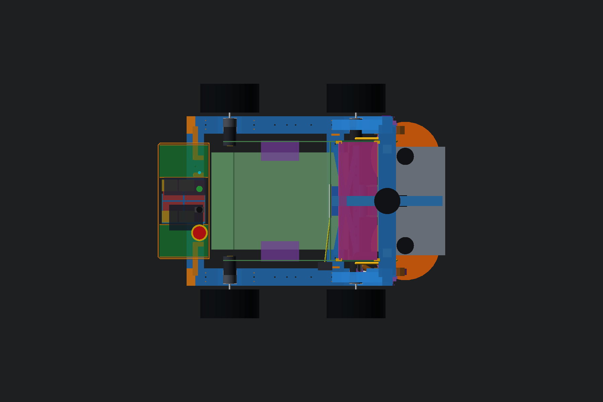
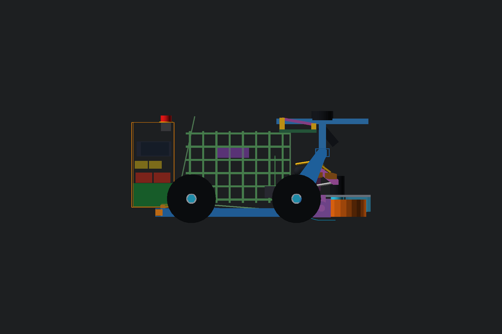

# Τι διαφέρει από το αναμενόμενο

- Το διαθέσιμο X≈−300 ισχύει μόνο κοντά στον διαμήκη άξονα. Με κέντρο
  επιτόπιας στροφής X=117 και υφιστάμενο εμπρός όριο X=542, η ακτίνα είναι
  425 mm. Στο X=−300 επιτρέπεται μόνο |Y|≤82,1 mm. Άρα ένα πλήρους πλάτους
  ορθογώνιο pod έως X−300 θα μεγάλωνε τον κύκλο στροφής.
- Η παρούσα απογραφή μαζών δεν δίνει ≈68% εμπρός αλλά **63,17% εμπρός**
  (CG X165,57 mm). Η μεταφορά των υπαρχόντων Parkside/Ugreen και ένα
  κέλυφος 770 g ως proxy παλαιότερου CAD δίνουν **58,04% εμπρός**, όχι
  ≈65%. Οι πραγματικές μάζες των ηλεκτρονικών και του νέου κελύφους δεν
  έχουν μετρηθεί, επομένως το τελικό CG παραμένει `ΜΕΤΡΗΣΗ ΧΡΗΣΤΗ`.
- Τα μικρότερα στατικά διάκενα της πρότασης είναι 5,0 mm προς το πλαϊνό
  grid του καλαθιού και 6,3 mm προς το γερμένο πίσω ταμπλό. Είναι θετικά,
  αλλά μικρά· δεν πιστώνονται ανοχές εκτύπωσης ή ελαστική παραμόρφωση.

Οι δύο εικόνες είναι review cutaways από το `full-robot-v3.scad`: το
εξωτερικό κέλυφος κρύφτηκε μόνο στο render, για να φανούν οι εσωτερικές
ζώνες. Η κατεύθυνση εμπρός είναι +X (δεξιά στις εικόνες) και στην πλάγια
όψη το +Z είναι επάνω.

## P2-70 — προτεινόμενη διάταξη

Η πρόταση είναι λοξοκομμένο κουτί με εξωτερικό envelope:

- X−272…−125 mm, Y±167 mm, σώμα Z55…350 mm,
- πίσω γωνίες `(X−272,Y±162)→(X−267,Y±167)`,
- top panel Z350 και ανώτατο σημείο μανιταριού Z374, δηλαδή 16 mm κάτω από
  το επίπεδο LiDAR Z390 και εντός του ορίου Z375,
- τοίχωμα πρότασης 3 mm, όχι manufacturing release.

Η χειρότερη πίσω γωνία έχει ακτίνα 421,38 mm γύρω από X117, άρα μένει
3,62 mm μέσα στον υφιστάμενο κύκλο R425. Αυτό είναι CAD margin, όχι
κατασκευαστική ανοχή. Το pod δένεται με τέσσερα πόδια στις υπάρχουσες M4
θέσεις της πίσω τραβέρσας Y±75/±125 και δύο anti-racking αυτιά προς τις
πίσω γωνίες. Δεν ζητείται νέα τρύπα στο παγωμένο σασί.

### Εσωτερική χωροθέτηση

- Αριστερά/δεξιά: δύο συρταρωτές προς −X θέσεις Parkside. Καθαρός χώρος
  ανά θέση **141×91×81 mm**, δηλαδή η CAD υπόθεση 135×85×75 συν 3 mm ανά
  πλευρά. Κέντρα περίπου `[-198,5, ±115,5, 98,5]`. Η πραγματική ράγα,
  πολικότητα προσαρμογέα και μάνδαλο είναι `ΜΕΤΡΗΣΗ ΧΡΗΣΤΗ` μετά την αγορά.
- Κάτω κέντρο: perfboard clear 86×126 mm και Mega clear 66×116 mm σε
  χωριστά επίπεδα. Τα ύψη, οι φίσες και οι ακτίνες κάμψης είναι
  `ΜΕΤΡΗΣΗ ΧΡΗΣΤΗ`.
- Μέσο κέντρο: τέσσερις αεριζόμενες θέσεις BTS7960 σε διάταξη 2×2, από τις
  οποίες η μία εφεδρική. Το προσωρινό bay 58×58×35 mm είναι μόνο zoning:
  `ΜΕΤΡΗΣΗ ΧΡΗΣΤΗ` για τις πραγματικές πλακέτες, ψύκτρες και κλέμμες.
- Πάνω από τα BTS: ζώνες για ασφάλεια, ρελέ E-stop ισχύος, DC-DC 12 V του
  FIT0186 και δύο ideal-diode branches. Όλα τα bodies/connectors είναι
  `ΜΕΤΡΗΣΗ ΧΡΗΣΤΗ` πριν από λεπτομερή carriers.
- Άνω service shelf: Pi 5 με θήκη/ψύκτρα σε clear 98×74×46 mm και Ugreen
  σε clear 121×52×52 mm. Το Ugreen βγαίνει προς −X και κρατιέται με
  αφρό/λουράκι, όχι press-fit. Οι δοθείσες διαστάσεις Ugreen
  115×46×45,5 mm υπερισχύουν της μέτρησης με χάρακα.
- Πάνω panel: E-stop οπή 22,5 mm και σώμα 35×30 από κάτω, καλυμμένος
  διακόπτης οπή 12,3 mm/σώμα 27×15, ARM οπή 15,5 mm και LED. Η διάμετρος
  και το σώμα του LED είναι `ΜΕΤΡΗΣΗ ΧΡΗΣΤΗ`.
- Το MPU6050 **δεν** μπαίνει στο pod. Παραμένει άκαμπτα στο σασί, κοντά
  στο κέντρο, ώστε να μη μετρά κραδασμό/κάμψη του αποσπώμενου κουτιού.

### Αερισμός και σκόνη

Τα BTS έχουν κάτω εισαγωγή από κατακόρυφες πλευρικές ζώνες με αφαιρούμενο
G2 αφρό και άνω εξαγωγή από οπίσθια louvres που κοιτούν προς τα κάτω.
Δεν υπάρχει οριζόντια τρύπα στο top. Μεταξύ BTS και άνω service shelf
μένει plenum. Ανεμιστήρας, θερμικό φορτίο, φίλτρο και ελάχιστη ελεύθερη
διατομή είναι `ΜΕΤΡΗΣΗ ΧΡΗΣΤΗ`/bench thermal gate πριν από κλειστό καπάκι.

## Έλεγχος γεωμετρίας από τα υπάρχοντα δεδομένα

Δεν έγινε νέο Gazebo run. Έγιναν αναλυτικός έλεγχος και exact-solid
OpenSCAD probes πάνω στην αποδεκτή P2-67/P2-68/P2-69 γεωμετρία:

- pod body ∩ καλάθι/feed/soft deflector: κενή τομή,
- pod body ∩ τέσσερις τροχοί/FIT0403: κενή τομή,
- pod body ∩ πραγματικό v3 frame: κενή τομή,
- pod front X−125 προς πίσω ακμή κεκλιμένου backboard: 6,3 mm,
- pod side Y167 προς basket grid Y172: 5,0 mm,
- pod side προς εσωτερική παρειά πίσω ελαστικού Y255,5: 88,5 mm,
- pod front προς πίσω άκρο rear FIT0403 X−85: 40,0 mm,
- pod bottom Z55 προς top πίσω τραβέρσας Z52: 3,0 mm.

Τα πόδια στερέωσης εξαιρούνται από το τελευταίο intersection, επειδή η
επαφή τους με την τραβέρσα είναι σκόπιμη. Δεν άλλαξε αψίδα, ταμπλό,
καλάθι, P2-40 core ή σασί v3.

## Κέντρο βάρους και φορτία αξόνων

Με πίσω άξονα X−65 και εμπρός X300:

- τρέχον repo baseline: 18,110 kg, CG X165,57 mm, εμπρός/πίσω
  **63,17/36,83%**,
- μεταφορά δύο Parkside στο X−198,5, Ugreen στο X−195 και προσθήκη 0,770 kg
  στο X−198,5 ως proxy παλαιότερου rear-pod CAD: 18,880 kg, CG X146,86 mm,
  εμπρός/πίσω **58,04/41,96%**,
- αν Pi, Mega, perfboard/harness, τέσσερα BTS, προστασίες ισχύος και controls
  είναι όλα πρόσθετα και έχουν συνολικά την προσωρινή υπόθεση 1,010 kg:
  19,890 kg, CG X129,37 mm, εμπρός/πίσω **53,25/46,75%**.

Η τρίτη γραμμή είναι μόνο sensitivity screen, όχι αποδεκτή mass estimate.
Οι προσωρινές επιμέρους μάζες είναι καταγεγραμμένες στο JSON και όλες
φέρουν gate `ΜΕΤΡΗΣΗ ΧΡΗΣΤΗ`. Αν μέρος τους περιλαμβάνεται ήδη στα 10 kg
του `bare_mobile_base`, δεν πρέπει να μετρηθεί δεύτερη φορά. Πριν παγώσει
το pod απαιτείται ζύγιση κάθε υποσυνόλου και τελικός έλεγχος τεσσάρων
ζυγαριών στους τροχούς.

## Εκτιμώμενα μήκη καλωδίων

Οι τιμές περιλαμβάνουν service loop και στρογγυλοποιούνται προς τα πάνω
στο επόμενο 100 mm. Είναι routing budget, όχι cut authorization:

- εμπρός FIT0403: **0,9 m ανά πλευρά**,
- πίσω FIT0403: **0,5 m ανά πλευρά**,
- LiDAR: **1,1 m**,
- κάμερα: **1,1 m**,
- FIT0186 actuator: **0,9 m**, από τα οποία 0,25 m κινούμενο service loop,
- κάθε πλευρικός D5065 controller: **0,6 m**.

Πριν κοπεί harness: `ΜΕΤΡΗΣΗ ΧΡΗΣΤΗ` με το πραγματικό gland, connector,
strain relief, steering slack και ελάχιστη ακτίνα κάμψης. Τα ζεύγη κινητήρων
δρομολογούνται χωριστά από USB/I²C/σήματα κάμερας και LiDAR.

## Τυπωνόμενα κομμάτια

Προτεινόμενος διαχωρισμός, χωρίς παραγωγή STL:

1. βάση/πίσω πλάτη pod και αριστερό/δεξί πλαϊνό,
2. αφαιρούμενο top/control panel,
3. τέσσερα M4 feet και δύο anti-racking ears,
4. central Mega/perfboard tray,
5. τετραθέσιο BTS rack με duct και μία κενή θέση,
6. carrier ασφάλειας/relay/DC-DC/ideal diodes,
7. Pi cradle με λουράκι και αεραγωγό,
8. συρτάρι Ugreen με αφρό/λουράκι,
9. δύο Parkside drawers/docks με μάνδαλο — **αναβάλλονται έως την αγορά και
   ΜΕΤΡΗΣΗ ΧΡΗΣΤΗ**,
10. filter frames/louvre hoods, cable-gland plates και strain-relief combs.

Για το πρώτο test κίνησης με PSU χρειάζονται μόνο: σώμα/στερέωση pod,
central board tray, BTS rack με **δύο** BTS, control panel με E-stop,
καλυμμένο switch, ARM και LED, PSU inlet/fuse/relay και strain relief. Το
Parkside hardware, οι δύο drawers, ideal-diode battery branches και η
τελική Ugreen drawer μπορούν να περιμένουν. Pi cradle χρειάζεται μόνο αν
το Pi θα συμμετάσχει στο συγκεκριμένο test.

## Αρχεία και κατάσταση

- CAD πρόταση: `cad/modular-test-chassis/shared-rear-pod-p270.scad`
- whole robot: `cad/modular-test-chassis/full-robot-v3.scad`
- machine-readable audit:
  `engineering/chassis-strength-bench/results/shared_flywheel_phase2/p270_rear_pod.json`
- επαναλήψιμος υπολογισμός:
  `engineering/chassis-strength-bench/run_phase2_p270_rear_pod.py`

Κατάσταση: `P2_70_REAR_POD_LAYOUT_PROPOSED_MEASUREMENT_GATED`. Δεν έγινε
STL, firmware, Gazebo, commit, push ή PR. **ΠΑΥΣΗ.**
