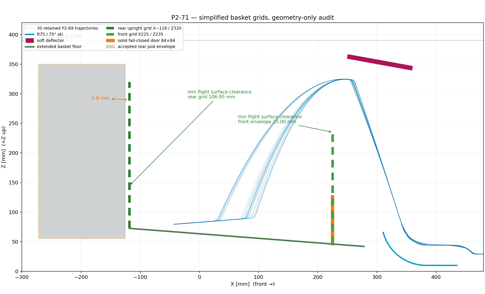

# τι διαφέρει από το αναμενόμενο

- Η υπόθεση για τα native contacts επιβεβαιώνεται πλήρως: το εμπρόσθιο
  τοίχωμα και η κλειστή θύρα έχουν 0/30 contact cases. Το παλιό backboard
  έχει επαφή σε 30/30, αλλά και στις 30 περιπτώσεις η πρώτη επαφή έρχεται
  **μετά** την πρώτη επαφή με τον πάτο. Τα 14.812 native samples του
  backboard είναι μόνο Z90,004…90,495 mm, με κέντρο μπάλας
  Z79,173…79,633 mm· δεν είναι επαφή πτήσης.
- Η παλιά σύντομη απαίτηση «45 μπάλες ≈Z236 σε φρενάρισμα» δεν
  τεκμηριώνεται από ρητό 0,2 g free-surface calculation. Με σωστό όριο
  αποθήκευσης το κλειστό X225, το νέο screen δίνει στο εμπρόσθιο τοίχωμα
  Z254,12 για 40 και Z266,18 για 45 μπάλες. Άρα το Z235 έχει έλλειμμα
  19,12/31,18 mm σε 0,2 g.
- Το X225…278 είναι κλειστό feed handoff και δεν πιστώνεται πλέον ως όγκος
  σωρού. Η πραγματική plan area του screen είναι 111.400 mm², όχι η παλιά
  P2-51 area των 120.392 mm².

Συνεπώς η απλοποίηση περνά το ζητούμενο flight-clearance gate, αλλά η
συγκράτηση σωρού σε 0,2 g είναι **FAIL**. Δεν έγινε tuning του ύψους ή
μετακίνηση καμίας παγωμένης γεωμετρίας.

## Native-contact επιβεβαίωση P2-69

Αναλύθηκαν απευθείας τα 30 `native_contacts.csv` και τα αντίστοιχα
`telemetry.csv` της P2-69:

- front-wall contact cases: 0/30,
- fail-closed door contact cases: 0/30,
- rear-backboard contact cases: 30/30,
- rear-backboard samples: 14.812,
- native contact-point Z: 90,004…90,495 mm,
- ball-centre Z κατά τα ίδια samples: 79,173…79,633 mm,
- backboard contact αρχίζει μετά από floor contact: 30/30.

Άρα το πίσω τοίχωμα δεν συμμετείχε στην εκτροπή. Η μπάλα είχε ήδη πέσει
και μεταφερόταν μαζί με το όχημα στον πάτο.

## P2-71 γεωμετρία

### Εμπρόσθιο τοίχωμα

Το X225/Z46,1…235 και το πάχος 4 mm παραμένουν. Το παλιό συμπαγές panel
αντικαταστάθηκε με grid 4 mm:

- άνω πεδίο: μέγιστο καθαρό άνοιγμα περίπου 33,8 mm,
- δύο κάτω πλαϊνά πεδία: μέγιστο καθαρό άνοιγμα περίπου 34,0 mm,
- κεντρικό clear feed aperture 80×80 mm,
- μοναδικό συμπαγές στοιχείο: η fail-closed leaf 84×84 mm, με την ίδια
  επικάλυψη 2 mm ανά πλευρά και την ίδια κινηματική P2-68.

Όλα τα ανοίγματα είναι ≤40 mm. Το feed channel και το selector nose δεν
άλλαξαν.

### Πίσω τοίχωμα

Το κεκλιμένο backboard αφαιρέθηκε και αντικαταστάθηκε από όρθιο grid:

- κεντρικό επίπεδο X−118 mm, πάχος 4 mm,
- Y±140 mm, όπως το προηγούμενο τοπικό backboard,
- bottom Z72,545 mm πάνω στην προέκταση της υπάρχουσας κλίσης πατώματος,
- top Z320 mm, ίδιο με τα πλαϊνά,
- μέγιστο καθαρό άνοιγμα περίπου 35,4 mm.

Η πίσω παρειά του grid είναι X−120. Το accepted rear pod αρχίζει στο
X−125, άρα το καθαρό κενό είναι ακριβώς **5,0 mm**. Exact-solid
rear-grid ∩ pod = κενή τομή. Ο πάτος επεκτάθηκε μόνο X−118…−85 με το ίδιο
πλάτος 280 mm και την ίδια κλίση· τα πλαϊνά συνεχίζονται ως grid, όχι ως
συμπαγείς πλάκες.

## Έλεγχος πτήσης από τις υπάρχουσες τροχιές

Δεν έγινε νέο Gazebo. Κάθε P2-69 τροχιά παρεμβλήθηκε σε chords ≤0,1 mm από
takeoff μέχρι την πρώτη επαφή με τον πάτο. Για συντηρητικό έλεγχο
χρησιμοποιήθηκε ολόκληρο συμπαγές envelope κάθε grid, όχι μόνο τα ribs:

- front-grid/closed-door minimum ball-surface clearance: **25,005 mm**,
- rear-grid minimum ball-surface clearance: **106,949 mm**,
- απαιτούμενο: ≥10 mm,
- αποτέλεσμα: **30/30 PASS και για τα δύο envelopes**.

Εφόσον το συμπαγές envelope περνά, τα πραγματικά grid με ανοίγματα έχουν
τουλάχιστον το ίδιο clearance. Δεν υπάρχει επαφή πτήσης.

## Νέος όγκος και σωρός 40/45

Το storage plan είναι X−118…225: πλάτος 280 mm στην πίσω επέκταση
X−118…−15 και 344 mm στο κύριο τμήμα X−15…225. Με την υπάρχουσα κλίση
πατώματος:

- plan area: **111.400 mm²**,
- gross volume έως το χαμηλό εμπρόσθιο rim Z235: **19,632 L**,
- usable μετά το ίδιο reserve 1,7 L: **17,932 L**,
- gross volume έως τα side/rear rims Z320: **29,101 L**,
- usable μετά reserve: **27,401 L**.

Με packing 0,56 και allowance μίας μπάλας Ø66:

- 40 μπάλες, ακίνητο volume-conserving plane: top Z221,24,
  margin από Z235 = 13,76 mm,
- 45 μπάλες, ακίνητο volume-conserving plane: top Z233,29,
  margin = 1,71 mm,
- 40 μπάλες, 0,2 g εμπρός φρενάρισμα: front top Z254,12,
  margin = **−19,12 mm — FAIL**,
- 45 μπάλες, 0,2 g εμπρός φρενάρισμα: front top Z266,18,
  margin = **−31,18 mm — FAIL**,
- αντίθετη 0,2 g κλίση προς το πίσω grid: Z256,95/Z269,01 για 40/45,
  άρα rear-wall margins 63,05/50,99 mm — PASS.

Για σύγκριση με την παλιά πιο συντηρητική μέθοδο P2-51
`max floor + mean bulk height + Ø66`, τα ακίνητα top είναι Z235,07 και
Z247,13 για 40/45. Δηλαδή ακόμη και η static 45-ball claim δεν έχει
robust margin. Τα free-surface αποτελέσματα είναι γεωμετρικό sizing
screen· η πραγματική τριβή/γωνία ανάπαυσης tennis-ball pile δεν είναι
βαθμονομημένη και θα κριθεί φυσικά. Ωστόσο δεν επιτρέπεται πλέον claim ότι
το cap 0,2 g αρκεί για συγκράτηση 40/45 με wall Z235.

## Αρχεία και κατάσταση

- CAD: `cad/modular-test-chassis/shared-flywheel-p271-basket-grid.scad`
- whole robot: `cad/modular-test-chassis/full-robot-v3.scad`
- side section: `cad/modular-test-chassis/p271-basket-grid-side.png`
- audit: `engineering/chassis-strength-bench/results/shared_flywheel_phase2/p271_basket_grid.json`
- analysis: `engineering/chassis-strength-bench/run_phase2_p271_basket_grid.py`

Το `full-robot-v3.scad` χρησιμοποιεί πλέον το grid basket όταν
`p271_enabled=true`. Το OpenSCAD compile πέρασε χωρίς warning και το
rear-grid/pod intersection είναι κενό. Δεν έγινε νέο Gazebo, STL, commit,
push ή PR. Κατάσταση:
`P2_71_FLIGHT_GEOMETRY_PASS_BRAKING_PILE_FAIL_PAUSED`. **ΠΑΥΣΗ.**
