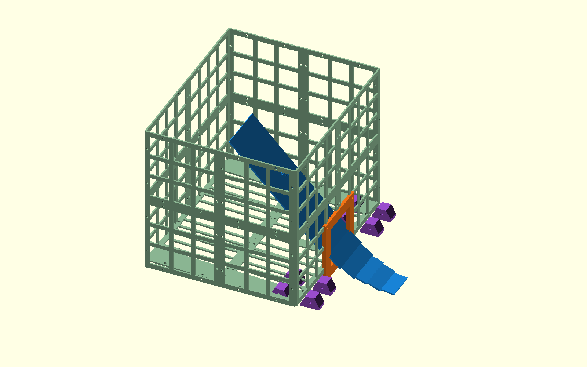
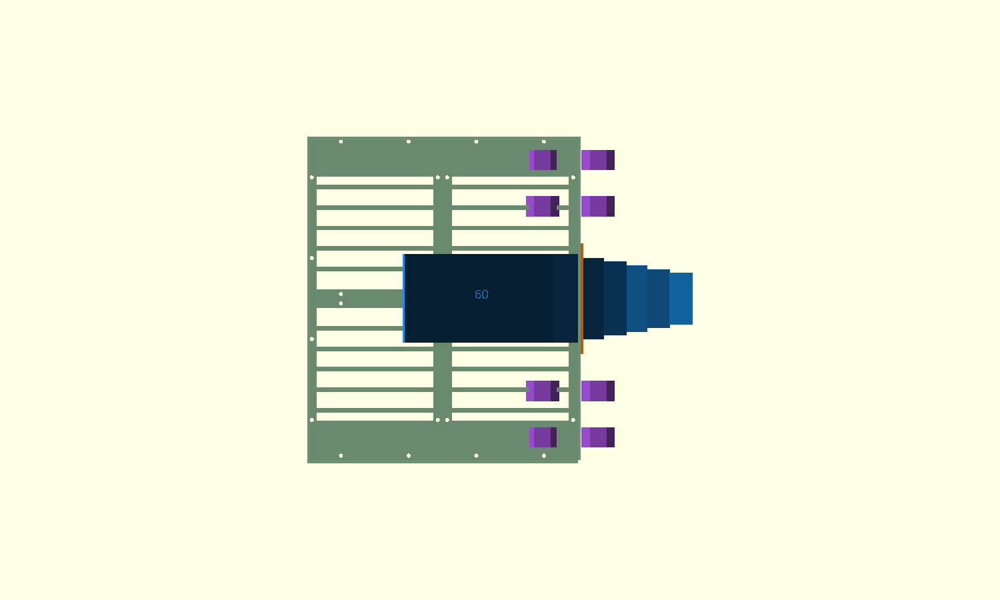

# P2-48 — τυπωμένο καλάθι 40 υποχρεωτικών / 45 best-effort μπαλών

> **ΑΠΟΡΡΙΦΘΗΚΕ ΛΕΙΤΟΥΡΓΙΚΑ ΑΠΟ P2-49:** η εσωτερική ράμπα θάβεται από
> τον εμπρός σωρό, ο όγκος/νεκρός χώρος της δεν είχε αφαιρεθεί επαρκώς και
> συνέπιπτε με τη launch-feed θύρα. Οι αριθμοί διατηρούνται ως ιστορικό,
> όχι ως print candidate. Βλ. `shared-flywheel-basket-p249-el.md`.

## Απόφαση και όρια ισχυρισμού

Το καλάθι σχεδιάζεται γεωμετρικά για 45 μπάλες, αλλά το υποχρεωτικό
κριτήριο φυσικής αποδοχής είναι **40 μπάλες**. Οι μπάλες 41–45 είναι
best-effort: καταγράφονται, αλλά απώλειά τους δεν αποτυγχάνει τη δοκιμή,
εφόσον παραμένουν τουλάχιστον 40, δεν κλείνει μόνιμα η είσοδος και δεν
προκαλείται βλάβη. Η βάση είναι η απλή `tall-open-drop`, χωρίς πτερύγιο ή
επένδυση.

Η γεωμετρία παραμένει **ΕΞΑΡΤΩΜΕΝΗ** μέχρι τη φυσική δοκιμή. Δεν αποτελεί
STL release και δεν αλλάζει την παγωμένη άρθρωση/αψίδα P2-40. Η επαφή
μπάλας–μπάλας του DART δεν είναι βαθμονομημένη, επομένως δεν έγινε νέο
Gazebo για να εξαχθεί απόλυτη χωρητικότητα.

## Σωρός και ύψη γέφυρας πτώσης

Χρησιμοποιήθηκε η ίδια μέθοδος του P2-47: εσωτερική κάτοψη 287×344 mm,
μπάλα Ø66 mm και packing fraction 0,56/0,60/0,64. Στο δυσμενές 0,56
προστίθεται μία διάμετρος μπάλας πάνω από το μέσο ύψος, ώστε να καλυφθεί
τοπική κορυφή του σωρού. Το υψηλό σημείο του κεκλιμένου πατώματος είναι
Z=54 mm.

| Πλήθος | Συμπαγής όγκος | Μέσο ύψος σωρού, φ=0,56/0,60/0,64 | Δυσμενής τοπική κορυφή |
|---:|---:|---:|---:|
| 40 | 6,021 L | 108,9 / 101,6 / 95,3 mm | Z=228,9 mm |
| 45 | 6,774 L | 122,5 / 114,4 / 107,2 mm | Z=242,5 mm |

Η απαίτηση είναι η επιφάνεια εξόδου της γέφυρας να βρίσκεται τουλάχιστον
20 mm πάνω από την κορυφή των 40. Οι ταχύτητες παρακάτω προκύπτουν από
`v=sqrt(2 g Δz)` και περιθώριο ταχύτητας 25%. Είναι ενεργειακό screen, όχι
μοντέλο απωλειών της πραγματικής ράμπας.

| Z γέφυρας | Περιθώριο 40 | Περιθώριο 45 | Ταχύτητα με +25% | Ø200 rpm | ως χείλος Z335 | ως LiDAR Z390 |
|---:|---:|---:|---:|---:|---:|---:|
| 247 mm | 18,1 mm — FAIL | 4,5 mm | 2,695 m/s | 257,4 | 88 mm επιφάνεια / 22 mm κορυφή μπάλας | 143 / 77 mm |
| **260 mm** | **31,1 mm — PASS** | 17,5 mm | **2,768 m/s** | **264,3** | 75 / 9 mm | 130 / 64 mm |
| 275 mm | 46,1 mm — PASS | 32,5 mm | 2,850 m/s | 272,1 | 60 / −6 mm | 115 / 49 mm |

Επιλέγεται **Z=260 mm** ως reference. Το 247 mm μένει μόνο ως χαμηλό
διαγνωστικό και δεν μπορεί να περάσει μόνο του το mandatory static gate.
Το 275 mm είναι εναλλακτικό test piece αν η πραγματική στοίβα χρειαστεί
περισσότερο χώρο, αλλά η κορυφή διερχόμενης μπάλας ανεβαίνει 6 mm πάνω από
το χείλος και αυξάνει τον κίνδυνο αναπήδησης/διαφυγής. Το LiDAR scan plane
δεν τέμνεται σε καμία επιλογή· τα αναφερόμενα περιθώρια δεν είναι optical
field-of-view validation της κάμερας.

## Εξαρτώμενο CAD και εκτυπώσιμη διαίρεση

Το παραμετρικό αρχείο είναι
`cad/modular-test-chassis/shared-flywheel-basket-p248-panels.scad`. Η
συναρμολόγηση φαίνεται στα:

Η μεγαλύτερη κύρια πλάκα είναι 175×146,5 mm και χωρά σε πλάκα 256 mm.
Οι πλαϊνοί κάνναβοι έχουν καθαρό άνοιγμα 38 mm (όριο 40 mm). Το δάπεδο
έχει νεύρα παράλληλα στη ροή +X, καθαρό άνοιγμα 18 mm (όριο 20 mm) και
συνεχή συμπαγή κεντρική λωρίδα 86 mm προς τη θύρα. Δεν υπάρχουν εγκάρσιες
βυθίσεις στη γραμμή κύλισης.

| Τυπωμένο μέρος | Ποσότητα | Σχόλιο |
|---|---:|---|
| πλευρικό quadrant 146,5×146,5 | 8 | κάνναβος ≤38 mm |
| front/rear quadrant 175×146,5 | 8 | ξεχωριστά `front_lower_left/right` σχηματίζουν τη θύρα |
| floor quadrant 146,5×175 | 4 | διαμήκη νεύρα + συμπαγής κεντρική λωρίδα |
| seam strap | 16 | M4 ενώσεις οριζόντιων/κατακόρυφων ραφών |
| corner angle 140 mm | 8 | δύο ανά γωνία |
| chassis mount ear | 8 | κάνναβος X240/X300, Y=±100/±150 |
| common lower bridge rails | 2 | σταθερό κατώτερο τμήμα |
| common bridge deck slats | 6 | βιδωτές, αντικαταστάσιμες |
| tail side rails | 2 ανά ύψος | θετικό Z=247/260/275, όχι friction shim stack |
| tail deck slats | 6 ανά ύψος | test kit του αντίστοιχου ύψους |
| port frame 120×120 | 1 | τέσσερις M4 θέσεις στα ±52 mm |
| removable blind plate | 1 | υποχρεωτική στις δοκιμές χωρητικότητας |

Οι ενώσεις είναι βιδωτές M4 με ροδέλες και nyloc ή heat-set inserts. Τα
mount ears χρησιμοποιούν τον υπάρχοντα κάνναβο M4, χωρίς νέα οπή στο
παγωμένο σασί. Η τελική λίστα μήκους βιδών κλειδώνει μετά το slicing και
ένα dry assembly.

Με effective density slicer 0,72 g/cm³, η εκτίμηση για κάνναβο μαζί με
τυπωμένα interfaces/bridge είναι **692 g**, έναντι **1.319 g** για
αντίστοιχο συμπαγές κέλυφος: εξοικονόμηση περίπου **626 g (47,5%)**.
Αβεβαιότητα ±15% μέχρι το πραγματικό slicing· μεταλλικές βίδες/ροδέλες δεν
περιλαμβάνονται. Δεν αποτελεί έλεγχο αντοχής των panel joints.

## Άνοιγμα τροφοδοσίας εκτόξευσης — μόνο interface

Το πάτωμα κατεβαίνει από Z=54 mm πίσω σε Z=42 mm εμπρός σε μήκος 293 mm
(2,345°), ώστε το χαμηλότερο σημείο να είναι η θύρα στο X=278, Y=0.
Το καθαρό άνοιγμα είναι **80×80 mm**: περνά μία Ø66, ενώ δύο δίπλα-δίπλα
(132 mm) δεν περνούν. Περιβάλλεται από πλαίσιο 120×120 mm με τέσσερις M4
θέσεις στα ±52 mm για μελλοντικό πορτάκι/χοάνη/singulator και για την
αφαιρούμενη τυφλή πλάκα.

Με κέντρο μπάλας της θύρας `[278, 0, 75] mm`, το παγωμένο P2-40 rear-mouth
reference της κινούμενης μονάδας δίνει:

| Θέση εκτόξευσης | Κέντρο μπάλας στο rear mouth | Διαδρομή από θύρα | Κλίση προς στόμιο |
|---:|---:|---:|---:|
| +15° | `[329,2, 0, 59,1] mm` | 53,6 mm | πτώση 15,9 mm / 17,3° |
| +20° | `[331,5, 0, 54,1] mm` | 57,4 mm | πτώση 20,9 mm / 21,3° |

Αυτό δεσμεύει μόνο centreline/keep-out ανάμεσα στη σταθερή θύρα και το
κινούμενο στόμιο. Δεν σχεδιάζει ούτε ισχυρίζεται singulation ή απομόνωση
κατά τη μετάβαση· αυτά ανήκουν στη 5d. Το μελλοντικό εξάρτημα πρέπει να
καλύψει και τα δύο endpoints +15…+20° χωρίς να φορτίζει την άρθρωση.

Ιδανικά, συμπαγής σφαίρα σε κλίση 2,345° επιταχύνεται περίπου 0,287 m/s²
και φτάνει περίπου 0,41 m/s στα 293 mm. Οι ραφές, η τραχύτητα εκτύπωσης και
η παραμόρφωση μπάλας μπορούν να μηδενίσουν αυτό το μικρό περιθώριο, άρα η
αυτόνομη ροή προς τη θύρα είναι φυσικό gate, όχι αποδεδειγμένο αποτέλεσμα.

## Φυσική δοκιμή του ίδιου του τυπωμένου καλαθιού

1. Συναρμολογείται το πραγματικό panel basket. Μετριούνται εσωτερικές
   διαστάσεις, μάζα, παραμόρφωση ραφών και πραγματικό Z κάθε tail.
2. Για capacity/retention τοποθετείται η τυφλή πλάκα. Δοκιμάζονται tails
   Z=260 και 275 mm· αν εκτυπωθεί και το 247 mm, είναι μόνο διαγνωστικό.
3. Για κάθε ύψος γίνονται τουλάχιστον 5 επαναλήψεις με preload
   25/35/39/44 και μία νέα μπάλα. Τα 25→26, 35→36 και 39→40 πρέπει να
   κρατούν τη νέα μπάλα 5/5, χωρίς μόνιμο κλείσιμο εισόδου ή απώλεια από
   τις πρώτες 40. Το 44→45 καταγράφεται διαγνωστικά: τελικό πλήθος ≥40
   χωρίς βλάβη είναι αποδεκτό, ακόμη κι αν χαθούν μπάλες 41–45.
4. Με 40 μπάλες και blind plate γίνεται ταλάντωση/κλίση και η ακολουθία
   κίνησης της φυσικής δοκιμής: ευθεία περίπου 0,6 m/s, φρενάρισμα, στροφή,
   stop. Απαίτηση: μηδενική απώλεια. Επαναλαμβάνεται με 45 ως best-effort,
   όπου τελικό ≥40 είναι αποδεκτό και οι επιπλέον απώλειες καταγράφονται.
5. Για flow αφαιρείται η blind plate. Με 1/5/10 μπάλες μετρώνται χρόνος
   κύλισης, στάση σε ραφή, γέφυρα στη θύρα, πλήθος που εμφανίζεται μαζί και
   ανάγκη χειροκίνητης διέγερσης. Δεν δηλώνεται one-by-one singulation από
   αυτό το interface.

Για είσοδο περίπου 2,7 m/s χρησιμοποιείται κεκλιμένη σανίδα. Για λεπτό
σφαιρικό κέλυφος το lossless κατακόρυφο ύψος είναι 0,619 m. Αρχικό setup:
**0,70 m κατακόρυφη πτώση σε σανίδα 1,20 m (35,7°)**. Η πραγματική ταχύτητα
μετριέται από video στο τελευταίο ευθύ τμήμα 300 mm και το ύψος
προσαρμόζεται. Ενδεικτικά, με allowance απωλειών 12%, τα Z=260/275 ζητούν
αρχικό release height περίπου 0,73/0,77 m.

Καταγράφονται: tail Z, measured entry speed, preload/final count, bounce
height, πρώτο σημείο blockage, χρόνος αποκατάστασης, panel/fastener damage,
blind-plate state, motion losses και port-flow observations.

## Κατάσταση

`P2_48_STATIC_CAD_COMPLETE_BASKET_DEPENDENT_PENDING_PHYSICAL_TEST`.
Δεν έγινε Gazebo, STL release, commit, push ή PR. ΠΑΥΣΗ πριν από 5c-3/5d
και πριν κλειδωθεί το καλάθι.
