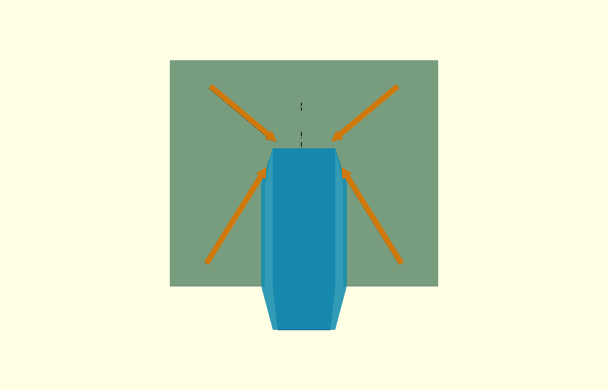
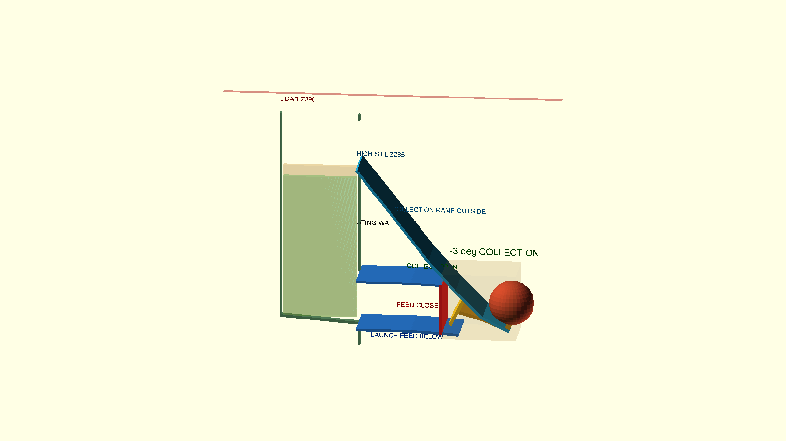
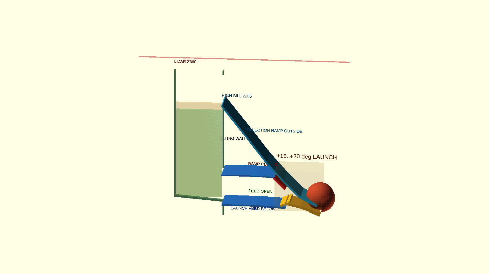

# P2-49 — διαχωρισμένη ράμπα συλλογής και τροφοδοσία εκτόξευσης

## Απόφαση

Η λειτουργική διάταξη P2-48 απορρίπτεται. Η ράμπα δεν επιτρέπεται πλέον
να καταλαμβάνει τον αποθηκευτικό όγκο: ο παλιός εμπρός χαμηλός διάδρομος
μπορούσε να θαφτεί πρώτος από τον σωρό, ο όγκος/νεκρός χώρος του δεν είχε
αφαιρεθεί σωστά και συνέπιπτε με τη θύρα τροφοδοσίας.

Το P2-49 χρησιμοποιεί:

- κεντρική εσοχή **έξω από τον αποθηκευτικό όγκο**, με clear πλάτος 80 mm
  και outer πλάτος 100 mm,
- ψηλή είσοδο συλλογής σε διαχωριστικό X=100 mm, sill Z=285 mm,
- ανεξάρτητο χαμηλό feed channel κάτω από τη ράμπα,
- κοινό, module-mounted throat μόνο κοντά στο μοναδικό rear mouth,
- αλληλοασφαλιζόμενο selector και δύο shutters, των οποίων ο μηχανισμός
  παραμένει αντικείμενο της 5d.

Δεν αλλάζει η παγωμένη άρθρωση/αψίδα P2-40. Το CAD είναι **ΕΞΑΡΤΩΜΕΝΟ**,
χωρίς STL release ή Gazebo.

## Γεωμετρία αποθήκευσης και εσοχής

Το πίσω τοίχωμα μένει X=−15, το εξωτερικό πλάτος 344 mm και τα δύο πλαϊνά
τμήματα φτάνουν μέχρι X=278. Μόνο η κεντρική ζώνη υποχωρεί:

- από X278 έως X145: εξωτερική εσοχή πλάτους 100 mm,
- X145→100: δύο λοξά fairings προς clear throat 80 mm,
- X=100: διαχωριστικό με χαμηλό feed opening και ψηλό collection opening,
- rim Z=360, δηλαδή 30 mm κάτω από το LiDAR scan plane Z=390.

Τα fairings δεν σχηματίζουν εσωτερική γωνία στην οποία μπορεί να κάτσει
Ø66 μπάλα. Η ελάχιστη δίοδος είναι 80 mm, δηλαδή 14 mm μεγαλύτερη από τη
διάμετρο. Αυτό είναι γεωμετρικό screen· παραμόρφωση μπάλας, χώμα και
τραχύτητα εκτύπωσης ελέγχονται φυσικά.

Ο πάτος είναι piecewise funnel:

- το πίσω κύριο τμήμα πέφτει 4,5° προς +X και 2° προς το κέντρο,
- τα δύο εμπρός πλαϊνά «φτερά» πέφτουν 4,5° προς −X και 2° προς το throat,
- επομένως και οι τέσσερις περιοχές έχουν αρνητική κλίση προς X100/Y0,
  χωρίς να ζητείται από μπάλα να ανέβει γύρω από την εσοχή.

## Δύο διαδρομές και κοινό rear mouth

Το κοινό rear-mouth floor από την παγωμένη P2-40 γεωμετρία είναι:

| Λειτουργία | Rear-mouth floor | Κέντρο μπάλας |
|---|---:|---:|
| συλλογή −3° | X324,7 / Z45,1 mm | Z78,1 mm |
| εκτόξευση +15° | X329,2 / Z26,1 mm | Z59,1 mm |
| εκτόξευση +20° | X331,5 / Z21,1 mm | Z54,1 mm |

Η παλιά τοπική ράμπα X330/Z≈31 αντικαθίσταται από module-mounted κοινό
nose που ακολουθεί ακριβώς το rear mouth, ώστε να μη δημιουργείται σκαλοπάτι
όταν αλλάζει η γωνία. Το σημείο διακλάδωσης καταλαμβάνει envelope
X225…335/Z32…130. Πίσω από αυτό οι διαδρομές είναι χωριστές:

- collection surface: `[324,7/45,1] → [285/65] → [245/105] →
  [205/150] → [155/215] → [100/285] mm`, εξ ολοκλήρου έξω από το καλάθι,
- feed surface: `[100/42] → [180/42] → [225/40] → [250/38] mm`, κάτω από
  τη ράμπα και χωρισμένη με συνεχή οροφή/δάπεδο.

Για την άνοδο 45,1→285 mm, το αρχικό point-mass screen έδινε 2,169 m/s
και 2,711 m/s με περιθώριο 25%. Το P2-50 απέδειξε ότι αυτό **δεν** είναι
αποδεκτό ως wheel-surface requirement: αγνοεί τις απώλειες
throat/μετάβασης. Η polyline αντικαταστάθηκε από R125 και συνεχείς οδηγούς
20 mm, αλλά έως 3,2 m/s καμία μπάλα δεν έφτασε στο sill. Αναλυτικά:
`docs/mechanism/shared-flywheel-basket-p250-el.md`.

### Καταστάσεις selector

| Κατάσταση | Ράμπα συλλογής | Feed channel | Κοινό throat |
|---|---|---|---|
| Συλλογή −3° | ανοικτή | shutter κλειστό στο χαμηλό άνοιγμα | mouth → επάνω branch |
| Μεταφορά 0° | κλειστή | κλειστό | άδειο/απομονωμένο |
| Εκτόξευση +15…+20° | shutter κλειστό | ανοικτό | χαμηλό branch → mouth |

Προβλέπεται δίθεσο rotary diverter με positive stops, δύο ανεξάρτητα
sealing lips και αισθητήρα κατάστασης. Δεν επιτρέπεται κατάσταση όπου και
οι δύο branches είναι ανοικτές. Actuator, timing, interlock με tilt και
singulator σχεδιάζονται στη 5d.

## Καθαρός όγκος και σωρός

Η κεντρική εσοχή/ράμπα/κανάλι αφαιρούνται πλήρως από το storage polygon.
Από τον υπόλοιπο όγκο αφαιρούνται επιπλέον:

- 0,55 L για panel ribs, seams και πλάτες fasteners,
- 0,25 L για τα δύο smooth corner fairings,
- 0,35 L για feed throat/gate keep-out.

| Μέγεθος | Τιμή |
|---|---:|
| storage plan area μετά την εσοχή | 83.442 mm² |
| reference πλήρους ορθογωνίου | 31,217 L |
| εσοχή ράμπας/καναλιού που αφαιρέθηκε | 5,393 L |
| gross volume κάτω από rim | 25,824 L |
| πρόσθετες εσωτερικές αφαιρέσεις | 1,150 L |
| **καθαρός αποθηκευτικός όγκος** | **24,674 L** |
| απαίτηση 40 σε packing 0,56 | 10,752 L |
| απαίτηση 45 σε packing 0,56 | 12,096 L |

Η θεωρητική volumetric capacity είναι πολύ μεγαλύτερη από 45· δεν
χρησιμοποιείται ως λειτουργικός ισχυρισμός, επειδή pile localization,
bridging και η ροή προς το throat παραμένουν φυσικά gates.

Για τον pile-height έλεγχο αφαιρέθηκε επιπλέον projected area 3.500 mm²
γύρω από fairings/gate. Με δυσμενές packing 0,56 και allowance μίας
διαμέτρου:

| Πλήθος | Worst local top | Περιθώριο ως sill Z285 | Gate |
|---:|---:|---:|---|
| 40 | Z261,1 mm | **23,9 mm** | PASS ≥20 mm |
| 45 | Z277,9 mm | 7,1 mm | best-effort |

Δεν χρειάζεται επέκταση προς τα πίσω ή επιπλέον ύψος. Διατηρούνται:

- 32 mm από το rear wall X−15 έως το FIT0403 envelope X−47,
- 27,5 mm από το καλάθι έως το εμπρός άκρο του Ugreen envelope X−42,5,
- 82,5 mm έως το εμπρός άκρο των Parkside X−97,5,
- εξωτερική πρόσβαση στις Parkside.

Η κάμερα βρίσκεται εμπρός, X350, ενώ η κεντρική εσοχή διατηρεί ανοικτή την
κεντρική θέα προς το έδαφος. Το ακριβές optical FOV παραμένει φυσικό gate.

## Panels και κάνναβος

Παραμένουν οι κανόνες P2-48:

- ανοίγματα τοιχωμάτων ≤40 mm· nominal grid 38 mm,
- ανοίγματα βάσης ≤20 mm· nominal 18 mm,
- ribs βάσης παράλληλα στην τοπική κλίση ροής,
- συμπαγής ζώνη 100 mm γύρω από throat/fairings και continuous floor του
  feed channel,
- M4 panel joints και τα υπάρχοντα chassis-grid mounts X240/X300.

Για bed 256 mm, οι πλευρές διαιρούνται σε 2 στήλες × 3 σειρές
(μέγιστο περίπου 146,5×105 mm), το πίσω τοίχωμα σε 2×3
(172×105 mm), και κάθε front wing σε τρεις κατακόρυφες πλάκες. Divider,
ramp rails, channel cover και selector cassette είναι ανεξάρτητα dependent
κομμάτια. Δεν έγινε STL export.

## Ενημέρωση P2-50

Το εξαρτώμενο CAD περιέχει πλέον R125 lower transition και συνεχείς
πλευρικούς οδηγούς. Αυτό αφαιρεί την κρούση της πρώτης polyline και την
τεχνητή πλευρική διαφυγή από κενά του bench. Το Gazebo gate παραμένει FAIL
0/9 λόγω ανεπαρκούς παράδοσης ενέργειας μέχρι Z285. Δεν υπάρχει STL
release και το sill/η ταχύτητα συλλογής παραμένουν ανοικτό φυσικό gate.

## Κατάσταση

`P2_50_GAZEBO_SINGLE_BALL_FAIL_PAUSED_BEFORE_5C3_5D`.
ΠΑΥΣΗ. Δεν έγινε Gazebo, STL release, commit, push ή PR.
