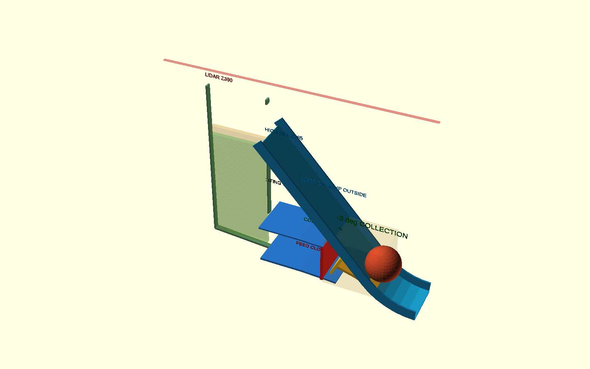

# P2-50 — μία μπάλα από το nip έως το sill Z285

## Συμπέρασμα

Το γρήγορο Gazebo gate **απέτυχε 0/9**: καμία από τις συνθήκες
2,8/3,0/3,2 m/s × Y=0/±50 mm δεν έφτασε στο sill. Η αρχική πολυγωνική
μετάβαση προκαλούσε κρούση και επιστροφή. Αντικαταστάθηκε στο εξαρτώμενο
CAD από κυκλικό κάτω τόξο R125 mm, με chords ανά 8°, εφαπτόμενο στην άνοδο
περίπου 48°. Η τελική επανάληψη είχε gap αναπήδησης 17,0…17,7 mm
(PASS ≤20 mm), μηδενική απαγορευμένη επαφή και χωρίς NaN/Inf, αλλά
παρέμεινε ενεργειακά ανεπαρκής.

Άρα το P2-50 **δεν εγκρίνει** sill Z285 με τις δοκιμασμένες ταχύτητες.
Το R125 και οι συνεχείς οδηγοί είναι η νέα εξαρτώμενη CAD αναφορά, όχι STL
release. Το P2-40 (άρθρωση/αψίδα/γωνίες) δεν άλλαξε.

## Παγωμένο gate και εκτελέσεις

Πριν από κάθε σειρά γράφτηκαν criteria files. Τελική σειρά:

- τροχός 2,8/3,0/3,2 m/s, μπάλα–πέλμα μ=0,6,
- προσέγγιση 0,6 m/s, Y=0/±50 mm, μία μπάλα, μία επανάληψη,
- calibrated `tennis_ball_compliant` χωρίς νέα προσαρμογή,
- sill reached: X≤110 mm, Zκέντρου≥305 mm, |Y|≤20 mm,
- sill speed ≥0,30 m/s, transition gap ≤20 mm, |Y| στη ράμπα ≤40 mm,
- |I|≤20 A και |T|≤0,62 N·m ανά D5065 στο ball-contact window.

Container image:
`sha256:86e0d8532b005efb99290c8e7875c204ce992fba009b6bd803af8e70587ba077`.
Τελικό criteria hash:
`d3e963b428148a2e90b2a93a5dccf286511b34ec7ed25d6ff62c9501c63497e1`.
Τελικό URDF hash:
`a259bce4cb17af401ed16738b5d6d93a3791641138569e4ec8600183399cc261`.
Μετά από κάθε run το `docker ps` ήταν κενό.

## Τελικός πίνακας R125 + συνεχείς οδηγοί

Η «βάση» μετριέται αμέσως μετά το common throat, στο X≈390 mm. Το
`transition exit` μετριέται μετά το R125, στο X≈325 mm. Τα apex X/Z είναι
στο base frame. Το sill δεν επιτεύχθηκε, άρα δεν υπάρχει sill speed.

| πέλμα m/s | Y mm | βάση m/s | exit R125 m/s | απώτερο X/Z mm | bounce mm | max |Y| mm | Imax A | αποτέλεσμα |
|---:|---:|---:|---:|---:|---:|---:|---:|:---:|
| 2,8 | −50 | 1,696 | 1,181 | 234,9 / 184,4 | 17,1 | 11,6 | 13,71 | FAIL |
| 2,8 | 0 | 1,874 | 1,538 | 168,2 / 259,0 | 17,2 | 0,0 | 11,16 | FAIL |
| 2,8 | +50 | 1,696 | 1,171 | 234,1 / 185,3 | 17,1 | 11,6 | 13,71 | FAIL |
| 3,0 | −50 | 1,549 | 0,710 | 307,3 / 103,4 | 17,7 | 12,3 | 13,67 | FAIL |
| 3,0 | 0 | 1,949 | 1,601 | 150,1 / 279,3 | 17,1 | 0,0 | 11,50 | FAIL |
| 3,0 | +50 | 1,549 | 0,710 | 307,3 / 103,4 | 17,7 | 12,3 | 13,66 | FAIL |
| 3,2 | −50 | 1,292 | 0,599 | 300,2 / 111,3 | 17,0 | 4,0 | 14,04 | FAIL |
| 3,2 | 0 | 1,998 | 1,643 | 144,1 / 286,0 | 17,2 | 0,0 | 11,36 | FAIL |
| 3,2 | +50 | 1,292 | 0,599 | 300,2 / 111,3 | 17,0 | 4,0 | 14,04 | FAIL |

Τα ±50 mm είχαν αυτοκεντραριστεί σε περίπου ±4 mm στην αρχή του R125.
Με τους παλιούς, ασυνεχείς simulation rails έφευγαν αργότερα πλευρικά έως
143 mm. Οι συνεχείς οδηγοί περιόρισαν τη διαδρομή σε ≤12,3 mm, αλλά η
επαφή τους με περιστρεφόμενη μπάλα εμφάνισε ισχυρή και μη μονοτονική
απώλεια ταχύτητας. Αυτό είναι contact-model sensitivity, όχι φυσική
απόδειξη ότι μεγαλύτερη rpm χειροτερεύει τη συλλογή.

Στις κεντρικές μπάλες, η ταχύτητα βάσης ήταν 1,874/1,949/1,998 m/s και
μετά το R125 1,538/1,601/1,643 m/s. Η thin-shell αδράνεια του υπάρχοντος
μοντέλου δίνει ιδανικά περίπου 1,97 m/s στη βάση για άνοδο μέχρι κέντρο
Z318 με υπόλοιπο 0,30 m/s. Η 3,2 m/s συνθήκη αγγίζει αυτό το ιδανικό όριο,
αλλά οι πραγματικές απώλειες της ράμπας την σταματούν στο X144/Z286.
Συνεπώς η παλιά static τιμή «2,711 m/s με 25% margin» δεν μπορεί να
χρησιμοποιείται ως wheel-surface acceptance value: υπέθετε ότι η διαθέσιμη
ταχύτητα μπάλας μεταφέρεται χωρίς τις μετρημένες απώλειες throat/R125.

Το contact-window peak ήταν 11,16…14,04 A, 0 s σε saturation και ροπή έως
0,435 N·m. Τα primary-contact means ήταν 1,81…6,68 A ανά μοτέρ· οι
μεταγενέστερες επαφές επιστροφής καταγράφονται ως χωριστά episodes και δεν
αναμειγνύονται πλέον στον πρώτο μέσο όρο. Οι DART δυνάμεις επαφής είναι
μόνο διαγνωστικές και όχι φορτία σχεδίασης.

## Εξαρτώμενο CAD και ανοικτές επιλογές

Το `shared-flywheel-basket-p249-separated.scad` ενημερώθηκε με R125 και
συνεχείς πλευρικούς οδηγούς ύψους 20 mm. Το sill, divider, αποθηκευτικός
όγκος και feed channel δεν άλλαξαν. Δεν έγινε STL.

Για 5d καταγράφεται μηχανική σύζευξη selector–κλίσης με έκκεντρο/cam slot:

- collect −3°: collection open / feed closed,
- transport 0°: και οι δύο κλειστές,
- launch +15…+20°: collection closed / feed open,
- spring fail-safe προς «και οι δύο κλειστές», positive detents/stops και
  ανεξάρτητη επιβεβαίωση θέσης.

Έτσι μπορεί να αποφευχθεί δεύτερος actuator, αλλά hysteresis, cam force,
wear και timing με τον P16 πρέπει να ελεγχθούν στη 5d.

Μετά τη φυσική δοκιμή μπορεί να εξεταστεί rim περίπου Z320 **μόνο ως
stepped side/rear rim**. Το τοπικό entry tower/sill πρέπει να παραμείνει
ψηλότερο: πλήρες rim Z320 αφήνει μόλις 35 mm πάνω από sill Z285, λιγότερο
από Ø66, και θα χτυπούσε τη διερχόμενη μπάλα. Η μείωση επιτρέπεται μόνο αν
το video επιβεβαιώσει ότι δεν αυξάνει rebound/spill και δεν κλείνει το
πεδίο της κάμερας.

## Κατάσταση

`P2_50_GAZEBO_SINGLE_BALL_FAIL_PAUSED_BEFORE_5C3_5D`.

ΠΑΥΣΗ. Δεν έγινε σωρός, 5c-3, 5d, STL, commit, push ή PR.
