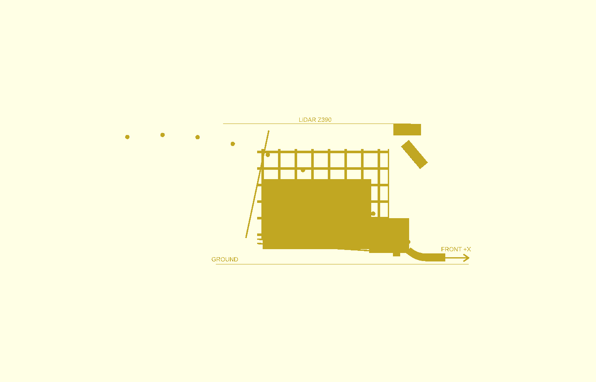

# P2-51 — παθητικός βατήρας και βαλλιστική παράδοση

> **ΑΝΤΙΚΑΤΑΣΤΑΘΗΚΕ από P2-61 μόνο ως προς το operating setpoint:** το
> historical 6 m/s 30/30 χρησιμοποιούσε `law(p)`. Με `law(2p)`, 6 m/s δίνει
> 11/30 και το ίδιο frozen R75/42° geometry επιστρέφει σε 30/30 στα 5 m/s.

## Απόφαση

Η απλούστερη λύση που πέρασε το συγκριτικό one-ball gate είναι παθητικός
βατήρας R75, συνολικού μήκους 107 mm (52 mm εφαπτομενικό τμήμα και τόξο
55 mm), με γεωμετρικό τελείωμα 42°. Στο DART η πραγματική έξοδος δεν είναι
42°: στη reference συνθήκη μετρήθηκε 37,98°. Το σημείο λειτουργίας είναι
περιφερειακή ταχύτητα τροχών **6,0 m/s = 573 rpm για Ø200**. Δεν υπάρχει
ιμάντας ή κινούμενος κύλινδρος.

Το αποτέλεσμα είναι PASS για μία calibrated μπάλα και άδειο καλάθι σε
30/30 συνθήκες μ πέλματος 0,6/0,9, μ βατήρα 0,15/0,25/0,4 και Y=0/±50/±100
mm. Δεν είναι claim για σωρό ή ball–ball rebound. Το καλάθι μένει
ΕΞΑΡΤΩΜΕΝΟ και δεν εκδίδεται STL πριν από τη φυσική δοκιμή.

## Γιατί άλλαξε το αρχικό R125

Το πρώτο R125/35° run σταμάτησε επειδή η μπάλα χτύπησε την παγωμένη
τραβέρσα X300. Το πρώτο R75/35° επίσης απέτυχε: ονομαστική εφαπτομένη 35°,
πραγματική έξοδος 25,98° και διείσδυση επαφής 1,50 mm στην X300. Δεν έγινε
αλλαγή στο P2-40. Χαρτογραφήθηκε η εξαρτώμενη γεωμετρία:

| Γεωμετρικό τόξο | Πραγματική έξοδος | Ταχύτητα | LiDAR margin | Αποτέλεσμα |
|---:|---:|---:|---:|:---:|
| 42° | 37,98° | 4,409 m/s | 45,3 mm | PASS |
| 50° | 46,28° | 3,837 m/s | 1,9 mm | FAIL (<10 mm) |
| 60° | 55,77° | 3,578 m/s | −218,1 mm | FAIL |

Η κλίση συλλογής παραμένει −3°. Οι −5°/−7° θα μείωναν τη στροφή του
βατήρα αλλά αποτυγχάνουν το παγωμένο moving-clearance gate με allowance
5 mm. Άρα δεν χρησιμοποιούνται για να «διορθώσουν» την τροχιά.

## Παγωμένη μήτρα 90 συνθηκών

Criteria:
`engineering/shared-flywheel-isolated-bench/criteria_5c_p251_delivery_matrix.json`,
SHA-256 `3f98e17d1748b1ec635467e5d66b2cf9145e80eab5dc8161e7ef568c046ff66d`.
Container image:
`sha256:86e0d8532b005efb99290c8e7875c204ce992fba009b6bd803af8e70587ba077`.
URDF 42°: `025dae6095b486341bddf2cd3959f8c9b397782d40052cef1b7028ac3ba9a271`.
Calibrated ball model:
`8715ce705508cc8c6428126a4063e1846f43d46c780eef5274780ee1cbb7356f`.

| Περιφέρεια | rpm Ø200 | PASS | Έξοδος min/mean/max | Γωνία min/mean/max | Ελάχιστο LiDAR margin |
|---:|---:|---:|---:|---:|---:|
| 6 m/s | 573 | 30/30 | 2,749 / 3,677 / 4,556 m/s | 39,40 / 41,02 / 45,96° | 18,88 mm |
| 10 m/s | 955 | 14/30 | 3,321 / 4,175 / 5,453 m/s | 25,23 / 37,50 / 45,14° | −237,27 mm |
| 14 m/s | 1.337 | 9/30 | 2,343 / 4,081 / 5,383 m/s | 28,68 / 35,86 / 43,56° | −428,10 mm |

Συνολικά 53/90 πέρασαν. Τα 37 FAIL περιέχουν 36 failures παραμονής, 10
LiDAR-envelope failures και 12 επαφές με την X300· μία συνθήκη μπορεί να
έχει περισσότερες από μία αιτίες. Δεν υπήρξε επαφή με κάμερα, αψίδα ή
LiDAR. Η αύξηση rpm δεν είναι μονοτονική αύξηση της ταχύτητας μπάλας στο
μοντέλο επαφής και μειώνει την ανοχή.

Στα 6 m/s πέρασαν **όλα** τα υλικά και offsets. Ανά υλικό:

| μ πέλματος | μ βατήρα | Έξοδος min/mean/max |
|---:|---:|---:|
| 0,6 | 0,15 | 3,374 / 3,634 / 4,184 m/s |
| 0,6 | 0,25 | 2,926 / 3,661 / 3,989 m/s |
| 0,6 | 0,40 | 2,749 / 3,231 / 3,576 m/s |
| 0,9 | 0,15 | 3,022 / 3,843 / 4,556 m/s |
| 0,9 | 0,25 | 3,170 / 3,672 / 4,324 m/s |
| 0,9 | 0,40 | 3,815 / 4,022 / 4,181 m/s |

Οι 26/30 έξοδοι βρίσκονται ακριβώς στο ζητούμενο 3,0–4,5 m/s. Οι τέσσερις
εκτός ζώνης παραδόθηκαν επίσης επιτυχώς: τρεις είναι 2,749–2,926 m/s και
μία 4,556 m/s. Δεν προτείνεται αύξηση command για να «διορθωθούν», επειδή
η μήτρα 10/14 m/s αποδεικνύει μη μονοτονική συμπεριφορά DART. Η φυσική
μέτρηση θα καθορίσει την τελική rpm.

### Απώλεια βατήρα και ρεύμα

Στο reference command, η ταχύτητα στη βάση είναι 4,400–5,082 m/s και στην
έξοδο 2,749–4,556 m/s. Η απώλεια είναι 0,500–1,652 m/s· retention ratio
0,625–0,897, μέσο 0,783. Αυτό περιλαμβάνει ολίσθηση, δημιουργία spin και
ανύψωση στο R75. Το μ=0,15/0,25/0,4 παραμένει επιλογή υλικού: λείο PETG,
ενδιάμεση επιφάνεια ή τραχύτερο PETG. Η ταινία PTFE είναι η υποψήφια
χαμηλής τριβής, όχι tuning parameter του simulation.

Στο contact window των 6 m/s, το μέσο ρεύμα ανά run είναι 4,68–12,05 A
(μέσο 6,13 A). Το peak είναι 5,54–20,0 A και ο χρόνος saturation
0–0,020 s (μέσο 0,0028 s). Η ροπή δεν υπερβαίνει 0,62 N·m. Τα στιγμιαία
20 A δεν πρέπει να διαβαστούν ως συνεχές ρεύμα συλλογής.

## Καλάθι και interfaces

Η ράμπα μέσα στον αποθηκευτικό όγκο αφαιρείται. Ο βατήρας τελειώνει στο
X332,8/Z29,3 mm surface και η μπάλα πετά ελεύθερα. Το καλάθι έχει κάτοψη
X−85…278 και Y±172 mm, κεντρική πίσω επέκταση Y±140 ώστε να αποφεύγει τα
πίσω FIT0403, πλαϊνό χείλος Z320 και τοπικό λοξό backboard ως Z375. Το
backboard μένει 15 mm κάτω από το LiDAR Z390. Το κεντρικό εμπρός άνοιγμα
είναι ελεύθερο για την πτήση και δεν υπάρχει βαθιά εσοχή.

Ο πάτος πέφτει περίπου 4,4° προς το χαμηλό feed channel. Το channel και ο
κοινός εκτροπέας του P2-49 παραμένουν από κάτω και μηχανικά ανεξάρτητα από
τον βατήρα. Στη συλλογή κλείνει το feed, στη μεταφορά κλείνουν και οι δύο
κλάδοι και στην εκτόξευση κλείνει ο συλλεκτικός κλάδος. Το cam που συνδέει
τον εκτροπέα με την κλίση παραμένει επιλογή 5d, όχι μέρος P2-51.

Η static καθαρή εκτίμηση είναι 30,20 L μετά από reserve 1,7 L. Με packing
0,56 το mean pile height είναι 89,3 mm για 40 και 100,5 mm για 45· η
συντηρητική τοπική κορυφή είναι Z225,3/Z236,5. Αυτά είναι sizing values,
όχι πραγματική χωρητικότητα. Το υποχρεωτικό φυσικό gate παραμένει 40 και
οι 41–45 best-effort.

Τα πάνελ κρατούν wall openings ≤40 mm, floor openings ≤20 mm, νεύρα στη
ροή και συμπαγή λωρίδα προς το feed. Το backboard/πλαϊνά διαιρούνται για
bed 256 mm με βιδωτές ενώσεις και M4 chassis grid. Προκαταρκτική μάζα
πλέγματος 0,75–0,95 kg, ±15% μέχρι slicing. Δεν έχει εκδοθεί STL.

Η κάμερα στο X350/Z305 δεν είχε collision σε κανένα 6 m/s run και η
κεντρική εμπρός aperture μένει ανοικτή. Το ground FOV και η απόκρυψη από
πραγματικό σωρό πρέπει να ελεγχθούν πάνω στο τυπωμένο καλάθι· το Gazebo
collision αποτέλεσμα δεν αποτελεί optical-FOV validation.

## Σύγκριση παθητικών επιλογών

| Λύση | Κεντρικά και ±50/±100 | Απλότητα/κομμάτια | Χωρητικότητα | Ευαισθησία σε μ | Απόφαση |
|---|---|---|---|---|---|
| R75 βαλλιστική | 30/30 PASS στα 6 m/s | Κοντός πάτος + 2 rails + backboard | Δεν καταναλώνει storage volume | Σαρώθηκε 0,15/0,25/0,4 και tread 0,6/0,9 | **Προτεινόμενη** |
| Λεία πλήρης ράμπα/μάγουλα | P2-50: 0/9 στο sill | Μακριά ράμπα και συνεχείς οδηγοί | Αφαιρεί ramp bay/νεκρό χώρο | Μεγάλη· δημιουργεί spin/ολίσθηση | Απόρριψη |
| Χαμηλότερο sill | Μόνο static· δεν έχει one-ball gate | Μετακίνηση Ugreen και νέο rear packaging | Κερδίζει ύψος αλλά πιέζει packaging | Παραμένει | Fallback μετά φυσική δοκιμή |
| Nip 56 αντί 58 mm | Δεν προσομοιώθηκε | Μηδενικό πρόσθετο part | Ουδέτερη | Πολύ μεγάλη: ονομαστική ball-only force ×1,40, TPU άγνωστο | Physical coupon πριν αλλαγή |
| Ηπιότερη/βαθύτερη ράμπα | Ίδιο ύψος, άρα ίδια potential energy | Μεγαλύτερη εσοχή/rails | Χειρότερη | Υψηλή | Δεν λύνει το root cause |

Το R75 είναι η απλούστερη λύση που περνά. Το αποτέλεσμα δεν δικαιολογεί
μηχανισμό κινούμενης ράμπας—αυτός έχει αποκλειστεί από τον χρήστη.

## Φυσικές δοκιμές

1. Τυπωμένο καλάθι με 0/25/40 μπάλες. Πέντε ρίψεις ανά preload στο σημείο
   38–42° και 3,0/3,7/4,5 m/s. Καταγράφονται landing X/Y, πρώτη πρόσκρουση,
   παραμονή, rebound έξω και τελικός αριθμός. Για 40 απαιτείται 5/5 χωρίς
   απώλεια από τις πρώτες 40· 41–45 είναι diagnostic.
2. Coupon R75 με ίδια 52 mm tangent και τόξο 42°, λείο PETG και PETG+PTFE.
   Δύο high-speed/video markers 100 mm πριν και 100 mm μετά μετρούν
   ταχύτητα και γωνία. Η έξοδος συγκρίνεται με retention 0,625–0,897.
3. Κεκλιμένη σανίδα: για thin-shell rolling η lossless κατακόρυφη πτώση
   είναι `h=5v²/(6g)`: 0,765 m στα 3,0 m/s, 1,151 m στα 3,68 m/s και
   1,721 m στα 4,5 m/s. Επειδή οι πραγματικές απώλειες ανεβάζουν το ύψος,
   τα 4,5 m/s είναι πρακτικότερα με χειροκίνητο εκτοξευτή και video παρά
   με μακριά σανίδα.
4. TPU incline coupon με την πραγματική μπάλα και συμπίεση nip. Η γωνία
   έναρξης ολίσθησης δίνει effective `μ≈tan(θ)`· επαναλήψεις σε καθαρό,
   σκονισμένο και φθαρμένο πέλμα. Είναι effective coupon result, όχι
   πλήρης dynamic-nip ταύτιση.
5. Με blind feed, ταλάντωση/φρενάρισμα/στροφή με 40 μπάλες. Χωρίς blind,
   gravity flow 1/5/10 μπαλών προς το χαμηλό άνοιγμα. Singulation και
   actuator ανήκουν στο χωριστό 5d πακέτο.

## Κατάσταση

`P2_51_PASSIVE_BALLISTIC_ONE_BALL_PASS_BASKET_DEPENDENT_PENDING_PHYSICAL_TEST`.
ΠΑΥΣΗ πριν από μηχανική μετάβαση, 5c-3, loaded-basket Gazebo ή 5d.

## Διόρθωση packaging P2-52

Η επέκταση του καλαθιού έως X−85 επικαλυπτόταν με την παλιά θέση Ugreen
X−157,5…−42,5. Το Ugreen περιστρέφεται και μεταφέρεται στο
`[-135,0,145]`, envelope X−158…−112/Y±57,5. Μένουν ονομαστικά 27 mm από
το καλάθι, 10 mm από κάθε Parkside και 12 mm από το rear electronics bay,
χωρίς να εμποδίζεται η εξωτερική αφαίρεση Parkside. Η πραγματική μέτρηση
pack/adapter παραμένει gate. Βλ. `shared-flywheel-transition-p252-el.md`.
