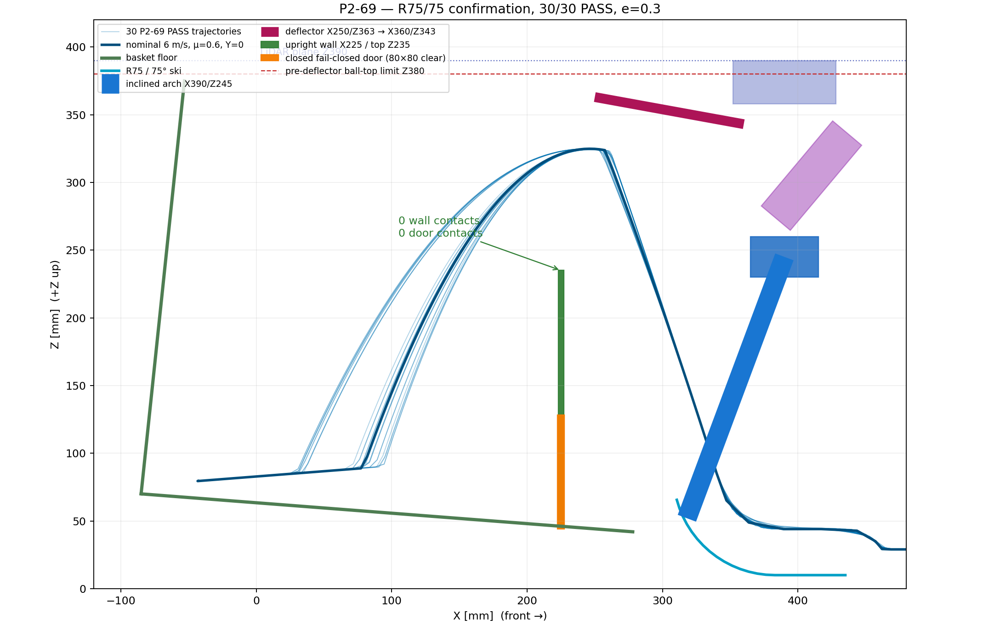

# P2-69 — επιβεβαίωση όρθιου τοιχώματος και κλειστής θύρας

> **ΙΣΤΟΡΙΚΟ — δεν περιγράφει το τρέχον design.** Διατηρείται ως evidence
> της απόφασης/δοκιμής της εποχής του. Δες
> [το τρέχον design](../current-design-el.md).

Ημερομηνία: 2026-10-17  
Κατάσταση: **PASS — 30/30, BASELINE ΕΠΙΒΕΒΑΙΩΜΕΝΟ**

## Απόφαση

Η εγκεκριμένη γεωμετρία P2-67/P2-68 πέρασε χωρίς αλλαγή:

- βατήρας R75/75°,
- γερμένη αψίδα με τραβέρσα X390/Z245 και πίσω ακμή X365,
- ταμπλό X250/Z363 → X360/Z343,
- όρθιο εμπρόσθιο τοίχωμα X225, πάχος 4 mm, top Z235,
- καθαρή θύρα 80×80 mm σε fail-closed, κλειστή θέση.

Το μοναδικό επιβεβαιωτικό run είχε 3 surface speeds × 2 μ × 5 Y και ένα
e=0,3, σύνολο **30 συνθήκες**. Αποτέλεσμα **30/30 PASS**. Δεν υπήρξε καμία
επαφή με τοίχωμα, κλειστή θύρα, αψίδα ή αισθητήρες. Δεν χρειάστηκε και δεν
έγινε αλλαγή γεωμετρίας.

## Αποτελέσματα

| Surface / μ | Y συνθήκες | Πραγματική γωνία | Ταχύτητα εξόδου | Μέγιστο ball-top | Μέγιστη τελική ταχύτητα | PASS |
|---:|---:|---:|---:|---:|---:|---:|
| 5 m/s / 0,6 | 0/±50/±100 | 65,58…68,21° | 3,572…3,665 m/s | 354,68 mm | 0,01210 m/s | 5/5 |
| 5 m/s / 0,9 | 0/±50/±100 | 68,37…70,17° | 3,850…4,075 m/s | 346,21 mm | 0,00514 m/s | 5/5 |
| 6 m/s / 0,6 | 0/±50/±100 | 64,38…67,79° | 4,204…4,218 m/s | 346,81 mm | 0,00377 m/s | 5/5 |
| 6 m/s / 0,9 | 0/±50/±100 | 68,72…69,82° | 4,256…4,462 m/s | 352,36 mm | 0,01343 m/s | 5/5 |
| 8 m/s / 0,6 | 0/±50/±100 | 64,79…68,74° | 5,530…5,607 m/s | 356,05 mm | 0,01835 m/s | 5/5 |
| 8 m/s / 0,9 | 0/±50/±100 | 56,00…60,00° | 5,560…5,592 m/s | 354,65 mm | 0,01578 m/s | 5/5 |

Συνολικά, η πραγματική γωνία ήταν 56,00…70,17° και η ταχύτητα εξόδου
3,572…5,607 m/s. Το μέγιστο ball-top πριν από το ταμπλό ήταν 356,05 mm,
με περιθώριο 23,95 mm από το όριο Z380. Η μέγιστη τελική μέση ταχύτητα ήταν
0,01835 m/s, πολύ κάτω από 0,25 m/s.

Όλες οι συνθήκες είχαν:

- επαφή με το ταμπλό και είσοδο στο καλάθι,
- παραμονή στο άδειο καλάθι,
- 0 επαφές με το εμπρόσθιο τοίχωμα,
- 0 επαφές με την κλειστή θύρα,
- 0 απαγορευμένες επαφές με αψίδα/αισθητήρες/σασί/actuator,
- finite state και τελική ταχύτητα εντός ορίου.

Το e=0,3 χρησιμοποιήθηκε μόνο ως το συμφωνημένο μοναδικό confirmation.
Η P2-67 έχει ήδη δείξει ότι το `restitution_coefficient` δεν αλλάζει το
DART αποτέλεσμα, άρα αυτό το run επιβεβαιώνει τη γεωμετρία και **όχι**
βαθμονομημένη συμμόρφωση EVA/διχτυού.

## Υποχρεωτική απαίτηση firmware και φυσικού ελέγχου

Με 45 μπάλες, η εκτιμώμενη κορυφή του σωρού σε φρενάρισμα είναι περίπου
Z236, δηλαδή 1 mm ψηλότερα από το τοίχωμα Z235. Συνεπώς το PASS μίας μπάλας
δεν επιτρέπει απότομο φρενάρισμα με γεμάτο καλάθι.

Το firmware πρέπει να επιβάλλει **μέγιστη επιβράδυνση περίπου 0,2 g** όταν
το καλάθι δηλώνεται ή εκτιμάται γεμάτο. Η τιμή είναι hard motion requirement,
όχι αποτέλεσμα αυτής της one-ball προσομοίωσης. Πρέπει να επαληθευτεί σε
φυσική μακέτα με 40 και 45 μπάλες, πραγματικό κέντρο βάρους, ελαστικά και
floor friction. Μέχρι τότε απαγορεύεται claim συγκράτησης γεμάτου σωρού.

## Αρχεία και όρια

Το aggregate βρίσκεται στο
`engineering/chassis-strength-bench/results/shared_flywheel_phase2/gazebo_p269/summary.json`.
Κάθε μία από τις 30 συνθήκες έχει `summary.json`, `telemetry.csv`,
`native_contacts.csv`, ball-contact log, ακριβές `model.sdf` και hashes.

Έγινε μία μπάλα και άδειο καλάθι. Δεν έγινε pile/feed/singulation simulation.
Δεν παράχθηκε STL και δεν έγινε commit, push ή PR. Κατάσταση:
`P2_69_R75_75_CLOSED_WALL_DOOR_30_OF_30_PASS`. **ΠΑΥΣΗ.**
