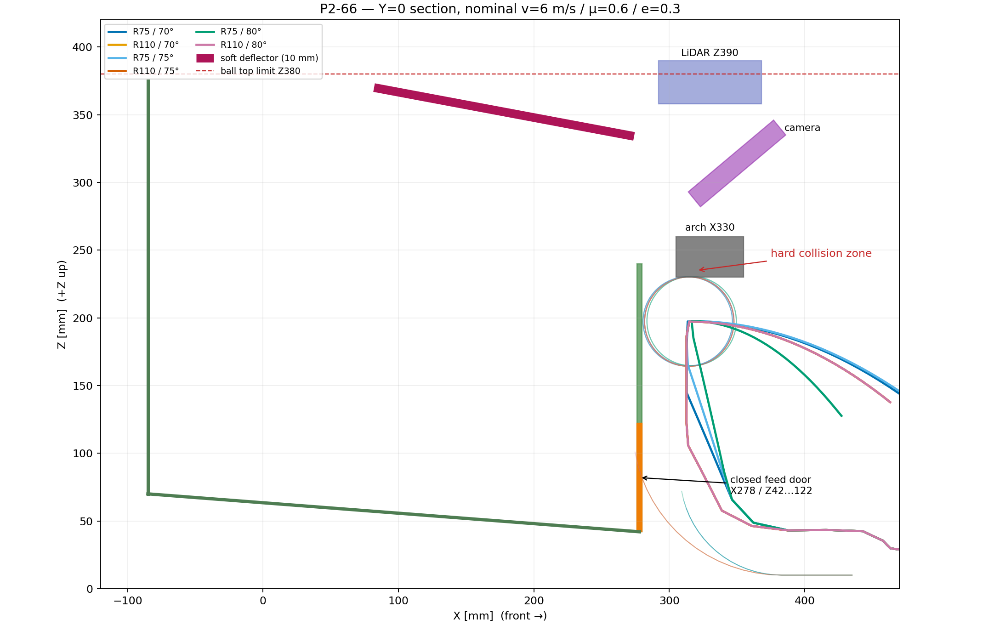

# P2-66 — βατήρας 70–80°, μαλακό ταμπλό και κλειστό μπροστινό καλάθι

> **ΙΣΤΟΡΙΚΟ — δεν περιγράφει το τρέχον design.** Διατηρείται ως evidence
> της απόφασης/δοκιμής της εποχής του. Δες
> [το τρέχον design](../current-design-el.md).

Ημερομηνία: 2026-10-16  
Κατάσταση: **NO-GO — 0/540 PASS, ΠΑΥΣΗ**

## Απόφαση

Με την αψίδα του πραγματικού `full-robot-v3.scad` παγωμένη, η μπάλα **δεν
μπορεί να περάσει αξιόπιστα με πραγματική γωνία εξόδου 60–70°**. Η τραβέρσα
της αψίδας στο X305…355/Z230…260 είναι το κυρίαρχο εμπόδιο: καταγράφηκε επαφή
σε 515/540 συνθήκες και καμία τροχιά δεν έφτασε στο ταμπλό.

Για μπάλα R33 και το υποχρεωτικό περιθώριο 10 mm, το κέντρο της μπάλας πρέπει
να είναι πίσω από X=262 mm πριν ανέβει πάνω από Z=187 mm. Στις 539 έγκυρες
απογειώσεις το κέντρο ήταν ακόμη στο X=312,5…317,6 mm όταν πέρασε αυτό το
ύψος. Επομένως λείπουν **50,5…55,6 mm οπισθοχώρησης**. Η αύξηση προς τις 70°
δεν το διορθώνει: κάνει την άνοδο πιο κατακόρυφη δίπλα στην αψίδα.

Άρα δεν υπάρχει προτεινόμενος συνδυασμός P2-66 μέσα στους παγωμένους
περιορισμούς. Για να ξανανοίξει η κατεύθυνση χρειάζεται είτε το σημείο
απογείωσης περίπου 55–60 mm πιο πίσω είτε αλλαγή/μετατόπιση της αψίδας. Ο
κλειστός υπερυψωμένος διάδρομος παραμένει απορριφθείς και δεν δοκιμάστηκε.

## Πλήρης μήτρα

Έτρεξαν 3 γεωμετρικές γωνίες × 2 ακτίνες × 3 surface speeds × 2 συντελεστές
τριβής πέλματος × 5 θέσεις Y × 3 συντελεστές ανάκτησης ταμπλό = **540**
συνθήκες. Χρησιμοποιήθηκε ένα μπαλάκι, άδειο καλάθι, collection −3°,
διορθωμένο contact model P2-61 και βήμα 0,25 ms. Δεν έγινε προσομοίωση σωρού.

| Γεωμετρική γωνία / R | Πραγματική γωνία εξόδου | Ταχύτητα εξόδου | Κρούση στο ταμπλό | Αποτέλεσμα |
|---|---:|---:|---|---|
| 70° / R75 | 51,25…65,63° (μ.ό. 60,29°) | 3,55…5,79 m/s | καμία, 0/90 | FAIL 0/90 |
| 75° / R75 | 57,54…70,30° (μ.ό. 66,66°) | 3,54…5,66 m/s | καμία, 0/90 | FAIL 0/90 |
| 80° / R75 | 62,50…75,06° (μ.ό. 71,47°) | 3,52…5,53 m/s | καμία, 0/90 | FAIL 0/90 |
| 70° / R110 | 32,76…52,75° (μ.ό. 43,70°) | 3,48…5,16 m/s | καμία, 0/90 | FAIL 0/90 |
| 75° / R110 | 32,76…52,75° (μ.ό. 43,70°) | 3,48…5,16 m/s | καμία, 0/90 | FAIL 0/90 |
| 80° / R110 | 32,76…52,75° (μ.ό. 43,70°) | 3,48…5,16 m/s | καμία, 0/90 | FAIL 0/90 |

Το R110 αποδεσμεύει τη μπάλα νωρίς και γι' αυτό οι τρεις ονομαστικές γωνίες
καταλήγουν στην ίδια πραγματική περιοχή. Το R75/75 καλύπτει καλύτερα τον
ζητούμενο πραγματικό τομέα 60–70°, αλλά έχει 84/90 απαγορευμένες επαφές και
90/90 επαφές με το κλειστό μπροστινό τοίχωμα. Το R75/80 δεν αγγίζει το
μπροστινό τοίχωμα, όμως χτυπά την αψίδα σε **90/90** συνθήκες. Αυτό αποδεικνύει
ότι η κλίση του τοιχώματος δεν λύνει το κύριο πρόβλημα.

Ο απλός βαλλιστικός οδηγός από X340/Z57 παραμένει σωστός ως έλεγχος ελεύθερης
τροχιάς: στα 4 m/s προβλέπει Z330 περίπου στο X229 για 70° και X287 για 80°.
Δεν περιλαμβάνει όμως την ενδιάμεση αψίδα. Η πλήρης γεωμετρία δείχνει ότι η
μπάλα προσκρούει σε αυτήν πριν φτάσει στην προβλεπόμενη ζώνη του ταμπλό. Οι
40–50° δεν επανεξετάστηκαν, σύμφωνα με την απόφαση ότι φτάνουν μόνο στο
μέσο/πίσω μέρος.

## Μπροστινό τοίχωμα και ερώτημα κλίσης

Με κατακόρυφο τοίχωμα και απαίτηση περιθωρίου 15 mm, το μέγιστο επιτρεπτό
ύψος από τις πραγματικές επαφές είναι:

- R75/70: 98,0…118,1 mm,
- R75/75: 120,3…142,8 mm,
- R110: 59,6…75,8 mm,
- R75/80: δεν υπήρξε επαφή τοιχώματος, αλλά απέτυχε 90/90 στην αψίδα.

Συνεπώς ο στόχος Z240 δεν είναι συμβατός με τις περισσότερες τροχιές. Μια
κλίση προς τα πίσω θα μπορούσε να αφαιρέσει **μόνο** την επαφή με τοίχωμα. Η
πρώτης τάξης γεωμετρική εκτίμηση είναι περίπου 25° για R75/75, περίπου 30° για
R75/70 και περίπου 55° για R110. Δεν έγινε ξεχωριστό sweep αυτών των κλίσεων,
επειδή ακόμη και το R75/80, που ήδη περνά το κατακόρυφο τοίχωμα, αποτυγχάνει
πάντα στην αψίδα. Οι τιμές δεν αποτελούν αποδεκτό design recommendation.

## Ταμπλό

Η υποψήφια compliant επιφάνεια μοντελοποιήθηκε από το μπροστινό σημείο
X274/Z334 έως το πίσω X82/Z370, μήκους περίπου 195 mm, πλάτους 340 mm και
πάχους 10 mm. Ανεβαίνει 10,6° προς τα πίσω, έχει top Z375 κάτω από το LiDAR
Z390 και βρίσκεται πίσω από το εμπρόσθιο FOV της κάμερας. Ελέγχθηκαν
restitution e=0,1/0,3/0,5, αλλά **καμία μπάλα δεν έφτασε σε αυτήν**, άρα το
sweep δεν μπορεί να επιλέξει υλικό ή e. Η ανάκτηση του πραγματικού EVA
αφρού/διχτυού πρέπει να μετρηθεί σε φυσική δοκιμή πριν από οποιαδήποτε
έγκριση.

## Κλειστή πύλη τροφοδοσίας

Το CAD/κινηματικό concept κρατά ολόκληρο το μπροστινό πάνελ X278,
Z42…240 κλειστό στη συλλογή και μεταφορά. Είναι fail-closed με άνω άρθρωση και
ελατήριο επαναφοράς. Με μηχανικό cam από την κλίση ανοίγει προς το εσωτερικό
του καλαθιού μόνο μεταξύ 0 και +15° και είναι πλήρως ανοικτό στις +15…+20°.
Εναλλακτικά το cam υποβοηθείται από servo PCA9685, αλλά παραμένουν υποχρεωτικά
τα interlocks P2-52/P2-59: όχημα ακίνητο, selector launch, επιβεβαιωμένη κλίση
14,5…20,5° και fail-closed σε απώλεια ισχύος/σήματος. Το paired-angle CAD
intersection της πύλης με το παγωμένο launcher sweep −10…+20° είναι κενό.
Δεν έγινε τροφοδοσία σωρού.

## Κριτήρια και αρχεία

Σύνολο αποτυχιών ανά hard check: ταμπλό 540, είσοδος καλαθιού 540, παραμονή
στο άδειο καλάθι 540, τοίχωμα 449, απαγορευμένη επαφή 515, τελική ταχύτητα
351 και takeoff 1. Το όριο ball-top ≤Z380 πριν από το ταμπλό και το finite
state πέρασαν σε όλες τις περιπτώσεις, αλλά δεν αντισταθμίζουν τις
γεωμετρικές αποτυχίες.

Κάθε μία από τις 540 αποτυχημένες συνθήκες έχει `summary.json`, πλήρη
`telemetry.csv`, `native_contacts.csv`, contact-model CSV και Gazebo log στον
κατάλογο `engineering/chassis-strength-bench/results/shared_flywheel_phase2/gazebo_p266/matrix`.
Επιπλέον υπάρχει πλήρες Gazebo state replay για τις έξι ονομαστικές
γεωμετρίες στα v=6 m/s, μ=0,6, Y=0 και e=0,3. Το συνολικό aggregate βρίσκεται
στο `gazebo_p266/summary.json`.

Δεν παράχθηκε STL, δεν έγινε commit, push ή PR. Το P2-66 παγώνει ως
`P2_66_NO_GO_FROZEN_ARCH_0_OF_540`.
