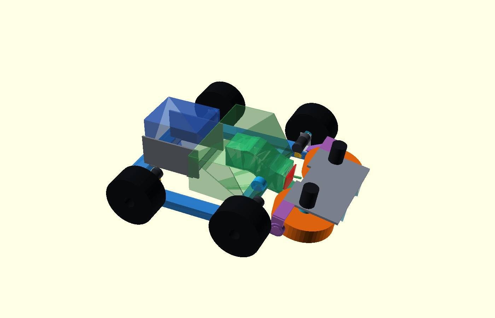
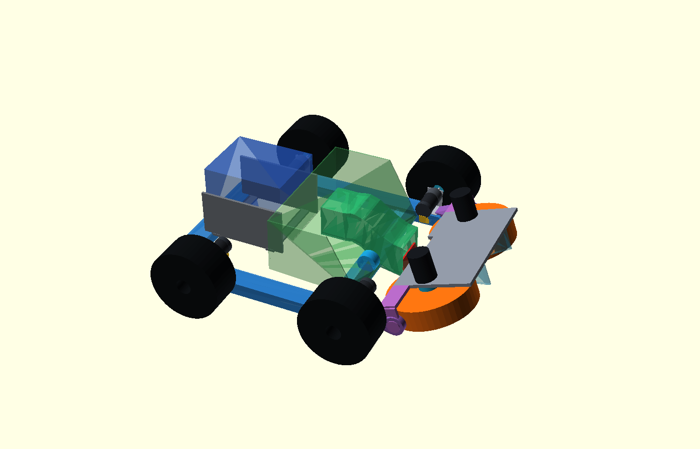
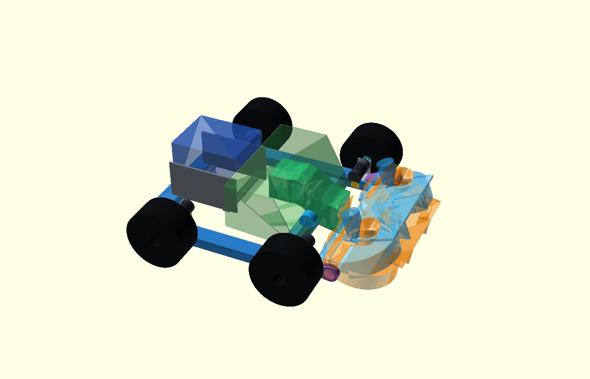
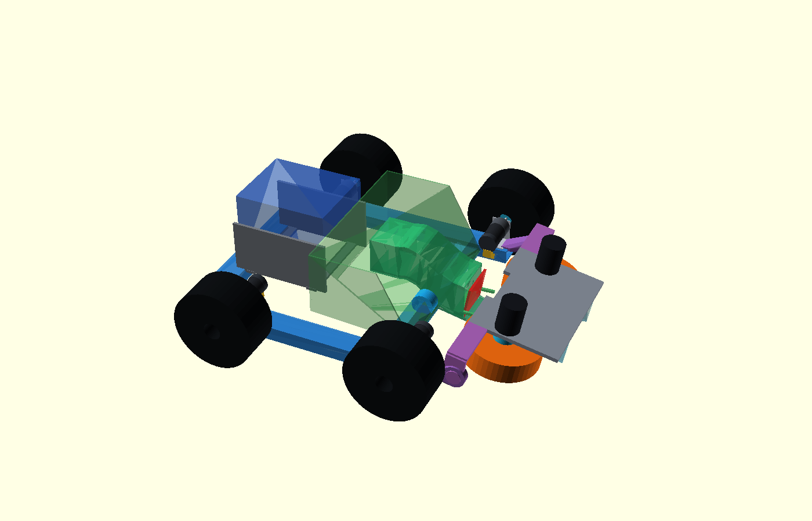

# Κοινό περιστρεφόμενο flywheel — αναθεωρημένη Φάση 1

> **ΙΣΤΟΡΙΚΟ — δεν περιγράφει το τρέχον design.** Διατηρείται ως evidence
> της απόφασης/δοκιμής της εποχής του. Δες
> [το τρέχον design](../current-design-el.md).

Ημερομηνία: 2026-10-11
Κατάσταση: **ΠΑΥΣΗ ΜΕΤΑ ΤΗ ΦΑΣΗ 1 — όχι xacro/Gazebo χωρίς νέα έγκριση**

> Ενημέρωση 2026-10-11: τα εγκεκριμένα σημεία 1–3 της Φάσης 2 ολοκληρώθηκαν
> και τεκμηριώνονται στο
> `shared-flywheel-intake-launcher-phase2-el.md`. Τα Phase-1 CAD/FEA
> συμπεράσματα για open-U stiffness και 8,5 mm bearing clearance
> αντικαθίστανται από P2-02…P2-08, αλλά διατηρούνται εδώ ως ιστορικό.

## Συμπέρασμα

Η νέα κύρια διάταξη είναι Ø200×50 mm, πλήρως μπροστά από κοντύτερες
διαμήκεις δοκούς, με άξονα άρθρωσης `[397,0,64,30] mm`. Διορθώνει τόσο τη
σύγκρουση της παλιάς πλάκας με τον τροχό όσο και το λανθασμένο αξονικό
connector envelope των FIT0403. Το CAD sweep είναι καθαρό, αλλά η Φάση 2 δεν
εγκρίνεται ακόμη: οι πραγματικές διαστάσεις έχουν αβεβαιότητα ±2–3 mm, τα
δυναμικά δεδομένα πρόσφυσης/πνευματικού τροχού λείπουν και ο συνδυασμός
D5065/FIT0403 μπορεί να ξεπεράσει το BMS 20 A.

Τα προηγούμενα συμπεράσματα για προεπιλογή Ø160, `6 mm` wheel–rail clearance,
hard collision με αξονικό connector και normal force `27,15 N`
**αντικαθίστανται** από P1-15…P1-20. Παραμένουν στο debug log ως ιστορικό.

## CAD και πραγματικές μετρήσεις

Οι τιμές με μεζούρα, με δηλωμένη αβεβαιότητα ±2–3 mm, είναι:

- ελαστικό κίνησης περίπου 83 mm, CAD nominal άξονας Y=297 mm μετά από
  spacer 5–8 mm, συνολικό πλάτος 677 mm και κενό tyre–rail 10,5 mm·
- FIT0403 από μεταλλική παρειά έως encoder 77–78 mm προς τα μέσα·
- radial cable exit κοντά στον encoder, δρομολόγηση προς τα κάτω, χωρίς τον
  παλιό υποθετικό αξονικό connector·
- εξωτερικό hex stack 47–49 mm πέρα από την κατακόρυφη πλάκα.

Η κύρια γεωμετρία έχει Ø200×50 mm, κέντρα Y=±129 mm και nip gap 58 mm. Οι
διαμήκεις δοκοί τελειώνουν στο X=330 mm. Το nip είναι X=441,32 mm στη
συλλογή και X=439,29 mm στην εκτόξευση. Η πίσω παρειά του τροχού μένει
τουλάχιστον 6,77 mm μπροστά από τη δοκό. Δεν περνά πλάκα, δοκός ή άξονας
μέσα από τροχό.

Οι στηρίξεις είναι μπροστά/ψηλότερα με trunnion `|Y|=237 mm`. Ο Ø200 φτάνει
στο `|Y|=229 mm`, άρα έχει 26,5 mm έως το drive tyre. Το nominal κενό
κινούμενου trunnion–tyre είναι 8,5 mm και περίπου 5,5 mm στη δυσμενή
αβεβαιότητα. Απαιτείται παχύμετρο. Λόγω της στρέψης με σηκωμένο τροχό, η
έδραση πρέπει να είναι self-aligning spherical ή ένα locating και ένα
floating bearing.

### Διαστάσεις και διάκενα

| Παραλλαγή / θέση | L×W×H (mm) | έδαφος (mm) | τροχός–άκρο δοκού X (mm) | drive clearance |
|---|---:|---:|---:|---:|
| Ø200 intake −10° | 709,14×677×222 | 14,50 | 8,49 | 8,625…8,75 mm |
| Ø200 launch +20° | 706,81×677×222 | 22,00 | 6,77 | 8,625…8,75 mm |
| Ø160 intake −10° | 688,92×677×222 | 20,93 | 28,71 | 8,00…8,25 mm |
| Ø160 launch +20° | 686,99×677×222 | 31,66 | 26,59 | 8,00…8,25 mm |

Το πλάτος είναι μικρότερο από το μήκος. Το clearance είναι bracket από
Minkowski expansion: μεγαλύτερη καθαρή δοκιμή έως πρώτη τομή, όχι ανοχή
κατασκευής. Τα `qa_sweep_frame`, `qa_sweep_drive`, `qa_sweep_basket`,
`qa_sweep_high_guide` και `qa_wheel_yoke` είναι κενά για Ø200/Ø160 στο
`−10…+20°` ανά 2° μαζί με endpoints.

Ο intake-only οδηγός μεγάλωσε 55 mm: ball-centre path
`[329,0,78] → [305,0,82] → [281,0,94] → [257,0,111] → [233,0,128] →
[209,0,136] → [187,0,132] → [163,0,132] → [132,0,132] mm`. Παραμένει πάνω
από X240 και κρατά ανοικτό το χαμηλό εμπρός μέρος. Η χωρητικότητα μένει
24–28 μπάλες ως packaging estimate. Το launch port έχει 10,78 mm
ball-centre clearance πάνω από το ιδανικό έδαφος· για χώμα απαιτείται
ανυψωμένο feed shoe και brush/labyrinth flap ή υψηλότερο dock.

Τα μάγουλα μένουν παραμετρικά: narrow `±72→±46 mm`, wide `±110→±46 mm`.

## Ø200 έναντι Ø160

| Κριτήριο | Ø200 κύριο | Ø160 σύγκριση |
|---|---:|---:|
| rpm για 30 m/s | 2865 | 3581 |
| ποσοστό no-load 3456 rpm | 82,9% | 103,6% |
| surface speed στα 3456 rpm | 36,19 m/s | 28,95 m/s |
| απώλεια στο ίδιο rpm | — | 20% / 7,24 m/s |
| ελάχιστο ground clearance | 14,50 mm | 20,93 mm |
| ελάχιστο πίσω X clearance | 6,77 mm | 26,59 mm |

Το Ø160 δεν φτάνει την περιφερειακή αναφορά 30 m/s ούτε στο θεωρητικό
no-load. Το Ø200 έχει μικρότερο γεωμετρικό περιθώριο αλλά είναι καθαρό επειδή
όλη η μονάδα βρίσκεται μπροστά από τις δοκούς.

## Διορθωμένη συμπίεση και πρόσφυση

Χρησιμοποιείται η συνολική διαμετρική παραμόρφωση:
`8 mm = δ_ball + 2·δ_tread`, `F=107309·δ_ball^1,5` και
`F=k_tread·δ_tread` ανά πέλμα.

| Περίπτωση | k/πέλμα | δ_ball | δ_tread/πλευρά | Fn/τροχό |
|---|---:|---:|---:|---:|
| άκαμπτο | ∞ | 8,000 mm | 0 | 76,78 N |
| TPU low order | 250 N/mm | 7,448 mm | 0,276 mm | 68,98 N |
| TPU nominal order | 1000 N/mm | 7,851 mm | 0,075 mm | 74,64 N |
| TPU high order | 5000 N/mm | 7,969 mm | 0,015 mm | 76,34 N |
| foam reference, όχι candidate | 3 N/mm | 1,931 mm | 3,035 mm | 9,10 N |
| pneumatic very soft | 10 N/mm | 3,519 mm | 2,240 mm | 22,40 N |
| pneumatic medium | 30 N/mm | 5,266 mm | 1,367 mm | 41,01 N |
| pneumatic firm | 100 N/mm | 6,797 mm | 0,601 mm | 60,14 N |

Τα TPU 250…5000 N/mm είναι μόνο τάξη `k=E·A/t`. Η τιμή 3 N/mm κρατείται
μόνο για να αναπαράγει το foam-like reference (9,10 N), όχι ως candidate
TPU 95A. Για κάθε περίπτωση έγιναν μ=0,3/0,6/0,9 και
Ø200/Ø160. Τα πλήρη Ft/ideal-energy screens είναι στο `report.json` και δεν
προβλέπουν έξοδο. Το root-cause 30 m/s → 8,25 m/s με μ=0,9 τεκμηριώνει
traction saturation. Ο λόγος 0,275 **δεν χρησιμοποιείται ως πρόβλεψη**.

## Μάζα, CG και φορτία

- printed Ø200 PETG/TPU/Al: 0,838 kg/τροχό, inertia estimate 0,00469 kg·m²,
  bounds 0,00419…0,00838 kg·m²·
- pneumatic Ø200: seller value 0,900 kg + assumed hub 0,0268 kg, χωρίς
  μέτρηση, tyre inertia bounds 0,0045…0,0090 kg·m².
- module: 4,527 kg printed ή 4,706 kg pneumatic.

| Περίπτωση | μάζα | CG [X,Y,Z] mm | πίσω/τροχό | εμπρός/τροχό |
|---|---:|---:|---:|---:|
| printed άδειο | 21,617 kg | [132,9,0,103,1] | 48,52 N | 57,47 N |
| printed 28 μπάλες | 23,233 kg | [135,1,0,104,6] | 51,45 N | 62,47 N |
| pneumatic άδειο | 21,796 kg | [135,3,0,103,1] | 48,22 N | 58,65 N |
| pneumatic 28 μπάλες | 23,411 kg | [137,4,0,104,6] | 51,15 N | 63,64 N |

Οι τιμές αλλάζουν όταν ζυγιστούν βάση, τροχοί, καλάθι και module CG.

## Global FEA και τοπικός έλεγχος

Το ideal-beam model στηρίζεται στα drive mounts X=−65/300 mm με ελάχιστους
περιορισμούς, ελεύθερες στροφές και αφαίρεση μόνο του εμπρός δεξιού U3 στο
wheel-lift. Περιλαμβάνει δοκούς έως X330 και bearings `[397,±237,64,3] mm`.

| Load case, X240 retained | PLA / PETG / PETG-CF απόκριση | peak stress |
|---|---:|---:|
| vertical 2g | 0,609 / 0,925 / 0,778 mm | ~1,50 MPa |
| launch reaction | 1,793 / 2,741 / 2,291 mm | 5,53…5,69 MPa |
| one-wheel lift | 7,756 / 11,981 / 9,910 mm | ~1,62 MPa |
| racking, relative bearing-X | 1,936 / 2,959 / 2,473 mm | ~1,82 MPa |

Χωρίς X240: racking 15,88/24,32/20,29 mm, launch
29,78/45,61/38,06 mm και wheel-lift 29,59/45,65/37,80 mm. Η X240 μειώνει
περίπου 88%, 94% και 74% αντίστοιχα και είναι υποχρεωτική. Η αλλαγή mesh
10→5 mm είναι έως 1,34%. Τα παλιά cantilever 12,9…19,8 mm παραμένουν
αντικατεστημένα.

Ο χωριστός local screen για Al arm 70×45×12 mm και resultant 83,10 N δίνει
5,39 MPa και 0,021 mm. Δεν καλύπτει bearing fit/rating, οπές, bolts,
trunnion shoulder, fatigue ή interfaces και δεν είναι release.

## Κριτήρια αγοράς D5065/controller

- No-load 3456 rpm. Ø200: 2865 rpm για 30 m/s. Με
  `rpm=Kv(V−IR)`, R=0,039 Ω και 20 A, το υπάρχον μοντέλο δίνει 11,39 V.
- Spin-up στα 8 A/motor: printed 5,07…10,13 s, pneumatic 5,44…10,89 s.
  Gate ≤12 s με ακίνητη βάση και χωρίς BMS trip.
- Gate μπάλας: droop ≤5%, recovery ≤1 s.
- Intake 1,5…1,9 m/s: Ø200 143…181 rpm, Ø160 179…227 rpm. Gate σταθερό
  closed loop με ≤10 A/motor (0,31 N·m), χωρίς stall/rebound.
- Τέσσερα FIT0403 δίνουν stall sum ~28 A και δύο D5065 provisional 40 A.
  Αποδοχή μόνο με measured total peak ≤20 A και continuous ≤16 A ή νέο
  battery/BMS. Launch spin-up και drive stall πρέπει να αλληλοαποκλείονται.
- Ενέργεια δύο τροχών στα 2865 rpm: printed 377…754 J, pneumatic 405…810 J.
  Stop 5 s απαιτεί 75…151 W ή 81…162 W. Απαιτείται ασφαλές coast ή
  validated regen/dump/brake path· αντιστροφή μόνο κάτω από 50 rpm.
- Ένας encoder ανά D5065, CUI AMT-102 class ή ισοδύναμος στη δεύτερη άκρη.
  Απαιτούνται δύο independent current/speed loops, telemetry, current limit,
  safe disable και bus over-voltage handling.

Δεν επιλέγεται controller και δεν απελευθερώνεται αγορά πριν τα bench gates.

## Main xacro — εύρημα χωρίς αλλαγή

Το κύριο xacro έχει `wheel_y=0.35 m`, άρα γεωμετρική απόσταση 0,70 m, ενώ η
πραγματική μέτρηση δείχνει περίπου 0,58…0,59 m. Καταγράφεται μόνο· δεν
τροποποιήθηκε xacro, controller config ή Gazebo.

## Ανοικτά gates

1. Παχύμετρο για tyre/track, FIT0403 stack, hubs και cable bend radius.
2. Οριστικό bearing arrangement, bolts, latch και detailed local FEA.
3. Ζύγιση/inertia του Ø200 και pneumatic stiffness/pressure.
4. Δυναμική πρόσφυση, spin-up, droop/recovery, intake torque και braking.
5. Συνολικό current profile έναντι BMS και μετά επιλογή controller.
6. Rebound/jam/full-basket test, cheek επιλογή και clay protection.

Η εργασία σταματά εδώ. Δεν εκτελέστηκε ή τροποποιήθηκε xacro/Gazebo και δεν
έγινε commit, push ή PR.
