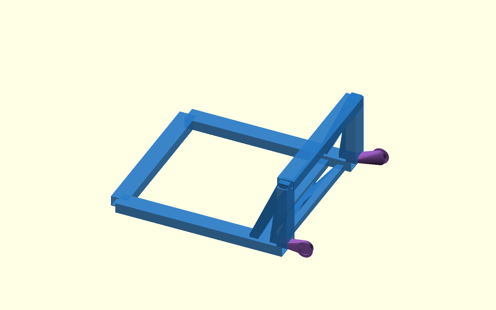
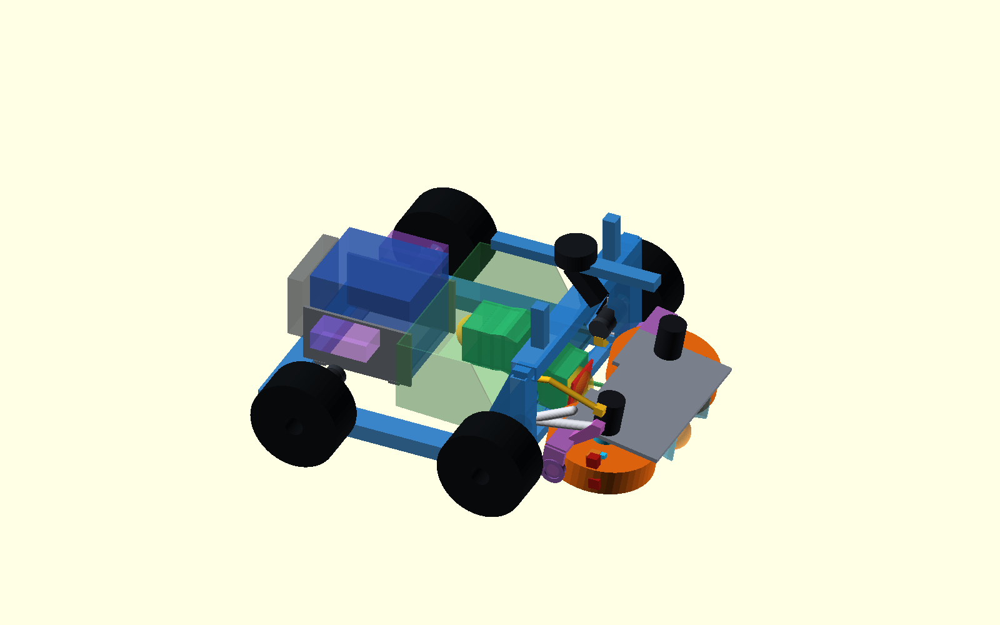
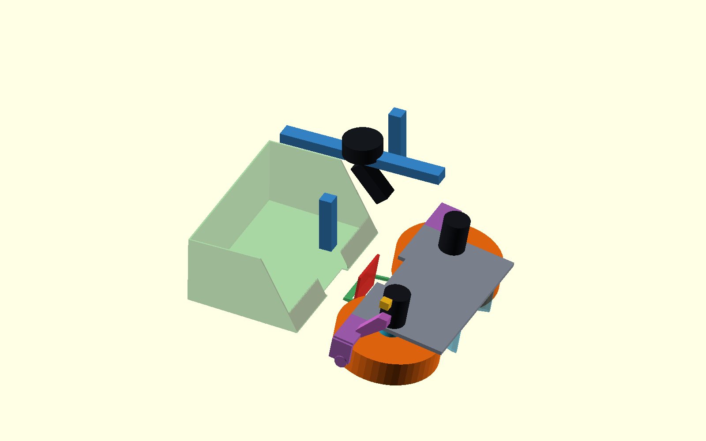

# Κοινό περιστρεφόμενο flywheel — Φάση 2, CAD/FEA πριν από xacro

> **Τρέχουσα παύση (2026-10-13):** το P2-49 αντικατέστησε τη λειτουργική
> διάταξη P2-48. Η ράμπα συλλογής βρίσκεται σε κεντρική εσοχή έξω από το
> storage και το launch-feed channel περνά ανεξάρτητα από κάτω. High sill
> Z285 αφήνει 23,9 mm πάνω από τον worst 40-ball pile. Clean net volume
> 24,674 L μετά από όλες τις δηλωμένες αφαιρέσεις. Κοινό rear mouth
> εξυπηρετείται από interlocked selector· ο μηχανισμός του μένει στη 5d.
> Χωρίς STL/Gazebo. ΠΑΥΣΗ.
>
> **Προηγούμενη παύση (2026-10-12):** ολοκληρώθηκε η διαγνωστική επανάληψη
> των στροφών 5a με 0,650 kg τροχούς και χωριστό gyro-yaw variant. Το
> open-yaw δεν γίνεται αποδεκτό και, παρότι το gyro μειώνει το yaw error σε
> 3,4–14,1%, η μετάθεση κέντρου 0,464–0,566 m στο DART κρατά το φυσικό
> συμπέρασμα ανοικτό. Βλ. `shared-flywheel-phase2-turn-diagnostic-el.md`.
> Παραμένει ΠΑΥΣΗ πριν από 5b–5d.

> **Διόρθωση γεωμετρίας/ICR:** αφαιρέθηκε από το isolated bench η legacy
> lower cradle plate, διορθώθηκε ο tilt axis σε `−Y` και επαναλήφθηκαν οι
> στροφές. Με τη νέα μέτρηση `h=29 mm`, το reference case `R=85 mm` δίνει
> non-wheel clearance 26 mm raw / 21 mm με allowance 5 mm. Στο sweep
> `R=82…90 mm`, `h=26…33 mm`, όλα τα non-wheel cases περνούν με 14…29 mm
> μετά το allowance. Το R υπό φορτίο παραμένει μη μετρημένο.
> Ο πρόσθετος static intake gate P2-37 περνά σε 0/9 σημεία του grid:
> το κέντρο μπάλας Z=33 mm απέχει −10,87…+4,13 mm από την κάτω ακμή της
> 50 mm contact band, αντί για ≥8 mm. Pure-Z και pure-angle διορθώσεις
> δημιουργούν ανεπαρκές clearance/ground strike. Δεσμεύεται συνδυασμένη
> ρύθμιση έως 23 mm προς τα κάτω και adjustable lower stop, χωρίς release
> πριν τη μέτρηση loaded R και tyre profile.
> Το P2-38 χώρισε το edge rounding 2/3 mm από το απαιτούμενο usable margin
> 8 mm. Το καλύτερο intake candidate είναι printed flat 60 mm/r2 στα −3,44°,
> αλλά βρίσκεται έξω από το αποδεκτό −10…−4,5° και στη θέση +20° αφήνει
> μόνο 3,64 mm μετά allowance. Δεν υπάρχει full-arc λύση με σταθερό pivot
> και Ø200· το CAD ρύθμισης παραμένει εξαρτώμενο, χωρίς STL release.
> Το P2-39 **αντικαθιστά αυτό το τελευταίο συμπέρασμα** με τον νέο κανόνα
> λειτουργίας: allowance 5 mm μόνο όταν κινείται το ρομπότ και static όριο
> 8 mm στην εκτόξευση με το ρομπότ ακίνητο. Με άρθρωση 55 mm πίσω από το
> nip, συλλογή −3°, μεταφορά 0° και εκτόξευση +15…+20° προκύπτουν αντίστοιχα
> 12,77 mm, 20,84 mm και 15,21…12,26 mm διαθέσιμης απόστασης. Το nominal
> CAD sweep είναι κενό, αλλά η έκδοση STL εξακολουθεί να περιμένει τη
> μέτρηση loaded R και τον φυσικό έλεγχο ανοχών.
> Στο P2-40 το ball-edge grid γράφτηκε ρητά: και τα 9 R/h cases δίνουν
> ακριβώς 8,000 mm με την αντίστοιχη κάθοδο. Οι side legs της αψίδας έγιναν
> dogleg στο X318, κρατώντας crossbar/LiDAR στο X330· μετά από budget 3 mm
> μένει clearance lower bound 11 mm. Το isolated xacro ενημερώθηκε και
> πέρασε validation στο Jazzy container για empty/full45/ballast. Παραμένει
> ΠΑΥΣΗ πριν από Gazebo 5b.
> Το P2-41 preflight σταμάτησε το 5b πριν από εκτέλεση: λείπουν από το
> isolated URDF η αψίδα/LiDAR collision representation και το moving terminal
> bracket/P16 linkage, δεν υπάρχει 5b runner/contact telemetry/criteria και το
> ballast case αφαιρεί τη μονάδα. Το P2-40 static PASS δεν αλλάζει.
> Το gyro ICR world spread είναι 0,050–0,090 m, ενώ το παλιό 0,46–0,57 m
> ήταν κυρίως κυκλική κίνηση του `base_link` origin. Βλ.
> `shared-flywheel-phase2-clearance-icr-review-el.md`.

Ημερομηνία: 2026-10-11  
Κατάσταση: **ΠΑΥΣΗ ΜΕΤΑ ΤΑ ΣΗΜΕΙΑ 1–3 — όχι xacro/Gazebo χωρίς έγκριση**

> **ΑΝΤΙΚΑΤΑΣΤΑΘΗΚΕ ΜΕΡΙΚΩΣ (2026-10-11):** οι τιμές FEA, η
> γραμμικοποίηση του sleeve play, ο ενεργός πείρος, το LiDAR Z=498 mm και το
> battery/electronics packaging παρακάτω διατηρούνται μόνο ως ιστορικό.
> Η διορθωμένη απόφαση και το εκτυπώσιμο v3 βρίσκονται στην
> [αναφορά διορθώσεων/print release](shared-flywheel-intake-launcher-phase2-v3-print-release-el.md).
> Ειδικά: το sleeve play είναι γεωμετρική νεκρή ζώνη και όχι spring, το open-U
> vertical 2g είναι 0,925 mm (όχι 2,092), baseline lock είναι P16 preload σε
> stop χωρίς ενεργό pin, το προτεινόμενο scan plane είναι Z=390 mm και το
> βασικό power layout είναι πλέον Parkside pair + ξεχωριστό Ugreen· η Redodo
> κρατείται μόνο ως παραμετρική σύγκριση.  Νεότερη συνέχεια P2-18…P2-20:
> το Gamma ballast αντικαταστάθηκε από πλάκα στα final terminals/X300, το
> καλάθι έγινε παραμετρικά περίπου 45 μπαλών και δημιουργήθηκε ξεχωριστό
> isolated xacro **χωρίς να εκτελεστεί**.  Ισχύουν οι αριθμοί και το execution
> stop της v3 αναφοράς.

## Απόφαση

Η προτεινόμενη διάταξη είναι ο **συνδυασμός** εμπρός αψίδας στο X330,
πλευρικού τριγωνισμού προς X240/X300 και χαμηλού διατμητικού πλαισίου
X240…X300. Η αψίδα φέρει τον actuator και τους αισθητήρες, όχι τους
τροχούς: οι εδράσεις μένουν στους κοντούς τοπικούς φορείς ώστε κανένα σταθερό
μέλος να μην περνά από το τόξο των Ø200.

Η τοπική απόκριση bearing ως προς το αντίστοιχο εμπρός drive mount είναι
0,770 mm με ιδανικές ενώσεις και 0,922 mm με τη γραμμικοποιημένη ευκαμψία
μανικιού, άρα περνά τον τοπικό στόχο 1 mm. Η απόλυτη μετατόπιση ως προς το
έδαφος είναι όμως 1,803/1,897 mm. Δεν δηλώνεται συνολική συμμόρφωση ≤1 mm:
το ελάχιστα δεσμευμένο μοντέλο αντιδρά όλο το διαμήκες φορτίο σε ένα σημείο
ελαστικού και περιλαμβάνει τη μετατόπιση της βάσης. Χρειάζεται βαθμονόμηση
διαμήκους δυσκαμψίας ελαστικού–εδάφους ή φυσική μέτρηση πριν κλείσει αυτό το
gate. Η μεταφορά της μονάδας εμπρός **δεν** χρησιμοποιείται ως λύση ακαμψίας.

## FEA δομής

Το CalculiX B32R screen χρησιμοποιεί PETG `E=1,5 GPa`, τις διορθωμένες
στηρίξεις στους άξονες X=−65/300 και mesh 10/5 mm. Η μέγιστη αλλαγή 10→5 mm
είναι 1,178%. Οι τιμές παρακάτω είναι συγκριτικές, όχι allowables τυπωμένου
υλικού.

- Open U, bonded: launch absolute/local 2,752/0,587 mm, vertical 2g
  2,092 mm, wheel-lift 12,608 mm, racking relative-X 3,295 mm.
- Αψίδα μόνο, bonded: 2,871/0,876 mm, 2,068 mm, 8,112 mm και 3,035 mm.
- Τριγωνισμός μόνο: ουσιαστικά ίδιος με open U, επειδή χωρίς κλειστό
  εγκάρσιο load path δεν αντιδρά τη στρέψη.
- Συνδυασμός, bonded: 1,803/0,770 mm, 2,055 mm, 6,946 mm και 2,286 mm.
- Συνδυασμός με sleeve sensitivity: 1,897/0,922 mm, 2,788 mm, 8,201 mm και
  2,511 mm.

Για διάκενο μανικιού 0,30 mm/πλευρά και εμπλοκή 60 mm, η γωνιακή νεκρή ζώνη
είναι 0,573°. Στο launch moment 3,110 N·m ανά πλευρά αντιστοιχεί secant
δυσκαμψία 311 N·m/rad και ισοδύναμο `E≈288 MPa` για 50×30×3,2 mm. Αυτό είναι
γραμμικοποίηση επαφής/τζόγου, όχι nonlinear contact model.

Τοπικός έλεγχος bearing/arm/trunnion παραμένει χωριστό ανοικτό gate. Το
παλιό αποτέλεσμα 0,021 mm του ιδανικού Al βραχίονα δεν καλύπτει fit, shoulder,
βίδες, κόπωση ή printed interfaces.

## Έδραση και λάστιχο κίνησης

Το κέντρο yoke μετακινήθηκε από |Y|=237 σε 234 mm. Το κινούμενο trunnion
έγινε Ø24×12 mm και το σταθερό housing Ø40×12 mm με bore 24,5 mm. Η εξωτερική
παρειά είναι |Y|=240 mm έναντι μετρημένης ονομαστικής εσωτερικής παρειάς
drive tyre |Y|=255,5 mm: **15,5 mm nominal**.

Με αβεβαιότητα μεζούρας ±2…3 mm το περιθώριο δεν είναι release. Προστέθηκε
αντικαταστάσιμος σταθερός δακτύλιος-προστατευτικό στην πλευρά του ελαστικού.
Απαιτούνται παχύμετρο, runout υπό φορτίο και έλεγχος guard wear πριν εκτύπωση.

## Actuator και μηχανικό κλείδωμα

Επιλέγεται ως CAD baseline ο **Actuonix P16-50-256-12-S**, όχι ακόμη ως
εντολή αγοράς. Με pins `[320,-190,120] mm` και local `[50,-190,90] mm`, η
απόσταση είναι 143,9 mm στη −10° και 103,9 mm στη +20°: stroke 40,0 mm μέσα
στο 50 mm. Ο μοχλοβραχίονας είναι 67,9…84,0 mm. Στα 150 N peak-efficiency
δίνει 10,2…12,6 N·m, πάνω από 5,3 N·m, και η μετάβαση είναι περίπου 8,3 s στα
4,8 mm/s. Είναι 12 V, 95 g, 97 mm closed hole-to-hole, έχει internal limits
και 500 N backdrive rating. Τιμή αναφοράς 2026-10-11: USD 80.

Οι άλλες δύο επιλογές παραμένουν τεκμηριωμένες:

- Makermotor PN01007-100: 13,5 V rated, 100 rpm, 6 A, 3 N·m και USD 75.
  Με 2:1 sector δίνει 6 N·m και 50 rpm, αλλά χρειάζεται encoder/limits,
  ελεγχόμενη επιτάχυνση και ξεχωριστό κλείδωμα. Το επίσημο drawing δίνει
  συνολικό μήκος περίπου 178 mm και χαρακτηριστικές διαστάσεις έως
  107,3×68 mm· η μάζα δεν δηλώνεται και είναι purchase gate. Το worm έχει
  μόνο τάση αυτοσυγκράτησης, όχι safety brake.
- ROBOTIS XH540-W270-R: 12 V, 33,5×58,5×45 mm, 165 g, 39 rpm, 9,9 N·m stall
  αλλά εκτιμώμενο continuous μόνο 1,98 N·m, 4,9 A stall και USD 632,39.
  Απορρίπτεται χωρίς επιπλέον reduction/lock: δεν καλύπτει continuous 5,3
  N·m και δεν αυτοσυγκρατείται μηχανικά.

Πηγές κατασκευαστών (προσπέλαση 2026-10-11):
[Actuonix P16](https://www.actuonix.com/p16-50-256-12-s),
[Makermotor PN01007-100](https://makermotor.com/pn01007-100-10mm-2-flat-shaft-electric-gear-motor-12v-low-speed-100-rpm-gearmotor-dc/),
[Makermotor drawing](https://makermotor.com/content/PN01007-PN01107-DIMS.pdf) και
[ROBOTIS XH540-W270-R](https://robotis.us/products/dynamixel-xh540-w270-r).

Η τελική διάταξη έχει spring pin Ø8 σε −10° και +20°, ανεξάρτητο Hall/limit
σε κάθε θέση και hard stops στις −12°/+22°. Στη +20° η αντίδραση εκτόξευσης
περνά από pin και stop στη δομή, όχι από τον κοχλία. Η ακολουθία είναι:
αποφόρτιση → pin release confirmation → κίνηση → sensor confirmation → pin
engaged confirmation. Το internal actuator limit δεν υποκαθιστά τους
εξωτερικούς αισθητήρες.

## Καλώδια και collision QA

Ορίστηκε service loop από moving point local `[40,-170,112]` μέσω
`[365,-185,215]` σε fixed `[300,-185,205] mm`. Είναι μόνο reserved 12 mm
envelope για δύο D5065 και actuator· bend radius, strain relief, abrasion και
connector sizes μένουν προς μέτρηση. Το sweep −10…+20° ανά 2° είναι κενό για
frame, drive hardware, basket/battery, high guide, arch, actuator έναντι
fixed packages και LiDAR scan plane. Η αρχική αψίδα με hangers πάνω από τους
τροχούς απορρίφθηκε από το QA και δεν αποτελεί το τελικό σχέδιο.

## LiDAR, κάμερα και packaging

Το LiDAR βρίσκεται στο X330, με επίπεδο σάρωσης Z=498 mm όπως στο datum του
commit `f9224f2`. Οι δομικές τραβέρσες τελειώνουν στο Z≈260 mm και οι
ελαφριές βάσεις αισθητήρα στο Z472 mm, άρα basket/flywheel/αψίδα δεν τέμνουν
το επίπεδο σε καμία θέση.

Η κάμερα έχει packaging center `[350,0,305] mm`, pitch 50° προς το έδαφος
και κεντρική θέα προς X≈490…545 mm, δηλαδή μπροστά από το στόμιο συλλογής.
Το horizontal FOV 1,204 rad (~69°) προέρχεται από το repo. Το vertical FOV
54° είναι προσωρινό packaging assumption και πρέπει να αντικατασταθεί από
το ακριβές OAK-D lens/ROI πριν release. Δεν έγινε optical/Gazebo validation.

Η μπαταρία παραμένει παραμετρική: 5,59 kg, 198×166×170 mm, όρθια. Το 12,8 V
50 Ah είναι πιθανή τιμή, όχι επιβεβαιωμένο δεδομένο· capacity και BMS limits
εκκρεμούν και **δεν** θεωρείται όριο 20 A. Διατηρούνται envelopes για δύο
D5065 controllers στα πλάγια της μπαταρίας και rear electronics bay, χωρίς
επιλογή ηλεκτρονικών ή σχεδίαση καλωδίωσης. Το καλάθι παραμένει packaging
estimate 24–28 μπάλες· 28 μπάλες χρησιμοποιούνται μόνο για mass/CG case.

## Τυπωμένα κομμάτια και interfaces πριν την εκτύπωση

1. Δύο διαμήκεις δοκοί με sleeves 60 mm και interfaces drive mounts.
2. Πίσω τραβέρσα, X240 τραβέρσα και χαμηλό X240…X300 crossed torsion deck.
3. Δύο ορθοστάτες X330, άνω τραβέρσα και τέσσερις πλευρικές αντηρίδες.
4. Δύο compact bearing carriers, locating/floating housings και δύο
   αναλώσιμα tyre guards.
5. Moving upper plate, δύο yokes, δύο trunnions και motor/hub interfaces.
6. Actuator fixed clevis, moving lever, sector plate, δύο pin blocks, δύο
   hard-stop blocks και δύο sensor brackets.
7. Intake cheeks narrow/wide, throat, high guide, dock/singulator interface
   και basket panels με service opening.
8. Battery cradle/retainers, δύο controller shelves και rear electronics
   shelf ως κενά interfaces, όχι ηλεκτρολογική υλοποίηση.
9. LiDAR mast/crossbar, camera bracket και strain-relief/service-loop clips.

Κάθε interface χρειάζεται οριστικά inserts/bolts, print orientation,
fillets, layer-direction check και tolerance coupons. Δεν είναι STL release.

## Αρχεία και επόμενο gate

- CAD: `cad/modular-test-chassis/shared-flywheel-intake-launcher-phase1.scad`
  (πλέον δηλώνει Phase-2 pre-xacro study).
- FEA runner: `engineering/chassis-strength-bench/run_shared_flywheel_phase2.py`.
- Πλήρες JSON: `engineering/chassis-strength-bench/results/shared_flywheel_phase2/report.json`.

Η παραπάνω πρόταση ήταν το αρχικό stop μετά τα σημεία 1–3 και διατηρείται ως
ιστορικό.  Μετά τη μεταγενέστερη έγκριση δημιουργήθηκε μόνο το ξεχωριστό
isolated xacro της v3 αναφοράς.  Δεν εκτελέστηκε xacro/ROS/Gazebo και ισχύει
νέα παύση πριν από κάθε εκτέλεση.  Δεν έγινε commit, push ή PR.

## Προσθήκη P2-42 — αποτέλεσμα Gazebo 5b

Η μεταγενέστερη ρητή έγκριση αντικαθιστά μόνο την τελευταία ιστορική πρόταση
περί μη εκτέλεσης. Το ελαφρύ 5b harness εκτελέστηκε για `empty`, `full45`
και `ballast`, με PASS και στις τρεις περιπτώσεις. Τα δύο πρώτα είναι
dynamic tilt cases· το ballast παραμένει αποκλειστικά spawn/stability-only.
Δεν παρατηρήθηκε καμία επαφή launcher με αψίδα X318/dogleg X330,
crossmember, LiDAR, chassis ή ground. Το μέγιστο post-dwell error ήταν
0,221786°. Η αρχική τιμή `base rise 2,503912 mm` αντικαταστάθηκε: ήταν η
spawn-to-settled διόρθωση από Z=1 σε ≈4 mm, όχι μεταγενέστερη ανύψωση. Με
settled datum 3,5…4,0 s, το πραγματικό post-settle rise ήταν 0,00016 mm.

Ο P16 παραμένει αφηρημένος 12,6 N·m actuator και δεν προκύπτει claim για
force/current/linkage. Η φυσική κρούση terminal επίσης δεν ελέγχθηκε. Το
CAD δεν άλλαξε, δεν έγινε STL release και το P2-40 παραμένει έγκυρο. Πλήρη
στοιχεία, hashes και εντολές υπάρχουν στο debug log P2-42 και στο
`engineering/chassis-strength-bench/results/shared_flywheel_phase2/gazebo_5b/summary.json`.
Ισχύει νέα ΠΑΥΣΗ πριν από 5c/5d.

## Προσθήκη P2-44 — open ramp και περιορισμένο Gazebo subset

Με μεταγενέστερη έγκριση άλλαξαν μόνο τα εξαρτώμενα guide/cheeks. Η νέα
ανοικτή ράμπα είναι chassis-fixed, εφάπτεται στη βάση της μπάλας με tip top
Μετά το P2-45, το reference ξεκινά με top Z=10 mm/underside=8 mm και
ανεβαίνει ομαλά ως το basket floor Z=54 mm. Η παλιά τιμή underside≈1 mm
αντικαθίσταται από το επιλεγμένο, δοκιμασμένο 8 mm.
Χαμηλά rails αρχίζουν μετά τους τροχούς και ένα μικρό flap περιορίζει την
αναπήδηση. Η παγωμένη μονάδα δεν τέμνει τη ράμπα σε −3…+20°, ενώ τα μάγουλα
τερματίζουν 5 mm μπροστά από το Ø200 envelope και δεν κρύβουν πλέον το
front-inner wheel quadrant. Το σημείο X=276…286/Z=52 mm είναι σκόπιμη
στήριξη της ράμπας πάνω στο low deck.

Το τελικό, διορθωμένο 75-run campaign (`gazebo_5c_p244_r2`) έδωσε 9/15
conditions PASS και 0 forbidden contacts. Όλες οι μπάλες πέρασαν το nip και
έφτασαν το κεντρικό basket entrance. Όλες οι συνθήκες y=0/±50 mm πέρασαν
5/5 για short, shallow και shallow-low-friction cheeks. Όλες οι y=±100 mm
απέτυχαν 0/5 μόνο επειδή το forward plough ήταν 130,6…199,1 mm, πάνω από το
παγωμένο όριο 100 mm. Το nip exit ήταν 1,935…2,251 m/s και τα D5065 έφτασαν
ακριβώς 20 A/0,62 N·m, χωρίς περιθώριο. Η ράμπα/είσοδος επομένως περνά το
μοντέλο έως ±50 mm, αλλά απαιτείται νέα cheek-entry iteration για ±100 mm.
Το CAD άρθρωσης/γωνιών/αψίδας P2-40 δεν άλλαξε και δεν έγινε STL release.
ΠΑΥΣΗ πριν από νέα geometry iteration, 5c-2, 5c-3 ή 5d.

## Προσθήκη P2-45/P2-46 — ramp reference και συγκράτηση καλαθιού

Το P2-45 αντικαθιστά την παραπάνω παλιά εκτίμηση ρεύματος: τα 20 A ήταν
spin-up peak. Στα ball-contact windows δεν υπήρξε saturation. Η σάρωση
3/5/8 mm πέρασε 135/135 runs και κλείδωσε ως reference το μεγαλύτερο
δοκιμασμένο κενό, **8 mm nominal exact-CAD** στην αρχή της ράμπας.

Το επόμενο 5c-2 ολοκλήρωσε 37/37 runs, αλλά απέτυχε τα παγωμένα κριτήρια
συγκράτησης. Η παράδοση σε άδειο καλάθι πέρασε 5/5, στα 10 preload πέρασε
4/5, ενώ στα 25 και 40 preload πέρασε 0/5 λόγω preload spill και μόνιμης
κατάληψης της εισόδου. Τα probes συνολικού φορτίου 45/50/55/60 πέρασαν
0/3 το καθένα. Στην κίνηση με requested 45, μόνο 41…44 είχαν παραμείνει
μετά το δυναμικό γέμισμα και χάθηκαν επιπλέον 1…4 ανά repeat κατά την
ευθεία/φρενάρισμα/στροφή.

Το αποτέλεσμα είναι diagnostic για το containment/front entry και **όχι
επικύρωση φυσικής χωρητικότητας**, επειδή basket/ramp και ball–ball είναι
native DART rigid contacts χωρίς βαθμονόμηση compliance/restitution. Ο
στόχος 45 δεν τεκμηριώνεται και απαιτείται retention geometry iteration
και φυσική δοκιμή. Το P2-40 παραμένει παγωμένο, δεν έγινε STL release και
ισχύει ΠΑΥΣΗ πριν από 5c-3 ή 5d. Οι λεπτομέρειες και τα hashes βρίσκονται
στο debug log P2-46 και στο `gazebo_5c2_p246/summary.json`.

## Προσθήκη P2-47 — συγκριτική είσοδος και ψηλό ανοικτό καλάθι

Μεταφέρθηκαν από το basket-v2 οι αρχές high entry, rear clearance και
ελεγχόμενης παράδοσης. Συγκρίθηκαν high hood, one-way flap, lip/light cover
και η νέα απλούστερη tall-open-drop χωρίς flap/liner. Για 45 μπάλες, το
στατικό sweep packing 0,56…0,64 και ανοχή τοπικής κορυφής μίας διαμέτρου
δίνει worst pile top Z=242,5 mm. Επιλέχθηκαν bridge surface Z=247 mm και
basket rim Z=335 mm: 55 mm κάτω από το LiDAR scan plane Z=390, χωρίς
αλλαγή του forward camera ground envelope.

Η άνοδος 237 mm απαιτεί lossless 2,156 m/s και 2,695 m/s για 25% velocity
margin, οπότε το r6 δοκιμάστηκε στα 2,70 m/s (≈258 rpm για Ø200). Πέρασε
3/3 unloaded, 2/3 στα 25 preload, 0/3 στα 40, 0/3 στα 44 και 0/3 motion-45
με οκτώ loss events. Contact-window peak 13,429 A, χωρίς 20 A saturation.
High hood και lip cover πέρασαν μόνο unloaded 3/3, ενώ το flap 0/6.

Άρα καμία εκδοχή δεν περνά το πλήρες gate. Η tall-open-drop προηγείται
μόνο για φυσικό mock-up λόγω απλότητας και καλύτερου συγκριτικού delivery,
όχι ως επικυρωμένη χωρητικότητα ή print release. Αναλυτική σύγκριση και
προδιαγραφή δοκιμής 1:1:
`docs/mechanism/shared-flywheel-basket-p247-el.md`.

## Προσθήκη P2-48 — panel basket και νέο φυσικό acceptance gate

Η απόφαση χρήστη αντικαθιστά το παλιό loaded-45 hard gate: η γεωμετρία
παραμένει για 45 μπάλες, αλλά υποχρεωτική φυσική χωρητικότητα είναι 40 και
οι 41–45 είναι best-effort. Με την ίδια μέθοδο packing, η δυσμενής τοπική
κορυφή είναι Z228,9 mm για 40 και Z242,5 mm για 45. Από τα εναλλάξιμα
bridge surfaces, το Z247 αποτυγχάνει το απαιτούμενο 20 mm margin για 40
(18,1 mm), το **Z260 περνά με 31,1 mm** και το Z275 περνά αλλά ανεβάζει την
κορυφή της διερχόμενης μπάλας 6 mm πάνω από το χείλος Z335. Συνεπώς το
Z260 είναι reference και τα 247/275 φυσικά diagnostic tails.

Το εξαρτώμενο CAD διαιρέθηκε σε πάνελ για bed 256 mm: μεγαλύτερο
175×146,5 mm, wall grid opening 38 mm, floor opening 18 mm με διαμήκη νεύρα
και συμπαγή κεντρική λωρίδα 86 mm. Η εκτίμηση filament είναι 692 g έναντι
1.319 g solid (−626 g/−47,5%, ±15% μέχρι slicing). Το καλάθι βιδώνεται στον
υπάρχοντα M4 grid X240/X300 και δεν αλλάζει το παγωμένο P2-40.

Δεσμεύτηκε μόνο το feed interface: θύρα 80×80 mm στο χαμηλό σημείο
X278/Z42, removable blind plate και τέσσερις M4 θέσεις για μελλοντικό
feeder. Η centreline προς το moving rear mouth έχει μήκος 53,6 mm στα +15°
και 57,4 mm στα +20°. Δεν σχεδιάστηκε μηχανισμός/singulator· παραμένει 5d.

Δεν έγινε νέο Gazebo ή STL release. Το πραγματικό τυπωμένο καλάθι θα
δοκιμαστεί με preloads 25/35/39/44, bridge tails Z260/275, blind plate για
capacity/motion και ανοικτή θύρα για gravity-flow. Πλήρης BOM, αριθμοί και
πρωτόκολλο: `docs/mechanism/shared-flywheel-basket-p248-el.md`. Κατάσταση:
`P2_48_STATIC_CAD_COMPLETE_BASKET_DEPENDENT_PENDING_PHYSICAL_TEST`.

## Προσθήκη P2-49 — χωριστό collection bay και feed channel

Το P2-48 ramp-inside-basket αποσύρεται ως λειτουργική λύση. Η νέα κεντρική
εσοχή outer 100/clear 80 mm αφαιρείται πλήρως από τον storage volume, ενώ
τα πλαϊνά wings παραμένουν έως X278. Collection ramp και floor-level launch
feed είναι χωριστά μέχρι selector X225…335, όπου συνδέονται διαδοχικά με
το μοναδικό moving rear mouth. Σε collect κλείνει το feed, σε transport
κλείνουν και τα δύο, σε launch κλείνει η collection ramp.

Με floor funnel 4,5°/2°, rim Z360 και sill Z285, το clean net είναι
24,674 L. Worst pile top Z261,1/277,9 για 40/45 δίνει margin 23,9/7,1 mm.
Δεν χρειάζεται rear extension και μένουν ανέπαφα Ugreen/Parkside/FIT0403
clearances. Πλήρης γεωμετρία και τομές:
`docs/mechanism/shared-flywheel-basket-p249-el.md`.

## Προσθήκη P2-50 — one-ball gate προς sill Z285

Το πρώτο frozen run με την P2-49 polyline χτύπησε στη μετάβαση και γύρισε
πίσω. Το εξαρτώμενο CAD ενημερώθηκε με κάτω τόξο R125 mm και, μετά από
διάγνωση των ±50 mm, με συνεχείς οδηγούς 20 mm. Στην τελική σειρά το
bounce gap ήταν 17,0…17,7 mm και max |Y| 12,3 mm, αλλά **0/9** συνθήκες
2,8/3,0/3,2 m/s × 0/±50 mm έφτασαν στο sill. Τα D5065 έμειναν κάτω από
14,04 A στο contact window, χωρίς saturation.

Η γεωμετρική κρούση διορθώθηκε, όχι όμως η παράδοση ενέργειας. Το sill
Z285 και η απαιτούμενη φυσική ταχύτητα παραμένουν ανοικτά· δεν επιτρέπεται
να χρησιμοποιηθεί η παλιά static τιμή 2,711 m/s ως αποδεδειγμένη wheel
surface speed. Πλήρης πίνακας, hashes και επιλογές cam/stepped rim:
`docs/mechanism/shared-flywheel-basket-p250-el.md`. Κατάσταση:
`P2_50_GAZEBO_SINGLE_BALL_FAIL_PAUSED_BEFORE_5C3_5D`.

## Προσθήκη P2-51 — παθητική βαλλιστική παράδοση

Η μακριά ράμπα προς Z285 αντικαταστάθηκε μόνο στα ΕΞΑΡΤΩΜΕΝΑ κομμάτια από
κοντό παθητικό ski-jump. Το R125 και το πρώτο R75/35° απορρίφθηκαν λόγω
επαφής της μπάλας με την παγωμένη X300. Η τελική δοκιμαστική γεωμετρία
είναι tangent 52 mm + R75 έως γεωμετρικά 42° (μήκος 107 mm), με πραγματική
έξοδο περίπου 38–41° στο επιλεγμένο εύρος. Το P2-40 δεν άλλαξε.

Η πλήρης 90-case μήτρα έδωσε 30/30 PASS στα 6 m/s περιφέρειας (573 rpm
Ø200) για tread μ 0,6/0,9, ski μ 0,15/0,25/0,4 και Y=0/±50/±100 mm. Η
ταχύτητα εξόδου ήταν 2,749–4,556 m/s, το ελάχιστο LiDAR margin 18,88 mm
και η μπάλα μπήκε και έμεινε στο άδειο καλάθι σε όλες τις συνθήκες.
Στα 10/14 m/s πέρασαν μόνο 14/30 και 9/30, με retention, LiDAR και X300
failures· άρα περισσότερα rpm δεν είναι robust λύση.

Ο βατήρας διατηρεί 62,5–89,7% της ταχύτητας στη βάση του. Στα 6 m/s το
contact-window mean current ήταν 4,68–12,05 A, με στιγμιαίο peak έως
20 A για 0–20 ms. Το καλάθι ανακτά τον βαθύ ramp bay, έχει side rim Z320,
τοπικό backboard Z375 και ανεξάρτητο χαμηλό feed channel/selector interface.
Το mandatory acceptance μένει 40 μπάλες, 41–45 best-effort και η απόλυτη
χωρητικότητα/ball–ball rebound απαιτούν φυσική δοκιμή.

Δεν έχει εκδοθεί STL. Το καλάθι/βατήρας παραμένουν ΕΞΑΡΤΩΜΕΝΑ. Αναφορά,
πίνακας σύγκρισης και φυσικό πρωτόκολλο:
`docs/mechanism/shared-flywheel-basket-p251-el.md`. Κατάσταση:
`P2_51_PASSIVE_BALLISTIC_ONE_BALL_PASS_BASKET_DEPENDENT_PENDING_PHYSICAL_TEST`.
ΠΑΥΣΗ πριν από το χωριστό πακέτο actuator/FIT0186/τερματικών/εκτροπέα/
singulator και πριν από 5c-3 ή 5d.

## Προσθήκη P2-52 — μηχανική μετάβαση

> **ΑΝΤΙΚΑΤΕΣΤΗΜΕΝΟ γεωμετρικά από P2-53.** Το P2-52 χρησιμοποίησε
> surrogate τροχών/δοκών. Διατηρείται μόνο ως ιστορικό της επιλογής
> actuator. Οι ισχύουσες αποστάσεις και η διάταξη δίνονται παρακάτω.

Baseline: ο υπάρχων FIT0186 + Tr8×2 στην κινηματική P16. Η διαδρομή
−3→+20° είναι 35,11 mm, ο ενεργός βραχίονας 77–93 mm και απαιτούνται
57–69 N για 5,3 N·m. Ο theoretical no-load χρόνος είναι 4,20 s, αλλά
release απαιτεί thermal/continuous-torque και backdrive/backlash test· το
1,77 N·m stall δεν θεωρείται continuous rating. P16-S μένει fallback και,
με AS5600 στον άξονα, δεν απαιτείται P16-P για τις τρεις θέσεις.

Προστέθηκαν indexed stops −10…−3/+15…+20, cam selector with both-closed
fail-safe και singulator reserve. Το Ugreen μεταφέρθηκε από X−100 σε
X−135 ανάμεσα στις Parkside, καθαρίζοντας το καλάθι X−85. Η μετατόπιση CG
είναι μόνο 0,52–0,61 mm πίσω. P2-40/locked v3 δεν αλλάζουν. Πλήρης αναφορά:
`docs/mechanism/shared-flywheel-transition-p252-el.md`. Κατάσταση:
`P2_52_STATIC_CAD_TRANSITION_PASS_WITH_MEASUREMENT_GATES`. ΠΑΥΣΗ.

## Προσθήκη P2-53 — exact frozen-geometry re-audit

Το transition assembly ξαναχτίστηκε από τα ίδια modules του παγωμένου CAD:
τροχοί Ø200×60, κέντρα Y±129, άξονες local Z, άνω πλάκα/yokes/trunnions και
D5065· δοκοί Y±220/50 mm, pivot `[387,0,51,837]`, αψίδα X318/X330,
LiDAR/camera και πραγματικές τιμές P2-51 basket/R75 ski/feed. Η παλιά
surrogate γεωμετρία και όλα τα P2-52 clearance claims σημειώθηκαν ως
αντικατεστημένα.

Ο coaxial FIT0186 της P2-52 συγκρούεται με drive package και αψίδα.
Διορθώθηκε σε parallel offset +37 mm Y/+50 mm Z, με 1:1 toothed belt προς
την ίδια Tr8. Η moving arm περνά πάνω από το tread, τα stops χρησιμοποιούν
local tongue `[20,−205,115]` και το AS5600 μεταφέρθηκε στο +Y guard
(board Y244, magnet Y240,5). Το P16 παραμένει direct fallback.

Το exact-solid sweep −10…+20° ανά 1° έδωσε μηδενική τομή και στους 18
ελέγχους. Κρίσιμα nominal minima: arm–launcher 8,000 mm στο +6°,
FIT–drive 8,426 mm, FIT–arch 8,557 mm, AS5600–drive 9,000 mm,
actuator–basket/ski/feed 11,557 mm και cables–fixed 11,414 mm. Αριθμητική
αβεβαιότητα ±0,5 mm· δεν έχουν πιστωθεί print tolerances, belt deflection
ή cable stiffness. Το 8,000 mm arm gap είναι physical-fit/release gate.

Με το σωστό pivot η διαδρομή −3→+20° είναι 33,976 mm, ο ενεργός βραχίονας
74,304…90,195 mm και η δύναμη για 5,3 N·m είναι 71,33…58,76 N. Το P16
full range 99,044…142,358 mm παραμένει εντός 97…147 mm.

Πλήρης mapping table, clearances και διορθωμένες όψεις/τομές:
`docs/mechanism/shared-flywheel-transition-p252-el.md`. Κατάσταση:
`P2_53_EXACT_GEOMETRY_REAUDIT_PASS_WITH_ARM_FIT_GATE`. Δεν έγινε STL,
Gazebo, ROS, Arduino/electronics change, commit, push ή PR. ΠΑΥΣΗ.

## Προσθήκη P2-54 — clearance/torsion gate

Χωρίς αλλαγή του P2-40, το dependent arm ανέβηκε στα local Z68/Z135 και
το parallel FIT0186 offset έγινε `[0,+40,5,+60] mm`. Focused exact sweep
−10…+20°: arm–launcher 14,000 mm, FIT–drive 10,426 mm και FIT–arch
10,932 mm· όλοι οι νέοι στόχοι περνούν.

Plate-only PETG screen για 8 N·m, actuator Y−205 και trunnions Y±234:
μέγιστη effective X-twist 0,0530°, Δnip 0,2388 mm και conservative combined
stress 0,4373 MPa έναντι 15 MPa 50%-strength gate. Μέγιστο trunnion
resultant 105,31 N στο −Y, ενώ το +Y φτάνει 25,01 N. Με
`Iyy=0,0335675 kg·m²` και 23°/8,3 s, η kinetic stop component είναι μόλις
0,09165 N·m ακόμη και με assumed 0,1 mm compression· το 8 N·m preload
κυβερνά.

Διατηρείται ένας actuator. Προτείνεται συμμετρικό δεύτερο stop Y=+205 πριν
από οποιαδήποτε σκέψη δεύτερου actuator, για load sharing στα endpoints.
Απαιτούνται PETG coupon, joint-compliance και physical preload/Δnip tests.
Κατάσταση `P2_54_CLEARANCE_PASS_TORSION_PASS_SECOND_STOP_RECOMMENDED`.
Χωρίς Gazebo/STL/commit/push/PR. ΠΑΥΣΗ πριν από 5c-3.

## Προσθήκη P2-70 — πίσω μονάδα ηλεκτρονικών/ενέργειας

Χωρίς αλλαγή του P2-67/P2-68/P2-69 ή του παγωμένου P2-40/v3 προτάθηκε
rear pod X−272…−125, Y±167, σώμα Z55…350 και controls έως Z374. Οι πίσω
γωνίες είναι λοξοκομμένες: worst radius 421,38 mm έναντι του υπάρχοντος
R425 γύρω από X117. Full-width X−300 απορρίπτεται, επειδή εκεί το
επιτρεπτό half-width είναι μόνο 82,1 mm.

Τα exact-solid body collision probes είναι κενά για basket/feed/deflector,
drive tyres/FIT0403 και v3 frame. Min gaps: basket side 5,0 mm, tilted
backboard 6,3 mm, rear FIT0403 40,0 mm και LiDAR plane προς highest control
16 mm. Η διάταξη κρατά δύο rear-sliding Parkside clear 141×91×81, central
Mega/perfboard, τέσσερις BTS θέσεις, προστασίες ισχύος, Pi/Ugreen upper
shelf και top controls. Όλα τα ατεκμηρίωτα bodies/rails/latches είναι
`ΜΕΤΡΗΣΗ ΧΡΗΣΤΗ`.

Η ισχύουσα baseline κατανομή είναι 63,17/36,83% εμπρός/πίσω, όχι 68%.
Με relocation και 770 g shell proxy γίνεται 58,04/41,96%. Το τελικό CG
δεν παγώνει χωρίς πραγματικές μάζες. Πλήρης αναφορά και εικόνες:
`docs/mechanism/rear-pod-p270-el.md`. Κατάσταση:
`P2_70_REAR_POD_LAYOUT_PROPOSED_MEASUREMENT_GATED`. Χωρίς STL, firmware,
Gazebo, commit, push ή PR. ΠΑΥΣΗ.

## Προσθήκη P2-71 — grid τοιχώματα καλαθιού

Τα raw P2-69 contacts επιβεβαίωσαν front wall/door 0/30 και παλιό
backboard 30/30 μόνο μετά από floor contact, στο Z90,004…90,495. Το
front X225 έγινε grid openings ≤40 mm με solid μόνο την fail-closed θύρα.
Το πίσω 12° backboard αντικαταστάθηκε από upright grid X−118/Y±140/top
Z320, με 5,0 mm gap από το rear pod.

Στις 30 υπάρχουσες τροχιές τα συντηρητικά solid-envelope clearances είναι
25,005 mm front και 106,949 mm rear, άρα flight geometry PASS. Όμως το
ρητό 0,2 g pile screen δίνει front top Z254,12/Z266,18 για 40/45 έναντι
wall Z235: braking-pile FAIL. Δεν έγινε tuning. Πλήρης αναφορά:
`docs/mechanism/shared-flywheel-basket-grid-p271-el.md`. Κατάσταση:
`P2_71_FLIGHT_GEOMETRY_PASS_BRAKING_PILE_FAIL_PAUSED`. Χωρίς νέο Gazebo,
STL, commit, push ή PR. ΠΑΥΣΗ.
