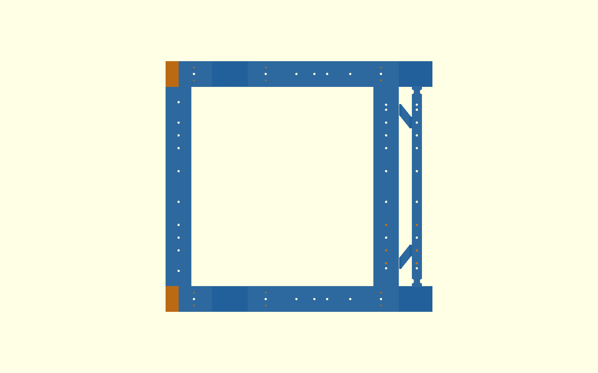
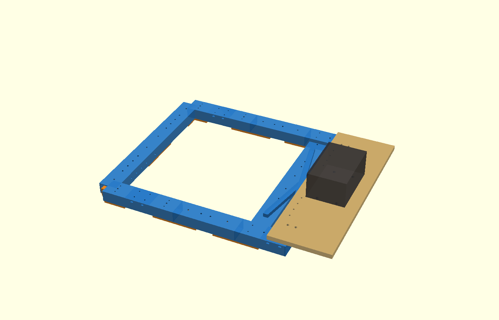
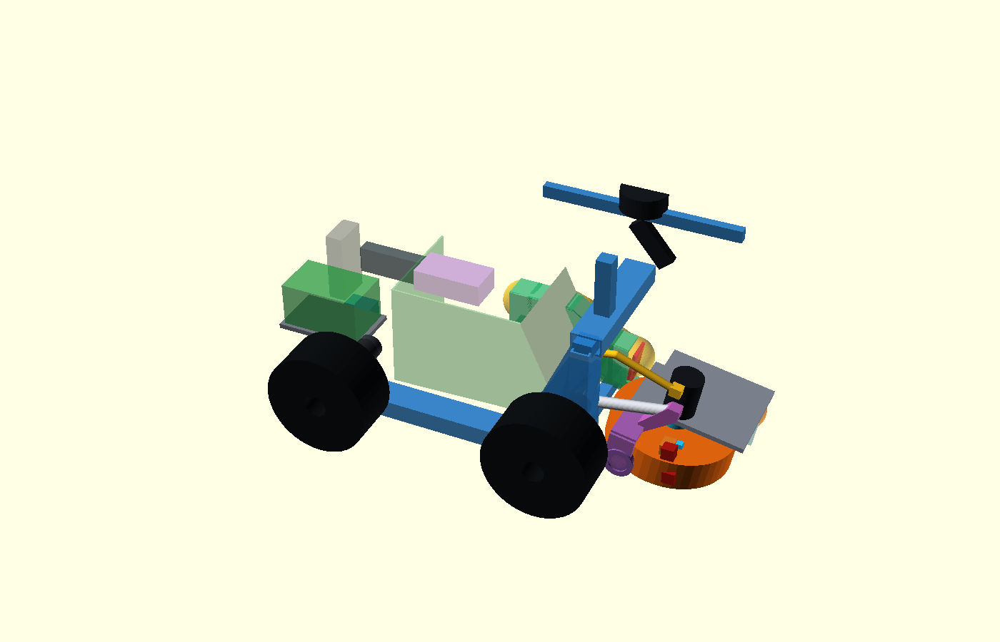
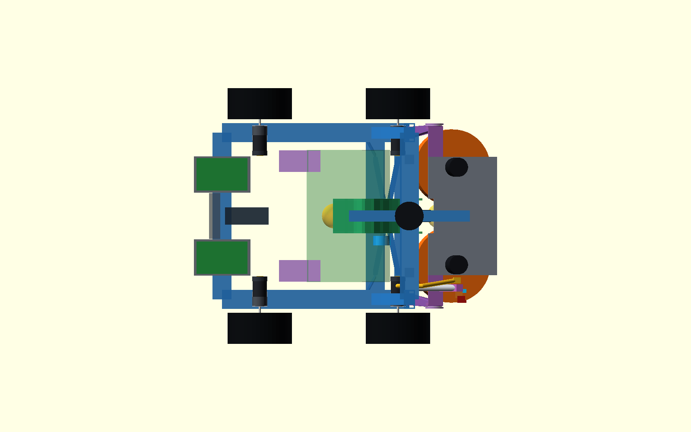

# Φάση 2 — διορθώσεις και σετ εκτύπωσης v3

Ημερομηνία: 2026-10-11  
Κατάσταση: **XACRO/ISOLATED BENCH ΕΤΟΙΜΟ ΩΣ ΑΡΧΕΙΑ — ΠΑΥΣΗ ΠΡΙΝ ΑΠΟ ΚΑΘΕ ΕΚΤΕΛΕΣΗ**

## Συμπέρασμα

Το κλειδωμένο προς άμεση εκτύπωση υποσύνολο είναι το χαμηλό σασί v3: δοκοί
μέχρι X330, τραβέρσες X240/X300 και crossed torsion deck.  Δεν περιλαμβάνει
την παλιά `ramp_back` στο X≈294 ούτε πέλμα Gamma έως X455.  Η αψίδα,
οι εδράσεις, ο οδηγός μπάλας, το καλάθι και οι βάσεις αισθητήρων παραμένουν
εξαρτώμενα κομμάτια και δεν πρέπει να τυπωθούν ακόμη.

## Α. Διορθώσεις της αρχικής αναφοράς Φάσης 2

### Τζόγος μανικιών

Η προηγούμενη προσομοίωση του τζόγου ως ελατηρίου με `E=288 MPa` ήταν λάθος
μοντελοποίηση και αντικαθίσταται.  Για διάκενο 0,30 mm/πλευρά και εμπλοκή
60 mm η καθαρά γεωμετρική νεκρή ζώνη είναι:

`2·atan(0,30/60) = 0,0099999 rad = 0,573°`.

Αυτό δίνει ελεύθερη μετατόπιση περίπου 1,02 mm στην έδραση (μοχλοβραχίονας
101,7 mm) και 1,43–1,46 mm στο nip πριν ακουμπήσουν οι επιφάνειες.  Δεν
προστίθεται στην ελαστική παραμόρφωση σαν spring deflection.

Το v3 χρησιμοποιεί M4 βίδα από πάνω και από την εξωτερική πλευρά σε κάθε
ένωση.  Οι βίδες προφορτίζουν το μανίκι πάνω σε δύο επιφάνειες αναφοράς και
αφαιρούν την ελεύθερη κίνηση.  Η ελαστική FEA θεωρεί αυτή την προφόρτιση
ενεργή.  Το `sleeve_fit_coupon.stl` και ένα `clamp_sleeve.stl` είναι το πρώτο
υποχρεωτικό print gate για πρόσβαση παξιμαδιού, πραγματικό fit και clamp.

### Κατακόρυφο 2g και διορθωμένη FEA

Η τιμή 2,09 mm της αρχικής Φάσης 2 ήταν regression: το carrier και ο
κατακερματισμός των beams δεν ήταν ίδιοι με τη διορθωμένη Φάση 1.  Με ακριβώς
ίδια γεωμετρία carrier, Y=237 mm, masses/loads, supports X=−65/300 και mesh
5 mm, το open-U δίνει ξανά **0,925 mm**, ακριβώς όσο η Φάση 1.  Το 2,09 mm
σημαίνεται αντικατεστημένο και δεν χρησιμοποιείται σε απόφαση.

Τα διορθωμένα αποτελέσματα PETG (`E=1,5 GPa`) είναι:

| Τοπολογία | 2g | launch absolute / local | wheel lift | racking |
|---|---:|---:|---:|---:|
| open U | 0,925 mm | 2,741 / 0,375 mm | 11,981 mm | 2,939 mm |
| αψίδα X330 | 0,776 mm | 2,884 / 0,597 mm | 7,344 mm | 2,663 mm |
| τριγωνισμός | 0,870 mm | 2,752 / 0,359 mm | 11,933 mm | 2,929 mm |
| συνδυασμός + low deck | **0,644 mm** | **1,940 / 0,444 mm** | **5,760 mm** | **1,981 mm** |

Η mesh αλλαγή 10→5 mm είναι έως 1,383%.  Ο συνδυασμός περνά τον τοπικό στόχο
launch ≤1 mm αλλά όχι την απόλυτη μετατόπιση ως προς το έδαφος.  Η τελευταία
περιλαμβάνει την ελαστική μετατόπιση όλου του minimally-constrained σασί και
παραμένει φυσικό measurement gate· δεν αποδίδεται στον τοπικό βραχίονα.

### P2-65 — πραγματικές συνδέσεις X240/X300

Οι παραπάνω τιμές `0,644 / 1,940 / 1,981 mm` χρησιμοποίησαν ιδανική κοινή
γραμμή κέντρου τραβέρσας–πλαϊνής δοκού. Μετά το εύρημα της 2026-10-16 αυτό
το interface **ΑΝΤΙΚΑΤΑΣΤΑΘΗΚΕ** από μισές τραβέρσες μήκους 195 mm έως την
εσωτερική παρειά Y=±195 και τυπωμένα T-clamps με 60 mm insertion. Κάθε clamp
κλειδώνει επάνω/πλάι στην τραβέρσα και με μία διαμπερή M4 στο terminal.

Η νέα συντηρητική B32R FEA δεν πιστώνει την ακαμψία της χαλύβδινης βίδας:

| Φόρτιση | παλιά ideal overlap | P2-65 T-connection | μεταβολή |
|---|---:|---:|---:|
| vertical 2g | 0,644 mm | **0,646 mm** | +0,17% |
| launch | 1,940 mm | **2,212 mm** | +14,01% |
| antisymmetric racking | 1,981 mm | **2,195 mm** | +10,81% |

Οι αντίστοιχες local-to-front-mount μετατοπίσεις είναι 0,645 / 0,474 /
0,415 mm και η mesh μεταβολή 10→5 mm μένει κάτω από 0,90%. Πρόκειται για
συγκριτική ελαστική οθόνη· preload, bearing/slip των M4, στρώσεις και fatigue
μένουν physical inspection gate.

Exact OpenSCAD έλεγχοι έδωσαν μηδενικό όγκο τομής τραβέρσας–terminal (μόνο
κοινή επιφάνεια Y=±195), πλάκας έρματος, Baja tyre και FIT0403/encoder με τη
ρητή διαδρομή καλωδίου. Το παλιό C-hook X310/Y±185 έτεμνε την άκρη της X300·
η νέα X300 έχει relief Ø9 και αφήνει 1,25 mm nominal ακτινικό διάκενο. Η
κονσόλα τελειώνει στο X185, δηλαδή 30 mm πριν από το πλησιέστερο X240 tube
envelope. Θέσεις field drilling και σειρά συναρμολόγησης δίνονται στο
`cad/modular-test-chassis/stl-v3/README.md`.

Ο πλάγιος assembly έλεγχος αποκάλυψε ανεξάρτητο transform-only σφάλμα: τα
centered clamp sleeves και rear corner clamps εμφανίζονταν 11,5 mm χαμηλά.
Οι θέσεις διορθώθηκαν σε centre Z37 για rail/rear και Z32 για τα low deck
sleeves. Τα ήδη τυπωμένα STL και η γεωμετρία τους δεν άλλαξαν.

### Τερματικά αντί ενεργού πείρου

Ο ενεργός πείρος Ø8 αφαιρέθηκε από το baseline, επειδή θα απαιτούσε δικό του
actuator, driver, engaged/retracted sensing και Mega pins.  Ο
P16-50-256-12-S σπρώχνει με μικρή ελεγχόμενη προφόρτιση τη μονάδα σε
αντικαταστάσιμο τερματικό +20°.  Η αντίδραση εκτόξευσης περνά
`yoke → stop → arch`, όχι από τον κοχλία.  Παραμένουν εξωτερικοί Hall/limit
αισθητήρες στις −10°/+20° και απορροφητικά emergency stops στις −12°/+22°.

Η ονομαστική backdrive force 500 N του P16 αντιστοιχεί σε 34–42 N·m στο
υπάρχον linkage, πολύ πάνω από 5,3 N·m, αλλά δεν χαρακτηρίζεται safety brake.
Μπορεί να προστεθεί μόνο χειροκίνητος, spring-retained transport pin όταν η
μονάδα είναι ακίνητη και χωρίς τροφοδοσία· δεν αποτελεί runtime lock.

Ο χρόνος μετάβασης του P16-256 είναι **8,3 s ιδανικός/no-load** για 40 mm
stroke και θα είναι μεγαλύτερος υπό φορτίο.  Είναι ρητός παράγοντας απόφασης.
Ο ταχύτερος P16-50-64-12-S δίνει 18 mm/s, δηλαδή 2,22 s no-load, ίδια τιμή
αναφοράς USD 80 και 95 g, αλλά μόνο 40 N στο peak-efficiency και 90 N max.
Στον ελάχιστο βραχίονα δίνει 2,72 N·m στο peak-efficiency ή 6,11 N·m στο
maximum: δεν είναι drop-in λύση για απαίτηση 5,3 N·m.  Χρειάζεται
counterbalance/gas spring και νέο bracket, με πρόσθετο κόστος/όγκο και νέο
failure mode.  Baseline παραμένει ο 256:1.

### LiDAR και κάμερα

Το επίπεδο Z=498 mm του παλιού datum δεν χρειάζεται για να καθαρίσει τη νέα
διάταξη.  Επιλέχθηκε προς packaging έλεγχο **Z=390 mm**, που καθαρίζει
μπαταρία, καλάθι, αψίδα, flywheel σε −10°/+20° και την κορυφή της κάμερας.
Το LiDAR body bottom είναι Z=358 mm και το περιστραμμένο camera envelope
φτάνει περίπου Z=345,4 mm, άρα μένουν 12,6 mm.  Τα OpenSCAD intersection
tests είναι κενά.

Ο ελεύθερος ιστός πέφτει από 217 σε 109 mm.  Για δύο PETG 25×25×3,2 mm posts,
`E=1,5 GPa` και top mass 0,25–0,45 kg, η απλή cantilever εκτίμηση πρώτου
mode είναι 126–94 Hz, αντί 45–34 Hz στο παλιό ύψος.  Το παλιό εύρος
επικαλυπτόταν με τα 47,8 Hz των D5065 στις 2865 rpm, ενώ το νέο όχι.  Πρόκειται
μόνο για screening: απαιτούνται accelerometer/scan-quality test και soft
mount check στο πραγματικό τυπωμένο bracket.

Στα 390 mm το 2D LiDAR βλέπει αντικείμενα που τέμνουν οριζόντια το επίπεδο:
κολώνες, το πλαίσιο του φιλέ και τον φράχτη.  Τα λεπτά κορδόνια/mesh μπορεί να
δίνουν ασυνεχείς επιστροφές· οι γραμμές του γηπέδου δεν είναι στόχος LiDAR και
μένουν στην κάμερα.  Η κάμερα παραμένει πάνω από το στόμιο και χρειάζεται
φυσικό optical/FOV check πριν τυπωθεί η βάση της.

### Διάκενο οδηγού μπάλας–low deck

OpenSCAD Minkowski sweep −10°…+20° ανά 2° έδωσε πρώτη επαφή 4 mm κοντά στις
−4°/−2°.  Λεπτή σάρωση −6…0° ανά 0,25° και clearance 0,125 mm έδωσε
χειρότερο σημείο στο −3,0°: καθαρό στα 2,750 mm και πρώτη τομή στα
2,875 mm.  Άρα το αριθμητικό ελάχιστο είναι **2,75–2,88 mm**.  Δεν υπάρχει
hard intersection, αλλά αυτό
δεν είναι επαρκές release margin για εκτύπωση, flex και ξένα σώματα.  Ο οδηγός
παραμένει ΕΞΑΡΤΩΜΕΝΟΣ· πριν το STL του χρειάζεται τοπική ανύψωση/εσοχή ώστε
να επιτευχθούν τουλάχιστον 8 mm με το ίδιο sweep.

## Β. Σετ εκτύπωσης v3

Τα STL βρίσκονται αποκλειστικά στο
`cad/modular-test-chassis/stl-v3/`.  Ο πλήρης πίνακας ποσότητας, μάζας,
orientation και κατάστασης είναι στο `stl-v3/README.md`.  Υπάρχουν 20 μοναδικά
meshes, όλα με `nonmanifold_edge_count=0`.  Η κλειδωμένη μάζα πλαισίου χωρίς
coupon/temporary tabs είναι περίπου 1,477 kg.  Μαζί με coupon και τέσσερα
ballast tabs είναι περίπου 1,551 kg.  Οι διαγώνιες βιδώνουν στα πραγματικά
top-grid σημεία Y=±150 mm των X240/X300 και ενώνονται ανά δύο στο κέντρο·
χρειάζονται φαρδιά ροδέλα/λεπτό μεταλλικό backing στα single-shear endpoints.

Τυπώνονται τώρα, μετά την επιτυχία του coupon: rear motor segments, rail
extensions, front terminals X330, πίσω/X240/X300 τραβέρσες, crossed-deck
halves/joiners και clamped sleeves/corners.  Περιμένουν: αψίδα, carriers,
flywheel yoke, P16 brackets/stops, guard, guide/basket και αισθητήρες.

Το M4 grid έχει βήμα 25 mm στην πάνω και εξωτερική πλευρά, μόνο έξω από
μανίκια, insertion/locking zones, motor lands και το εσωτερικό W.  Συντηρητικός
net-section υπολογισμός δίνει έως περίπου 5% τοπική απώλεια του `I` από επάνω
οπή· δεν πιστώνεται το πρόσθετο nut tower.  Η συνολική επίδραση είναι μικρότερη,
αλλά notch, layer adhesion και fatigue δεν έχουν μπει στη beam FEA.

Η προηγούμενη χρήση των `front_motor_gamma_left/right.stl` ως φορέα έρματος
**αντικαθίσταται και απαγορεύεται**.  Τα πέλματά τους είχαν σχεδιαστεί γύρω
από 0,4 N·m, ενώ το έρμα στο X≈424 mm τα φόρτιζε περίπου 3 N·m το καθένα
στατικά.  Το Gamma pair δεν χρειάζεται πλέον για τη δοκιμή κίνησης.

### Πλάκα έρματος πάνω στα τελικά front terminals

Η νέα πλάκα είναι 160×480×12 mm από plywood ή ισοδύναμα άκαμπτο μέταλλο,
με κέντρο X=360/Y=0 και περιοχή X=280…440.  Βιδώνεται σε οκτώ πραγματικές
οπές M4 του X300, Y=±75/100/125/150 mm, πάνω σε άκαμπτους αποστάτες 10 mm
(crossbar top Z42, plate bottom Z52).  Τέσσερις M6 στα X=310/330,
Y=±185 mm κρατούν τα εσωτερικά σκέλη δύο αφαιρούμενων C-hook clamps που
αγκαλιάζουν από κάτω τα τελικά `front_terminal`.  Έτσι δεν τρυπιούνται τα
terminals, δεν χρησιμοποιούνται οι βίδες FIT0403 και τίποτα δεν προεξέχει
στο διάκενο του ελαστικού.  Τέσσερις οπές M8 X=335/385, Y=±60 συγκρατούν το έρμα σε όλους τους
άξονες.  Το σχέδιο είναι στο
`cad/modular-test-chassis/v3-drive-test-ballast-plate.scad`.

Η ισοδυναμία υπολογίζεται από τη ροπή γύρω από τον πίσω άξονα X=−65 mm:

`m_ballast = 4,706·(427+65)/(360+65) = 5,448 kg`.

Η τιμή **περιλαμβάνει πλάκα, βίδες και κινητό έρμα**.  Με το νέο εκτιμώμενο
basket/support 1,70 kg και P16 0,095 kg, το πραγματικό module case είναι
18,110 kg, CG X=165,6 mm και εμπρός φορτίο 112,19 N.  Το drive-test surrogate
είναι 18,852 kg, CG X=156,5 mm και δίνει το ίδιο εμπρός φορτίο 112,19 N,
αλλά μεγαλύτερο πίσω φορτίο 72,69 αντί 65,41 N.  Δεν είναι δυναμικά ισοδύναμο:
ο σημειακός όρος αδράνειας ως προς τον πίσω άξονα είναι 13,6% μικρότερος.
Άρα το τεστ είναι έγκυρο για φορτία τροχών/πρόσφυση και βασική οδήγηση,
όχι για pitch transient ή yaw inertia του τελικού module.

Αν λείπουν οι πραγματικές μπαταρίες, προστίθενται χωριστά 0,650 kg στα
X=−165/Y=−110, 0,650 kg στα X=−165/Y=+110 και 0,309 kg στο X=−100/Y=0.
Δεν μπαίνουν πάνω στην εμπρός πλάκα, γιατί τότε αλλάζει το axle-load match.

Κατά τον επανέλεγχο βρέθηκε ότι η assembly όψη είχε grid στο X300, αλλά ο
STL selector το εξήγαγε χωρίς grid.  Στην τότε έκδοση διορθώθηκε σε
`half_crossbar(...,true)` και επανεξήχθησαν τα 18 STL. Οι αριθμοί
38,15 g/τεμάχιο και 1,407 kg είναι πλέον ιστορικοί και **ΑΝΤΙΚΑΤΑΣΤΑΘΗΚΑΝ**
από το P2-65 set των 20 meshes.

## Β.1 Καλάθι περίπου 45 μπαλών

Το πίσω τοίχωμα μετακινήθηκε X=60→**−15 mm**, το άνω όριο Z=195→**215 mm**
και το δάπεδο έγινε Z=42 mm πίσω έως Z=54 mm εμπρός.  Η μικρή κλίση 2,35°
στέλνει τις μπάλες προς τον πίσω ελεύθερο όγκο.  Το πλάτος μένει 350 mm.
Επειδή το καλάθι σταματά στο X=−15, απέχει 32 mm από το εμπρός άκρο των
πίσω FIT0403 στο X=−47 και δεν χρειάζεται τοπικό στένεμα/σήκωμα.  Οι D5065
controller envelopes μετακινήθηκαν σε X=80/Y=±145/Z=245 mm, πάνω από το
καλάθι.  Το UGREEN παραμένει X=−100 και τα Parkside εξωτερικά στο X=−165.

Το αριθμητικό εσωτερικό είναι 14,47 L gross και **13,17 L usable** μετά από
συντηρητικό keepout 1,30 L για οδηγό/feeder.  Για τυχαία συσκευασία
0,55/0,58/0,60/0,64 αντιστοιχεί σε 48,1/50,7/52,5/56,0 μπάλες.  Επομένως οι
45 χωρούν γεωμετρικά με 6–20% volumetric margin, αλλά αυτό δεν είναι απόδειξη
ότι η είσοδος παραμένει ανοιχτή.

Με ομοιόμορφη στάθμη, η κάτω ακμή/κέντρο/άνω ακμή του σημερινού outlet
Z=94/132/168 mm αντιστοιχούν περίπου σε 14,8/28,0/39,7 μπάλες.  Η πίσω κλίση
και ο σωρός θα καθυστερήσουν τοπικά το κλείσιμο στην αρχή, αλλά στις 45 μπάλες
η υπάρχουσα έξοδος αναγκαστικά βρίσκεται μέσα στη ζώνη του σωρού.  Άρα για
πραγματική συλλογή 45 μπαλών χρειάζεται μετά το φυσικό test είτε υψηλότερη
έξοδος/over-pile chute είτε αναδευτήρας/anti-bridge flap.  Χωρίς αυτό, το
γεωμετρικό capacity δεν είναι λειτουργικό capacity.  Γέφυρα σε όλο το πλάτος
είναι απίθανη (πάνω από πέντε διαμέτρους μπάλας), αλλά το στενό κανάλι 86 mm
είναι μόνο 1,30 διαμέτρους και είναι το πιθανό jam point.

Για τον feeder χρησιμοποιήθηκε συντηρητική τοπική στήλη 10 μπαλών: 5,59 N.
Σε ενεργή ακτίνα 23 mm η καθαρή ροπή βαρύτητας είναι 0,129 N·m· με factor 3
για τριβή/σφήνωμα απαιτείται τουλάχιστον **0,39 N·m output** και ≥15 N
tangential force, με current limit και jam reversal.  Δεν έγινε επιλογή μοτέρ.

Με basket/support 1,70 kg στο X=120 mm και 45 μπάλες 2,565 kg στο X=105 mm,
η πλήρης Parkside διάταξη εκτιμάται 20,675 kg, CG X=158,1 mm, εμπρός άξονας
61,11%, δηλαδή 39,42 N ανά πίσω και 61,95 N ανά εμπρός τροχό.  Οι θέσεις CG
και η μάζα του καλαθιού είναι προ-φυσικές εκτιμήσεις.  Το καλάθι και ο οδηγός
παραμένουν **ΕΞΑΡΤΩΜΕΝΑ** και δεν προστίθενται στο print release πριν το
collection/bridging test.

Τα CAD intersection views `qa_basket_drive`, `qa_basket_controllers` και
`qa_sweep_basket` είναι όλα κενά.  Αυτό αποδεικνύει μόνο ονομαστικό packaging,
όχι ανοχές, δυναμική παραμόρφωση ή ροή μπαλών.

## Β.2 Ξεχωριστό xacro / isolated bench — μόνο προετοιμασία

Δημιουργήθηκαν, έξω από το production package:

- `engineering/shared-flywheel-isolated-bench/v3_chassis_flywheel_bench.urdf.xacro`,
- `engineering/shared-flywheel-isolated-bench/v3_controllers.yaml`,
- `engineering/shared-flywheel-isolated-bench/v3_bench_contract.json`,
- `engineering/shared-flywheel-isolated-bench/README.md`.

Περιλαμβάνουν track 0,594 m, `drive_axle_y=±0,297 m`, Parkside/Ugreen masses,
κενό/45-ball καλάθι, P16 joint με −10°/+20° stops, κανονικό module και
`drive_test_ballast` case.  Το module έχει συνολική μάζα 4,7055 kg με τα
Phase-1 pneumatic wheel mass/inertia.  Οι D5065 constants παραμένουν τα
υπάρχοντα 270 KV, 0,031 N·m/A, 0,039 Ω και 20 A/0,62 N·m ανά μοτέρ.  Η
βαθμονομημένη μπάλα παραμένει το υπάρχον
`gazebo/models/tennis_ball_compliant/model.sdf` χωρίς refit.

Έγινε μόνο XML well-formed check και YAML parse.  **Δεν έγινε xacro expansion,
ROS build, launch ή Gazebo execution.**  Η πρώτη επιτρεπτή εκτέλεση, μετά από
νέα ρητή άδεια, είναι validation μέσα στο Ubuntu 24.04/Jazzy container και
κατόπιν μόνο το Gazebo 5a.  Ακολουθεί δεύτερη παύση πριν από 5b–5d.

## Γ. Τροφοδοσία, controllers και Mega — απαιτήσεις μόνο

Νέο baseline είναι δύο Parkside X20V Team 4 Ah, 0,65 kg η καθεμία, σε
παράλληλους αλλά ηλεκτρικά απομονωμένους κλάδους.  Κάθε pack χρειάζεται δικό
του quick-change adapter, ασφάλεια και ideal-diode/ORing πριν από τον κοινό
15–21 V bus· **δεν** επιτρέπεται hard parallel των pack terminals.  Η
ideal-diode αποτρέπει reverse current, αλλά δεν εγγυάται ίσο μοίρασμα:
packs διαφορετικού SoC/τάσης/εσωτερικής αντίστασης μπορεί να φορτίζονται
ασύμμετρα, άρα απαιτείται μέτρηση ρεύματος ανά κλάδο.  Η
ονομαστική ενέργεια είναι 144 Wh με 18 V nominal ή 160 Wh με το manufacturer
20 V-max label.  Το επιτρεπόμενο συνεχές/peak ρεύμα ανά pack δεν έχει
επιβεβαιωθεί και παραμένει υποχρεωτική παράμετρος bench test.

Τα δύο pack envelopes τοποθετήθηκαν συμμετρικά στο X=−165 mm, Y=±110 mm για
πίσω αντίβαρο και εξωτερική αφαίρεση.  Οι προσωρινές διαστάσεις
135×85×75 mm είναι **μη μετρημένο envelope**: quick-change dock STL δεν
απελευθερώνεται πριν μετρηθούν pack, adapter, release button και hand sweep.
Το Ugreen τοποθετήθηκε στο X=−100 mm.  Τα Parkside/Redodo variants έχουν κενές
OpenSCAD τομές με frame, μετακινημένους D5065 controllers και rear electronics
bay.

Ο παρακάτω πίνακας P2-17 με basket/support 1,5 kg και 28 μπάλες διατηρείται ως
ιστορική σύγκριση και **αντικαθίσταται για τη νέα χωρητικότητα** από το
45-ball case της ενότητας Β.1:

| Power variant | Basket | Total | CG X | Front axle | Rear/front ανά τροχό |
|---|---|---:|---:|---:|---:|
| Parkside pair + Ugreen | empty | **17,815 kg** | 169,0 mm | **64,12%** | 31,34 / 56,01 N |
| Parkside pair + Ugreen | +28 balls | 19,411 kg | 168,7 mm | 64,03% | 34,23 / 60,94 N |
| Redodo comparison | empty | 21,496 kg | 138,0 mm | 55,61% | 46,79 / 58,61 N |
| Redodo comparison | +28 balls | 23,092 kg | 139,8 mm | 56,12% | 49,68 / 63,55 N |

Η εκτίμηση 17,6 kg/64% επιβεβαιώνεται εντός των μη μοντελοποιημένων μαζών:
το 17,815 kg δεν περιλαμβάνει adapters, ideal diodes, ασφάλειες, XT60, 12 AWG,
buck, docks ή guards.  Αυτά πιθανότατα αυξάνουν το τελικό σύνολο κατά μερικές
εκατοντάδες γραμμάρια.

Για άδειο καλάθι, τα friction limits ανά τροχό πίσω/εμπρός είναι
`9,40/16,80 N` σε μ=0,3, `18,80/33,61 N` σε μ=0,6 και `28,21/50,41 N` σε
μ=0,9, πριν το motor torque ceiling.  Ο πίσω τροχός επομένως ολισθαίνει
νωρίτερα σε ανομοιόμορφο ή σκονισμένο γήπεδο· στο μ=0,6 το rear cap πέφτει
από 28,07 N με Redodo σε 18,80 N, δηλαδή κατά 33%.  Παρ' όλα αυτά, το απλό
Coulomb pivot screen βελτιώνεται: available yaw/scrub ratio 1,77 έναντι 1,65
με Redodo, επειδή η συνολική μάζα και το lateral scrub πέφτουν.  Αυτό δεν
αποδεικνύει επιτόπια στροφή· απαιτείται low-speed test με ανεξάρτητη
encoder/current επίβλεψη ανά μοτέρ, ramped torque και σύγκριση τεσσάρων
encoders με IMU yaw.  Πρέπει να καταγραφούν onset duty, peak current,
front/rear speed split και sustained rear free-spin σε σκληρό και χωμάτινο
γήπεδο πριν αυξηθεί το PWM limit.

Οι FIT0403 μένουν σε 12 V-equivalent operation.  Θεωρητικό PWM ceiling για
12 V average είναι 80,0% στα 15 V, 66,7% στα 18 V και 57,1% στα 21 V.
Το duty clamp μόνο του δεν προστατεύει stall ή overspeed: χρειάζονται current
limit, ramp και μέτρηση.  Ο P16 τροφοδοτείται από ρυθμιζόμενο 12 V buck με
περιθώριο για το μετρημένο peak και προστασία από transients.  Ο propulsion
bus χρειάζεται master disconnect και low-voltage cutoff με hysteresis,
βαθμονομημένο υπό sag.

Pi 5, αισθητήρες και Mega μένουν σε χωριστό Ugreen 12000 mAh/100 W USB-PD.
Το επίσημο Ugreen listing δίνει 45,5×46×115 mm και 309 g.  Με 5 V/3 A ο Pi 5
περιορίζει τα downstream USB σε συνολικά 600 mA· το high-current mode
ενεργοποιείται μόνο αφού επαληθευτεί ότι το PD profile/cable παρέχει ασφαλώς
την απαιτούμενη ισχύ.  Το Mega τροφοδοτείται από τον USB/5 V κλάδο και ποτέ
απευθείας από 15–21 V.  Το ρεύμα του Mega μετρά μέσα στο USB peripheral
budget· δεν τροφοδοτείται ταυτόχρονα από δεύτερη 5 V πηγή και απαιτείται μία
μόνο ελεγχόμενη signal-ground σύνδεση προς τον propulsion bus ή απομονωμένα
interfaces, ώστε να μην υπάρξει back-powering.  Πηγές:
[UGREEN 12000 mAh 100 W](https://www.ugreen.com/en-au/products/au-35526),
[Raspberry Pi 5 power guidance](https://www.raspberrypi.com/documentation/computers/getting-started.html),
[Parkside X20V manual example](https://parkside-diy.com/nl/asset/download/21433/file/Manual_PAMR_750_A1_GB_IE_NI_MT_DE_AT_BE_CH_FR_NL.pdf?version=14).

Η Redodo παραμένει παραμετρική εναλλακτική: 12,8 V, 50 Ah/640 Wh,
195×166×172 mm, 5,29 kg στο επίσημο listing και BMS 50 A continuous.  Πηγή:
[Redodo 12 V 50 Ah Pro](https://jp.redodopower.com/products/redodo-12v-50ah-lifepo4-battery).

Οι bench δοκιμές με εργαστηριακό τροφοδοτικό εξακολουθούν να απαιτούν χαμηλό
current limit, διαδοχική εκκίνηση και coast-only stop μέχρι να υπάρχει
επιβεβαιωμένο brake/dump path.  Ο D5065 controller χρειάζεται UART/Arduino
library, rpm/current/temperature telemetry, hardware enable στο E-stop,
watchdog και ασφαλή over-voltage/coast ή dump λειτουργία.

### Προτεινόμενος πίνακας Mega (χωρίς αλλαγή κώδικα)

| Λειτουργία | Mega pins | Παρατήρηση |
|---|---|---|
| D5065 left UART | D16/TX2, D17/RX2 | level shifter 5→3,3 V, έλεγχος RX tolerance |
| D5065 right UART | D14/TX3, D15/RX3 | ίδιο interface |
| Controller hardware enable | D26, D27 | AND με το υπάρχον hardwired E-stop |
| Controller fault inputs | D28, D29 | αν προσφέρονται από τον controller |
| P16 H-bridge | D4 PWM, D7 DIR, D8 ENABLE | current limit και safe-off |
| Intake/launch endpoint sensors | D12, D13 | εξωτερικά Hall/limits, όχι internal limits μόνο |

Το Serial1 D18/D19 παραμένει δεσμευμένο από encoders.  Επιπλέον, αντίθετα με
την αρχική λίστα «ελεύθερων» pins, το σημερινό firmware χρησιμοποιεί ήδη
D44/D45/D40 και D46/D11/D42 για τα δύο intake BTS channels.  Επομένως D11 και
D44–D46 δεν είναι διαθέσιμα χωρίς μελλοντική αρχιτεκτονική αλλαγή.  Δεν έγινε
καμία τέτοια αλλαγή και δεν τροποποιήθηκε Arduino code.

## Ανοιχτά πριν από xacro/Gazebo

- Φυσικό fit coupon και clamp-preload test πριν από τις μεγάλες εκτυπώσεις.
- Παχύμετρο/runout για bearing guard και τελικός local carrier/fastener έλεγχος.
- ≥8 mm guide–deck clearance (τώρα 2,75–2,88 mm) και φυσική δοκιμή
  συλλογής/jam πριν guide STL.
- Επιβεβαίωση P16 linkage, stop contact και πραγματικού χρόνου μετάβασης.
- Φυσικό LiDAR vibration/scan-quality και camera FOV check πριν sensor STLs.
- Επιλογή D5065 controller και επιβεβαίωση UART, telemetry, enable και dump.
- Ακριβείς διαστάσεις/κουμπί απασφάλισης Parkside, adapter sweep και
  συνεχές/peak ρεύμα ανά pack πριν quick-change dock ή fuse sizing.
- Επιβεβαίωση USB-PD profile/cable του Ugreen υπό πλήρες Pi 5 + sensor load.

Το ξεχωριστό xacro δημιουργήθηκε αλλά δεν εκτελέστηκε.  Δεν εκτελέστηκε
ROS/Gazebo και δεν τροποποιήθηκε ο πλήρης robot stack, Arduino, ηλεκτρονικά ή
καλωδίωση.  Δεν έγινε commit, push ή PR.  Η εργασία σταματά εδώ πριν από κάθε
xacro/ROS/Gazebo execution για νέα ρητή έγκριση.
