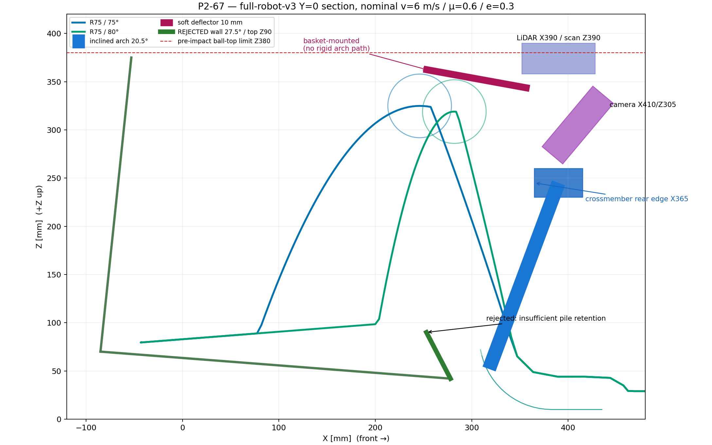

# P2-67 — γερμένη αψίδα και ταμπλό πάνω από τη στήλη

Ημερομηνία: 2026-10-17  
Κατάσταση: **ΑΠΟΔΕΚΤΟ BASELINE — 180/180 πτήσεις στο καλάθι, το παλιό
τοίχωμα P2-67 απορρίπτεται**

## Απόφαση

Η γερμένη αψίδα με τις βάσεις αμετάβλητες στο X318 και το επάνω σύνολο
μετατοπισμένο κατά +60 mm λύνει την επαφή της P2-66. Η τραβέρσα έχει κέντρο
X390/Z245 και πίσω ακμή X365, δηλαδή τουλάχιστον 15 mm μπροστά από τη στήλη
της μπάλας. Το ανεξάρτητα στηριγμένο ταμπλό
X250/Z363 → X360/Z343 οδήγησε και τις **180/180** πτήσεις στο άδειο καλάθι.

Το γερμένο εμπρόσθιο τοίχωμα στην παλιά ακμή X278 **απορρίπτεται**. Το
επιτρεπτό top είναι μόνο περίπου Z90–100. Αυτό δεν συγκρατεί σωρό 40–45
μπαλών: απαιτείται περίπου Z190 όταν το όχημα είναι ακίνητο και περίπου
Z225 με ήπιο φρενάρισμα. Το σταματημένο rerun με top Z90 δεν χρησιμοποιείται
ως νέο αποτέλεσμα και η μήτρα δεν ξανατρέχει.

## Υπάρχοντα αποτελέσματα Gazebo

Η ολοκληρωμένη μήτρα είχε R75/75 και R75/80, surface 5/6/8 m/s, μ
0,6/0,9, Y=0/±50/±100 και e=0,1/0,3/0,5. Έγινε με μία μπάλα, άδειο καλάθι
και χωρίς προσομοίωση σωρού.

| Γεωμετρία | Πραγματική γωνία | Ταχύτητα εξόδου | Κρούση στο ταμπλό, base frame | Αποτέλεσμα |
|---|---:|---:|---:|---:|
| R75 / 75° | 56,00…70,17° (μ.ό. 66,12°) | 3,572…5,607 m/s | X257,9…266,4 / Y±34,0 / Z354,9…356,5 mm | PASS 90/90 |
| R75 / 80° | 61,48…74,18° (μ.ό. 70,61°) | 3,547…5,606 m/s | X287,7…292,7 / Y±31,6 / Z350,1…351,0 mm | PASS 90/90 |

Οι περιοχές κρούσης base-frame προκύπτουν από τα διατηρημένα contact logs
ενός αντιγράφου e ανά συνθήκη· το aggregate των 180 runs είναι η πηγή για
τα PASS και τα exit ranges. Το raw contact X του aggregate είναι world
coordinate και δεν πρέπει να διαβαστεί ως CAD-local θέση όταν το όχημα
κινείται.

Σε όλες τις συνθήκες υπήρξαν μηδενικές επαφές με αψίδα, αισθητήρες και
τοίχωμα. Το μέγιστο ball-top πριν από το ταμπλό ήταν 356,1 mm για 75° και
351,9 mm για 80°, κάτω από Z380. Η μέγιστη τελική μέση ταχύτητα ήταν
0,0184 και 0,0194 m/s αντίστοιχα, κάτω από 0,25 m/s.

Παρότι και οι 80° περνούν, αφήνουν αισθητά λιγότερο χώρο ανάμεσα στον
ανερχόμενο και τον κατερχόμενο κλάδο για εμπρόσθιο τοίχωμα. Η baseline
επιλογή είναι συνεπώς **R75/75°**. Το R110 παραμένει απορριφθέν από την
P2-66.

## Σημαντικός περιορισμός του «μαλακού» ταμπλό

Τα αποτελέσματα για e=0,1, 0,3 και 0,5 είναι αριθμητικά ίδια ανά ίδια
συνθήκη speed/μ/Y. Το `restitution_coefficient` του collision δεν επηρεάζει
το DART σε αυτή τη διαμόρφωση. Άρα το sweep **δεν μοντελοποίησε πραγματικά
μαλακό ή compliant ταμπλό** και δεν επιλέγει EVA, δίχτυ ή συντελεστή
ανάκτησης.

Ο solver μειώνει την ταχύτητα σε χαμηλή τιμή αμέσως στην επαφή και η μπάλα
τελικά ηρεμεί σχεδόν πλήρως, οπότε η ανάκτηση μάλλον δεν θα είναι ο
κυρίαρχος παράγοντας αυτής της γεωμετρίας. Αυτό όμως είναι μόνο ένδειξη του
μη βαθμονομημένου μοντέλου. Το e και η πραγματική απόσβεση πρέπει να
**μετρηθούν φυσικά** σε EVA/δίχτυ πριν από release.

## Αψίδα, αισθητήρες και απλός δομικός έλεγχος

Η ελάχιστη κλίση που χρησιμοποιήθηκε είναι 20,46° από την κατακόρυφο:
βάση X318/Z52 και επάνω κόμβος X390/Z245. Το LiDAR μετακινείται στο X390,
με το scan plane αμετάβλητο στο Z390. Η κάμερα μετακινείται στο X410/Z305,
με την ίδια κλίση 50°. Άρα οι οπτικές γωνίες δεν αλλάζουν· το ground
footprint της κάμερας μετατίθεται περίπου 60 mm εμπρός. Το ταμπλό στηρίζεται
στα πλαϊνά του καλαθιού μέσω ελαστομερών blocks και όχι άκαμπτα στην αψίδα
αισθητήρων.

Ο συντηρητικός beam screen ανά σκέλος χρησιμοποίησε PETG E=2 GPa, διατομή
30×50×3,2 mm, φορτίο actuator 168,16 N από το P2-40 12,6 N·m και
αισθητήρες/βάσεις 0,58 kg στα 3g. Έδωσε 13,08 N·m ροπή βάσης, 3,03 MPa
τάση, factor 6,60 ως προς screen 20 MPa και 0,814 mm μετατόπιση κορυφής.
Δεν είναι πιστοποίηση joints, print layers, fatigue, vibration ή impact·
απαιτούνται proof-load και vibration test με τους πραγματικούς αισθητήρες.

Το OpenSCAD intersection της αψίδας/αισθητήρων και του ταμπλό έναντι του
παγωμένου launcher/actuator/arm/stops/cables στο sweep −10…+20° ήταν κενό.
Δεν παράχθηκε STL και δεν έγινε commit, push ή PR.

Αρχεία αναφοράς:

- `engineering/chassis-strength-bench/results/shared_flywheel_phase2/gazebo_p267/summary.json`
- `engineering/chassis-strength-bench/results/shared_flywheel_phase2/p267_arch_screen.json`
- `cad/modular-test-chassis/shared-flywheel-p267-tilted-arch.scad`
