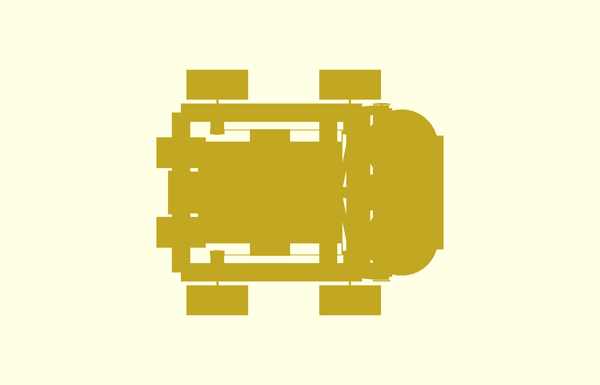
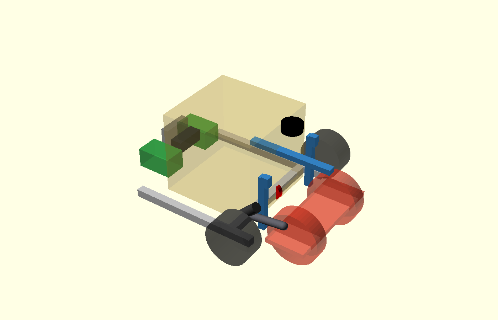

# P2-52/P2-53/P2-54 — μηχανική μετάβαση συλλογή / μεταφορά / εκτόξευση

> **ΙΣΤΟΡΙΚΟ — δεν περιγράφει το τρέχον design.** Διατηρείται ως evidence
> της απόφασης/δοκιμής της εποχής του. Δες
> [το τρέχον design](../current-design-el.md).

## P2-54 — περιθώρια και ασύμμετρη φόρτιση

Το P2-53 έγινε δεκτό. Το P2-54 δεν αλλάζει pivot, γωνίες, frozen launcher,
αψίδα ή άλλο στοιχείο του P2-40. Το dependent moving arm ανασηκώθηκε από
local root/high points `[−10,−160,60]/[−10,−205,115]` σε
`[−10,−160,68]/[−10,−205,135]`. Το FIT0186 παραμένει παράλληλο με 1:1
belt, αλλά το offset από το fixed pin γίνεται `[0,+40,5,+60]` mm. Το
μικρό belt carrier έγινε Ø14/8 mm αντί Ø18/10 mm· η τελική διάσταση
τροχαλιών/δοντιών παραμένει measurement/manufacturing gate.

Επαναλήφθηκαν μόνο τα πέντε σχετικά exact-solid ζεύγη, −10…+20° ανά 1°:

| Ζεύγος | P2-53 | P2-54 | Αποτέλεσμα |
|---|---:|---:|---|
| moving arm–launcher, χωρίς intended root | 8,000 mm | **14,000 mm** στο +2° | PASS ≥12 mm |
| moving arm–drive | 33,423 mm | 33,432 mm | PASS |
| FIT–launcher | 11,222 mm | 17,405 mm στο +20° | PASS |
| FIT–drive | 8,426 mm | **10,426 mm** | PASS ≥10 mm |
| FIT–arch, χωρίς intended mount | 8,557 mm | **10,932 mm** | PASS ≥10 mm |

### Στρέψη upper plate/yokes

Ο υπολογισμός είναι συντηρητικό analytical screen, όχι nonlinear FEA.
Χρησιμοποιεί μόνο την PETG upper-plate strip 195×8 mm κατά Y, απλή στήριξη
στα trunnions Y±234, `E=1,5 GPa`, και δεν πιστώνει ακαμψία από yoke webs,
μοτέρ ή hubs. Η μονάδα είναι 4,60996 kg. Η δύναμη actuator εφαρμόζεται στο
Y=−205. Ως 50% strength gate χρησιμοποιείται 15 MPa, δηλαδή το 50% μιας
ρητής συντηρητικής υπόθεσης 30 MPa για printed PETG· απαιτείται coupon στην
πραγματική διεύθυνση στρώσεων πριν release.

Στατικό 8,0 N·m:

- Στις −10° η δύναμη είναι 107,67 N (`Fx=−107,30`, `Fz=−8,92 N`). Με το
  βάρος μισό ανά πλευρά, τα resultants είναι 105,31 N στο −Y trunnion και
  24,09 N στο +Y. Η effective twist γύρω από X είναι 0,0158° και η διαφορά
  ύψους nip 0,071 mm.
- Στις +20° η δύναμη είναι 88,70 N (`Fx=−83,47`, `Fz=−30,01 N`). Τα
  trunnion resultants είναι 93,31/25,01 N. Αυτή είναι η δυσμενέστερη
  στρέψη: **0,0530° και 0,2388 mm** διαφορά nip.
- Το μέγιστο συντηρητικό άθροισμα vertical και in-plane bending stress
  είναι **0,4373 MPa**, δηλαδή 2,92% του 15 MPa gate. Τα κριτήρια
  `Δnip≤1 mm` και `stress≤50% assumed PETG strength` περνούν.

Για την κρούση στο stop χρησιμοποιήθηκε το validated conservation
surrogate `Iyy=0,0335675 kg·m²` και η P2-52/P2-42 ταχύτητα
`23°/8,3 s=0,048365 rad/s`. Η κινητική ενέργεια είναι μόλις
`3,926·10⁻⁵ J`. Με linear-contact sensitivity 0,1/0,25/0,5 mm, η peak
κινητική ροπή είναι 0,09165/0,03666/0,01833 N·m. Ακόμη και στο 0,1 mm,
μαζί με συνεχιζόμενο preload 8 N·m, προκύπτουν 0,2415 mm διαφορά nip και
0,4423 MPa. Άρα το static preload, όχι η κινητική κρούση, κυβερνά. Αυτό
ισχύει μόνο με current cut-off· άκαμπτη κρούση μηδενικής διαδρομής δεν
έχει πεπερασμένη δύναμη και δεν αποτελεί αποδεκτό μοντέλο.

Η μονή actuator baseline διατηρείται και δεύτερος actuator δεν
δικαιολογείται. Παρότι το screen περνά, προτείνεται **δεύτερο συμμετρικό
stop στο Y=+205 πριν από δεύτερο actuator**: όταν η μονάδα εδράζεται,
μοιράζει το preload και ακυρώνει πρώτης τάξης τη στρέψη γύρω από X. Το
single-stop παραμένει μόνο dependent concept μέχρι φυσικό preload test.

Αποτελέσματα: `engineering/chassis-strength-bench/results/shared_flywheel_phase2/p254_margin_torsion.json`.
Κατάσταση: `P2_54_CLEARANCE_PASS_TORSION_PASS_SECOND_STOP_RECOMMENDED`.
Δεν έγινε Gazebo, STL, commit, push ή PR. ΠΑΥΣΗ πριν από 5c-3.

> **Διόρθωση P2-53.** Η αρχική συναρμολόγηση P2-52 χρησιμοποίησε λάθος
> υποκατάστατο: τροχούς με άξονα Y και δοκούς Y±235/30 mm. Οι παλιές
> εικόνες, η θέση AS5600 Y216 και όλα τα διακένια P2-52 είναι
> **ΑΝΤΙΚΑΤΕΣΤΗΜΕΝΑ**. Η αριθμητική σύγκριση actuator παραμένει χρήσιμη,
> αλλά η έγκυρη γεωμετρία και η απόφαση packaging είναι αποκλειστικά η
> παρακάτω P2-53.

## P2-53 — επανέλεγχος με την παγωμένη γεωμετρία

Το assembly πλέον εισάγει απευθείας τα modules της παγωμένης Phase 1/2
γεωμετρίας: δύο τροχούς Ø200×60 με κέντρα Y±129 και άξονες local Z, άνω
πλάκα, yokes, trunnions και D5065 από πάνω. Το frame έχει δοκούς Y±220,
πλάτους 50 mm, pivot `[387,0,51,837]` και την αψίδα X318/dogleg X330.
Καλάθι, R75 ski-jump, feed channel, LiDAR, camera, Parkside και Ugreen
χρησιμοποιούν τις πραγματικές τιμές P2-51/P2-40, όχι νέα envelopes.

Αντιστοίχιση CAD προς το static fixture:

| Πηγή CAD | Fixture P2-53 | Κρίσιμες διαστάσεις | Frame |
|---|---|---|---|
| `upper_plate`, `wheel_and_motor`, `trunnions_and_standoffs` | `p253_frozen_launcher` | Ø200×60, Y±129, pivot X387/Z51,837 | moving module, περιστροφή γύρω από Y |
| `chassis_structure` | ίδιο module | rails Y±220, 50 mm, κάτω Z22 | base/world |
| `front_arch_and_triangulation` | ίδιο module | X318 uprights, dogleg/crossbar X330 | base/world |
| `sensors_and_mounts` | ίδιο module | LiDAR scan Z390 και camera mount | base/world |
| P2-51 basket/ski/feed parameters | `p251_basket_exact`, `p251_ski_exact`, `p251_feed_exact` | basket X−85…278/Y±172, ski R75/42° | base/world |
| P2-52 transition | `p253_actuator`, `p253_as5600`, `p253_cam_moving`, `p253_stops`, `p253_cables` | fixed pin `[310,−205,120]`, moving local `[50,−205,90]` | fixed pin base, moving pin module |

Η επαναφορά του πραγματικού launcher αποκάλυψε ότι ο coaxial FIT0186
Ø37×70 της P2-52 τέμνει το εμπρός drive package και την αψίδα σε όλο το
τόξο. Δεν μπορεί να παραμείνει στην ευθεία της Tr8. Η διορθωμένη baseline
κρατά την ίδια Tr8/κινηματική, αλλά μεταφέρει το FIT0186 κατά +37 mm στο Y
και +50 mm στο Z πάνω σε κοινό rocking carrier και χρησιμοποιεί μικρή
οδοντωτή μετάδοση 1:1 προς τον κοχλία. Προστίθενται δύο τροχαλίες,
tensioner και guard· η απόδοση 0,90 είναι μόνο design assumption και η
continuous-torque δοκιμή πρέπει να περιλάβει την πραγματική απόδοση
ιμάντα. Το P16 παραμένει direct, λεπτό fallback και δεν χρησιμοποιεί το
offset carrier.

Η moving arm ανεβαίνει από το άκρο της άνω πλάκας και περνά πάνω από το
πέλμα· το stop tongue μεταφέρθηκε στο local `[20,−205,115]`. Το AS5600
μπαίνει στο +Y guard, board Y244 και magnet Y240,5. Η παλιά θέση Y216
απορρίπτεται. Ο selector cam μένει στο κεντρικό ελεύθερο διάκενο και τα
D5065 service loops αγκυρώνονται στα Y±180.

Νέα κινηματική, με το πραγματικό pivot Z:

| Γωνία | Pin spacing | Ενεργός βραχίονας | Δύναμη 5,3 N·m | Ισοδύναμη 8,0 N·m |
|---:|---:|---:|---:|---:|
| −10° | 142,358 mm | 74,304 mm | 71,33 N | 107,67 N |
| −3° | 133,020 mm | 78,511 mm | 67,51 N | 101,90 N |
| 0° | 128,864 mm | 80,225 mm | 66,06 N | 99,72 N |
| +15° | 106,818 mm | 87,949 mm | 60,26 N | 90,96 N |
| +20° | 99,044 mm | 90,195 mm | 58,76 N | 88,70 N |

Η διαδρομή −3→+20° γίνεται 33,976 mm. Το πλήρες −10…+20° είναι
99,044…142,358 mm και παραμένει μέσα στο P16-50 97…147 mm.

Το exact-solid sweep έγινε ανά 1° από −10 έως +20°. Και οι 18 έλεγχοι
μηδενικής τομής πέρασαν. Τα ελάχιστα ονομαστικά διακένια είναι:

| Ζεύγος | Ελάχιστο | Κυβερνώσα γωνία |
|---|---:|---:|
| FIT0186–launcher | 11,222 mm | +20° |
| FIT0186–drive tyre/package | 8,426 mm | full sweep |
| FIT0186–arch, χωρίς το intended mount | 8,557 mm | full sweep |
| Tr8–launcher / drive | 32,708 / 19,222 mm | −10° / full sweep |
| moving arm–launcher, χωρίς το intended root | **8,000 mm** | +6° |
| moving arm–drive | 33,423 mm | full sweep |
| whole actuator–frame / sensors | 54,000 / 41,352 mm | full sweep |
| whole actuator–basket/ski/feed | 11,557 mm | full sweep |
| whole actuator–power/electronics | 165,763 mm | full sweep |
| AS5600–launcher / drive | 18,818 / 9,000 mm | full sweep |
| cam–launcher / fixed ski-feed | 19,000 / 21,337 mm | +16° / full sweep |
| stops–launcher | 39,000 mm | full sweep |
| cables–launcher / fixed world | 24,004 / 11,414 mm | −8° / full sweep |

Οι αποστάσεις προέρχονται από triangulated exact solids, με δηλωμένη
αριθμητική αβεβαιότητα ±0,5 mm. Δεν περιλαμβάνουν ανοχές εκτύπωσης,
κάμψη ιμάντα ή δυσκαμψία καλωδίων. Ειδικά το arm–launcher στα 8,000 mm
είναι ακριβώς στο nominal gate και **όχι release clearance**: απαιτεί
φυσικό fit check ή αύξηση πριν κλειδώσει το εξαρτώμενο arm.

Τομές Y=0: [−3°](../../cad/modular-test-chassis/p253-section-minus3.png),
[0°](../../cad/modular-test-chassis/p253-section-zero.png),
[+20°](../../cad/modular-test-chassis/p253-section-plus20.png). Οι τροχοί
Y±129 δεν τέμνονται από το Y=0, όπως πρέπει. Όλες οι πλάγιες όψεις έχουν
+Z προς τα πάνω, ground datum, labels και βέλος `FRONT +X`. Διορθώθηκε και
η P2-51 όψη.

Κατάσταση: `P2_53_EXACT_GEOMETRY_REAUDIT_PASS_WITH_ARM_FIT_GATE`.
Δεν έγινε STL, Gazebo, ROS, Arduino/electronics change, commit, push ή PR.
ΠΑΥΣΗ.

## Απόφαση

Η προτεινόμενη baseline είναι ο υπάρχων **FIT0186 + μονόσπειρη Tr8×2**, με
ξεχωριστό thrust bearing, flexible coupling και anti-rotation nut carriage.
Κρατιέται το hole pattern για P16 ως fallback. Η άρθρωση P2-40 δεν αλλάζει:
X387, συλλογή −3°, μεταφορά 0°, εκτόξευση +15…+20°. Δεν εκδόθηκε STL.

Το FIT0186 επιλέγεται υπό δύο measurement gates: συνεχής ροπή/θερμοκρασία
σε 12 V και πραγματικό backdrive/backlash του επιλεγμένου παξιμαδιού Tr8.
Η τιμή 1,77 N·m είναι **stall**, όχι συνεχής. Για screening χρησιμοποιήθηκε
μόνο προσωρινή ζώνη 0,35–0,53 N·m (20–30% stall), η οποία δεν γίνεται
προδιαγραφή μέχρι τη δοκιμή.

## Κινηματική και φορτία

Η ίδια κινηματική X/Z με το P16 έχει fixed pin `[310,-205,120]` και moving
pin `[50,-205,90]` στο frame της μονάδας. Η lateral γραμμή μετακινήθηκε
15 mm έξω, επειδή στο Y−190 το Ø37 FIT0186 είχε overlap 0,5 mm με το νέο
πλαϊνό καλάθι Y−172. Στο Y−205 μένουν ονομαστικά 14,5 mm από το καλάθι,
32 mm από το drive tyre, 24 mm από την αψίδα και 26,5 mm από το flywheel.
Ο υπολογισμός χρησιμοποιεί μόνο τη
συνιστώσα ροπής γύρω από τον άξονα Y της άρθρωσης.

| Γωνία | Pin spacing | Ενεργός βραχίονας | Δύναμη για 5,3 N·m | Ισοδύναμη για 8,0 N·m |
|---:|---:|---:|---:|---:|
| −10° | 142,0 mm | 77,2 mm | 68,6 N | 103,6 N |
| −3° | 132,3 mm | 81,4 mm | 65,1 N | 98,3 N |
| 0° | 128,0 mm | 83,1 mm | 63,8 N | 96,3 N |
| +15° | 105,2 mm | 90,7 mm | 58,4 N | 88,2 N |
| +20° | 97,2 mm | 92,9 mm | 57,0 N | 86,1 N |

Το fixed clevis πήγε από X320 σε X310, επειδή στο X320 το +20° απαιτούσε
87,6 mm, μικρότερο από το P16-50 closed length 97 mm. Τώρα όλο το
−10…+20° είναι 97,2…142,0 mm μέσα στο διαθέσιμο 97…147 mm.

Η λειτουργική διαδρομή −3→+20° είναι 35,11 mm. Στα 251 rpm, η Tr8×2 έχει
θεωρητική ταχύτητα 8,37 mm/s και no-load χρόνο 4,20 s· χρησιμοποιείται
4,5–6,0 s ως design range ώσπου να μετρηθεί. Είναι 17,56 στροφές ή περίπου
12.290 encoder counts. Για 68,6 N, απαιτούνται περίπου 0,062/0,087/0,146 N·m με
απόδοση κοχλία 35/25/15%. Η γωνία έλικας είναι περίπου 5,2°: αυτοσυγκράτηση
είναι πιθανή μόνο αν το effective μ του nut υπερβαίνει 0,091 και πρέπει να
επαληθευθεί με λίπανση, σκόνη και κραδασμό.

## Σύγκριση actuator

| Επιλογή | Ικανότητα / χρόνος | Hold | Μάζα / χώρος / κόστος | Απόφαση |
|---|---|---|---|---|
| P16-50-256-12-S | 150 N στο peak efficiency, 11,6–13,9 N·m· 7,3 s για 35,1 mm, 8,3 s για 40 mm | backdrive >500 N, αλλά το launch φορτίο πάει στο stop | 95 g, 97…147 mm pin length, περίπου US$80–90 | compact fallback |
| FIT0186 + Tr8×2 | απαίτηση 57–69 N· το 0,35 N·m screening δίνει 165–385 N για η=0,15–0,35· no-load 4,20 s, design 4,5–6 s | πιθανή self-lock· θέλει test | motor 205 g, assembly 0,38–0,47 kg· motor ήδη υπάρχει, Tr8 hardware εκτίμηση €15–30 | **baseline μετά test** |
| FIT0186 + τυπωμένος ατέρμονας | 50–60:1· με 0,35 N·m και η=0,30 δίνει 5,25–6,3 N·m· περίπου 0,9 s no-load για 23° | εξαρτάται από lead/μ και PETG creep | assembly εκτίμηση 0,35–0,55 kg, hardware/filament €5–15, μεγάλος sector και tooth load 8 N·m | όχι baseline |

Στο P16, `-S` σημαίνει εσωτερικούς end-of-stroke limit switches και
δισύρματο έλεγχο· δεν είναι position feedback. Το `-P` δίνει potentiometer
feedback χωρίς εσωτερικό controller/limits. Με AS5600 ως authoritative
absolute hinge sensor, δεν απαιτείται `-P` για τρεις θέσεις: το external
loop σταματά σε −3/0/+15…20 και τα `-S` προστατεύουν μόνο τα πλήρη άκρα.
Πηγές: [Actuonix P16 datasheet](https://www.actuonix.com/assets/images/datasheets/ActuonixP16Datasheet.pdf),
[P16-P](https://www.actuonix.com/p16-p),
[DFRobot FIT0186](https://www.dfrobot.com/product-634.html).

## AS5600, driver και pins Mega

Ο D6×2,5 mm diametric magnet μπαίνει σε μη μαγνητικό cap στο +Y άκρο του
trunnion. Η πλακέτα βρίσκεται στην εσωτερική πλευρά του +Y yoke, κέντρο
περίπου `[387,216,50]`, αντίθετα από τον actuator, plane normal στο Y.
Nominal air gap 1,5 mm, ρυθμιζόμενο 0,5–2,5 mm, στόχος εκκεντρότητας
≤0,25 mm. Η θέση αυτή δεν καταναλώνει το οριακό εξωτερικό διάκενο tyre–yoke.

| Λειτουργία | Mega pins | Σημείωση |
|---|---|---|
| AS5600 + MPU6050 I2C | D20 SDA, D21 SCL | 0x36 έναντι 0x68/0x69, χωρίς conflict |
| BTS7960 actuator baseline | D44 RPWM, D45 LPWM, D40 enable | υπάρχον intake channel |
| BTS7960 alternate | D46 RPWM, D11 LPWM, D42 enable | μόνο αν το πρώτο δεσμευθεί |
| Ανεξάρτητα stop switches | D12 lower, D13 upper | safety proof, όχι position control |
| D5065 telemetry | Serial2 D16/17, Serial3 D14/15 | αμετάβλητο requirement |
| D5065 enable/fault | D26/27, D28/29 | αμετάβλητο requirement |

Ο Mega είναι 5 V. Επιτρέπεται κοινό I2C μόνο με μία γνωστή τάση pull-up:
ελέγχονται τα πραγματικά breakout boards και μπαίνει bidirectional level
shifter αν οποιοδήποτε είναι 3,3-V-only. Το AS5600 έχει fixed address 0x36,
ενώ το MPU6050 0x68/0x69. Πηγές:
[AS5600 datasheet](https://look.ams-osram.com/m/7059eac7531a86fd/original/AS5600-DS000365.pdf),
[AS5600 eval guide](https://look.ams-osram.com/m/4f8342513a447495/original/AS5600_UG000254_2-00.pdf),
[Mega 2560](https://docs.arduino.cc/hardware/mega-2560/).
Το AS5600 δίνει απόλυτη γωνία χωρίς homing· απαιτεί μόνο μία φορά
mechanical zero/scale calibration, η οποία αποθηκεύεται ως offset και δεν
«καίγεται» μόνιμα στο chip πριν ολοκληρωθεί η φυσική ρύθμιση.

Το BTS7960 οδηγεί τον FIT0186 από **ρυθμισμένη γραμμή 12 V**. PWM limiting
από 15–21 V δεν αντικαθιστά ρυθμιστή, ειδικά σε stall/πέδηση. Δεν αλλάχθηκε
Arduino code ή καλωδίωση στο P2-52. Το module δεν θεωρείται αξιόπιστη
τηλεμετρία ρεύματος: το implementation requirement παραμένει fuse,
timeout/stall cut-off και, αν ζητηθεί closed-loop current limit, ξεχωριστή
μέτρηση ρεύματος. Αν προσωρινά τροφοδοτηθεί από το raw Parkside bus, το
command cap είναι `duty_max=12/Vbus`: 0,80 στα 15 V, 0,667 στα 18 V και
0,571 στα 21 V, με μέτρηση Vbus και χωρίς claim ισοδυναμίας με ρυθμιστή.

## Τερματικά, selector και singulator reserve

Το κάτω stop είναι indexed −10…−3° και το πάνω +15…+20°, ανά 1°. Κάθε
replaceable block έχει δύο M6 και ώμο που παραλαμβάνει τη διάτμηση· slot
χρησιμοποιείται μόνο για calibration και όχι ως μοναδικό load path. Design
load 8,0 N·m. Στα endpoints η αντίδραση περνά stop→yoke/arch, όχι actuator.
Στο 0° η Tr8 αυτοσυγκρατεί και το AS5600 επιτηρεί απόκλιση· απαγορεύεται
εκτόξευση εκεί.

Ο selector είναι cam στον άξονα με δύο αντίθετους followers, deadband και
spring-centred fail-safe. Στο −3° collection OPEN/feed CLOSED, στο 0° και
οι δύο CLOSED, στα +15/+20° collection CLOSED/feed OPEN. Στις μεταβάσεις
κλείνουν πρώτα και οι δύο. Η φάση του cam ρυθμίζεται μαζί με το επιλεγμένο
κάτω stop. Αστοχία link/ελατηρίου οδηγεί σε both-closed.

Το cam επιλέγει διαδρομή αλλά δεν μετρά μία μπάλα. Δεσμεύεται envelope
80×100×88 mm περίπου στο `[145,0,76]` για two-stage escapement με δύο
δάκτυλα σε απόσταση 70–75 mm, removable blind plate και μελλοντικό
low-force servo/solenoid. Η τελική κίνηση/χρονισμός ανήκει στο 5d.

## Packaging Ugreen και CG

Το προηγούμενο envelope X−157,5…−42,5 συγκρουόταν με το κεντρικό καλάθι
που πλέον φτάνει X−85. Το Ugreen περιστρέφεται 90° και μπαίνει στο κέντρο
`[-135,0,145]`, envelope X−158…−112, Y±57,5. Ονομαστικά μένουν 27 mm από
το καλάθι, 10 mm από κάθε Parkside και 12 mm από το rear electronics bay.
Οι Parkside συνεχίζουν να βγαίνουν προς τα έξω· το Ugreen αφαιρείται προς
τα πάνω/πίσω. Τα 10 mm δεν είναι release clearance: η πραγματική
pack+adapter μέτρηση και bend radius πρέπει να αφήσουν ≥5 mm.

| Case | νέο CG X | μετατόπιση | φορτίο εμπρός άξονα |
|---|---:|---:|---:|
| empty 17,815 kg | 168,39 mm | −0,61 mm | 63,94% |
| full45 20,675 kg | 157,58 mm | −0,52 mm | 60,98% |

## Ακολουθία ασφαλείας και parts status

1. Command D5065 zero και επιβεβαίωση rpm κάτω από threshold.
2. Κλείσιμο και των δύο κλάδων selector.
3. Κίνηση άρθρωσης με AS5600 loop, timeout και current limit.
4. Έδραση σε stop ή hold στο 0° με Tr8· επαλήθευση γωνίας/selector.
5. Μόνο τότε enable συλλογής ή εκτόξευσης. Η εκτόξευση απαιτεί robot
   stationary και πάνω stop seated.

Το actuator cable δένεται στο σταθερό clevis και κάνει ένα service loop
γύρω από τον άξονα. D5065 power/telemetry ακολουθούν ξεχωριστές διαδρομές,
με strain relief και minimum bend radius που ελέγχεται σε −10…+20°. Το
moving attachment διαγράφει τόξο περίπου 54 mm στο πλήρες −10…+20°·
δεσμεύονται τουλάχιστον 70 mm ελεύθερου service loop πέρα από τη στατική
διαδρομή, χωρίς τέντωμα σε κανένα stop.

Κλειδώνουν με αυτό το πακέτο: fixed/moving clevis, Tr8 nut carriage και
thrust housing, AS5600 pod/cap, indexed stops, cam/followers/springs και τα
interfaces front basket/common throat/feed channel. Το παγωμένο P2-40 και
τα ΚΛΕΙΔΩΜΕΝΑ v3 parts δεν αλλάζουν.

Ανοιχτά: FIT0186 thermal/continuous test, Tr8 backdrive/backlash, measured
Parkside adapters, selector contamination/timing, cable loop, singulator
5d και φυσικό basket-40 gate. Κατάσταση:
`P2_52_STATIC_CAD_TRANSITION_PASS_WITH_MEASUREMENT_GATES`. ΠΑΥΣΗ.
