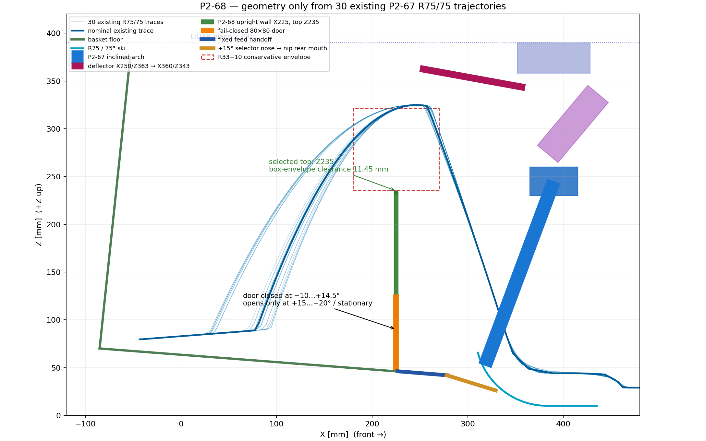

# P2-68 — όρθιο εμπρόσθιο τοίχωμα ανάμεσα στους δύο κλάδους

> **ΙΣΤΟΡΙΚΟ — δεν περιγράφει το τρέχον design.** Διατηρείται ως evidence
> της απόφασης/δοκιμής της εποχής του. Δες
> [το τρέχον design](../current-design-el.md).

Ημερομηνία: 2026-10-17  
Κατάσταση: **ΑΠΟΔΕΚΤΟ BASELINE — X225 / top Z235**

## Πρόταση

Η προτεινόμενη γεωμετρία είναι όρθιο τοίχωμα:

- κεντρικό επίπεδο X=225 mm,
- πάχος 4 mm, άρα παρειές X=223…227 mm,
- πλήρες πλάτος καλαθιού Y=−172…+172 mm,
- bottom Z=46,1 mm, πάνω στην υπάρχουσα κεκλιμένη βάση P2-51,
- φυσικό top Z=235 mm με συνεχή στρογγυλεμένη ακμή R2.

Η επιλογή περνά τον στόχο Z≥225 και αφήνει 10 mm πάνω από το ζητούμενο
περίβλημα σωρού με ήπιο φρενάρισμα. Δεν αποτελεί απόδειξη χωρητικότητας ή
motion retention 40–45 μπαλών· αυτά παραμένουν φυσικό gate.

## Ακριβής γεωμετρικός έλεγχος

Δεν έγινε νέα προσομοίωση. Διαβάστηκαν οι 30 ήδη υπάρχουσες τροχιές
R75/75 του P2-67 για 5/6/8 m/s × μ 0,6/0,9 × Y 0/±50/±100. Χρησιμοποιήθηκε
μόνο το αντίγραφο e=0,3, επειδή τα τρία e είναι ίδια. Κάθε καταγεγραμμένο
chord παρεμβλήθηκε σε μήκος ≤0,1 mm.

Ο ακριβής έλεγχος θεωρεί σφαίρα R33, περιθώριο 10 mm και το πραγματικό slab
πάχους 4 mm. Ο δεύτερος, επιλεγμένος για design, έλεγχος χρησιμοποιεί
συντηρητικό ορθογώνιο envelope ±43 mm και δεν πιστώνει τη στρογγυλεμένη
γωνία του Minkowski sum.

| X τοιχώματος | Ακριβές κυκλικό μέγιστο top | Συντηρητικό box μέγιστο top |
|---:|---:|---:|
| 200 mm | 230,34 mm | 198,60 mm |
| 220 mm | 260,22 mm | 231,49 mm |
| **225 mm** | **266,09 mm** | **238,37 mm** |
| 230 mm | 263,93 mm | 229,04 mm |
| 240 mm | 237,73 mm | 202,55 mm |
| 270 mm | 154,05 mm | 118,23 mm |

Έτσι επιβεβαιώνεται η θέση της εκτίμησης του χρήστη: το χρήσιμο μέγιστο
είναι στο X220–230 και όχι στην παλιά ακμή X278. Η αριθμητική διαφορά από
τις πρόχειρες τιμές X200/Z208, X240/Z217 και X270/Z130 οφείλεται στον τρόπο
που πιστώνεται η κυκλική γωνία του envelope. Για κατασκευή δεν
χρησιμοποιείται το αισιόδοξο ακριβές Z266, αλλά το αυστηρό box όριο.

Στο επιλεγμένο X225/Z235 το ελάχιστο ακριβές center-to-panel είναι
58,00 mm, δηλαδή **25,00 mm από την επιφάνεια της μπάλας**. Με το
συντηρητικό box είναι 44,45 mm από το κέντρο, δηλαδή **11,45 mm από την
επιφάνεια**, λίγο πάνω από το απαραίτητο 10 mm. Κοντά στο τοίχωμα το
μέγιστο |Y| της μπάλας είναι 33,93 mm· από την επιφάνεια της μπάλας μέχρι
την πλαϊνή ακμή του πάνελ μένουν 105,07 mm. Άρα η πλήρης ακμή Y±172, όχι
μόνο το Y=0, είναι καθαρή.

## Fail-closed θύρα και κοντό κανάλι

Στη βάση υπάρχει καθαρό άνοιγμα 80×80 mm, Z46,1…126,1 και Y±40. Το φύλλο
είναι 84×84 mm ώστε να επικαλύπτει 2 mm το πλαίσιο σε κάθε πλευρά. Η άρθρωση
είναι στο Z126,1. Ελατήριο το κρατά κλειστό χωρίς ισχύ. Στις −10…+14,5°
μένει κλειστό· ανοίγει προς τα πίσω μόνο στις +15…+20° και μόνο με όχημα
ακίνητο. Η κίνηση μπορεί να προέλθει από το cam κλίσης P2-52 ή από το
PCA9685 servo P2-59, αλλά η μηχανική επιστροφή παραμένει fail-closed.

Το χαμηλό handoff έχει δύο τμήματα:

1. σταθερό κανάλι πλάτους 80 mm από X227/Z46,1 έως το διατηρημένο datum
   X278/Z42,
2. selector nose πλάτους 72 mm από X278/Z42 έως το κινούμενο rear-mouth
   floor X329,2/Z26,1 στις +15° ή X331,5/Z21,1 στις +20°.

Εκτός launch state, κόκκινο shutter κλείνει το nose. Η γεωμετρία είναι μόνο
CAD/κινηματική: δεν έγινε τροφοδοσία, singulation ή pile simulation και δεν
αποδεικνύεται gravity flow. Τα interlocks παραμένουν AS5600 14,5…20,5°,
όχημα ακίνητο, selector launch, D5065 έτοιμα και fail-closed σε απώλεια
ισχύος/σήματος.

## CAD και επόμενο gate

Το `full-robot-v3.scad` χρησιμοποιεί πλέον την P2-67 γερμένη αψίδα και το
ταμπλό μαζί με το P2-68 όρθιο τοίχωμα/θύρα/κανάλι. Το paired-angle exact
OpenSCAD intersection του σταθερού τοιχώματος και της αντίστοιχης θέσης της
πόρτας με launcher, D5065, actuator, arm και cables στο −10…+20° ήταν κενό.
Χωριστοί έλεγχοι του σταθερού καναλιού X227…278 έναντι όλου του sweep και
του κλειστού shutter στις −10…+14° ήταν επίσης κενοί. Το λειτουργικό overlap
του selector nose με το rear mouth είναι
σκόπιμο και δεν μετρήθηκε ως collision. Το τοίχωμα βρίσκεται πίσω και κάτω από την
κάμερα X410/Z305 και κάτω από το επίπεδο LiDAR Z390, άρα δεν αλλάζει το
εμπρόσθιο FOV ή το scan plane.

Η γεωμετρία εγκρίθηκε και το μοναδικό επιβεβαιωτικό Gazebo run εκτελέστηκε
ως P2-69: R75/75, 30 συνθήκες, ένα e, με αποτέλεσμα 30/30 PASS.

Αρχεία:

- `engineering/chassis-strength-bench/results/shared_flywheel_phase2/p268_wall_geometry.json`
- `engineering/shared-flywheel-isolated-bench/analyze_p268_wall_geometry.py`
- `cad/modular-test-chassis/shared-flywheel-p268-upright-wall.scad`
- `cad/modular-test-chassis/full-robot-v3.scad`

Δεν παράχθηκε STL και δεν έγινε commit, push ή PR. **ΠΑΥΣΗ.**
