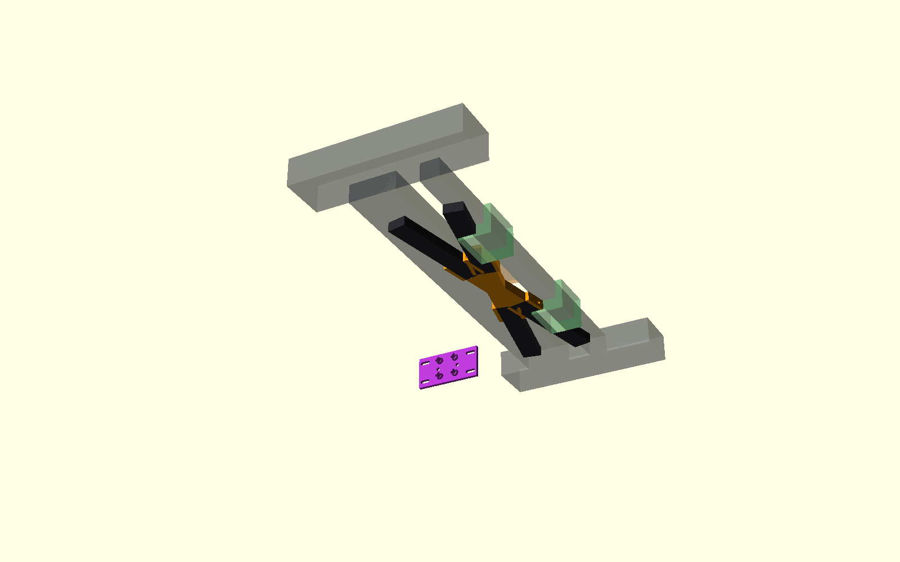
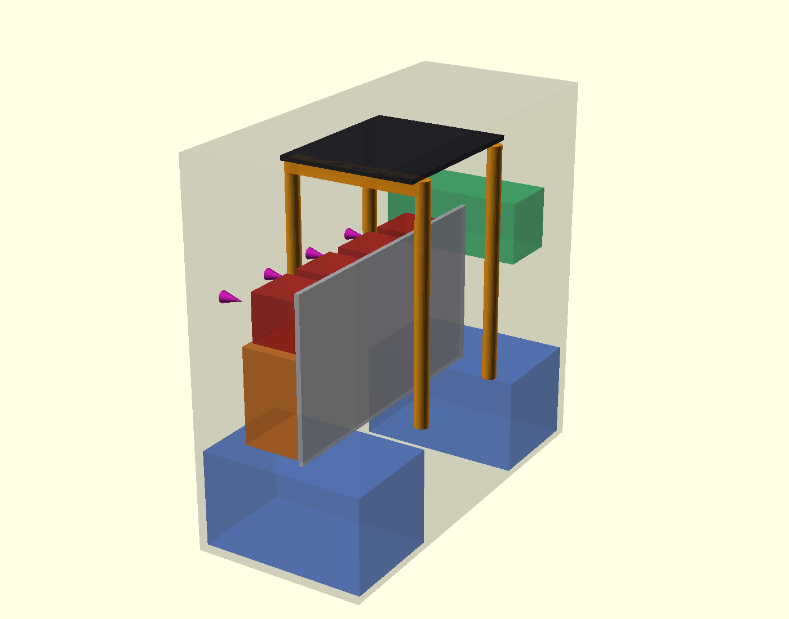

# τι διαφέρει από το αναμενόμενο — P2-77

> **ΙΣΤΟΡΙΚΟ — δεν περιγράφει το τρέχον design.** Διατηρείται ως evidence
> της απόφασης/δοκιμής της εποχής του. Δες
> [το τρέχον design](../current-design-el.md).

## Απόφαση torsion deck

Ο αρχικός σχεδιασμός δεν είναι συναρμολογήσιμος: τα τέσσερα μισά και οι δύο
joiners διεκδικούν τον ίδιο όγκο στο X270/Y0/Z42…52. Επιπλέον, η επάνω θέση
τέμνει το σταθερό P2-68 κανάλι και τον μελλοντικό πάτο καλαθιού. Η αρχικά
εξετασμένη ανύψωση της δεύτερης διαγωνίου κατά +12 mm απορρίπτεται, επειδή
ένα άκαμπτο μισό τέμνει την 50 mm πλατιά τραβέρσα X240 πριν ελευθερωθεί από
αυτή.

Η επιλεγμένη επισκευή κρατά και τα τέσσερα τυπωμένα μισά, τα κόβει στα
129,0 mm από το εξωτερικό άκρο και τα συνδέει σε έναν νέο κοινό κόμβο κάτω
από το deck. Το σύνολο είναι στο Z12…22. Τα άκρα βιδώνονται στις υπάρχουσες
Y±150 grid οπές και ο κόμβος απαιτεί μία ελεγχόμενη εγκάρσια οπή ανά μισό.
Η αναλυτική τοπολογία παραμένει Χ με κοινό κεντρικό node, αλλά η χαμηλή
τοποθέτηση και η έκκεντρη μεταφορά φορτίου στα άκρα μοντελοποιήθηκαν ρητά.

Οι γεωμετρικοί έλεγχοι δίνουν ≥18 mm προς P2-68/πάτο καλαθιού, ≥30 mm προς
τον συντηρητικό μελλοντικό όγκο βάσης έρματος Z≥52 και empty exact-solid
intersection με τα P2-73 ski brackets. Το χαμηλότερο σημείο είναι 12 mm από
το πάτωμα, 2–3 mm ψηλότερα από το ski. Το frozen envelope δεν αλλάζει.

## FEA

Στα 5 mm στοιχεία B32R:

- P2-65 crossed: 0,6455 / 2,2118 / 2,1954 mm.
- P2-77 under-deck node: 0,6456 / 2,3894 / 2,3597 mm, μεταβολή
  +0,01% / +8,03% / +7,49%.
- Μία μόνο διαγώνιος: 0,6454 / 2,3754 / 2,3542 mm, μεταβολή
  −0,01% / +7,40% / +7,23%.

Η σειρά είναι vertical 2g / launch reaction / antisymmetric racking. Η μία
διαγώνιος σχεδόν δεν επηρεάζει το συμμετρικό vertical case, αλλά χάνει
περίπου 7,3–7,4% στα δύο ασύμμετρα cases. Το P2-77 μοντέλο είναι συντηρητικό:
οι τέσσερις κατακόρυφες μεταφορές endpoint μοντελοποιούνται ως 10×10 PETG
και δεν πιστώνεται η ακαμψία των χαλύβδινων M4. Physical proof-load παραμένει
υποχρεωτικό.

## Νέα θέση MPU6050

Η νέα βάση βιδώνει άκαμπτα στην εσωτερική παρειά της +Y διαμήκους ράγας,
στις υπάρχουσες πλευρικές grid οπές X100/X125, με κέντρο X112,5/Z47. Είναι
μακριά από το Χ, P2-68, X300/ski και μελλοντικό έρμα. Η πλακέτα είναι πλέον
κατακόρυφη: η φορά αξόνων πρέπει να καταγραφεί πριν από μελλοντικό firmware
axis transform, χωρίς αλλαγή firmware σε αυτό το βήμα.

## Rear pod μετά το drive test

Η P2-76 v2 και τα STL της μένουν ακριβώς ως έχουν. Για την τελική έκδοση
προτείνεται:

- μετακίνηση Ugreen στον ελεύθερο άνω +Y όγκο, κέντρο περίπου
  `[-198,5, 112, 264]`, μέσα στο P2-70 envelope,
- μία όρθια service plate στο X≈−181 με perfboard και Mega χαμηλά και τα
  4×BTS σε μία άνω σειρά,
- όλοι οι BTS/Mega/perf connectors προς −X και η καλωδίωση προς τα πίσω ή
  προς τα πάνω· καμία πρόσβαση από το διάκενο 7 mm προς το καλάθι,
- τέσσερις ευθείς Ø12 στύλοι στις σημερινές γωνίες και τοπικό μονολιθικό
  rib/doubler συνολικού πάχους 12 mm κάτω από τη γραμμή E-stop, δεμένο στο
  ζεύγος στύλων/side frames.

Στο 30 N, το 2-D frame screen των λυγισμένων P2-76 στύλων δίνει κατακόρυφη
μετατόπιση 0,035 mm, πλάγια 0,089 mm και στροφή 0,000326 rad με άκαμπτο
πάνελ. Οι ευθείς στύλοι δίνουν 0,019 mm, 0,051 mm και 0,000174 rad. Όμως η
τοπική κάμψη της αμετάβλητης πλάκας 4 mm είναι 0,884 mm ακόμη και αν
πιστωθεί όλο το πλάτος 138 mm, ή 3,049 mm για ενεργό strip 40 mm. Άρα οι
ευθείς στύλοι μόνοι τους δεν αποδεικνύουν τον στόχο ≤1 mm. Με το τοπικό
12 mm rib, το συντηρητικό strip δίνει 0,113 mm και το άθροισμα με τους
ευθείς στύλους 0,132 mm. Αυτό είναι η προτιμώμενη τελική λύση, όχι αλλαγή
της v2 του τεστ κίνησης.

## Παραδοτέα

Μόνο νέα STL βρίσκονται στο `cad/modular-test-chassis/stl-p277/`: centre
node, drill jig και νέα βάση MPU. Δεν έγινε firmware, Gazebo, commit, push
ή PR.
