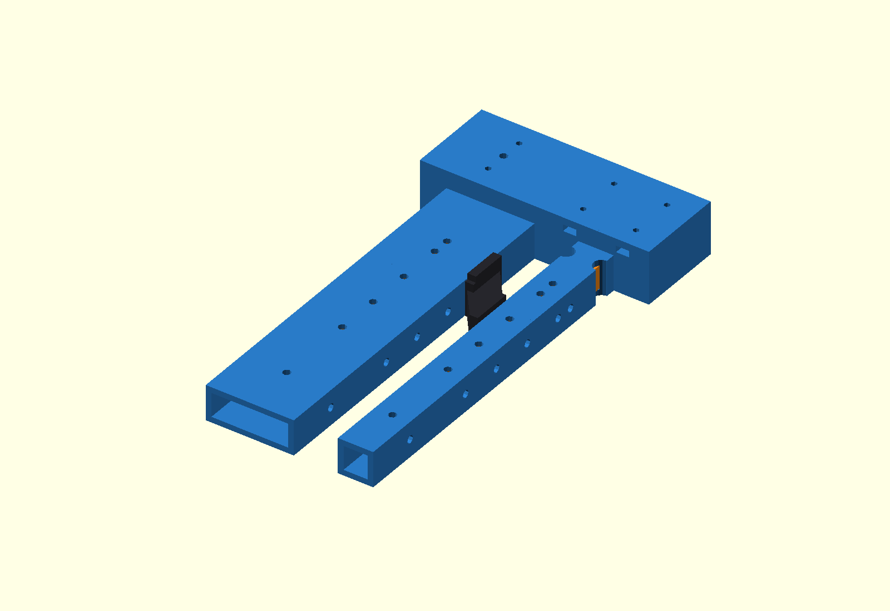
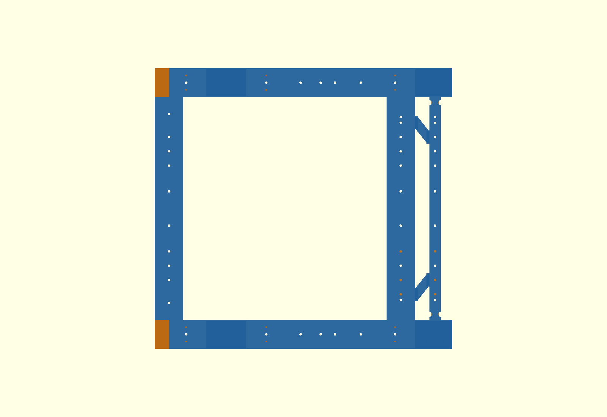
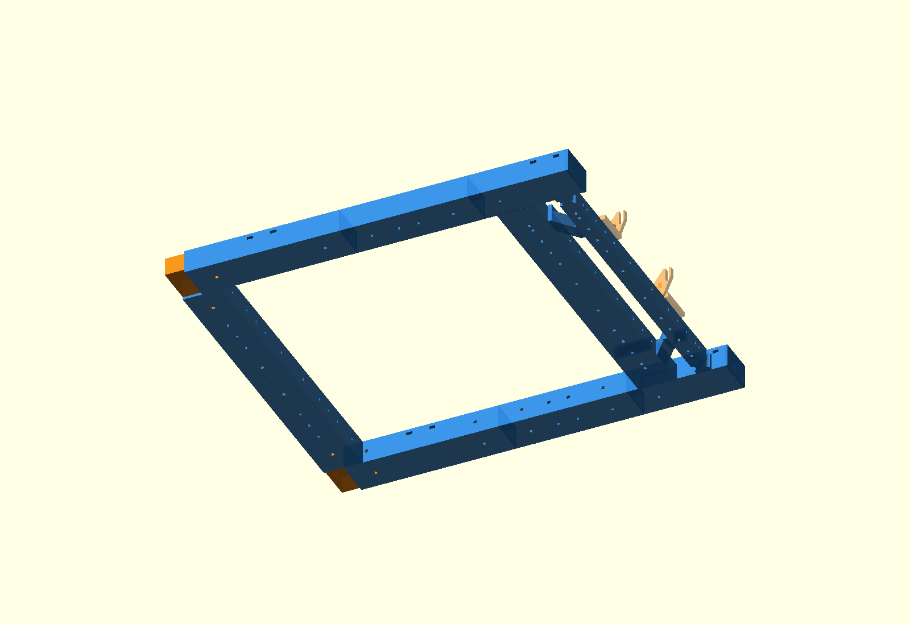

# τι διαφέρει από το αναμενόμενο — P2-78

## Αποτέλεσμα

Τα εύθραυστα `x240_t_clamp` / `x300_t_clamp` δεν είναι πλέον ενεργά μέρη.
Κάθε νέο front terminal έχει δύο μονολιθικές κούφιες υποδοχές στην εσωτερική
παρειά, 50×20 στο X240 και 20×20 στο X300. Η κάτω τους πλευρά είναι στο Z22,
ίδια με τη ράγα, ώστε τα terminals να τυπώνονται επίπεδα χωρίς supports.

Η διεπαφή socket–crossbar είναι Y±130. Τα νέα crossbar halves έχουν μήκος
130 mm και κάθε end sleeve έχει μήκος 120 mm, δηλαδή 60 mm εμπλοκή σε κάθε
μέρος. Οι lock οπές είναι 30 mm από τη διεπαφή, στα Y±100 και Y±160. Όλα τα
υπάρχοντα grid Y75/100/125/150 έχουν pass-through και στο sleeve. Το κεντρικό
`x240_clamp_sleeve`, το κεντρικό `x300_clamp_sleeve` και το X200 sleeve μέσα
στο terminal δεν αλλάζουν.

Το torsion deck παραμένει απαραίτητο, αλλά γίνεται δύο κοντές μονοκόμματες
πλευρικές διαγώνιες, X240/Y±150 → X300/Y±125. Κάθε `torsion_side_brace`
έχει body 20×15 και end lands 23×23. Μπαίνει στο διάκενο ανάμεσα στις
αντικριστές παρειές των δύο τραβερσών, με κάτω παρειά CAD Z20,5 — περίπου
18,5 mm από το έδαφος στο φυσικό chassis. Δεν υπάρχει frame part κάτω από το
κριτήριο φυσικού Z≈15.

Βίδες brace, ανά πλευρά: M4×65 στο X240/Y±150 και M4×35 στο X300/Y±125,
με μεγάλες ροδέλες και εξωτερικά παξιμάδια. Βίδες socket/sleeve: X240
4× top M4×30 + 4× transverse M4×60. X300 2× top M4×30 στα Y±160 + 4×
transverse M4×30 στα Y±100/160. Τα top locks Y±100 μοιράζονται τις
υπάρχουσες M4×35 των ski brackets· οι άλλες δύο M4×35 μένουν στα Y±75.

## FEA

Το P2-78 CalculiX B32R screen χρησιμοποίησε full-section hollow socket load
paths, χωρίς να πιστώνει ακαμψία από bolt/contact. Αποτελέσματα 5 mm mesh,
σε σειρά vertical 2g / launch reaction / antisymmetric racking:

- χωρίς διαγώνιο: **0,6454 / 2,3121 / 2,3077 mm**,
- μία συνεχής 20×15: **0,6449 / 1,9746 / 2,0276 mm**,
- δύο short, X240/Y±150 → X300/Y±125: **0,6427 / 2,1770 / 2,1840 mm**,
- δύο short, αντίστροφα X240/Y±125 → X300/Y±150:
  **0,6425 / 2,1544 / 2,1665 mm**,
- αναφορά P2-77 single diagonal: **0,6454 / 2,3754 / 2,3542 mm**.

Χωρίς διαγώνιο, τα δύο ασύμμετρα cases είναι κατά 17,1% και 13,8% χειρότερα
από τη μία πλήρη 20×15, άρα η κατάργηση απορρίπτεται. Το αντίστροφο short
ζεύγος ήταν FEA-optimal, αλλά έτεμνε τον μελλοντικό πάτο κατά 0,08–0,45 mm.
Το επιλεγμένο ζεύγος είναι το καλύτερο που χωράει: έναντι της πλήρους
διαγωνίου είναι +10,25% / +7,72% στα launch/racking, αλλά έναντι P2-77 είναι
καλύτερο κατά 8,35% / 7,23%. Το mesh delta 10→5 mm είναι ≤0,90%.

Περιορισμός: πρόκειται για γραμμικό ισότροπο beam screen, όχι πιστοποίηση
στρώσεων εκτύπωσης, hole bearing, preload/slip ή fatigue.

## Exact-solid έλεγχοι

Και οι 13 τελικές OpenSCAD intersections εξήχθησαν κενές:

- εισαγωγή X240/X300 terminal sleeve, 60 mm ανά πλευρά,
- καθαροί και ομόκεντροι άξονες Y75/100/125/150/160,
- side braces έναντι frame, ski brackets, P2-68 feed channel, μελλοντικού
  πάτου καλαθιού, ballast envelope, MPU mount και FIT0403 cable path,
- νέες terminal sockets έναντι FIT0403/encoder/cable path και τροχών,
- απαγορευμένη ζώνη κάτω από CAD Z17 / φυσικό περίπου Z15.

Η βάση FIT0403 (νευρώσεις, πυργίσκοι, M3), η ζώνη κινητήρα, η καθορισμένη
διαδρομή καλωδίου μέσω X275/Y185/Z16, οι rail extensions και τα βιδωτά
`x300-ski-bracket` έμειναν αμετάβλητα. Το C-hook clearance X310/Y±185
μεταφέρθηκε ως Ø9 relief στην X300 socket.

## Μικροδιορθώσεις / αποκλίσεις

- Το πρώτο layout είχε interface Y135 και lock Y105. Η Y105 απείχε μόνο
  5 mm κέντρο-με-κέντρο από την υποχρεωτική Y100, αφήνοντας 0,5 mm ligament
  μεταξύ Ø4,5 οπών. Η διεπαφή μετακινήθηκε στο Y130, ώστε η Y100 να είναι και
  grid και lock, και η απέναντι lock να γίνει Y160.
- Η αρχική under-deck 20×15 άφηνε μόνο περίπου 5 mm στο φυσικό chassis και
  απορρίφθηκε μετά τη διόρθωση του physical datum. Το STL κρατήθηκε μόνο στο
  `archive/p278-superseded-stl/` και δεν πρέπει να τυπωθεί.
- Το FEA-optimal short orientation απορρίφθηκε από exact-solid λόγω της
  μικρής αλλά πραγματικής τομής με τον future basket floor. Στο επιλεγμένο
  orientation, το X240 end land μετακινείται στο Y±150 και αφήνει 0,5 mm
  lateral nominal clearance από το floor boundary Y±140.
- Τα side braces έχουν κάτω παρειά CAD Z20,5 / φυσικό περίπου 18,5 mm,
  δηλαδή περίπου 3,5 mm πάνω από το απαγορευμένο όριο Z15. Τα 23×23 lands
  αφήνουν 9,25 mm καθαρό υλικό πέρα από την παρειά της Ø4,5 οπής. Ένα τοπικό
  άνω inboard relief στο X240 land καθαρίζει τον future floor χωρίς να πέφτει
  κάτω από αυτή την ελάχιστη απόσταση.

## Τι ξανατυπώνω

Οι μάζες είναι CAD volume × 0,72 g/cm³ και πρέπει να αντικατασταθούν από το
τελικό slicer estimate.

- `front_terminal_left.stl` — 1 × 104,9 g
- `front_terminal_right.stl` — 1 × 104,9 g
- `x240_crossbar_half.stl` — 2 × 37,5 g = 75,0 g
- `x240_terminal_sleeve.stl` — 2 × 11,7 g = 23,4 g
- `x300_crossbar_half.stl` — 2 × 19,5 g = 39,1 g
- `x300_terminal_sleeve.stl` — 2 × 5,0 g = 9,9 g
- `torsion_side_brace.stl` — 2 × 7,9 g = 15,7 g

Σύνολο νέας εκτύπωσης: περίπου **372,9 g**.

## Τι πετιέται / δεν ξαναχρησιμοποιείται

- τα σημερινά `front_terminal_left/right` με τις field-drilled οπές Z46,
- τα δύο παλιά `x240_crossbar_half` και τα δύο `x300_crossbar_half`,
- 2× `x240_t_clamp` και 2× `x300_t_clamp`,
- από την εγκατεστημένη single diagonal: 2× `torsion_diagonal_half` και
  1× `torsion_joiner`; αν έχουν τυπωθεί και τα spare του αρχικού crossed set,
  καταργούνται και τα συνολικά 4 halves + 2 joiners,
- αν έχουν ήδη τυπωθεί, `torsion_centre_node` και `brace_drill_jig` της P2-77.

Το απορριφθέν `torsion_diagonal_onepiece.stl` δεν τυπώνεται.

Το `mpu6050_rail_side_mount` της P2-77 **μένει**. Τα καταργημένα active-v3
STL μεταφέρθηκαν στο `archive/p278-superseded-stl/` αντί να διαγραφούν.

Δεν έγινε firmware, Gazebo, commit, push ή PR.
